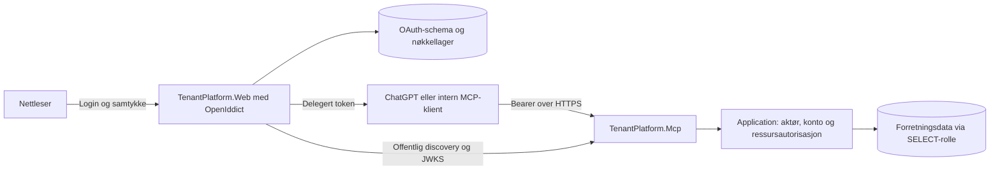

# Autentisering for MCP: anbefaling for egen drift

Dato: 17. oktober 2026. **Arkitekturgrunnlaget er vedtatt gjennom implementeringsoppdraget 5B1.** OpenIddict i Web, eksisterende lokal innlogging, code+PKCE S256, én resource/lesescope, fem minutters signert JWT og uttrykkelig refresh med absolutt åtte timers grense er nå implementert og protokolltestet mot isolert PostgreSQL. Se [5B1-status](modernization-plan.md#22-steg-5b1-oauth-utsteder-i-web) og [driftsveiledningen](oauth-issuer-operations.md). OAuth er deaktivert som standard; ingen ekstern publisering, utviklings-/produksjonsmigrering eller intern OAuth-klient inngår i 5B1. Separat MCP-lesehost er senere implementert i 5B2; se [status](modernization-plan.md#23-steg-5b2-separat-autentisert-mcp-lesehost) og [MCP-drift](mcp-read-host-operations.md). Sammenligningen nedenfor er beslutningsgrunnlaget, ikke en ny implementeringsbestilling.

**Oppdatert ved 5B3:** den interne delegerte Web-klienten er implementert med samme bruker/konto, kryptert serverlager og databasekoordinert refresh. Se [driftsveiledningen](internal-mcp-client-operations.md) og [status](modernization-plan.md#24-steg-5b3-intern-delegert-oauth-mcp-klient). Dette bygger videre på beslutningen; ingen agent, rapportmotor eller generell ekstern serverregistrering er bygget.

## 1. Kort anbefaling

**Velg OpenIddict som OAuth/OIDC-komponent i eksisterende TenantPlatform.Web, og behold TenantPlatform.Mcp som separat, skrivefri resource server.** Bruk dagens User/LoginAccount og passordvalidering. Nettleseren logger inn på TenantPlatforms vanlige origin; en gyldig GUI-cookie kan brukes lokalt der for å godkjenne OAuth-tilkoblingen. Cookie sendes aldri til MCP eller brukes som API-token.

Dette gir minst samlet kompleksitet for denne løsningen: ett brukerlager, samme passord og innloggingsøkt, ingen Java-integrasjon mot passordlageret og ingen ekstra identitetstjenestecontainer. Det krever likevel et avgrenset arbeid med innloggingsretur, samtykke, tilkoblingsadministrasjon, OAuth-lagring og nøkkeldrift. OpenIddict leverer protokollmotoren, ikke et ferdig identitetsprodukt med alle skjermbilder. [OpenIddicts introduksjon](https://documentation.openiddict.com/introduction) bekrefter at egen brukerautentisering kan brukes uten ASP.NET Core Identity.

Anbefalt første profil er forhåndsregistrerte klienter, authorization code med PKCE S256, én MCP-resource og ett lesescope, signerte JWT-access-tokens på fem minutter og lokal tokenvalidering. OAuth-grant kan tilbakekalles straks hos utsteder; et allerede utstedt access-token kan fortsatt virke frem til utløp, maksimalt fem minutter pluss 30 sekunders klokkeavvik. Application kontrollerer lokale brukerrettigheter ferskt uavhengig av dette. Kortvarig, rotert refresh anbefales for brukbar tilkobling gjennom en arbeidsøkt; se avsnitt 5.

## 2. Hva dagens kode faktisk tilbyr

Tabellen beskriver utgangspunktet før 5B1. Implementert OAuth-lagring/loginretur og senere MCP-host står i moderniseringsplanens avsnitt 22–23; historiske mangler her er ikke en ny restantliste.

| Kontrollert kode | Betydning for valget |
|---|---|
| [User](../../src/TenantPlatform.Core/Identity/User.cs), [LoginAccount](../../src/TenantPlatform.Core/Identity/LoginAccount.cs) | Lokal Guid-identitet, aktiv bruker, separat innloggingsaktivering og passordhash. Ingen ekstern issuer/sub-kobling eller OAuth-klient-/granttabeller er funnet. |
| [PasswordService](../../src/TenantPlatform.Infrastructure/Authentication/PasswordService.cs) | Bruker `Microsoft.AspNetCore.Identity.PasswordHasher<LoginAccount>`. Dette er en hasher, ikke ASP.NET Core Identity som innloggingssystem. At begge produkter støtter PBKDF2 betyr ikke at Keycloak kan importere denne hashstrengen direkte. |
| [LocalAuthenticationService](../../src/TenantPlatform.Infrastructure/Authentication/LocalAuthenticationService.cs) og [AuthenticationSessionService](../../src/TenantPlatform.Application/Authentication/AuthenticationSessionService.cs) | Passord, IsEnabled og lockout kontrolleres; Application kontrollerer aktiv bruker og kontotilgang. Innlogging kan skrive lockout-/innloggingsdata og LastAccountId. Disse effektene hører til autentisering, ikke MCP-lesing. |
| [Program.cs](../../src/TenantPlatform.Web/Program.cs), [Login.razor](../../src/TenantPlatform.Web/Components/Pages/Login.razor), [AuthenticationCookieService](../../src/TenantPlatform.Web/Security/AuthenticationCookieService.cs) | Egen cookie, åtte timers sliding expiration, SameSite Lax. Loginform har antiforgery-token. Etter login går brukeren til kontovalg/startside; en validert retur til en ventende OAuth-interaksjon finnes ikke i dagens flyt. Logout logger ut cookie, ikke OAuth-grants. |
| [CurrentUserContextService](../../src/TenantPlatform.Web/Security/CurrentUserContext/CurrentUserContextService.cs) og [ICurrentActor](../../src/TenantPlatform.Application/Security/ICurrentActor.cs) | Circuit-konteksten skal ikke gjenbrukes av MCP. MCP trenger et eget frosset aktørsnapshot fra validert bearer-identitet og verifisert konto per operasjon. |
| [AuthorizationService](../../src/TenantPlatform.Application/Security/AuthorizationService.cs), [AuthorizationData](../../src/TenantPlatform.Infrastructure/Authorization/AuthorizationData.cs) og [AccountContextReader](../../src/TenantPlatform.Application/Security/AccountContextReader.cs) | Fersk User.IsActive, medlemskap, roller og grants. PlatformAdmin er ikke generell tenantadgang. Autorisasjonsfakta kontrollerer ikke LoginAccount.IsEnabled; sperring av passordinnlogging er derfor ikke allerede en global sesjonssperre. Egen kontoliste kan leses uten å skrive kontovalg. |
| [Compose](../../docker/compose.yml) og Web-oppstart | Web, PostgreSQL og Serga finnes; ingen AS eller MCP-host. Web er konfigurert for Development/LAN i filen. Ekstern TLS/proxy og produksjonsoppsett må avklares; faktisk VM-konfigurasjon er ikke verifisert. |

Steg 4 er rapportert implementert og sluttkontrollert i 19.35. Dette oppdraget revurderer autentiseringsvalget, ikke den gjennomførte migreringen eller dens historiske tester.

## 3. To konkrete alternativer

Hovedkandidatene er **Keycloak Community som Docker-tjeneste** og **OpenIddict i Web-host**. OpenIddict [7.7.2](https://github.com/openiddict/openiddict-core/releases/tag/7.7.2) er kontrollert som aktuell stabil utgave; eksakt versjon og .NET 10/EF/Npgsql-kompatibilitet skal låses og testes ved implementering. En fremtidig preview er ikke forutsatt.

| Tema | Keycloak i Docker | OpenIddict i TenantPlatform.Web |
|---|---|---|
| Ferdig produkt / eget arbeid | Ferdig login, samtykke, klient-/sesjonsadministrasjon og driftsgrensesnitt. Vi må konfigurere realm/klienter og integrere lokale brukere. | Protokollmotor, validering og lagringskomponenter. Vi bygger TenantPlatform-integrasjon, samtykkesider og minimal tilkoblingsadministrasjon. |
| Eksisterende passord | Ingen dokumentert ferdig kobling til vår User/LoginAccount-modell. Krever SPI-integrasjon eller migrering. | Eksisterende passordvalidering kan beholdes; ingen kopiering av brukere eller hasher. |
| Samme nettleserøkt | Keycloak gjenkjenner ikke dagens Web-cookie. Samme passord via federation er ikke SSO med GUI-et. | Samme Web-host kan autentisere authorize-kallet med eksisterende cookie. Ingen delt cookie mellom prosesser trengs. |
| PKCE / discovery / samtykke | Har standardfunksjonene; riktige klientpolicyer må konfigureres. | Har code/PKCE og discovery; PKCE og klienttillatelser må konfigureres. Samtykkets innhold og livsløp er vårt ansvar. |
| MCP-resource og klientregistrering | DCR støttes. MCP-guiden markerer RFC 8707 resource indicators og CIMD som eksperimentelle, med egne feature-flagg. | Registrerte resources og klienttillatelser finnes i 7.x. DCR og CIMD er fortsatt åpne funksjonsoppgaver, ikke en forutsetning vi kan love i stabil 7.7.2. Forhåndsregistrering er første løsning. |
| Prosesser og lagring | Én ekstra AS-container utover MCP. Eget Keycloak-datalager og DB-bruker; samme PostgreSQL-server kan brukes med separat database. | Ingen ekstra AS-container utover MCP. Nye OAuth-tabeller og separat auth-context/schema i eksisterende PostgreSQL anbefales. |
| Feilsøking og oppgradering | Egen Java-/Keycloak-stakk, realm-/proxyoppsett og eventuell SPI må følges gjennom oppgraderinger. | Samme .NET-stakk; Web og utsteder oppgraderes sammen. Vår integrasjonskode må vedlikeholdes og regresjonstestes. |
| Driftsmessig kobling | Utstederen kan driftes uavhengig av Web, men en adapter mot Web/brukerlageret skaper fortsatt avhengigheter. | Web-utfall stopper ny login/refresh. Gyldige JWT-er kan valideres av MCP mens nøkkelmaterialet er tilgjengelig og Application-databasen fungerer. |
| Lisens / kostnader | Apache 2.0; ingen obligatorisk Community-runtimeavgift. Drift og eventuell betalt støtte kommer i tillegg. | Apache 2.0, også for kommersiell bruk. Integrasjon/vedlikehold og eventuell støtteavtale er egne kostnader. |

Kildegrunnlag for protokollforskjellene: [Keycloaks MCP-guide](https://www.keycloak.org/securing-apps/mcp-authz-server), [OpenIddict 7 resource-/klienttillatelser](https://documentation.openiddict.com/guides/migration/60-to-70#register-audiences-and-resources-if-applicable), [DCR-oppgave #2404](https://github.com/openiddict/openiddict-core/issues/2404) og [CIMD-oppgave #2552](https://github.com/openiddict/openiddict-core/issues/2552). Keycloaks scope/audience-mapper uten resource indicators er ikke det samme som full behandling av `resource` i begge protokollsteg. Guidens eksperimentelle støtte er ikke en kjørt ChatGPT-test.

Lisensgrunnlaget er [Keycloaks LICENSE](https://github.com/keycloak/keycloak/blob/main/LICENSE.txt) og [OpenIddicts offisielle nettsted](https://openiddict.com/). Bevar lisens-/copyright-/NOTICE-krav ved distribusjon; øvrige avhengigheter må gjennomgås ved pakkevalg. OpenIddicts [supportpolicy](https://openiddict.com/support) gir ordinær støtte til nyeste stabile versjon; lengre støtte avhenger av særordninger/sponsing/avtale. Ingen tilbud, priser eller SLA er innhentet.

### 3.1 Hvorfor Keycloak blir mer arbeid med akkurat dette brukerlageret

Keycloaks [User Storage SPI](https://www.keycloak.org/docs/latest/server_development/index.html#_user-storage-spi) lar en egen Java-provider slå opp eksterne brukere og validere passord. Den er en utvidelsesmekanisme, ikke en ferdig SQL-tilkobling til TenantPlatforms modell. En slik integrasjon må ivareta hasher, aktivering, lockout, passordendringer, stabile identiteter og cacheinvalidering. Direkte SQL mot passordtabellen gir Keycloak mer privilegert DB-tilgang; en intern valideringsadapter krever et nytt beskyttet grensesnitt. Begge har varig vedlikeholdskostnad. Federation trenger ikke kopiere passord, men Keycloak har fortsatt egne identitets-/sesjonsdata og eventuelt lokale brukerkoblinger.

Andre veier innebærer at vi migrerer brukere og passordforvaltning til Keycloak, eller gjør TenantPlatform til OIDC-provider som Keycloak kan bruke. Migrering krever eksplisitt plan for hashformat eller passordbytte og for administrasjon/synkronisering av brukere. OIDC-brokering krever at vi først bygger en utsteder i TenantPlatform; det fjerner ikke integrasjonsarbeidet.

For sammenhengende GUI-SSO med Keycloak må GUI-et normalt bli OIDC-klient mot samme Keycloak-økt. Overgangen må da håndtere kobling til lokale User.Id, inn-/utlogging, gamle cookies og kontovalg. Det er ikke begrunnet av det lille MCP-leseutvalget alene. Keycloak blir mer attraktivt dersom et felles, selvstendig identitetssystem for flere produkter, federation og sentral MFA blir et eget produktmål.

### 3.2 Hva vi selv må bygge med OpenIddict

OpenIddict leverer requestvalidering før pass-through, kode-/tokenbehandling og standardbasert kryptografi. Vi må likevel koble en ferskt verifisert lokal bruker til authorize/refresh, velge tillatte claims/resources/scopes og bygge samtykke-/tilkoblingssidene. [ASP.NET Core-integrasjonen](https://documentation.openiddict.com/integrations/aspnet-core), [PKCE-konfigurasjonen](https://documentation.openiddict.com/configuration/proof-key-for-code-exchange) og [authorization storage](https://documentation.openiddict.com/configuration/authorization-storage) beskriver dette skillet. Ikke bruk degraded mode eller skru av klient-/resourcevalidering for å få en klient til å virke.

En separat `TenantPlatform.Auth`-host kan bruke samme komponent senere, men er ikke hovedanbefalingen nå: samme brukerdatabase alene gir ikke delt innloggingsøkt. Den krever en konkret SSO-overgang eller sikker deling av cookieformat, key ring og applikasjonsnavn, i tillegg til en ny prosess. Plassering i Web unngår dette første gang; logisk separasjon av auth-komposisjon og lagring gjør senere uttrekk mulig.

## 4. Tilkobling og identitet

### 4.1 Verifisert ChatGPT-støtte og avgrensning

OpenAIs [offisielle autentiseringsdokumentasjon](https://developers.openai.com/plugins/build/auth) beskriver beskyttet remote MCP med code+PKCE S256, resource-/AS-discovery og ressursbundet access-token. Forhåndsregistrert klient er støttet i tillegg til CIMD/DCR; derfor trenger første OpenIddict-versjon ingen egen registreringsprotokoll. Bruk callback-URI-en fra den faktiske tilkoblingens administrasjon, uten wildcard; publiser korrekte token-endpoint-metoder og S256-metadata. Stabil callback avhenger blant annet av korrekt RFC 9207 issuer-respons. Ikke annonser dette eller CIMD hvis implementasjonen ikke faktisk støtter det.

Dette er dokumentert protokollstøtte, **ikke verifisert TenantPlatform-kompatibilitet**. Mål-workspace må tillate tilkoblingen og forhåndsregistrert klientoppsett. En faktisk tilkobling mot isolerte testdata er eget akseptansekriterium. Klienter som krever DCR/CIMD uten forhåndsregistrering inngår ikke i første kompatibilitetsløfte. Enterprise-domenerestriksjoner med verifisert e-post/UserInfo er heller ikke dekket: vår modell dokumenterer ingen e-postverifisering, og vi skal ikke fabrikkere `email_verified=true`.

For den forhåndsregistrerte ChatGPT-klienten anbefales confidential code+PKCE med `client_secret_basic`, forutsatt at målflaten tilbyr denne konfigurasjonen. OpenAIs [klientkonfigurasjon](https://developers.openai.com/plugins/build/plugins) dokumenterer `provided` med blant annet `client_secret_basic` og `client_secret_post`; [tilkoblingsveiledningen](https://developers.openai.com/plugins/deploy/submission) plasserer hemmeligheten i portalen, utenfor manifestet. Eksakt metode skal avtales og prøves, ikke utledes fra CIMD-støttens metoder.

### 4.2 Foreslått flyt for eksisterende bruker

1. Operatøren registrerer ChatGPT-klienten med eksakt callback, påkrevd PKCE, tillatt lesescope og kun MCP-resource. Klientmetoden velges fra det faktiske ChatGPT-oppsettet; en confidential forhåndsregistrering bruker en unik klienthemmelighet i klient-/AS-konfigurasjonen, ikke en brukerhemmelighet.
2. Brukeren starter tilkoblingen i ChatGPT. Discovery fører nettleseren til authorize-endepunktet i TenantPlatform.Web. OpenIddict validerer protokollforespørselen og klientregistreringen.
3. Web autentiserer sin egen cookie eksplisitt. Finnes ingen gyldig innlogging, brukes dagens login og passordvalidering. En ny, serverbeskyttet interaksjonsreferanse bevarer returen; dagens startsideflyt beholdes når ingen OAuth-interaksjon venter. Tillat bare lokal, validert retur og bind den til samme interaksjon. Ikke send en fritt angitt ekstern returnUrl videre etter login.
4. Før samtykke/utstedelse kontrollerer et Application-brukstilfelle lokal User.IsActive og LoginAccount.IsEnabled ferskt. En gammel cookie alene er ikke tilstrekkelig. Passord-lockout beholder sin funksjon ved ny passordinnlogging; den erklæres ikke global øktrevokering. Vis navngitt klient, hvilke lesedata den kan få, varighet og at egne nåværende medlemskontoer omfattes. Samtykke-POST har antiforgery og binder bruker, klient, scope og resource til den validerte interaksjonen. Avslag gir ingen grant.
5. Etter samtykke oppretter/knytter vi en authorization via OpenIddicts manager. Biblioteket utsteder og innløser engangskoden med PKCE. Identiteten og godkjent ressurs lagres i den etablerte grant-/kodekjeden; tokenutstedelse tar ikke en vilkårlig UserId fra klienten.
6. MCP mottar kun bearer, validerer det og lager et frosset lokalt aktørsnapshot. Konto foreslås i verktøyargumentet, verifiseres via Application og fryses for operasjonen; readeren autoriserer igjen. GUI-ens LastAccountId eller cookie velger ikke konto for ChatGPT.

Samme konto betyr her samme User/LoginAccount og passord. Sammenhengende innlogging betyr i tillegg at samme nettleser sender en gyldig cookie til Web-origin ved authorize. Annen nettleser/profil, utløpt cookie eller eksplisitt ny innlogging kan kreve passord igjen. Samtykke er en egen handling. Det er ikke et løfte om universell SSO mellom ChatGPT-klienter.

### 4.3 Issuer, lokal bruker og kontogrense

Utstederen kan bruke eksisterende User.Id i kanonisk Guid-format som stabil `sub`, hentet fra den verifiserte lokale identiteten. MCP godtar denne oversettelsen **bare for den eksakt konfigurerte TenantPlatform-issuer etter full tokenvalidering**. Ingen generell regel om at en hvilken som helst ekstern `sub` er en lokal bruker-ID. Ingen kobling via e-post, brukeroppretting, administratorclaim eller klientvalgt autorisert scope.

Det trengs dermed ikke en ekstra ekstern identitetskoblingstabell i denne varianten. Hvis en annen IdP innføres senere, må den få en eksplisitt, verifisert `(issuer, sub) → User.Id`-kobling og overgangsplan; e-postlikhet er ikke bevis.

Piloten anbefales å omfatte brukerens egne til enhver tid tilgjengelige medlemskontoer, med eksplisitt konto per kall. Nytt medlemskap kan da bli tilgjengelig innen samme samtykke. Hvis produkteieren ønsker én fast konto eller en fast kontoliste per tilkobling, må dette lagres i granten og håndheves som ekstra grense før Application; et verktøyargument alene gjør ikke dette. Lokale roller/grants blir alltid i Application.

### 4.4 Intern agent og rapportmotor

Registrer separate confidential klienter for agent og rapportmotor. Bruk etablert .NET OAuth-klient med code+PKCE mot samme utsteder og Web-innlogging. Gyldig Web-cookie kan gjøre innloggingen sømløs, mens samtykke fortsatt er eksplisitt. Ved callback må ferskt validert GUI-bruker være samme lokale subjekt som det validerte OAuth-resultatet. Bruk etablert state-/korrelasjons- og eventuell OIDC-noncevalidering.

Token lagres kryptert på serversiden, bundet til bruker og klient. Interne kall går gjennom reell MCP-klient med bearer per request, også for egne data. Ingen token i prompt eller delt HttpClient-header. Et rapportkøelement med UserId er ingen fullmakt. Manglende, utløpt eller tilbakekalt grant stopper kjøringen; workerens tjenesteidentitet arver ikke rettigheter. Client credentials, password grant og cookievideresending er ikke alternativer til delegert brukergrant. Token exchange og ubetjente rapporter kan vente.

## 5. Forholdsmessig token- og revokeringsprofil

Dette er foreslått policy, ikke eksisterende konfigurasjon:

| Kontroll | Første komplette versjon |
|---|---|
| Access-token | Asymmetrisk signert JWT/JWS, fem minutter; tillat maksimalt 30 sekunders klokkeavvik. Ingen roller, medlemslister, e-post eller dokumentdata i tokenet. |
| Lokal validering i MCP | Etablert OpenIddict validation-handler med discovery/JWKS fra fast issuer. Krev access-token-type, korrekt signatur/algoritme, issuer, eksakt audience, utløp/nbf, sub, godkjent client_id og `tenantplatform.agreements.read`. ID-token og app-only-token avvises. |
| Ressurs | Én kanonisk HTTPS-URI, eksempelvis `https://mcp.example.no/mcp`, både som resource og audience. Registrer den og klientens resource-/scopetillatelser i OpenIddict; sett bare godkjent resource på principal. Test authorize, code exchange og refresh med ukjent/endret/flere resources. Ikke kopier en uvalidert resource til aud. |
| Refresh | Kun etter uttrykkelig samtykke, roterte refresh-tokens og lagret authorization/tokenkjede. Anbefalt absolutt åtte timers delegert sesjon fra første godkjenning; refresh forlenger ikke denne grensen. Hvert nytt access-token må også slutte senest ved grantens absolutte slutt. Bruk standard `offline_access` når refresh-flyten krever det, men beskriv at tillatelsen er tidsbegrenset, uten løpende nattlige rapporter. |
| Utstedelse/refresh | Application revaliderer lokal bruker og lokal innloggingsadgang; AS kontrollerer klient, grantstatus og tillatt scope/resource. Nye rettigheter kan ikke oppstå gjennom refresh. Refresh-/authorizationlagring og absolutt sluttdato må testes; bibliotekets standardlevetider er ikke vår valgte policy. |
| Nøkler | Vedvarende asymmetrisk signeringsnøkkel og separat krypteringsnøkkel/-sertifikat i utstederen. Kun offentlige valideringsnøkler til MCP. Rotasjon med overlapp, gyldig key ring og testet gjenoppretting. |

[OpenIddicts tokenformater](https://documentation.openiddict.com/configuration/token-formats) krypterer normalt access-tokens. For separat MCP med offentlig nøkkelvalidering anbefales eksplisitt å slå av **bare access-token-kryptering**, og beholde signering. Koder/refresh beholder bibliotekets beskyttelse. JWT-claims er lesbare for innehaveren, så feltutvalget skal være minimalt. [Signerings-/krypteringsdokumentasjonen](https://documentation.openiddict.com/configuration/encryption-and-signing-credentials) skiller disse nøklene fra ASP.NET Data Protection-key ring for cookies. Prod bruker vedvarende hemmeligheter, ikke tilfeldige oppstartsnøkler eller development-sertifikater. Eget TLS-sertifikat er et annet ansvar; offentlig CA er ikke automatisk nødvendig for tokenets interne signeringssertifikat.

Resourcevalideringen og klienttillatelsene er dokumentert i [7.0-guiden](https://documentation.openiddict.com/guides/migration/60-to-70#register-audiences-and-resources-if-applicable). [Utstederkoden i 7.7.2](https://raw.githubusercontent.com/openiddict/openiddict-core/7.7.2/src/OpenIddict.Server/OpenIddictServerHandlers.cs) setter access-tokenets audiences fra principalens resources. Dette erstatter ikke arbeidet med å konfigurere og teste vår ene ressurs-/grantkontrakt. Krav om resource, ingen utvidelse og korrekt binding gjennom hele flyten skal håndheves med bibliotekets konfigurasjon/policyhooks; ingen egen kode-/tokenprotokoll bygges.

### Tre forskjellige former for tilbakekalling

| Hendelse | Faktisk garanti med anbefalt profil |
|---|---|
| Brukeren fjerner en OAuth-tilkobling i TenantPlatform | Tilhørende authorization og tokenkjede tilbakekalles via OpenIddict. Videre refresh/code-utstedelse fra granten avvises. Et tidligere access-token kan fortsatt passere lokal signaturvalidering i inntil fem minutter + klokkeavvik. Frakobling bare i ChatGPT er ikke dokumentasjon på at alle grants er tilbakekalt hos oss. |
| En klient sperres av operatør | AS nekter nye tokens og tilbakekaller relevante grants. En lokal allowlist-/sperreendring i MCP kan stoppe hele klienten etter konfigurasjonsutrulling, men er ikke individuell grantrevokering. Allerede utstedte JWT-er har ellers samme restlevetid. |
| User.IsActive=false eller medlemskap/rolle/avtalegrant fjernes | Application nekter nye lesekall etter fersk kontroll, selv med kryptografisk gyldig JWT. Det innføres ingen ekstra rettighetscache. Et kall som allerede har passert kontrollen er ikke lovet transaksjonelt avbrutt. |
| LoginAccount.IsEnabled=false eller passord endres | Dagens kode gjør ikke dette til global sesjonsrevokering. Foreslått AS-policy nekter utstedelse/refresh ved deaktivert lokal login; eksisterende JWT følger restlevetiden. Passordbytte og «steng alle økter» må få eksplisitt produktsemantikk. |
| Web-logout eller cookie/circuit-revokering | Separat fra OAuth. Vanlig logout sletter GUI-cookie; den skal ikke omtales som tilbakekalling av ChatGPT/agentgrants. Generell global Web-sesjonsrevokering er fortsatt et eget spor. |

[OpenIddicts token storage](https://documentation.openiddict.com/configuration/token-storage) støtter revokering uavhengig av tokenformat når lagring er beholdt, men API-valideringen sjekker normalt ikke tokenraden ved hvert kall. Online token-entry-validering krever DB-oppslag; introspection gir nettverksavhengighet og ekstra latency. **Første versjon anbefales uten begge deler i MCP.** Den aksepterte restlevetiden gir enklere drift, og lokal tilgang revalideres allerede i Application.

Hvis umiddelbar individuell OAuth-revokering blir et krav, må profilen endres til etablert online validering/introspection med dokumentert cache-/utfallsatferd. Gevinsten er rask grant-/tokensperring; kostnaden er AS-/lageravhengighet på hvert lesekall, ekstra legitimasjon, kapasitet og feilmodi. Opaque tokens er mulig, men er ikke nødvendig bare for å ha grantlager. Discovery/JWKS for lokal JWT-validering er fortsatt en driftsavhengighet ved oppstart/nøkkelbytte; ukjent nøkkel eller manglende gyldige metadata gir ikke en autentiseringsfallback.

## 6. Komponenter, lagring og drift

| Del | Nødvendig endring ved senere implementering |
|---|---|
| Web / identitetsfunksjon | Egen `Security/OAuth`-komposisjon med OpenIddict, eksplisitte authentication schemes, authorize/token/revocation/discovery/JWKS-ruter og samtykke-/tilkoblingssider. Behold GUI-cookie som GUI-default; bearer skal ikke utilsiktet bli GUI-innlogging. Login og samtykke ligger på eksisterende Web-origin. |
| Application | Avgrenset brukeradgang for OAuth-utstedelse/refresh og egen tilkoblingsadministrasjon med betrodd aktør, fersk lokal status og eierskap. Ingen OpenIddict-/HTTP-/EF-typer her. Application eier lokal adgang; biblioteket eier protokoll-/klientreglene. Infrastructure utfører kun nødvendige status-/lagringsoppslag. |
| OAuth-persistens | Standard OpenIddict EF-lagring, separat kortlivet auth-context/schema i eksisterende PostgreSQL, med applications, authorizations, scopes og tokens. Nye tabeller/migreringer er nødvendige selv om identitetsdata beholdes. Egen migrationshistorikk og DB-legitimasjon; ikke bland dette inn i MCPs SELECT-rolle. Ingen degraded mode eller deaktivert tokenlagring. |
| MCP | Eget prosjekt/container, offentlig resource metadata og beskyttet Streamable HTTP. Bare avtaleliste, Attention og egen kontokatalog fra 5A. Egen bearer-adapter og token-/scopepolicy; ingen Web-referanse, login, private utstedernøkler, jobbstart eller migrering/seed. |
| Intern klient | Senere Web-adapter med etablert OAuth-klient og kryptert tokenlager. Dette er noe annet enn AS-tabellene: lagret grantstatus er ikke automatisk et klart-til-bruk access-token for agenten. Eget formål/nøkkelbeskyttelse og klientbinding. |
| Reverse proxy / secrets | Én vedtatt Web-issuer og én MCP-resource med TLS; tillatte proxies, korrekte forwarded headers og eksakte redirects. Beskyttet secret-/sertifikatlager og persistent cookie-key ring, uten hemmeligheter i Git/image. MCP mottar bare offentlige nøkler. |

Ingen ekstra databaseprosess er nødvendig for OpenIddict, men schemaendring, skriverrolle for utsteder, backup og styrt migrering er reelt arbeid. MCP-forretningslesing forblir skrivefri; login, samtykke, refresh, revokering og teknisk auth-opprydding har legitime skriveroperasjoner utenfor MCP-verktøyene. Opprydding begrenses til OAuth-tabellene og skal ikke starte eksisterende domenejobber.

Foreslått issuer er Webs kanoniske offentlige origin, for eksempel `https://app.example.no`, med protokollruter som `/connect/authorize` og `/connect/token`. MCP har egen origin `https://mcp.example.no` og ressurs `/mcp`. Dette er eksempler, ikke vedtatte adresser. Et separat auth-subdomene skal ikke antas å motta dagens hostbundne cookie; det ville kreve en annen, eksplisitt innloggings-/proxyplan. MCP-planens tidligere `auth.example.no`-eksempel følger det eldre separate-AS-forslaget.

Med Keycloak ville det i tillegg kommet eget image/providerbygg, realm-/klientkonfigurasjon og separat Keycloak-database. Offisiell [containerveiledning](https://www.keycloak.org/server/containers) og [produksjonsveiledning](https://www.keycloak.org/server/configuration-production) skiller utviklingsmodus fra produksjonsoppsett. [Realm import/export](https://www.keycloak.org/server/importExport) er ikke en fullgod erstatning for databasebackup.

For begge alternativer må backup omfatte DB, nøkler og konfigurasjon med testet restore. OAuth-lager og nøkler er sikkerhetskritiske; gjenoppretting fra gammel backup kan kreve tvungen ny tilkobling fremfor å gjenopplive tilbakekalte grants. Logg korrelasjon, klient, feilklasse og varighet; ikke passord, koder, tokens, cookies eller hele auth-requests. Dokumenter nøkkelrotasjon, klokkesynkronisering, DB-feil og feil i discovery/redirect. OpenIddict krever mindre infrastruktur her, men gjør oss ansvarlige for sikkerheten i integrasjonen og hyppige oppgraderinger.

## 7. Minste komplette første implementering

Følgende anbefales som revidert 5B dersom arkitekturvalget godtas:

1. **Utsteder i Web:** begrenset OpenIddict-oppsett, standard lagring/migreringer, vedvarende nøkler, eksisterende login med sikker interaksjonsretur, fersk lokal adgang, samtykke og en enkel side for egne tilkoblinger/tilbakekalling. Operatørstyrt, idempotent registrering av navngitte klienter via etablerte managers; ingen ny generell klientadministrasjonsportal.
2. **Fungerende ekstern tilkobling:** forhåndsregistrert ChatGPT-klient med godkjent callback og én resource. Full code+PKCE, token/refresh/revocation og oppdagelse. OAuth alene er nok for lesetilgangen; OIDC-scopes/ID-token tillates bare når implementert og nødvendig. Ikke annonser uimplementert email/profile/UserInfo.
3. **MCP-resource-server:** de tre verktøyene fra MCP-planen, eksisterende svargrenser/paging/metadatautelatelser, lokal JWT-validering, separat SELECT-rolle og ingen initialisering eller bakgrunnsjobber. Verktøy kaller bare Application.
4. **Intern delegeringsadapter:** én avgrenset code+PKCE-klient og MCP-smoke som beviser brukerbinding og samme transport. Planlegg separate agent-/rapportklienter; full agent, modellkall og rapportmotor bygges ikke her. Klienttokens lagres server-side og isolert per bruker/klient.
5. **Verifikasjon og driftsgrunnlag:** isolert PostgreSQL og faktisk OAuth-/MCP-protokollkjøring, produksjonsegnet proxy-/secret-/migreringsoppskrift og egen manuell ChatGPT-prøve mot testdata. Ingen produksjonsdeploy er implisitt.

Testene må bevise gyldig/manglende/utløpt/feilsignert token, feil issuer/audience/token-type/scope/klient, PKCE-feil, kodegjenbruk, callbackavvik, avslag/CSRF, ukjent/endret resource og refresh uten scopeutvidelse. Test tilbakekalt grant ved tokenendepunktet **og forventet restlevetid i MCP**; ikke skriv testen som om offline JWT-validering gir umiddelbar grantrevokering. Test lokal deaktivering, fjernet medlemskap/grant, fremmed konto og to samtidige brukere/kontoer. Sammenlign toolsvar med direkte Application-kall og bevis skrivevern, init=false, kansellering og eksplisitt feil ved for store svar.

Test loginretur både med eksisterende cookie og med ny passordinnlogging, også for bruker med flere medlemskontoer og uten valgt GUI-konto. OAuth-interaksjonen skal fullføres uten at MCP velger eller lagrer en GUI-konto; ordinær GUI-login uten ventende interaksjon skal beholde dagens navigasjon.

Autentiseringstester skal kjøre den faktiske OpenIddict-/valideringskjeden i en isolert fixture; en mock bearer alene er utilstrekkelig. Testnøkler og eventuelle identitetsstubber finnes bare i testassembly/host factory og kan ikke aktiveres i produksjon med miljøvariabel. Test utløp/rotasjon med styrt tid, restart med vedvarende nøkler og begrensede DB-roller. Ingen utviklings-/produksjonsdatabase, ekte utsendinger eller modellkall.

## 8. Hva som kan vente, ulemper og beslutninger

DCR/CIMD, ekstern IdP/federation, separat auth-container, generell SSO-omlegging av GUI, bred klientportal, token exchange, ubetjent langtidsrapportering og MCP-writes kan vente. MFA/passkeys kan behandles i et eget identitetsspor, men må vurderes før ekstern bruk dersom virksomhetens sikkerhetspolicy krever det. Detalj-/oppfølgingsmetadata og større rapportkontrakter er fortsatt utenfor første verktøyutvalg.

| Vedtatt profil / gjenstående driftsvalg | Status / konsekvens |
|---|---|
| Plassering og vedlikeholdsansvar | Vedtatt og implementert: OpenIddict i Web; utpek eier av protokollintegrasjon, sikkerhetsoppdateringer og nøkkeldrift. Det er mindre drift enn Keycloak her, men mer egen UI-/integrasjonskode. Web-deploy og AS-tilgjengelighet blir koblet. |
| Revokering og brukeropplevelse | Vedtatt profil i 5B1: fem minutter + 30 sekunder ved OAuth-grantrevokering, samt absolutt åtte timers refresh-grant. Hyppigere ny tilkobling er prisen for kort grant; lengre varighet krever ny vurdering. Hvis restlevetiden ikke kan godtas, velg online validering før implementering. |
| Kontosamtykke | Vedtatt samtykke: egne nåværende medlemskontoer, konto per senere MCP-kall. Et fast kontoutvalg krever ekstra grantmodell/-håndheving og tester. |
| Ekstern pilot | Velg HTTPS-domener, mål-ChatGPT-workspace, navngitte klienter/brukere og ansvar for ekstern databehandling. Dokumentert støtte gir ingen garanti for den konkrete workspacepolicyen. |
| Lagring, login og operasjonell beredskap | Tabeller/migrering, nøkkelkonfigurasjon, loginretur og samtykke er implementert; faktisk driftskonfigurasjon og produksjonsmigrering er ikke utført. Avklar hvem som registrerer klienter, håndterer tapte nøkler og tilbakekaller tilkoblinger. |

To kodeoppgaver fra vurderingen er fulgt opp separat, 17. oktober 2026; se [moderniseringsplanens verifikasjon](modernization-plan.md#21-restfunn-etter-steg-4-eiermetadata-og-web-restore). Funnene er fortsatt lukket i dette omfanget; etterfølgende OAuth-implementering er dokumentert i 5B1:

- **Eiermetadata lukket:** OwnerName/Owners er avgrenset gjennom medlemskap i aktuell konto, uten å fjerne avtaler ved manglende etikett. Direkte Application-tester med SaveChanges-vakt bestod i InMemory og isolert PostgreSQL. Første MCP-utvalg beholder feltutelatelsene.
- **Restore-input rettet, containerbygg fortsatt åpent:** Application-prosjektfilen kopieres før Web-restore, og alle fire prosjektfiler samt eksisterende build-/NuGet-input er kontrollert. Restore fra en separat mappe med bare Dockerfilens restore-input bestod. Faktisk `docker build` stoppet ved utilgjengelig daemon; Web-/AS-containeren er ikke verifisert eller deployet.

Interaktiv GUI-kontroll fra steg 4, separate produkt-/legacyrollevalg og generell Web-cookie-/sesjonsrevokering gjenstår i sine egne spor. De er ikke en grunn til å innføre en parallell rettighetsmodell i AS eller MCP.

**Anbefalingen er alternativ 2: OpenIddict i eksisterende Web-host, med samme lokale brukerkonto og separat MCP-resource-server.** For TenantPlatforms nåværende brukerlager og lille leseutvalg veier gjenbruk av innlogging og fravær av federation/migrering tyngre enn Keycloaks ferdige administrasjonssider. Dette hovedvalget er implementert i 5B1; gjenstående ekstern konfigurasjon, manuell GUI-/driftskontroll og MCP-/klientdelsteg er avgrenset i driftsveiledningen.
