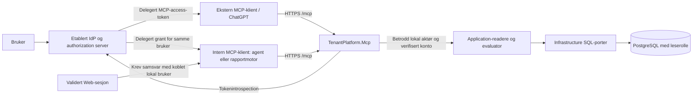

# Steg 5A – implementeringsgrunnlag for autentisert MCP-lesehost

6A bygger videre på 5B3 med kontoeide serverdefinisjoner og et felles klientgrunnlag for egen/ekstern OAuth. [Registerdrift og begrensninger](mcp-connection-registry-operations.md) beskriver profilgodkjenning, restart, credential-migrering og verktøygodkjenning; faktisk verifikasjon er samlet i moderniseringsplanens avsnitt 25. Ingen agent, rapportmotor eller utvidelse av egen MCP-host inngår.

Dato: 17. oktober 2026. **5A er historisk dokumentasjonsgrunnlag; 5B1-utsteder, 5B2-lesehost og [5B3 intern delegert Web-klient](internal-mcp-client-operations.md) er nå implementert lokalt.** Se [5B2-status og faktisk verifikasjon](modernization-plan.md#23-steg-5b2-separat-autentisert-mcp-lesehost) og [MCP-driftsveiledningen](mcp-read-host-operations.md). Ingen ekstern publisering eller ChatGPT-prøve er gjennomført. Resten av den opprinnelige planen beskriver grunnlaget; statusendringene nedenfor har forrang.

Planen bygger på [moderniseringsplanens avsnitt 18](modernization-plan.md#18-steg-4e-skrivefri-autorisert-oppfølgingslesing), dagens kode og [sluttstatus 19.35](modernization-plan.md#1935-steg-4-implementert-og-sluttkontrollert). Restlistene i avsnitt 18 er historikk: flere av områdene er senere migrert. De historiske anbefalingene må leses sammen med gjennomføringen og de presiserte grensene i 5B2-driftsveiledningen.

## 0. Ny vurdering: egen drift og gjenbruk av innlogging

**Oppdatert ved 5B1, 17. oktober 2026:** Brukeren har vedtatt arkitekturgrunnlaget og bestilt utstederen separat. OpenIddict-utsteder i Web er implementert med separat auth-schema/migreringshistorikk, eksisterende passord/cookie, beskyttet loginretur, samtykke, egne tilkoblinger og lokal Application-adgang. Fem minutters signert JWT, ressursbinding og absolutt åtte timers rotert refresh er protokolltestet i isolert PostgreSQL. OAuth er deaktivert som standard; drift må konfigurere issuer/resource, klienter, vedvarende nøkler og key ring eksplisitt. Se [driftsveiledningen](oauth-issuer-operations.md) og [moderniseringsplanens 5B1-status](modernization-plan.md#22-steg-5b1-oauth-utsteder-i-web).

**5B2 implementert:** egen TenantPlatform.Mcp med offisiell SDK 2.2.0, eksplisitt stateless Streamable HTTP, nøyaktig accounts_list/agreements_list/agreements_attention, lokale OpenIddict 7.7.2-validerte access-JWT-er fra fast issuer/JWKS og eget operasjonsscope. Signert delegasjons-ID, klient, scope, lokal sub, eksakt issuer/audience, RS256 og exp/nbf kontrolleres, uten online grantoppslag. Application revaliderer tilgang. Reell SELECT-rolle, oppstartsbasert privilegiekontroll og SaveChanges-vern beskytter databasen. Request-grense 16 KiB, verktøyresultat 60 KiB med framingreserve og hele HTTP-svaret 64 KiB; eksplisitt feil ved overskridelse. 10 sekunders totalbudsjett, SQL 8 sekunder, fire samtidige kall og 60/minutt per bruker i én-instanspilot. Ingen introspection-timeout gjelder den valgte lokale JWT-profilen. Intern OAuth-klient er senere implementert i [5B3](internal-mcp-client-operations.md). Agent og rapportmotor er fortsatt senere delsteg. Ingen MCP-host, transport eller ChatGPT-kompatibilitet er implementert/testet i 5B1. Tidligere beskrivelse av samlet 5B i avsnitt 7 er videreplan; den er ikke en påstand om levert funksjonalitet.

[Autentiseringsvurderingen for MCP](mcp-auth-decision.md) sammenligner Keycloak og OpenIddict mot dagens kode og offisielle kilder. **Ny hovedanbefaling er OpenIddict i eksisterende Web-host og separat TenantPlatform.Mcp**, med samme lokale brukere og GUI-innlogging. Dette hovedvalget er vedtatt for og implementert i 5B1; opprinnelig sammenligning er bevart som beslutningsgrunnlag.

Følgende deler av det opprinnelige 5A-forslaget nedenfor foreslås erstattet. De beholdes som historisk alternativ, og skal ikke behandles som låste implementeringskrav ved siden av den nye anbefalingen. Ved vedtak om 5B brukes én sammenhengende profil fra beslutningsdokumentet, med akseptansekriterier tilpasset den valgte profilen.

| Berørte avsnitt | Tidligere anbefaling | Foreslått endring |
|---|---|---|
| 3.1, diagrammet, 6 og 9 | Separat tjeneste med forvaltet drift. | Egen drift med OpenIddict i Web; eget MCP-prosjekt/container beholdes. Web håndterer login/utstedelse, MCP bare bearer-validering og Application-lesing. |
| 3.2–3.3, 3.5, 6–7 | Separat OAuth-innlogging og administrert ekstern issuer/sub-kobling. | Gjenbruk lokal User/LoginAccount og Web-cookie på Web-origin. Stabil lokal sub fra verifisert bruker under fast issuer; ingen e-postkobling eller cookievideresending. Minimal sikker loginretur og samtykke må bygges. |
| 3.4, 5.3–5.4, konfigurasjon/tester i 7 | Opaque/reference-token med introspection på hvert HTTP-kall, umiddelbar online sperring. | Fem minutters signert JWT med lokal validering; grantrevokering har inntil fem minutter + 30 sekunders restvirkning. Ingen introspection-hemmelighet/-timeout i første profil. Application revaliderer lokale rettigheter ferskt som før. Testene må bevise den faktiske restlevetiden. |
| 3.3–3.4, 6–7 | Refresh og intern kobling uten konkret valgt utsteder-/lagerprofil; ingen automatisk offline_access. | Eksplisitt samtykke til rotert refresh med absolutt åtte timers grant foreslås. Protokollscope offline_access brukes når nødvendig, uten ubetjente langtidsrapporter. Samme utsteder og Web-økt for interne brukerklienter; separat kryptert klienttokenlager. |
| 3.2, 6–7 | Tilbyderavhengig klientregistrering og AS-oppsett. | Forhåndsregistrerte klienter i første OpenIddict-versjon. Stabil DCR/CIMD-støtte er ikke forutsatt; klienter som krever det er utenfor første kompatibilitetsløfte. Nye OAuth-tabeller/migreringer og vedvarende utstedernøkler må inngå i 5B, utenfor MCPs skrivefrie runtime. |

Verktøyutvalg, feltutelatelser, paging-/svargrenser, fersk Application-autorisasjon, isolert PostgreSQL og forbudet mot MCP-jobber/migrering/seed beholdes. Beslutningsdokumentet konkretiserer også bruker-/kontoisolasjon, revokeringstester og vedlikeholdsansvar. Ingen eksisterende kodeoppgave er rettet i vurderingen.

**Oppdatert etter separat kodeoppfølging 17. oktober 2026:** Listeeiermetadata er kontobegrenset og verifisert i direkte Application-/PostgreSQL-tester. Web-Dockerfilens manglende Application-input er rettet; prosjektgraf og restore fra bare restore-inputfilene er verifisert. Faktisk containerbygg gjenstår fordi Docker-daemonen ikke var tilgjengelig. Se [moderniseringsplanens verifikasjon](modernization-plan.md#21-restfunn-etter-steg-4-eiermetadata-og-web-restore). Feltutvalget i første MCP-versjon beholdes; rettingen eksponerer ikke nye verktøyfelter eller godkjenner auth-forslaget.

## 1. Kontrollert utgangspunkt i arbeidskopien

| Område | Faktisk kode og konsekvens |
|---|---|
| Identitet | [User/LoginAccount](../../src/TenantPlatform.Core/Identity/LoginAccount.cs) bruker lokal bruker-ID, passordhash, innloggingsaktivering, lockout og sist valgte konto. Ingen ekstern `(issuer, subject)`-kobling er funnet i modellen. User, UserAccount og UserAccountRole skiller person, medlemskap og kontotildeling. |
| Passord og sesjon | [LocalAuthenticationService](../../src/TenantPlatform.Infrastructure/Authentication/LocalAuthenticationService.cs) validerer passord og lagrer innloggings-/lockoutdata. [AuthenticationSessionService](../../src/TenantPlatform.Application/Authentication/AuthenticationSessionService.cs) velger medlemskonto og kan skrive LastAccountId/språk. Dette er ikke skrivefrie MCP-leseoperasjoner eller en OAuth-tokenutsteder. |
| Web-cookie | [AuthenticationCookieService](../../src/TenantPlatform.Web/Security/AuthenticationCookieService.cs) bygger Web-claims fra validert bruker. [Program.cs](../../src/TenantPlatform.Web/Program.cs) bruker TenantPlatform.Auth, åtte timers sliding expiration og egne login-/kontobytte-/språkruter. Ingen OAuth/OIDC-/bearer-resource-server er funnet. Cookieinnlogging kan ikke gjenbrukes som OAuth ved å endre et headernavn. |
| Betrodd aktør | [ICurrentActor](../../src/TenantPlatform.Application/Security/ICurrentActor.cs) gir `ActorSnapshot(IsAuthenticated, UserId, AccountId)`. [CurrentActorAdapter](../../src/TenantPlatform.Web/Security/Application/CurrentActorAdapter.cs) er Web-spesifikk; MCP trenger sin egen adapter fra validert bearer-identitet. Snapshotet har ingen klientvalgt administratorstatus. |
| Ressursautorisasjon | [AuthorizationService](../../src/TenantPlatform.Application/Security/AuthorizationService.cs) tar aktørsnapshot før await, sjekker aktiv lokal bruker, valgt konto, medlemskap og ferske tildelinger/grants. En global PlatformAdmin får ikke tenantinnsyn uten medlemskap og ordinær avtaletilgang. Konto-/rolle-/eierregler skal bli her. Kontoens IsActive er ikke en ny generell regel som 5B kan anta ligger i disse readerne. |
| Kontokontekst | [AccountContextReader](../../src/TenantPlatform.Application/Security/AccountContextReader.cs) kan lese den betrodde brukerens egne medlemskontoer uten valgt konto, uten å skrive LastAccountId. Den er et egnet støttebrukstilfelle for kontovalget. |
| Data og DI | [Program.cs](../../src/TenantPlatform.Web/Program.cs) registrerer Application-evaluator og konkrete leseporter mot Infrastructure. [AgreementReadQueries](../../src/TenantPlatform.Infrastructure/Agreements/AgreementReadQueries.cs) avgrenser konto og eier/grants før materialisering. Hvert dataoppslag bruker kortlivet context. Ny host skal registrere et uttrykkelig delutvalg; den skal ikke starte Web eller kopiere hele Program. |
| Oppstart og deployment | [Compose](../../docker/compose.yml) har Web, Serga og PostgreSQL, med Web satt til Development og bundet til en LAN-adresse. [deploy.sh](../../scripts/deploy.sh) synkroniserer og bygger eksisterende compose. Ingen ekstern MCP-rute/TLS-proxy er funnet i repoet; faktisk ekstern infrastruktur er ikke verifisert. Web-oppstart migrerer schema og kaller plattform-/demojobber. Dette skal ikke følge MCP-hosten. |

Det er seks aktuelle, selvstendige skrivefrie Application-operasjoner:

| Operasjon | Signatur / faktisk begrensning | Første utvalg |
|---|---|---|
| [Avtaleliste](../../src/TenantPlatform.Application/Agreements/AgreementListService.cs) | `IAgreementListService.ListAsync(accountId, filter, ct)`. [Listeporten](../../src/TenantPlatform.Infrastructure/Agreements/AgreementListData.cs) har fast sidestørrelse 25, Title/Id-sortering, reelt query-totalantall og sideklamping. Owners-alternativene er ikke paginert. | Ja, med eget feltutvalg. |
| [Attention](../../src/TenantPlatform.Application/Agreements/AgreementAttentionService.cs) | `IAgreementAttentionService.GetAttentionAsync(accountId, ct)`. Dagens kontodato, Notice/Renewal innen 90 dager og Expired før i dag; arkiv utelates. SQL-tellinger, ingen fristinitialisering. | Ja. |
| [Prioriterte avtaler](../../src/TenantPlatform.Application/Agreements/AgreementDashboardService.cs) | `IAgreementDashboardService.GetDashboardContractsAsync(accountId, ct)`. Bevisst topp fem, ikke totaloversikt eller paginert liste. | Senere; liten merverdi utover første liste/Attention. |
| [Innsikt](../../src/TenantPlatform.Application/Agreements/AgreementInsightsService.cs) | `IAgreementInsightsService.GetInsightsAsync(accountId, dimension, selected, ct)`. Grupper og eventuelt hierarkialternativer kan bli store. | Senere; avklar paginering og hierarkitotaler først. |
| [Detalj](../../src/TenantPlatform.Application/Agreements/AgreementDetailsReader.cs) | `IAgreementDetailsReader.ReadAsync(accountId, agreementId, ct)`. Skrivefri også når DeadlinesInitialized=false; DTO inkluderer vilkår, dokumentmetadata, noticehistorikk og eventuelt grants. | Senere; ingen automatisk eksponering av GUI-DTO. |
| [Oppfølging](../../src/TenantPlatform.Application/Agreements/AgreementFollowupReader.cs) | `IAgreementFollowupReader.ReadAsync(accountId, agreementId, ct)`. Alle lagrede tilstander og historikk; ingen paging. Leveringsmetadata har særskilt Application-regel. | Senere; ingen kø-/leveringsdata i 5B. |

### To konkrete funn – oppdatert status etter kodeoppfølging

1. **Lukket med kode og tester:** Listeportens OwnerName og Owners bruker nå Users avgrenset gjennom medlemskap i aktuell konto, også for inaktive medlemmer. LEFT JOIN bevarer autoriserte avtaler med tom etikett når medlemskap mangler; eierskap/grants og ID-filter beholdes. Direkte Application-tester med SaveChanges-vakt bestod i InMemory og isolert PostgreSQL, inklusive fjernet/utenlandsk medlemskap, telling, filtre og paging. **5B skal fortsatt utelate OwnerUserId, OwnerName og hele Owners fra alle svarflater**, inklusive tekst og logging; å utvide feltutvalget er et separat kontraktsvalg.
2. **Restore-input rettet; containerverifikasjon åpen:** [Web-Dockerfilen](../../docker/web/Dockerfile) kopierer nå Application.csproj før restore, sammen med Web/Core/Infrastructure og solution. Ingen eksisterende Directory.Build/Directory.Packages-, NuGet.config-, global.json- eller lockfiler finnes i repoet å kopiere. Prosjektgrafen og en separat restore fra bare disse inputfilene er kontrollert. `docker build` ble forsøkt, men kunne ikke nå daemonen; dette er ikke et verifisert containerbygg. Runtime/startkommando og deployment er beholdt, og Serga er ikke endret.

## 2. Offisielle kilder og hva de faktisk bekrefter

Kildene ble åpnet 17. oktober 2026. Lenkene bruker konkrete versjoner der det er relevant. Dokumentasjonsstøtte er ikke en kjørt interoperabilitetstest.

| Kilde | Verifisert støtte / betydning |
|---|---|
| [MCP 2026-07-28: Streamable HTTP](https://modelcontextprotocol.io/specification/2026-07-28/basic/transports/streamable-http) | Ett HTTP-endepunkt med POST og JSON/SSE-svar, Origin-validering og endrede transportregler. Ny protokollversjon har ikke de eldre protokollsesjonene. Velg Streamable HTTP; ikke den gamle separate SSE-transporten. |
| [MCP 2026-07-28: Authorization](https://modelcontextprotocol.io/specification/2026-07-28/basic/authorization) | MCP er OAuth resource server. Resource metadata, AS-discovery, PKCE, ressursbinding og bearer per HTTP-kall er sentralt; tokenet må være ment for denne ressursen. OIDC-discovery betyr ikke at et ID-token kan brukes som API-access-token. |
| [MCP 2025-11-25: transport](https://modelcontextprotocol.io/specification/2025-11-25/basic/transports) | Eldre klienter har initialize-håndtrykk. Det må testes som egen kompatibilitetsvei. |
| [Offisiell C# SDK v2.2.0](https://github.com/modelcontextprotocol/csharp-sdk/releases/tag/v2.2.0) og [v2 session-/DI-dokumentasjon](https://csharp.sdk.modelcontextprotocol.io/v2/concepts/stateless/stateless.html) | Utgivelsen og API-et finnes. SDK anbefaler eksplisitt stateless mode; HTTP-scope kommer fra RequestServices. v2 dokumenterer både initialize-kompatibilitet og 2026-07-28 med server/discover. Pakke-/net10.0-kompatibilitet og faktisk klientatferd er ikke bygget/testet her. |
| [SDKs beskyttede ASP.NET Core-eksempel, fast tag](https://github.com/modelcontextprotocol/csharp-sdk/blob/v2.2.0/samples/ProtectedMcpServer/Program.cs) | Viser ASP.NET-autentisering, MCP resource metadata, WithHttpTransport og beskyttet MapMcp. Eksempelets lokale/in-memory OAuth-server og loggeksempler er ikke en produksjonsløsning. |
| [OpenAI: custom MCP server](https://developers.openai.com/api/docs/guides/custom-mcp-server) | ChatGPT støtter remote MCP med streaming HTTP og OAuth; egne verktøy trenger ikke hete search/fetch. Tilgang til oppretting/bruk styres også av produkt-/workspacepolicy. Målworkspacets adgang er ikke verifisert. |
| [OpenAI: Authentication](https://developers.openai.com/plugins/build/auth) | Dokumenterer OAuth code+PKCE, resource/audience, metadata og forhåndsregistrering/CIMD/DCR. ChatGPT-koblingens faktiske callback må tillates; den varierer med issuer-støtte. ChatGPT-brukerdelegering skal ikke erstattes med client credentials eller en innlimt API-nøkkel. |
| [OpenAI: Responses API MCP](https://developers.openai.com/api/docs/guides/tools-connectors-mcp) | Et program kan oppgi MCP-access-token som authorization; applikasjonen må håndtere OAuth. Dette er API-integrasjon, ikke bevis for at en Web-cookie kan delegeres eller at den innebygde agenten allerede finnes. |
| [RFC 7662: introspection](https://www.rfc-editor.org/info/rfc7662/) | Etablerer online kontroll av access-tokenets aktive status og metadata. Tilbyderens konkrete audience-/revokeringskontrakt må kontrolleres før valg. |

**Versjonsvalg:** planlegg `ModelContextProtocol.AspNetCore` med v2.2.0 som kontrollert kandidat, eksplisitt `HttpServerSessionMode.Stateless` og ingen legacy SSE. Lås kompatible pakkeversjoner i 5B etter restore-/byggkontroll. Test både 2025-11-25 initialize→initialized→tools/list→tools/call og 2026-07-28 server/discover→tools/list→tools/call. Ikke bygg eget håndtrykk eller stol på en default fra et eldre SDK-eksempel. Ingen påstand om hvilken protokollversjon mål-ChatGPT faktisk velger før den er koblet til.

## 3. Anbefalt autentiseringsarkitektur

### 3.1 Fire ansvar, én brukerbundet tilgangskjede

**Hovedanbefaling:** en separat, etablert OAuth/OIDC-tjeneste med forvaltet drift, og TenantPlatform.Mcp som ressursserver. Eksterne og interne klienter bruker delegert authorization code med PKCE S256. Eksisterende lokal GUI-innlogging beholdes; OAuth-tilkobling er en egen, eksplisitt brukerflyt. Leverandørvalget må oppfylle kravene nedenfor før 5B kan gi en autentisert ekstern leveranse.

| Ansvar | Eier |
|---|---|
| Identitetsleverandør (IdP) | Autentiserer personen, eventuelt med virksomhetens SSO/MFA. Gir stabil ekstern identitet. |
| Authorization server (AS) | Registrerer klienter, håndterer samtykke, code/PKCE, tokenutstedelse, refresh og revokering. IdP og AS kan være samme etablerte produkt, men har forskjellige ansvar. |
| MCP-host | Validerer access-token, tillatt issuer/client/scope, lokal identitetskobling, kontovalg og transportgrenser. Driver ikke passordinnlogging eller OAuth-utstedelse selv. |
| Application | Revaliderer lokal aktivstatus, medlemskap, kontotildeling, eierskap og grants på hvert lesekall. OAuth-scope gir ingen nye domenerettigheter. |



Ingen hjemmelaget authorization server, token-minting fra en UserId-header, password grant, delt administratortoken eller cookievideresending inngår. En klient-/tjenesteidentitet alene gir ikke et lokalt brukersubjekt. `client_credentials` avvises i dette brukerleseutvalget, også på internnett.

### 3.2 Eksterne klienter

1. Klienten oppdager beskyttet ressursmetadata og AS-metadata. Anbefalt kanonisk ressurs er `https://mcp.<valgt-domene>/mcp`; samme verdi brukes i metadata, OAuth resource og tokenets audience. Adressen er et forslag, ikke en eksisterende host.
2. AS utfører brukerinnlogging og samtykke med code+PKCE. For pilot anbefales forhåndsregistrerte klienter og eksakte callback-URI-er. Kontroller og bruk callback fra den faktiske ChatGPT-tilkoblingen; ikke hardkod en antatt universell callback. CIMD kan vurderes ved flere klienter; DCR er ikke et krav om å åpne fri klientregistrering.
3. AS utsteder et MCP-bundet bruker-access-token. Klienten sender bearer på alle beskyttede protokollkall, også oppdagelse av verktøy. Bare offentlig OAuth-metadata og enkel health-status kan være anonyme. Ingen data fra en konto finnes i tools/list.
4. MCP validerer og mapper identiteten. Et gyldig token uten lokal kobling gir ingen konto-/avtaledata og oppretter ingen bruker automatisk.

Samtykket for piloten må uttrykkelig forklare at lesescope gjelder brukerens til enhver tid tilgjengelige avtaler i egne medlemskontoer, med konto valgt per kall. En fremtidig begrensning av én tilkobling til én bestemt konto krever en egen AS-/grantkontrakt og håndheving på hosten; det er ikke implisitt i et vanlig OAuth-scope.

### 3.3 Intern agent og deterministisk rapportmotor

Begge skal bruke en reell MCP-klient mot samme autentiserte endepunkt og verktøykontrakter, også for egne data. Blazor kan fortsette å kalle Application direkte. Det innføres ingen intern rute rundt MCP med samme dataadgang.

Den interne serverklienten registreres som egen confidential OAuth-klient med code+PKCE. En bruker kobler sin eksterne identitet ved behov. Web-sesjonens ferskt verifiserte lokale UserId må være identisk med den lokale brukeren som OAuth-subjektet mapper til; A innlogget i GUI og B hos IdP skal avvises. Eksisterende GUI-cookie sendes aldri til MCP eller AS som et bruker-access-token. Dette erstatter ikke GUI-innloggingen.

Access-/refresh-token lagres på serversiden i et kryptert grantlager, bundet til lokal bruker og OAuth-klient; aldri i prompt, verktøyargument, nettleserlagring eller en delt HttpClient.DefaultRequestHeaders. Hvert utgående MCP-kall får sitt eget Authorization-header. Rapportkonto og filter er eksplisitte; et køelement med UserId er ingen fullmakt. Manglende/utløpt/tilbakekalt grant gir reautentisering eller en avvist kjøring.

Token exchange/OBO er ikke nødvendig i første utvalg og er ikke antatt støttet av eksisterende cookies. Dersom en senere løsning bruker det, må AS validere en reell brukergrant og klientdelegasjon med innskrenket audience/scope. Den tjenesteidentiteten som autentiserer en worker skal fortsatt ikke få lese som en vilkårlig bruker. Ubetjente rapporter og offline_access krever separat samtykke-/levetidsbeslutning; de inngår ikke i 5B.

### 3.4 Tokenprofil, utløp og revokering

Følgende er foreslått pilotpolicy, ikke eksisterende TenantPlatform-konfigurasjon:

| Kontroll | Beslutning for 5B |
|---|---|
| Tokenformat og validering | Foretrekk reference/opaque access tokens med etablert ASP.NET Core-introspection-komponent. Kontrollér mot forhåndsvalgt AS over TLS på hvert HTTP-kall; ingen positiv introspection-cache i piloten. Valgt AS må levere audience, sub, client og scope som kan valideres. Introspection er ikke en hjemmelaget OAuth-flow. |
| Issuer/audience | Én eksplisitt tillatt issuer i piloten, fast metadata-/introspection-adresse og eksakt forventet MCP-audience. Introspection-endepunktets autentiserte AS er issuer-tilliten; en returnert iss må samsvare. Ikke følg klientvalgt issuer, jku, introspection-URL eller ressursadresse. ID-tokens og tokens for Web/andre API-er avvises. |
| Bruker og klient | Krev aktiv delegert brukergrant med sub og godkjent klientregistrering. Klientautentisering eller en sub-lignende tekst på et app-token er ikke nok. Bruk AS-ens dokumenterte grant-/tokenprofil til å skille bruker- og app-tokens; dette skal testes. |
| Scope | Ett API-scope: `tenantplatform.agreements.read`, som også dekker minimal egen kontokatalog. Ingen write/admin/system-scope i verktøyutvalget. Scope åpner bare disse verktøyene; Application avgjør hvilke rader brukeren får. |
| Levetid | Access token maksimalt fem minutter, opptil 30 sekunders klokkeavvik. Krev aktiv=true, sub, exp og forventet audience/scope; valider nbf når det finnes. Ingen evigvarende pilottokens. |
| Refresh | AS-eid rotasjon og revokering. Interne kjøringer kan be brukeren koble til på nytt; ingen automatisk offline_access i MCP-resource-metadata. Refresh-token sendes bare til AS, aldri til MCP. |
| Tilbakekalling | AS må gjøre revokering synlig ved neste introspection. Lokal User.IsActive, medlemskap, roller og grants kontrolleres i tillegg ferskt av Application. Fjernet lokal identitetskobling må også avvise neste kall. Ingen rettighetscache i MCP. |
| Feil i AS/koblingslager | Feil lukket: ingen Application-data. Teknisk utilgjengelighet skilles fra ugyldig token i sikker feilmapping; ingen fallback til gammel token-/cookieidentitet. |

JWT med bare lokal signaturkontroll gir ikke samme umiddelbare revokeringsgaranti. Dersom valgt AS bare leverer JWT uten online aktivstatus, må produkteieren godta en dokumentert revokeringsforsinkelse eller velge en annen AS/etablert valideringsløsning. Ikke merk den varianten som lik hovedanbefalingen. MCP SDKs JWT-eksempel beviser ikke reference-token- eller introspection-støtte hos en valgt leverandør.

En AS-revokering stopper nye kall; den trekker ikke tilbake allerede returnerte data. Et pågående lesekall kan fullføres innen tidsgrensen etter sin autorisasjonskontroll. Ingen ny transaksjonell øyeblikksrevokering loves. Generell Web-cookie-/circuit-revokering er et separat spor.

### 3.5 Ekstern identitet, lokal bruker og kontovalg

For en avgrenset pilot anbefales en administrert, skrivebeskyttet mapping av **eksakt `(iss, sub) → eksisterende User.Id`**, levert til hosten som beskyttet serverkonfigurasjon. Det krever ingen ny domenetabell i første pilot. Avvis ukjent/duplisert/tvetydig kobling ved oppstart eller kall, og les en ny godkjent mappingversjon ved endring uten å beholde tilgang fra gamle cacher. E-postadresse, visningsnavn og klientangitte claims kan aldri skape koblingen. Ingen automatisk provisioning, passordkopiering eller kontomedlemskap opprettes. Et senere vedvarende koblingsregister krever egen Application-administrasjon og eventuelt schemaarbeid.

Hostadapteren bruker bare validert issuer/sub og mappert lokal ID. Tokenets eventuelle admin-/rolle-/konto-claims brukes ikke som lokal fullmakt. `LoginAccount.IsEnabled` er dagens passordinnloggingskontroll, ikke en verifisert global OAuth-revokering; lokal User.IsActive og AS-revokering er de valgte sperrene. Endring av dette må være en eksplisitt produktregel.

Kontovalg er operasjonsbundet:

1. `accounts_list` bruker `AccountContextReader.ReadAsync` med betrodd lokal identitet og AccountId=null. Bare egne medlemskontoer returneres, også for PlatformAdmin.
2. Et avtaleverktøys `accountId` er en **anmodning om konto**, aldri dokumentasjon på tilgang. Hostens executor leser egne medlemskap gjennom samme Application-reader og avviser ukjent/fremmed konto med identisk svar. Den oppretter så et frosset ActorSnapshot for denne ene operasjonen.
3. Avtaleoperasjonen mottar samme konto-ID og bruker den eksisterende Application-evaluatoren, som revaliderer medlemskap/roller/grants. Ingen ferdigautorisert scope sendes som klientargument.
4. Ingen global selected account, cookieendring, RememberAccountAsync eller gjenbruk av forrige MCP-kalls konto. To samtidige kall kan velge ulike autoriserte kontoer uten å påvirke hverandre.

## 4. Første verktøyutvalg og nøyaktige kontrakter

To domeneverktøy fra de seks readerne anbefales. Ett støtteverktøy bruker den allerede skrivefrie AccountContextReader; dette er et eksplisitt tillegg for kontovalg, ikke en sjuende avtaleoperasjon. Verktøyene er de samme for interne og eksterne klienter.

Felles: versjonert `schemaVersion: "1"`, JSON Schema med additionalProperties=false og servervalidering av alle felt. UUID er ikke-null/tom GUID og kan ikke brukes som identitetsclaim. Enums er eksakte strenger; numeriske verdier, ukjente navn og case-varianter avvises. Dato er ISO `yyyy-MM-dd`, null betyr ukjent/mangler. UTC-tid har Z. Ingen lokaliserte UI-tekster som maskinkoder.

Alle tre annonseres med readOnlyHint=true, destructiveHint=false, idempotentHint=true og lukket verktøyutvalg. Hintene er beskrivelser, ikke tilgangskontroll eller løfte om uendrede resultater. Der mål-ChatGPT krever det, speiles oauth2-scope i verktøymetadata og auth-challenge som dokumentert av OpenAI. Serveren håndhever auth uansett klientmetadata.

### 4.1 `accounts_list`

| Kontrakt | Omfang |
|---|---|
| Formål / Application | Finn konto-ID og navn for eksplisitt kontovalg. Kall bare AccountContextReader.ReadAsync(ct). |
| Innparametere | Tomt objekt `{}`. Ingen userId, accountId, rolle eller søk etter andres medlemskap. |
| Utdata | `{schemaVersion, accounts:[{id,name}], returnedCount, complete:true}`. Ingen brukeretiketter, roller, medlems-ID-er eller andre kontofakta. |
| Tilgang | Gyldig delegert token, read-scope og lokal identitetskobling. Application kontrollerer aktiv bruker og egne medlemskap; tom liste er gyldig. |
| Grenser / feil | Maksimalt 100 kontoer og felles bytegrense. Hele resultatet eller RESULT_TOO_LARGE; ingen delvis liste. Ved mer enn 100 må en senere paginert Application-kontrakt lages før videre henting kan støttes. Ingen SQL-fallback. |
| Skrivegaranti | Ingen kontovalg i databasen, cookie, profil eller auditpost. |

### 4.2 `agreements_list`

| Innparameter | Validering / mapping til ny AgreementFilter |
|---|---|
| accountId | Påkrevd UUID; verifiseres som beskrevet i 3.5. |
| search | Valgfri, trimmet tekst på maks 200 Unicode-tegn; kontrolltegn avvises. Null/tom gir ingen søkefilter. Ingen SQL-/uttrykksinput. |
| status | Valgfri: Draft, Active, Terminated, Expired. |
| type | Valgfri: Lease, SoftwareLicense, ServiceMaintenance, Supplier, Other. |
| attention | Valgfri: Notice, Renewal, Expired. Bruker Application-regelen; ingen klientvalgt horisont eller dato. |
| page | Heltall 1–10000, standard 1. Fast Application-sidestørrelse 25; ingen pageSize/Take fra klienten. |

Kall bare `IAgreementListService.ListAsync(accountId, nyFilter, ct)`. OwnerUserId settes ikke. Tilgang er aktivt medlemskap i valgt konto, der Application velger ordinært konto-/eier-/grantomfang; Read og Edit gir ordinært leseinnsyn, og PlatformAdmin er ikke et tenantbypass.

Utdata tillater bare følgende felter:

```json
{
  "schemaVersion": "1",
  "accountId": "<verifisert konto>",
  "requestedPage": 1,
  "page": 1,
  "pageSize": 25,
  "totalCount": 41,
  "returnedCount": 25,
  "hasMore": true,
  "nextPage": 2,
  "complete": false,
  "snapshotConsistent": false,
  "limitReached": false,
  "items": [
    {
      "id": "<avtale-ID>",
      "title": "Eksempel",
      "counterpartyName": "Eksempelmotpart",
      "type": "Supplier",
      "status": "Active",
      "endDate": null,
      "noticeDeadline": null,
      "isArchived": false
    }
  ]
}
```

Eksempelet viser formen, ikke en hel side med 25 rader. totalCount er Application-queryens total **etter de valgte filtrene og innsynsomfanget**, ikke summen av en hentet side eller alle kontoens avtaler. complete er true bare når denne ene responsen inneholder hele queryresultatet (eventuelt tomt). Senere sider blir ikke complete bare fordi hasMore=false. page er faktisk klampet side fra Application; requestedPage gjør klampingen synlig. nextPage beregnes fra faktisk side og totalCount. Ved sidegrense 10000 og flere treff: hasMore=true, nextPage=null og et eget `limitReached:true`; klienten må snevre inn filtrene. Ingen tilbakevending til en tidligere side i en uendelig henteløkke.

OwnerUserId, OwnerName, Owners, grants, dokument-/transportdata og vilkår utelates. Omitted-feltene finnes ikke i JSON Schema, tekstinnhold, `_meta` eller verktøylogger. Behold arkiv/status som egne opplysninger; innfør ikke et nytt arkivfilter eller generelt forbud mot lesing av Terminated.

Sikker feil er INVALID_ARGUMENT, RESOURCE_UNAVAILABLE, RESULT_TOO_LARGE eller en teknisk kode fra 4.5. Ikke bruk en feil til å røpe om en konto/avtale eksisterer. Kallet bruker ingen initialisering, settingsoppretting eller SaveChanges.

### 4.3 `agreements_attention`

| Kontrakt | Omfang |
|---|---|
| Formål / Application | Gi eksisterende varselkategorier, direkte fra IAgreementAttentionService.GetAttentionAsync(accountId, ct). |
| Innparametere | Bare påkrevd accountId, med samme validering og kontokontroll. |
| Utdata | `{schemaVersion, accountId, today, notice, renewal, expired, horizonDays:90}`. today kommer fra Application, ikke MCP-hostens lokale dato. |
| Tilgang | Samme ferske konto-/eier-/grantinnsyn som listeoperasjonen; ingen generell plattformadministratorfullmakt. |
| Grenser | Fast lite svar, ingen paging. Counts er fullstendige for hver Application-kategori. Kategorier kan overlappe; de summeres ikke til en oppdiktet total. Counterne bruker ikke listeverktøyets søke-/status-/typefilter. |
| Feil og skriving | Samme sikre feilkontrakt. Ingen køoppslag, frist-/settingsinitialisering, auditposter eller SaveChanges. |

### 4.4 Store svar, videre henting og rapportkorrekthet

Maksimalt **64 KiB UTF-8 for hele serialiserte MCP-verktøyresultatet**, inklusive envelope/content/structuredContent. Bygg og mål det ferdige resultatet før svaret sendes. Bruk strukturert JSON som datakontrakt og bare kort tekst i content; ikke kopier hele payloaden til en ekstra tekstblokk eller skjult metadata. Ingen feltforkorting, array-tilfeldig Take, delvis JSON eller stille trunkering. Et overskridende svar gir bare RESULT_TOO_LARGE og sikker veiledning, uten deldata eller falskt totalantall.

Listeklienten henter nextPage med **samme konto og normaliserte filtre** og ny autorisasjon per kall. Ingen MCP-konto-/rettighetssnapshot gjenbrukes. Ny tilgang eller endret data mellom sider kan endre totalCount, plassering eller sideklamping; klienten må oppdage endrede totaler/duplikater/tilbakesprang og merke kjøringen ufullstendig eller starte på nytt. Selv uendrede totaler beviser ikke et konsistent snapshot. Ingen snapshotgaranti kan konstrueres av et host-tidsstempel eller en signert cursor alene.

Attention teller sekvensielt, og liste teller/henter sekvensielt; dagens porter gir ikke ett transaksjonelt snapshot på tvers av SQL-kall eller sider. Den deterministiske rapportmotoren kan bruke disse kontraktene til visning og deterministisk behandling av et gitt datasett, men skal ikke kalle en flersiders kjøring et reproduserbart regnskaps-/eksportsnapshot. Det krever senere et eget autorisert Application-brukstilfelle med konsistens- og størrelseskontrakt, fortsatt konsumert via MCP. Ingen skjult direkte database-/Application-fallback fra agent eller rapportmotor.

For en for stor liste: snevr inn søk/type/status/attention. Dersom én tillatt side fortsatt er for stor, returneres feilen til en senere mindre-sidekontrakt finnes; ikke del siden uten å kunne bevare paginering/totaler. For kontolisten over grensen finnes ingen videre henting i 5B. Detalj-/oppfølgingshistorikk får først verktøy etter at en eksplisitt avgrenset/paginert kontrakt er bestemt.

### 4.5 Feilmapping og innholdstillit

| Situasjon | Svar |
|---|---|
| Manglende, utløpt, deaktivert eller ugyldig token | HTTP 401 med korrekt Bearer/resource_metadata-challenge. Ingen kontoopplysning. |
| Gyldig token uten lesescope eller tillatt klientprofil | HTTP 403, eventuelt insufficient_scope med nødvendig scope. Ikke feilaktig «ugyldig passord». |
| Ukjent lokal identitetskobling | Generisk 403/ACCESS_UNAVAILABLE; ikke e-post-/brukeroppslag som hjelper enumerering. |
| Ugyldige argumenter | Protokollens valideringsfeil / INVALID_ARGUMENT med feltnavn og tillatte verdier; ingen interne exception-tekster. |
| Application UnauthorizedAccessException, fremmed/ukjent konto eller ressurs | Identisk tool error RESOURCE_UNAVAILABLE, isError=true; ingen forskjell mellom ikke funnet og manglende innsyn. Ikke OAuth-scope-challenge for et manglende avtalegrant. |
| For stort queryresultat/svar | RESULT_TOO_LARGE, uten delresultat. |
| Tidsgrense / rate-/samtidighetsgrense | TIMEOUT eller HTTP 429 med Retry-After før dispatch; ingen vellykket tom liste som erstatning. |
| AS-/database-/uventet feil | Generisk midlertidig feil, for eksempel HTTP 503 eller tool error TEMPORARILY_UNAVAILABLE, med korrelasjons-ID. Ingen SQL, stack, adresser eller tokens. |
| Klienten avbryter | Propager avbrudd og frigjør context; et brutt HTTP-svar kan ikke loves en levert feilenvelope. |

Bruk SDKs protokollfeil for protokollbrudd; ikke håndlag en konkurrerende JSON-RPC-stack. Dersom ChatGPT-kobling trenger tool-level auth-relink, verifiser dokumentert securitySchemes-/`mcp/www_authenticate`-metadata i SDK-adapteren. Det må ikke åpne anonyme data-/verktøykall. Bedriftsdata som titler/motpartsnavn er ubetrodd innhold, ikke instruksjoner til agenten; ingen automatisk åpning av URL-er eller videre verktøykall basert på slike felt.

## 5. Host, DI og deployment

### 5.1 Prosjekt og registrering

Planlagt eget ASP.NET Core .NET 10-prosjekt: `src/TenantPlatform.Mcp/TenantPlatform.Mcp.csproj`. Referanser til Application og Infrastructure som composition root; Core er allerede transitiv og kan refereres eksplisitt ved bruk av domenetyper. Ingen Web-referanse. MCP-/HTTP-/OAuth-pakker ligger i hosten og eventuelle klientadaptere, aldri i Application. Application→Core og Infrastructure→Application/Core beholdes.

Tillatt runtime-DI er et uttrykkelig delutvalg:

- TimeProvider, hostens validerte identitetskontekst, operasjonsbundet ICurrentActor og eksisterende AuthorizationService/AuthorizationData.
- AccountContextReader/IAccountContextData→AccountContextData.
- IAgreementListService→AgreementListService og IAgreementListData→AgreementListData.
- IAgreementAttentionService→AgreementAttentionService og IAgreementAttentionData→AgreementAttentionData.
- Kortlivet Npgsql DbContextFactory, tjenestespesifikk leserolle og et lagringsvern som nekter SaveChanges. Ingen auditinterceptor som skriver leselogger til forretningsdatabasen.
- Eksplicitte MCP-verktøytyper, argument-/DTO-mapping, avbrudd, størrelses- og feilhåndtering. Ingen automatisk assemblyskanning som eksponerer andre Application-metoder.

Verktøyenes konstruktører får Application-grensesnitt/executor, ikke DbContext, IAgreementListData eller andre Infrastructure-porter. At composition root registrerer SQL-porter betyr ikke at MCP-verktøy får lov til å kalle dem direkte.

### 5.2 Betrodd kontekst og samtidighet

MCP SDK settes eksplisitt stateless; ingen brukervalg i en MCP-sesjon. ASP.NET Core bearer-validering bygger en frosset identitet for HTTP-kallet. En operasjonsbundet McpCurrentActor holder bare denne lokale identiteten og det verifiserte kontovalget; identitet kan ikke overskrives av argumenter/headers.

Tillat én JSON-RPC-melding og ett verktøykall per HTTP-dispatch; avvis batch. Ved kontofritt støtteverktøy er AccountId=null. Ved avtaleverktøy verifiserer executor medlemskap via Application før aktørens konto fryses én gang og leseren løses/kalles. Ingen holder fra singleton, statisk felt, gjenbrukt tool-instans eller ambient mutable konto. Dersom SDK-kjøremåten senere tillater flere samtidige operasjoner i samme HTTP-scope, kreves eget DI-scope og separat aktør per operasjon; deling av en muterbar aktør er ikke tillatt.

Hver request har egne scoped tjenester. DbContextFactory gir separate contexts; EF-operasjoner på samme context er sekvensielle. MCP-session-ID, klientens session-header og en tidligere initialize-principal er aldri bruker-/kontobevis. Test med barrierer og identiske JSON-RPC-ID-er fra forskjellige klienter, kontoer og brukere.

### 5.3 HTTP og drift

- Anbefalt rute er dedikert HTTPS-origin og `/mcp` bak reverse proxy. Tilby offentlig `.well-known/oauth-protected-resource` med riktig path-discovery/resource-verdi og challenge-URL. AS-metadata peker bare til valgt issuer. Ikke utled issuer/audience fra ubetrodd Host/X-Forwarded-Host.
- Stol bare på konfigurerte proxyadresser/-nett; håndter videresendt scheme før auth-/metadata-/redirectbygging. La proxy beholde Authorization, Content-Type, Accept og protokollheaders. De nye protokollheaderne må ikke fjernes. Ingen caching av MCP-svar eller bearer-data; Cache-Control: no-store.
- Valider Origin når det finnes; manglende Origin for en autentisert serverklient er tillatt etter transportreglene. Ingen wildcard credentials/CORS. Direkte browserklient er ikke del av piloten; OAuth-redirect skjer hos AS/Web-klienten. Vurder CORS kun ved et konkret browserbehov.
- Svar i JSON for korte verktøyresultater; hvis SDK bruker request-SSE, må proxy tillate streaming uten buffering og bevare avbrudd. Ingen separat `/sse`-/message-rute, sampling, roots, subscriptions, tasks eller serverinitiert agentarbeid.
- Foreslåtte startgrenser: HTTP-body 16 KiB, verktøysvar 64 KiB, lesekall 10 sekunder inklusive autorisasjon, SQL command timeout 8 sekunder, introspection-timeout 2 sekunder innen samme totalbudsjett, proxy-timeout 15 sekunder, maks fire samtidige kall og 60 kall/minutt per lokal bruker på tvers av klienter. Én instans i pilot gjør kvotene håndhevbare; flere instanser krever delt kvotekoordinering før skalering.
- Koble SDK-token, RequestAborted, total deadline og host shutdown til Application/EF. Ingen ukontrollert bakgrunns-Task.Run eller SQL som fortsetter uten hensyn til avbrudd. Håndter request-SSE-disconnect og initialize-klientens relevante avbruddsatferd i transporttestene.
- Egen container/service og begrenset nettverkstilgang til database og AS. Ny MCP-Dockerfil må kopiere Core-, Application-, Infrastructure- og MCP-prosjektfiler før restore. Separate image-/compose-/proxyfiler; ikke endre Serga eller bruke eksisterende deploy.sh uten egen gjennomgang av faktisk driftsoppsett.

**Ingen Web-oppstart:** registrer ikke HostedServices, livsløp/påminnelser, IMAP, outbox, analyse-/fakturatolking, DatabaseInitializer.MigrateSchemaAsync, PlatformInitializationJob eller DemoInitializationJob. Hosten forventer ferdig migrert schema; utilgjengelig/feil schema gir readiness-feil. Ingen automatisk migreringsretry med skriveridentitet.

DB-rollen skal ha CONNECT/USAGE og bare SELECT på de tabellene leserne trenger: Accounts, Users, UserAccounts, UserAccountRoles, Agreements, AgreementAccess, Organizations og AgreementReminderSettings, med faktiske mappede tabellnavn kontrollert i 5B. Den skal ikke eie schema, migrere, skrive, eie skrivefunksjoner eller ha kø-/transporttilgang. SQL-tilgang erstatter ikke Application-autorisasjon. Opprettelse av rollen er en eksplisitt driftsoppgave; den gjøres ikke i dette dokumentasjonssteget.

Planlagt offentlig discovery for eksempeldomenet er `GET https://mcp.example.no/.well-known/oauth-protected-resource/mcp`, med challenge som peker til akkurat denne URL-en. Den skal være tilgjengelig uten bearer og uten bruker-/kontodata. Eksempel på metadata (adresser erstattes av godkjente verdier i 5B):

```json
{
  "resource": "https://mcp.example.no/mcp",
  "authorization_servers": ["https://auth.example.no"],
  "scopes_supported": ["tenantplatform.agreements.read"]
}
```

En beskyttet request uten token skal få HTTP 401 og `WWW-Authenticate: Bearer resource_metadata="https://mcp.example.no/.well-known/oauth-protected-resource/mcp", scope="tenantplatform.agreements.read"`. Verifiser SDKs faktiske path-discovery og auth-middleware ved den valgte basestien; unngå en global fallback-policy som også sperrer offentlig OAuth-metadata. Health kan gi enkel liveness uten data; detaljert readiness/DB-diagnostikk holdes internt.

### 5.4 Hemmeligheter, logger og konfigurasjonsprofiler

Oppbevar databaselegitimasjon, introspection-klienthemmelighet og klientenes refresh-/access-token i godkjent secret-/grantlager. Bruk AS-ens etablerte autentiseringsmetode for introspection og tokenendepunkt. MCP-hosten skal ikke ha tokenutsteders private signeringsnøkkel eller lokale brukeres passord. Konfigurasjon med faktisk identitetsmapping behandles som beskyttet administrativ informasjon.

Logger: korrelasjons-ID, verktøynavn, godkjent klient-ID, intern/pseudonymisert lokal aktør, konto-ID etter validering, varighet, antall og feilklasse. Ikke logg bearer/cookies, introspection-innhold, sub/e-post som fritekst, søketekst, titler, svarbody, argumentpayload, SQL-parametre eller modellprompter. Deaktiver SDK/debug-/proxy-bodylogging som ellers kan røpe dette. Teknisk tilgangslogg er utenfor forretningsdatabasen og må ikke bli en skjult Application-write.

| Lokal testprofil | Faktisk ekstern pilot |
|---|---|
| Loopback HTTP/TLS og ekte MCP-transport mot isolert fixture. AS-stub styres av testen og kan utstede feil/utløpte/revokerte grants. | Publisert HTTPS-endepunkt, verifisert DNS/proxy, valgt reell AS, eksakte client/callback-registreringer og prod-egnede hemmeligheter. |
| Testautentisering finnes bare i testprosjektets host factory. Ingen header kan velge UserId direkte i produksjonshosten. | Bare ordinær bearer-handler. Manglende issuer/audience/introspection/secrets/mapping fører til oppstartsfeil. |
| Testprosjekt kan erstatte tokenvalidering for enkelte scenarier, men egen serie må kjøre faktisk bearer-/introspection-handler mot AS-stub. | Ingen TestAuthEnabled, wildcard issuer eller development bypass kan aktiveres med miljøvariabel. Produksjonsartefakt har ingen test-handlerreferanse. |
| Eksisterende isolert PostgreSQL-runner kan senere utvides med eksplisitt prosjekt-/databasenavnsvakt. Ingen docker/.env. | Egen leserolle og schema deployet av separat godkjent prosess. Aldri Development-/demooppstart fra MCP. |

ChatGPT kan ikke antas å nå loopback. Ekstern test trenger godkjent HTTPS-testdomene eller separat vurdert sikker tunnel og en test-AS; ingen eksponering av utviklings-/produksjonsdata. Tunnel er en mulig senere driftsopsjon, ikke en antatt erstatning for brukerautentisering.

## 6. Beslutninger før 5B

Anbefalingene kan godtas samlet, men valgene må være eksplisitte før de avhengige delene implementeres. Ingen leverandør tilkobles i 5A.

| Valg for produkteieren | Anbefaling | Konsekvens / hva må avklares |
|---|---|---|
| IdP/AS og drift | Separat etablert tjeneste med forvaltet drift, bruker-code+PKCE, resource/audience, discovery og introspection. | Velg leverandør/abonnement, behandlingssted og driftsansvar. Verifiser reference tokens, revokeringsrespons og OAuth-klientregistrering i en reell testtenant. SDKs resource-serverstøtte gir ikke disse AS-egenskapene automatisk. |
| Lokal identitetskobling | Administrert `(iss,sub)→User.Id`-allowlist for en liten pilot; eksisterende lokale brukere. | Utpek hvem som verifiserer koblinger og sperrer dem. Ingen e-post-autolinking. Selvbetjent onboarding/vedvarende koblingstabell er senere scope. |
| Brukerdata og klienter | Pilot med navngitte testbrukere og forhåndsgodkjente klienter, inkludert mål-ChatGPT-workspace. | Godta ekstern databehandling, workspacepolicy og ansvar for OAuth-samtykke. Ikke lov tilgjengelighet i alle ChatGPT-planer. |
| Kontogrense i grant | Første pilot bruker egne nåværende medlemskontoer, eksplisitt konto per kall. | Hvis én konto per tilkobling kreves, må grant-/AS-kontovalget spesifiseres før 5B; verktøyargument alene er ikke en slik samtykkebegrensning. |
| Første verktøy/felt | accounts_list + agreements_list uten eiermetadata + agreements_attention. | Godta det lille leseutvalget og at detalj/oppfølging/leveringslogg/finans er utsatt. Senere utvidelse krever egne metadata-/størrelsestester. |
| Revokering og langtidskjøring | Online aktivstatus per kall, fem minutters tokens, ingen ubetjente rapporter/offline-tilgang i 5B. | AS-utfall avviser data. Dersom JWT uten online status velges, må forsinkelsen godtas eksplisitt. Generell Web-sesjonsrevokering løses separat. |
| Intern delegering | Egen serverklient med bruker-OAuth-kobling og kryptert grantlager; ingen cookie-/servicekonto-snarvei. | Velg grantlager og callback-UI/operatøransvar. En ekstra tilkoblingshandling kan være nødvendig selv om brukeren allerede er innlogget i GUI. |
| Ekstern adresse og oppstart | Egen MCP-service/proxy/leserolle med produksjonsprofil. | Velg domene, sertifikater, proxy, secretlager og eksplisitt deployansvar. Eksisterende LAN-compose er ikke godkjent ekstern MCP-deployment. |

## 7. Nøyaktig implementeringsomfang for 5B

5B skal levere den første autentiserte lesehosten og en begrenset intern klientadapter, etter valgene over. Ingen full agent, rapportdesigner eller ny rapportmotor implementeres. Ingen av de øvrige fire avtaleoperasjonene eller andre domeners operasjoner eksponeres.

### 7.1 Planlagte filer og arbeidspakker

| Prosjekt / foreslåtte filer | Konkret arbeid |
|---|---|
| `src/TenantPlatform.Mcp/TenantPlatform.Mcp.csproj`, `Program.cs` | Net10.0-host i solution; låste MCP-/etablerte auth-pakker, eksplisitt read-DI og MapMcp-beskyttelse. Ingen Web-start eller jobber. |
| `Authentication/McpAuthenticationOptions.cs`, `ExternalIdentityResolver.cs`, `McpCurrentActor.cs`, `McpOperationContext.cs` | Fast issuer/resource, introspection-policy, eksakt lokal mapping, frosset aktør og verifisert konto. Forby rolle-/UserId-overstyring og servicegrant som bruker. |
| `Composition/ReadServices.cs`, `McpReadOnlySaveChangesInterceptor.cs` | Kun evaluator, kontokontekst og de to leserne/portene. SaveChanges-vern og separat SELECT-rolle. Ingen generisk delegering av verktøy til Infrastructure. |
| `Tools/AccountTools.cs`, `Tools/AgreementReadTools.cs` | Kun de tre eksplisitte verktøyene; kall Application etter kontekstverifisering. Streng validering og fast allowlist for utdata. |
| `Contracts/*`, `Transport/McpErrorMapper.cs`, `McpResponseLimits.cs` | Versjonerte skjemaer, faktiske side-/totalfelter, bytegrense før sending, kjente feilkoder, redigert logging og avbrudd. |
| `src/TenantPlatform.Web/Mcp/*` | En avgrenset intern OAuth-callback/tilkoblingsadapter og delegert MCP-klient med etablert klientbibliotek. Sammenlign validert GUI-bruker med koblet OAuth-bruker. Oppbevar grants server-side. Ikke bytt ut eksisterende GUI-auth eller implementer agent-/rapportarbeidsflyt. |
| `tests/TenantPlatform.Mcp.SmokeTests/*` | Test-host, AS-/introspection-fixture, ekte MCP-klient og PostgreSQL-fixture. Test-handlerkode finnes bare her. Klienttest beviser programmatisk MCP-bruk med delegert grant, uten model-/agentkall. |
| `scripts/test-agreements-postgres.sh` eller egen like strengt isolert runner | Eksplisitt nytt testprosjekt, eget testdatabasenavn og guarded schema; testens migrering utføres av testadministratoren, runtime bruker separat leserolle. Ingen bruk av vanlig appstart. |
| `docker/mcp/Dockerfile`, separat pilot-compose/proxyeksempel og hostens konfigurasjonsmal | Alle fire prosjektfiler før restore, hemmeligheter som referanser, health/readiness, kun godkjent nettverks-/AS-/DB-tilgang. Ingen deploy eller endring av Serga. |

Foreslåtte konfigurasjonsnavn: `Mcp:PublicResource`, `Mcp:AllowedOrigins`, `Mcp:Limits:*`, `Authentication:Authority`, `Authentication:Audience`, `Authentication:IntrospectionEndpoint`, `Authentication:IntrospectionClientId`, hemmelighetsreferanse for introspection, `Authentication:AllowedClientIds`, beskyttet `IdentityMapping`, `ConnectionStrings:McpReadOnly`. Intern klient har egne `McpClient:Authority/ClientId/CallbackPath/Resource` og referanse til grantlager/klienthemmelighet. Dette er nye planlagte innstillinger, ikke eksisterende nøkler som er satt. Ingen produksjonsnøkkel for å velge testautentisering.

Rekkefølge: lås AS-/klient-/mappingbeslutning → verifiser SDK/AS-discovery og autentiseringsprofil → isolert host/read-DI → aktør/konto → verktøy/skjema/feil/grenser → intern delegert klientadapter → database-/transporttester → ekstern ChatGPT-prøve i testtenant → separat utrullingsgodkjenning. Ved manglende leverandørstøtte eller workspaceadgang skal den avhengige akseptansen stå åpen, ikke erstattes med testauth i produksjon.

### 7.2 Akseptansekriterier og tester

| Prøve | Påkrevd bevis |
|---|---|
| Protokoll | Reell HTTP-MCP-klient gjennomfører både 2025-11-25 initialize/initialized og 2026-07-28 discovery, tools/list og tools/call. Kun tre tools og korrekte input-/outputskjemaer. Ukjent versjon, metode, batch og ugyldige argumenter gir sikre protokollfeil. Ikke bare direkte C#-metodekall. |
| Autentisering | Gyldig brukergrant gir data; manglende, manipulert, utløpt, fremtidig nbf, revokert, feil issuer/audience/scope/client og ID-token avvises. Test opaque introspection med aktiv=false, ukomplett svar, AS-timeout og endret signerings-/AS-metadata der relevant for valgt komponent. Ingen App-data før validering. |
| Identity mapping | Ukjent/duplisert kobling og samme e-post med annet iss/sub gir ikke lokal bruker. Konfigurasjonsreload som fjerner kobling avviser neste kall. Klientangitt UserId/admin/rolle/«scope» eller spoofet header kan ikke endre aktør. App-/client_credentials-token avvises selv om det har sub eller samme lesescope. |
| Konto-/brukerisolasjon | Egen konto tillates; fremmed/ukjent konto gir identisk feil. PlatformAdmin uten medlemskap avvises. A/B-brukere, ulike grants, inaktiv bruker og fjernet medlemskap/rolle/grant verifiseres på gjenbrukt klient. Neste side reautoriseres. Ingen effekt fra LastAccountId, gammel cookie eller MCP-session-header. |
| Intern delegering | GUI A + koblet OAuth B avvises. Samme bruker kan kalle MCP via intern klient med egen header per request. Manglende/revokert grant starter ikke en administrativ fallback. Ingen token i prompt/logg/cookie. Rapportsmoke bruker MCP, ikke en direkte Application-/SQL-reservevei. |
| Sammenligning | Med samme betrodde bruker, konto, filtre, fryst TimeProvider og fixture: toolsvar svarer til den dokumenterte projeksjonen av direkte Application-kall; counts, dato, klampet page og totalCount er like. Utelatte felt må være fraværende, ikke bare null. |
| Metadata | Lag eldre/fremmede/manglende owner-/motpartsreferanser. Ingen OwnerUserId/OwnerName/Owners, grants, vilkår, dokumentnøkler, e-post-/kø-/transportdata eller intern exception i MCP-responsens JSON, content, _meta eller logger. Kontolisten kan ikke brukes til å finne andres medlemskap. |
| Skrivevern | SaveChanges-guard på alle runtime-contexts, reell PostgreSQL SELECT-rolle og etterkontroll av rader/revisjoner/history/audit. Lesing av avtaler med init=false og manglende reminder-settings oppretter ingenting. Startup må ikke migrere/seede eller starte jobber. Auth-/samtykke/grantlagring er separat fra skrivefrie forretningslesekall. |
| Samtidighet | Parallelle kall fra forskjellige brukere og to kontoer for samme bruker, med barrierer og samme request-ID, returnerer bare riktig scope. Ingen delt DbContext/aktor/Authorization-header. Scope/context disposes etter avbrudd. |
| Avbrudd/ressursgrenser | Faktisk HTTP-disconnect/SDK-avbrudd, total-/SQL-timeout og host shutdown stanser arbeid. Rate-/samtidighetsgrenser håndheves. For store request-/resultatbytes, mer enn 100 kontoer, sidegrense og én for stor listeside gir eksplisitte feil/limitReached uten deldata eller feil totaler. |
| Paging/rapport | Flere sider, side over siste side, null/0 treff og endring under henting. Klienten oppdager sideklamping/duplikater/endrede totaler og lover ikke snapshot selv ved stabile totaler. Attention kategorier summeres ikke til et totalantall. |
| Produksjonssperrer | Testassembly/-handler er fraværende i publish. Forsøk å aktivere testauth/ukjent issuer via prod-konfigurasjon gir oppstartsfeil eller fortsatt avvisning. Ingen delt demo-/administratortoken. Test med samme publish-artefakt og ugyldig auth. |
| PostgreSQL og regresjon | Ny transportserie bruker isolert testcluster og eksplisitt testdatabasenavn/schema, admin kun for fixture/migrering og separat leserolle for MCP. Kjør relevante eksisterende AgreementList-/auth-/readerregresjoner, solution og alle berørte testprosjekter. Ingen utviklings-/produksjonsdatabase eller ekte utsendinger/modellkall. |
| Ekstern kompatibilitet | Mot godkjent test-AS og testkonto: reell ChatGPT-OAuth-tilkobling, metadata, verktøyoppdagelse og tillatt/avvist verktøykall. Dokumenter dato, SDK-/forhandlet protokollversjon, callback/klienttype og workspacepolicy uten tokens. Dette er en egen manuell akseptanse; verken SDK-smoke eller 5A oppfyller den. |

5B kan erklæres som en implementert/testet host først når de relevante automatiserte kriteriene er oppfylt. «ChatGPT-kompatibel» og «klar for ekstern pilot» krever i tillegg den faktiske eksterne prøven og driftsbeslutningene. Ingen deploy/commit/push er implisitt i denne planen.

## 8. Hva som gjenstår fra steg 4 og separate spor

Migreringsoversikten/19.35 rapporterer ingen åpne beskyttede operasjoner. 5A gjør ikke om hele steg 4 og gir ingen ny generell sikkerhetsattestasjon. Følgende er konkrete gjenværende kontroller/oppfølging som ikke krever at det avgrensede MCP-leseutvalget utsettes:

- Interaktiv GUI-kontroll i 19.35, spesielt ny lasting etter fjernet tilgang. MCP-transporttestene er egne tester og erstatter ikke dette.
- Listeeier-/Owners-funnet i 1 er rettet og PostgreSQL-verifisert i separat kodeoppfølging. 5B beholder de planlagte feltutelatelsene og egne transporttester; ingen MCP-felt er eksponert ved denne rettingen.
- Web-containerens restore-input er rettet og separat restore verifisert. Faktisk containerbygg må fortsatt gjennomføres med tilgjengelig Docker-daemon før containeren leveres; ingen deploy er gjort.
- PropertyAdmin-produktregler og harmonisering av eldre kandidat-/bakgrunnsroller, kontoaktiveringsregler og større sesjons-/initialiseringsarkitektur er separate produkt-/sikkerhetsspor. Det første MCP-utvalget bruker uendrede avtaleautorisasjonsregler, uten å utvide rettigheter.
- Generell Web-cookie-/circuit-revokering og eventuell felles «steng alle innlogginger»-semantikk for LoginAccount er ikke løst. MCP får den eksplisitte token-/mapping-/Application-revokeringen i 3.4–3.5.
- Full detalj-/oppfølgingsmetadata, paginert historikk, operasjonell leveringsmetadata og konsistente store rapportsnapshots er senere MCP-kontrakter. Allerede migrerte writes, leasing, møterom, binærfiler og andre moduler eksponeres ikke gjennom 5B.

## 9. Leveringsstatus for 5A

Bare dette dokumentet og en kort status/henvisning i moderniseringsplanen er endret. Kildehenvisninger og relevante påstander er kontrollert ved kode-/dokumentlesing. Ingen pakker, byggekall, applikasjonsstart, database, OAuth-tilkobling, MCP-initialisering eller verktøykall er kjørt i 5A. Tidligere grønne tester i 19.35 er historisk verifikasjon av Application, ikke MCP-bevis.

Anbefalingen er en egen stateless HTTP-resource-server med etablert OAuth/OIDC, delegert brukeridentitet og fersk lokal Application-autorisasjon. Produkteieren må særlig velge AS/drift, mapping, klient-/kontosamtykke, revokeringsprofil og intern grantlagring. Etter de valgene er 5B avgrenset til hosten, tre lesetools, intern delegert klientadapter og test-/deploymentgrunnlag beskrevet i 7. Ingen MCP-host er implementert eller testet gjennom 5A.
