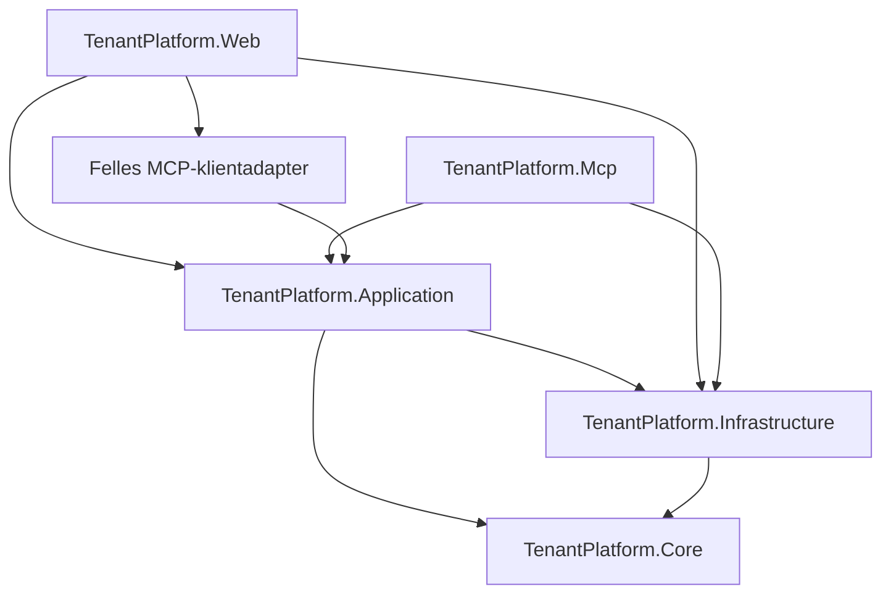

# Kartlegging og plan for videreutvikling av TenantPlatform

Dato: 17. oktober 2026. Kodegrunnlag: Git-revisjon `78232b0`, undersøkt arbeidskopi uten eksisterende endringer ved oppstart.

Dette er steg 1: kartlegging og beslutningsgrunnlag. Ingen nye prosjekter, tjenester, rettigheter, MCP-verktøy eller databaseskjemaer implementeres i dette steget.

**Lesemerking:** «Bekreftet» betyr observert i kode eller repository-dokumentasjon. «Anbefalt» beskriver fremtidig arbeid. «Uavklart» betyr at kodegjennomgangen ikke fastslår ønsket produktregel eller faktisk driftsoppsett. Dette er ikke en fullstendig sikkerhetsrevisjon eller penetrasjonstest.

## 1. Oppsummering og viktigste funn

- **Bekreftet:** `TenantPlatform.sln` inneholder fire produksjonsprosjekter: `TenantPlatform.Core`, `TenantPlatform.Infrastructure`, `TenantPlatform.Web` og `Serga.Website`. Alle bruker `net10.0`. De tre TenantPlatform-prosjektene utgjør plattformen. Serga er en separat Razor Pages-markedsnettside uten referanser til plattformen.
- **Bekreftet:** Web er både Blazor-host, vert for bakgrunnsjobber og dagens applikasjonslag. Det finnes ikke et separat REST API-prosjekt eller et generelt CRUD-API. Det finnes likevel HTTP-endepunkter i Web for autentisering, språk, dokumenter, fakturaoriginaler og rapporteksport.
- **Bekreftet:** Datatilgang skjer hovedsakelig med direkte EF Core og kortlivede kontekster fra `IDbContextFactory<TenantPlatformDbContext>`. Kontogrensen uttrykkes i spørringene, ikke med globale tenantfiltre.
- **Bekreftet:** Avtaler, Leasing og flere nyere moduler har tjenestebasert tilgangskontroll. Flere eldre registertjenester verifiserer ressursens konto, men ikke om innringer har tilgang til kontoen eller handlingen. Disse kan ikke gjøres til MCP-verktøy gjennom en enkel videresending.
- **Bekreftet:** Roller er systemdefinerte enumverdier i databasen. Konto-, organisasjons- og byggomfang finnes allerede i `UserAccountRole`, men ikke alle autorisasjonsmetoder bruker alle omfang.
- **Bekreftet:** Rapporter, dashboards, deterministiske beregninger, dokumentanalyse og integrasjonsgrensesnitt finnes allerede. Et nytt Application-lag bør gjenbruke dette fremfor å bygge parallelle regelverk.
- **Anbefalt:** Innfør Application gradvis. Start med en autorisert, skrivefri avtaleoversikt. Legg deretter til MCP som en separat transport over de samme brukstilfellene. Ikke la agenten eller rapportdefinisjoner kjøre vilkårlig SQL eller velge innringers identitet.

## 2. Prosjekter, ansvar og oppstart

### 2.1 Dagens avhengigheter

| Prosjekt | Referanser | Faktisk ansvar |
|---|---|---|
| `src/TenantPlatform.Core` | Ingen prosjektreferanser | Domeneobjekter og enums for kontoer, organisasjoner, eiendom, identitet, tjenester, avtaler, leasing, møterom, dimensjoner og revisjon; også leasingkalkulatorer. |
| `src/TenantPlatform.Infrastructure` | Core | `TenantPlatformDbContext`, EF-konfigurasjoner og migreringer, PostgreSQL/Npgsql, initialisering, passordkontroll, revisjonsinterceptor og lokal dokumentlagring. |
| `src/TenantPlatform.Web` | Core og Infrastructure | Blazor, DTO-er, applikasjonstjenester, autorisasjon, cookies og innloggingsflyt, AI-klienter, e-post, rapporteksport og jobber. |
| `src/Serga.Website` | Ingen prosjektreferanser | Separat serverrendret markedsnettside. Skal ikke få Application-/MCP-avhengigheter som følge av denne planen. |

Kilder: [solution](../../TenantPlatform.sln), prosjektfilene i de fire prosjektmappene, [DbContext](../../src/TenantPlatform.Infrastructure/Persistence/TenantPlatformDbContext.cs).

Det finnes dessuten separate konsollbaserte smoke-testprosjekter under `tests/`; disse er ikke oppført i den undersøkte solution-filen. Det er derfor ikke tilstrekkelig å bygge solution for å verifisere testprosjektene.

### 2.2 Composition root og levetider

[Web/Program.cs](../../src/TenantPlatform.Web/Program.cs) er composition root:

- Registrerer scoped applikasjonstjenester og `ITenantAuthorizationService`.
- Registrerer DbContext-fabrikken eksplisitt som scoped, med Npgsql og `AuditSaveChangesInterceptor`. Interceptor og `IAuditUserContext` er scoped.
- Registrerer `AgreementService` én gang og lar `IAgreementService`, `IAgreementFollowupService` og `IAgreementAnalysisService` bruke samme scoped instans.
- Registrerer `LeasingService`, møteringstjenester, dimensjons- og registertjenester samt e-posttjenester.
- Dokumentlager og `TimeProvider.System` er singleton. AI-klientene er typed `HttpClient`-registreringer. Dokumentlageret valideres til å ligge utenfor `wwwroot`.
- Bakgrunnsarbeidere oppretter egne scopes og kontekster. `CurrentUserContextService` er både scoped brukerkontekst og Blazor `CircuitHandler`.
- Oppstart kjører `DatabaseInitializer.InitializeAsync`; dette inkluderer migreringer og utviklingsdata i utviklingsmiljø. **Å starte Web er ikke en skrivefri verifikasjon.** Ny MCP-host må ikke ukritisk kopiere oppstartsinitialiseringen eller starte alle arbeidere en gang til.

Scoped i Interactive Server betyr ofte kretslevetid, ikke én handling. Dagens kortlivede kontekster må bevares; en ny scoped tjeneste må ikke beholde en åpen DbContext i et felt. Parallelle dashboard-/verktøykall skal ha hver sin kontekst.

## 3. Brukstilfeller, datatilgang og regler

### 3.1 Tjenestekart

Alle tjenestestier nedenfor er relativt til `src/TenantPlatform.Web/Services/`.

| Område | Sentrale filer/symboler | Hva som faktisk ligger der |
|---|---|---|
| Avtaler | `Agreements/IAgreementService.cs`, `AgreementService.cs` og `AgreementService.*.cs` | Liste/detaljer, oppretting/endring, objekttilgang, dokumenter, deling, frister, økonomiske linjer, indeksregulering, grunnlag, godkjenning, analyse og dashboardspørringer. |
| Avtaleoppfølging | `AgreementFollowupDtos.cs`, `AgreementService.Followup.cs`, `AgreementDeadlineSynchronizer.cs`, `AgreementReminderProcessor.cs` | Frister, oppfølgingsstatus, ansvarlig, rettighetskontroll ved varsling, innstillinger, kø, reservasjon/retry og utsending. |
| Leasing | `Leasing/LeasingService.cs` og delklassene `Orders`, `Invoices`, `RentalInvoices`, `PaymentPlans`, `Lifecycle`, `Equipment`, `Reports` | Direkte EF, ressursavgrensning, økonomiske transaksjoner, ramme/reservasjon, realisering, fakturagodkjenning, betaling, livsløp og rapportering. Har i hovedsak konkret tjeneste fremfor et samlet grensesnitt. |
| Felles dimensjoner | `Dimensions/DimensionService.cs`, `DimensionHierarchy.cs` | Kontoadministrasjon, hierarki, validering, revisjoner og endringshistorikk. |
| Organisasjon/geografi | `AccountSettings/OrganizationElementService.cs`, `GeographicAreaService.cs`, `AccountRegisterHierarchy.cs` | Kontoeide registre og hierarkier som allerede brukes i kontrakter og diagrammer. |
| Bygg/enheter/organisasjoner/belegg | `Buildings/BuildingService.cs`, `Units/UnitService.cs`, `Organizations/OrganizationService.cs`, `Occupancies/OccupancyService.cs` med `I*Service` | Registerspørringer, oppslag, validering av referanser og endringer. Flere av disse stoler på autorisasjon i kallende side. |
| Brukere og kontoer | `UserAdministration/UserAdministrationService.cs`, `Accounts/AccountService.cs` med grensesnitt | Plattform-/kontoadministrasjon. Brukeradministrasjonen har egne bruker- og kontosjekker; den må ikke likestilles med enklere registertjenester. |
| Tjenestekatalog og bestillinger | `ServiceCatalog/ServiceCatalogService.cs`, `ServiceRequests/ServiceRequestService.cs` | Tjenestetilgjengelighet, aktive leieforhold, oppretter-/leverandørroller, tilstandsoverganger og e-post/outbox. Flere metoder mottar bruker-ID fra kalleren og må få betrodd aktør før MCP-eksponering. |
| Møterom/booking | `MeetingRooms/IMeetingRoomService.cs`, `IRoomBookingService.cs`, implementasjonene og `MeetingRoomAccess.cs` | Konto- og rollesjekk, kontoeide ressursoppslag, bookingintervall, eierskap/admin og overlappsjekk under romlås. |

### 3.2 Regelplassering og presentasjonsgrense

**Bekreftet:** `Core/Leasing/LeasingCalculator.cs` og `LeasingAllocationCalculator.cs` inneholder gjenbrukbare beregninger. Avtaleberegninger ligger derimot i Web, blant annet `AgreementNoticeRules`, `AgreementPeriodCalculator`, `AgreementAdjustmentCalculator`, `AgreementAutomaticIndexCalculator` og `AgreementReminderSchedule`.

**Anbefalt:** Behold Core-domene og allerede rene kalkulatorer. Flytt avtaleberegninger og DTO-er sammen med brukstilfellene til Application først; flytt bare stabile, infrastrukturfrie domeneregler videre til Core dersom det gir en reell fordel. Ikke opprett duplikater av kalkulatorene i MCP eller rapportmotoren.

Razor-komponentenes skjema-/visningstilstand, `NavigationManager`, `EditForm`, lokaliserte etiketter, CSS, grafer og nedlastingsrespons skal bli i Web. Filvalidering, tilgang, transaksjoner og økonomiske beslutninger må kunne kalles uten en Razor-komponent.

### 3.3 Direkte datatilgang i Web

Dette er ikke bare tjenestekall: [Home.razor](../../src/TenantPlatform.Web/Components/Pages/Home.razor) bruker `IDbContextFactory` direkte til konto, roller, nøkkeltall og nylige forespørsler. [SelectAccount.razor](../../src/TenantPlatform.Web/Components/Pages/SelectAccount.razor) spør direkte etter brukers kontomedlemskap. `Program.cs` bruker DbContext direkte i innlogging, kontobytte og språkpreferanse.

Home har også separate avtale-widgets som allerede bruker applikasjonstjenester. Derfor bør senere arbeid flytte de resterende direkte Home-spørringene, ikke erstatte hele dashbordet.

### 3.4 Transaksjoner og skjulte skriveeffekter

- `AgreementService` bruker revisjonskontroll (`CheckRevision`) og transaksjoner ved endringer. Andre delklasser benytter kontolåser og egne snapshot-/historikkforløp.
- Leasing og dimensjoner bruker blant annet `SELECT ... FOR UPDATE` på kontoen for å serialisere økonomiske endringer. Revisjoner og idempotens-/request-ID-er beskytter godkjenninger og retry.
- `RoomBookingService.CreateAsync` bruker transaksjon og romlås før endelig overlappsjekk; en separat tilgjengelighetssjekk er bare veiledende.
- `AgreementService.GetAsync` er **ikke alltid skrivefri**: dersom frister ikke er initialisert, kalles `AgreementDeadlineInitializer.EnsureAccountAsync`. Dette er en grunn til ikke å velge avtaledetaljer som første «read-only»-MCP-verktøy.
- `AgreementService.ListAsync` har ikke denne initialiseringen. `Attention`-filteret leser påminnelsesinnstillinger gjennom `SettingsAsync`, som gir et standardobjekt uten lagring hvis innstillinger mangler.

Disse egenskapene må dokumenteres per verktøy. Et navn som «Get» eller «Preview» er ikke bevis på at et kall ikke skriver.

## 4. Identitet og autorisasjon

### 4.1 Innlogging og kontekst

**Bekreftet:** Egen modell med `User`, `LoginAccount`, `UserAccount` og `UserAccountRole`. `LocalAuthenticationService` i Infrastructure kontrollerer passord, `IsEnabled` og midlertidig sperring etter mislykkede forsøk. `PasswordService` bruker ASP.NET Cores `PasswordHasher<LoginAccount>`. Dette er ikke ASP.NET Core Identity som komplett autentiserings-/rollemodell.

[AuthenticationCookieService](../../src/TenantPlatform.Web/Security/AuthenticationCookieService.cs) oppretter claims for bruker-ID, e-post, navn, global plattformadministrator og valgt konto. Den legger ikke kontoens roller inn som rolleclaims. `Program.cs` konfigurerer HttpOnly-cookie, SameSite Lax, åtte timers levetid og sliding expiration; Secure er miljøavhengig. Roller hentes fra databasen.

Kontovalg bygger på `UserAccounts` og eventuelt `LoginAccount.LastAccountId`. Kontobytte verifiserer medlemskap og utsteder ny cookie. Det finnes ikke én globalt valgt organisasjon eller ett globalt valgt bygg i `CurrentUserContext`; slike omfang ligger i rolletildelinger eller konkrete ressursvalg.

[CurrentUserContextService](../../src/TenantPlatform.Web/Security/CurrentUserContext/CurrentUserContextService.cs) bruker HTTP-principal utenfor kretsen og kretsens `AuthenticationStateProvider` etter `OnCircuitOpenedAsync`. Den lytter til endret autentiseringstilstand og feiler lukket mens en ny tilstand ikke er ferdig eller har feilet. Den bygger konteksten fra claims; den laster ikke selv ny medlems-/aktivstatus fra databasen ved hver tilgang.

### 4.2 Roller, omfang og ressursregler

[UserRole](../../src/TenantPlatform.Core/Identity/UserRole.cs) inneholder AccountAdmin, PropertyAdmin, TenantAdmin, TenantUser, ServiceProviderUser og særskilte leasingroller for godkjenning, ramme, betalingsplan, faktura, avvik, utstyr, livsløp og rapport/eksport. `IsPlatformAdmin` ligger separat på `User`.

[UserAccountRole](../../src/TenantPlatform.Core/Identity/UserAccountRole.cs) knytter enumrollen til et kontomedlemskap og har valgfrie `OrganizationId` og `BuildingId`. Det finnes ingen generell tabellmodell for administratoropprettede roller med en samling rettigheter.

[TenantAuthorizationService](../../src/TenantPlatform.Web/Security/Authorization/TenantAuthorizationService.cs) har:

- `HasAnyRolesAsync`: autentisert bruker + valgt konto + rolletildeling i konto. Ikke generell kontroll av brukerens `IsActive` eller ressursens omfang.
- `CanManageBuildingAsync`: AccountAdmin eller PropertyAdmin for konkret bygg innen valgt konto.
- `HasTenantAccessToUnitAsync`/`HasTenantAccessToBuildingAsync`: tenantrolle kobles til organisasjonens aktive occupancy og kontoeide enheter.
- `CanUseAgreementsAsync`/`CanUseLeasingAsync`: aktiv bruker/medlemskap og relevante roller, eierskap eller eksplisitt avtaletilgang.
- Leasingmetoder for handlinger som fakturagodkjenning og eksport: systemrollebaserte, i dag i hovedsak kontoovergripende innen den valgte kontoen.
- Plattformadministrasjon og startside: separat global adminatferd. En ren PlatformAdmin får ikke automatisk ordinær konto-/avtaletilgang.

`Program.cs` registrerer `AddAuthorization()` uten et navngitt, generelt permission-policy-register. `AuthorizeRouteView` og `[Authorize]` beskytter ruter, men uttrykker ikke alle ressursreglene.

### 4.3 Konkrete håndhevingspunkter

| Lesing/endring | Serverhåndheving observert i kode |
|---|---|
| Avtaleliste, detaljer og deling | `AgreementService.RequireMemberAsync`, `Accessible` og `RequireAsync`: valgt konto må samsvare, aktivt medlemskap, eksplisitt AccountId, konto-admin/eier/ressursgrant. Edit-grant gir endring, ikke automatisk rett til å administrere deling. Arkiverte avtaler blokkerer vanlig redigering. |
| Avtalereferanser | `AgreementService.ValidateAsync` og `AgreementService.Structure.cs` kontrollerer relevante kontoeide parter, ansvarlige og strukturreferanser. |
| Dokumenter | `AgreementEndpoints.MapAgreementEndpoints` krever autentisering og valgt konto; tjenester kontrollerer avtalen før filstrømmen returneres. Beskyttet lager er utenfor webroot. |
| AI-utkast | `AgreementService.Analysis.cs`: aktivt medlemskap, oppretterbundet utkast, tilstand/revisjon, avtaletilgang ved eksisterende avtale, brukerbekreftelse før anvendelse. |
| Leasing | `LeasingService.Member`, `Frameworks`, `Acquisitions`, `Orders`, `ReadAcquisitions` og delklassenes handlingssjekker. `LeasingLifecycleAccess.CanRead` håndhever aktivt medlemskap og eier-/rollebasert ressurslesing. |
| Leasingrapport og eksport | `GetLeasingReportAsync` bruker valgt konto og leserregler; eksport har egen rettighet. `LeasingEndpoints` ber om `export:true`, kontrollerer format og filterlengde og setter blant annet `Cache-Control: no-store`. Rapporten begrenser datamengden. |
| Booking | `MeetingRoomAccess.RequireAsync`, kontoeide rom/bookingoppslag, samt `RequireOwnerOrAdminAsync` ved endring av booking. Rolle-/kontoporten må ikke forveksles med et ferdig generelt bygningsomfang for møterom. |
| Påminnelser | `AgreementReminderProcessor` finner aktive kontoer og kontoeide frister/avtaler. Før levering sjekkes mottaker mot `AgreementFollowupAccess.Editors`. Leasingprosessoren revaliderer mottakertilgang gjennom `LeasingLifecycleAccess.CanRead`. |

Menysynlighet fra `NavigationPermissions` og knapper som `CanEdit` er hjelp for brukeren. De er ikke erstatning for kontroll inne i et brukstilfelle som kan kalles fra en annen host.

## 5. Svakheter, usikkerheter og konsekvenser

### 5.1 Prioriterte funn

| Prioritet | Bekreftet observasjon | Konsekvens og nødvendig oppfølging |
|---|---|---|
| Høy før MCP | `BuildingService`, `UnitService` og `OrganizationService` tar konto-ID og kontrollerer data mot denne, men har ingen innringer-/autorisasjonsavhengighet i de undersøkte metodene. | AccountId-predikat begrenser spørringen til oppgitt konto, men beviser ikke tilgang til den kontoen. En ny MCP-host må ikke videreformidle verktøyargumentenes konto-ID direkte. Tjenestene trenger brukstilfellebasert autorisasjon før eksponering. Dette funnet alene beviser ikke et offentlig HTTP-angrep. |
| Høy, avklar nåværende produktregel | `Buildings.razor` godkjenner `CanManageBuildingsAsync` og kaller `GetBuildingsAsync(accountId)` uten byggfilter. `Units.razor` gjør tilsvarende med `CanManageUnitsAsync` og `GetUnitsAsync(accountId)`. Disse generelle tillatelsene inkluderer PropertyAdmin, mens detalj-/endringskontroll kan være byggspesifikk. | Kodeveien kan liste metadata for andre bygg/enheter i samme konto enn PropertyAdmin er tildelt. Dette er et konkret omfangsavvik dersom byggtildeling skal avgrense også listelesing. Ikke bekreftet ved innlogging i en kjørende løsning. Ikke påvist tilgang på tvers av kontoer gjennom denne GUI-veien. Rapportmotor må ikke arve den brede listen som en antatt sikker datakilde. |
| Høy før flerhost | `ServiceRequestService` mottar aktør-ID i flere signaturer; `CurrentUserContextService` og cookie-/auditadapteren er Web-bundet. | En modell eller MCP-klient må aldri kunne velge «hvem den er». Betrodd identitet skal komme fra hostens validerte autentisering. Bevar faktiske organisasjons-/leverandørkontroller fra tjenesten, ikke bare rolleporten i UI. |
| Middels/høy | Ikke funnet felles cookie-`OnValidatePrincipal`/sikkerhetsstempelrevalidering. `LocalAuthenticationService` sjekker LoginAccount.IsEnabled, men ikke eksplisitt User.IsActive; `HasAnyRolesAsync` sjekker ikke aktiv bruker. Avtaler/Leasing har derimot egne aktive medlemskapssjekker. | Deaktivering og revokering er ikke enhetlig håndhevet. En aktiv krets/cookie kan ha gamle navn/global adminstatus. Innfør en eksplisitt, testet revokeringsstrategi før agent med lang levetid. Ikke anta at auth-state-event betyr database-revalidering. |
| Middels | Ingen globale tenantfiltre; eldre entitetsrelasjoner og spørringer varierer i eksplisitt kontofilter. | Bevar AccountId på alle datakilder, joins, oppslag, eksport og writes. Ikke innfør globalt filter som eneste kontroll, og ikke påstå at alle nåværende spørringer er bevist sikre ved denne kartleggingen. |
| Middels | Brede delklasser med interne hjelpefunksjoner; `AgreementService` mottar også AI-klient/varsleralternativer for funksjoner som ikke trenger dem. | Del ett avgrenset brukstilfelle om gangen. Flytting av én fil uten de delte hjelpefunksjonene kan både ødelegge kompilering og miste tilgangsregler. |
| Middels | Lesekall kan initialisere data; bakgrunnsjobber kjører i Web. | Verktøymetadata og bekreftelsesregler må baseres på faktiske effekter. Unngå doble scheduler-instanser ved ny host. |

### 5.2 Hva kartleggingen ikke bekrefter

Ingen fullstendig metode-for-metode-revisjon av alle service-request-/registeroperasjoner, produksjonsdatabase, nettverksoppsett, cookie-nøkler, proxytilgang, faktisk brukerrevokering eller angrepstesting er utført. Ingen hemmelige konfigurasjonsverdier er lest eller tatt inn i dokumentet. `docker/.env` er ikke brukt som kilde til verdier.

Organisasjon som **motpart**, organisasjon som **rolleomfang**, `OrganizationElement` og kontoen som tenant er forskjellige begreper. Det er uavklart om fremtidige organisasjonsspesifikke roller skal begrense alle data relatert til organisasjonen, bare enkelte handlinger eller bestemte datakilder. En generell automatisk join-regel kan ikke utledes av dagens modell.

## 6. Eksisterende fundament som skal gjenbrukes

| Fundament | Finnes allerede | Hva som mangler i målbildet |
|---|---|---|
| Dashboard/diagrammer | `Components/Pages/Dashboard/AttentionWidget`, `ContractsWidget`, `InsightsWidget`; `AgreementService.Dashboard.cs` og `AgreementDashboardDtos.cs`. Gruppering på type, status, eier, motpart, organisasjon/geografi og hierarkisk drill-down. | Brukerlagrede sidedefinisjoner, generell widget-/datakildekatalog, sideversjoner og autorisert runtime. |
| Leasingrapporter | `LeasingService.Reports.cs`, `LeasingReportExport.cs`, `LeasingReportPage.razor`, `LeasingDashboard.razor`; seks rapporttyper, filtre, summer per valuta og CSV/XLSX. | Generisk, brukerdefinert rapportmodell. Datagrunnlag og regler skal gjenbrukes; eksportformattering/lokalisering er ikke selve datatilgangen. |
| Beregninger | Avtaleperioder, indeks, justeringer, leasingfordeling, betalingsplan og livsløp. | Et avgrenset register over deterministiske operasjoner som en sidedefinisjon kan referere til. Ingen modell skal regne om godkjente økonomiske snapshots. |
| AI | `AgreementService.Analysis.cs`, `IContractAnalysisClient`, `OpenAiContractAnalysisClient`, `ContractAnalysisSchema`, fakturatolking i `Leasing/Invoices`. Dokumenterte skjemaer, lokale valideringer, utkast, godkjenning og opprydding. | Innebygd chat, generell agent, MCP-klient/server og verktøyautorisasjon. Dokumentanalyse er ikke en eksisterende MCP-integrasjon. |
| Kalender | `ICalendarProvider`, `CalendarIntegrationService` og `CalendarIntegration`/`MeetingRoomCalendar`. | Grensesnittet er eksplisitt fremtidig; `ICalendarProvider` sier at adapter ikke kalles/registreres før autentisering og pålitelig levering er implementert. Ikke omtale Microsoft/Google-kalender som ferdig tilkobling. |
| E-post/integrasjon | SMTP, IMAP-innlesing, outbox og service-provider-modell; fristtransport har Capture/Smtp. | Generelt tilkoblingsregister, per-bruker/delegert OAuth og MCP-server-/verktøytilgang. |
| Navigasjon/preferanser | `Components/Layout/MainLayout.razor`, `Security/Authorization/NavigationPermissions.cs`, `User.PreferredLanguage`, språkcookie, `LoginAccount.LastAccountId`, `wwwroot/js/theme.js` med localStorage. | «Mine sider», kontobundet eierskap/deling, lagring av sideoppsett og sikker agenthistorikk. Ikke gjenbruke localStorage som autoritativ servertilgang. |
| Logging/revisjon | `Infrastructure/Auditing/AuditSaveChangesInterceptor`, `IAuditUserContext`, `Web/Auditing/AuditUserContext`; avtale-/leasinghistorikk, revisjoner, økonomiske snapshots, AI-forbruk/status og køstatus. | Felles korrelasjon for bruker → chat → MCP → brukstilfelle → datatilgang; tydelig aktør for jobber. Revisjonsinterceptor er ikke autorisasjon og logger ikke automatisk alle lesinger. |

AI-klienten bruker Responses API med strukturert JSON og `store=false`; dokumentinnhold sendes til ekstern modell etter den eksisterende arbeidsflyten. Providerintegrasjon og modellvalg skal ikke endres i steg 1. Bevar dagens skille mellom beskyttet analyseinnhold og vanlig revisjonslogg; ikke logg tokens, rå dokumenter eller MCP-hemmeligheter.

Relatert dokumentasjon: [avtaler](../agreements.md), [oppfølging](../agreement-follow-up.md), [dokumentanalyse](../agreement-contract-analysis.md), [avtaleperioder](../agreement-financial-periods.md), [grunnlag](../agreement-adjustments-basis.md), [møterom](../meeting-rooms.md), [leasingoversikt](../leasing-overview.md).

### 6.1 Eksisterende tester og verifikasjonsgrenser

Testprosjektene er konsollprogrammer med egne assertions, ikke et vanlig xUnit-/NUnit-oppsett. De relevante inngangene er `tests/<prosjektnavn>/Program.cs`:

| Prosjekt | Relevant dekning i testkoden |
|---|---|
| `TenantPlatform.Agreements.SmokeTests` | Avtaleregistrering, referanser, lesing/deling og kontogrenser. |
| `TenantPlatform.AgreementFollowup.SmokeTests` | Oppfølging, frister, ansvar og påminnelsesflyt. |
| `TenantPlatform.AgreementNotice.SmokeTests` og `TenantPlatform.AgreementPeriods.SmokeTests` | Oppsigelsesregler, avtaleperioder og økonomiske perioder. |
| `TenantPlatform.AgreementProcessing.SmokeTests` | Beregninger, grunnlag, indeksendringer, bulk og godkjenning; `ComponentEditorChecks.cs` rendrer og bruker editorene. |
| `TenantPlatform.AgreementAnalysis.SmokeTests` | Dokumentanalyse, klient-/responskontroll og godkjenningsflyt med testoppsett. Ikke grunnlag for å anta at levende providerkall er nødvendige for regresjonstester. |
| `TenantPlatform.Dashboard.SmokeTests` | Datofiltre, hierarkier, EF-oversettelse via `ToQueryString`, InMemory-baserte tilgangsscenarioer og rendring. `translation_only` i testprogrammet brukes til SQL-generering, ikke tilkobling. |
| `TenantPlatform.Leasing.SmokeTests` | Faser for kjøp, dimensjoner, faktura, bestillinger, betaling, livsløp, rapporter og komponenter. |
| `TenantPlatform.AccountRegisters.SmokeTests` og `TenantPlatform.MeetingRooms.SmokeTests` | Kontohierarkier samt rom/booking og tilhørende grenser. |

Flere av PostgreSQL-testprogrammene krever eksplisitt testtilkobling, avviser andre databasenavn og lager isolert skjema med migreringer. De må derfor ikke kjøres som en antatt lesekontroll mot applikasjonsdatabasen. Les README/program for hvert prosjekt før kjøring. I dette steget er bare dashboardtesten forsøkt uten restore; se verifikasjonen nederst.

## 7. Anbefalt målarkitektur

### 7.1 Ansvar og avhengigheter

En **pragmatisk Application-uttrekking med direkte EF** anbefales først. Dette følger dagens struktur og krever ikke repositories, MediatR, CQRS eller et nytt Result-lag.

Pil betyr prosjektreferanse/anvendelse, ikke at alle delene implementeres nå. Web/Mcp refererer Infrastructure ved behov for composition root. Klientadapteren er en anbefalt separat modul; et eget `TenantPlatform.McpClient`-prosjekt kan vurderes når begge hostene faktisk trenger den. MCP-serveren trenger ikke utgående klient bare for å eksponere lokale brukstilfeller.

| Lag | Anbefalt ansvar |
|---|---|
| Core | Domene, stabile enums/invarianter, rene domeneberegninger. Ingen HTTP, Blazor, MCP SDK eller providerklient. |
| Application | Brukstilfeller, inn-/ut-DTO-er, felles aktørkontrakt, autorisasjon og autoriserte spørringer, deterministisk rapport-/sideruntime og agentens kontrollerte verktøyorkestrering. Ingen HttpContext eller AuthenticationStateProvider. |
| Infrastructure | EF/Npgsql, migreringer, eksisterende audit- og lagringsmekanismer, autentiseringens tekniske deler og tekniske adaptere der avhengighetene tillater det. Ingen avhengighet til Web eller Mcp. |
| Web | Cookies, Blazor, innlogging/kontobytte, menyer, chatpanel, skjemaer, visning/grafikk, lokaliserte svar og HTTP-nedlasting. Adapterer Web-identitet til Application-kontekst. |
| Mcp | Egen autentisert host, verktøyregistrering, schema/argumentvalidering, protokollsvar, tids-/størrelsesgrenser og betrodd aktøradapter. Kaller Application; ingen egne EF-regler eller parallell tilgangsmodell. |
| Felles MCP-klient | Tilkoblings-/sesjonshåndtering og SDK-transport bak Application-kontrakt. Samme implementasjon brukes av chat og eventuelle andre konsumenter. Ikke avhengig av Razor-krets eller browserlagring. |

**Viktig avveining:** Med `Application → Infrastructure` kan Infrastructure ikke samtidig referere Application for å implementere nye porter; det gir en syklus. I første uttrekk beholdes eksisterende EF-/lagringskontrakter i Infrastructure, mens hostadaptere implementerer Application-kontraktene. Dersom renere porter eller plassering av AI-/MCP-adaptere krever det senere, må avhengighetsretningen endres bevisst eller adapter legges i en egen assembly. Ikke flytt alle DTO-er til Core eller legg til et repositorylag bare for å skjule denne beslutningen. Dette er ikke en påstand om at dagens kode allerede følger Clean Architecture.

### 7.2 Felles aktør og rettighetskontroll

Anbefalte nye kontrakter, navn er forslag:

- `IExecutionContext` med en uforanderlig aktør per operasjon: bruker-ID, valgt konto-ID, aktørtype (bruker/system), betrodd host-/klientidentitet og korrelasjons-ID. Ikke en klientstyrt claims-/rollepose.
- Web-adapter henter identitet fra eksisterende autentisering; MCP-adapter henter den fra validert protokollautentisering. Verktøyargumenter kan angi en ressurs eller ønsket kontobytte, men gir aldri autoritet til det.
- Application kontrollerer aktiv bruker, kontomedlemskap og relevant handlings-/ressurstillatelse før data returneres eller endres. Systemjobber bruker særskilt, avgrenset systemkontekst, ikke en falsk innlogget administrator.
- `IPermissionEvaluator` evaluerer systemdefinert rettighets-ID + operasjonens ressurs/omfang. Et globalt «kan bruke modulen» er ikke nok for lister, detaljer, eksport og writes.
- UI får `Can*`-verdier fra samme evaluering, men tjenesten kontrollerer alltid på nytt. Aktøravlesning tas som et konsistent snapshot per operasjon; oppdatert tilgang hentes/revalideres med en tydelig strategi.

Senere egne roller: behold `UserRole` og eksisterende tallverdier. Lag en eksplisitt, testet kompatibilitetsmapping fra gamle roller til systemdefinerte permissions. Nye roller grupperer de samme permissions og tildeles med konto-/organisasjons-/byggomfang. Kontogrensen gjelder også ved organisasjons-/byggtildeling. Definer eksplisitt om tilganger kombineres som union, hvordan arv fungerer, og om eksplisitt avslag skal eksistere. Ikke la brukere definere vilkårlige SQL-predikater som en rettighet.

### 7.3 Felles datatilgang

Bruk eksisterende kontekstfabrikk med én kortlivet kontekst per operasjon. Samle autoriserte spørringsuttrykk per datadomene, etter mønster av `AgreementService.Accessible`. Apply filtre og aggregasjoner **etter** sikkerhetsavgrensning; samme avgrensning gjelder eierlister, grupperingsetiketter, telling, drill-down og eksport.

Ved writes verifiseres alle referanser i valgt konto og nødvendig ressursomfang. Bevar revisjonssjekker, låserekkefølge, idempotens og snapshotregler. Ulike EF-operasjoner på samme kontekst må ikke kjøres parallelt. Ikke eksponer IQueryable, DbContext, databasekolonnenavn eller vilkårlig expression/SQL direkte i MCP eller sidedefinisjoner.

### 7.4 MCP, eksterne tilkoblinger og chat

Start med få lesende verktøy som hver representerer ett autorisert brukstilfelle. Bruk helst intern funksjonskalling direkte til Application for lokal orkestrering; ekstern MCP er en transport, ikke en obligatorisk omvei gjennom HTTP for Webs egne data. Egen MCP-server eksponerer nøyaktig samme regler for eksterne klienter.

Tilkoblingsregisteret må senere skille mellom kontofelles serveroppsett, brukerens autentiseringsgrant, tillatt server/verktøy og faktisk datatilgang. Modellens verktøyvalg er aldri en tilgangsgodkjenning. For eksterne servere må kontodata ikke sendes uten godkjent formål og servertilgang. Eksterne verktøyresultater er ubetrodd innhold, ikke nye systeminstruksjoner.

Anbefalt sikkerhetsminimum: validerte utgående adresser/redirects (SSRF), eksplisitt tillatte servere og verktøy, begrensede tokenrettigheter, sikker hemmelighetslagring, eierskap til sesjon/chat og tids-/størrelses-/antallsgrenser. Ikke videresend plattformcookie til eksterne MCP-servere. Brukerbekreftelse for irreversible/vesentlige writes skal knyttes til konkrete argumenter, aktør og revisjon og revurderes på serveren ved utførelse.

MCP-hostens auth-transport (for eksempel delegert bearer/OAuth for nettverk eller separat lokal prosess) er en åpen beslutning. Dette steget velger ikke SDK, pakkeversjon eller et protokolloppsett som om det allerede var verifisert.

### 7.5 «Mine sider» og modellfri kjøring

AI skal lage/endre en **versjonert, deklarativ sidedefinisjon**, ikke SQL, C#, JavaScript eller Razor som kjøres på serveren. Definisjonen bør referere kjente datakilde-ID-er, validerte filtre, tillatte grupperinger, deterministiske beregninger og støttede widgettyper. Lagre eier, AccountId, versjon og eventuelle eksplisitte delinger. Innhold sendes ikke til andre brukere bare fordi modellen foreslår det.

Ved åpning av ferdig side: runtime validerer definisjonen, kontrollerer nåværende tilgang og kjører autoriserte Application-spørringer og vanlige kalkulatorer. **Ingen modellkall skal være nødvendige.** Bygg på dagens avtaleinnsikt og leasingrapportregler. Ikke anta at alle eksterne MCP-verktøy er egnede rapportdatakilder; det krever egne regler for stabilitet, skjema, feil og sideeffekter.

Cache må avgrenses med konto, bruker/effektiv tilgang, definisjonsversjon og filtre. Tilgang må revalideres etter rolle-/eierendringer; eksport og drill-down må ikke bruke bredere datagrunnlag enn widgeten. Begrens resultater og beregningstid; økonomiske summer per valuta og fordelingsgrunnlag må bevare eksisterende semantikk.

## 8. Konkret flytteplan

| Eksisterende kode | Anbefalt behandling | Begrunnelse |
|---|---|---|
| `Core/**` | Behold; unngå endring i første uttrekk. | Stabilt domene skal ikke trekkes mot Web/transport. |
| `Infrastructure/Persistence/**`, migreringer, initialisering | Behold. Hosts registrerer eksisterende fabrikk/interceptor eksplisitt. | Unngå skjemaendring og ny lagringsarkitektur samtidig med uttrekk. |
| `Web/Security/CurrentUserContext/*` | Behold HTTP-/kretsadapter, innfør Application-kontrakt og adapter gradvis. | AuthenticationStateProvider og CircuitHandler kan ikke gjenbrukes av MCP-host. |
| `Web/Security/Authorization/TenantAuthorizationService.cs` | Del presentasjonsrettede menyer/startside fra handlings- og ressurskontroll. Innfør kompatibilitetsfasade for eksisterende `ITenantAuthorizationService`. | Dagens roller og UI kan fortsette å fungere mens felles regler trekkes ut. |
| `Web/Services/Agreements/AgreementService*.cs` | Trekk ut ett brukstilfelle og dets DTO-/regelavhengigheter om gangen. Gammel tjeneste videresender for migrert funksjon. | Flere grensesnitt deler én delklasseimplementasjon; unngå samtidig totalflytting. |
| `Agreement*Calculator`, `AgreementNoticeRules`, `AgreementReminderSchedule` | Del/flytt til Application når et migrert brukstilfelle trenger dem. Skill eventuelle transport-/lokaliseringsavhengigheter. | Regler må ikke dupliseres mellom gammel og ny tjeneste. |
| `LeasingService.*`, dimensjons- og registertjenester | Senere funksjonsvise uttrekk. Registertjenester får innringer-/ressurskontroll før MCP. | Eksisterende sikkerhetsnivå varierer; et nytt namespace gjør ikke tjenestene sikre. |
| `Home.razor`, `SelectAccount.razor`, auth/språk i `Program.cs` | Presentasjon/HTTP blir; gjenbrukbare spørringer/valg flyttes etter pilot. | Reduser direkte EF i komponentene uten å flytte cookies til Application. |
| `OpenAiContractAnalysisClient`, fakturatolk, SMTP/IMAP, kalenderadapter | Skill providerkall fra brukstilfelleorkestrering. Eksisterende klientgrensesnitt og feiltyper må flyttes/splittes koordinert. | Ikke lag Infrastructure→Web eller Infrastructure→Application→Infrastructure-syklus. |
| `AgreementReminderWorker`, `LeasingLifecycleWorker`, fakturaarbeider, outbox | HostedService blir i én utpekt host i første omgang; domenearbeidet kan kalles gjennom Application. | Bevar kø/lås/retry; ikke doble jobbkjøring ved MCP-oppstart. |
| `LeasingReportExport` og HTTP-endepunkter | Autoriserte data til Application; format-/lokalisering og HTTP-respons blir adapteransvar. | Eksport må dele datatilgang uten at Application trenger HttpContext eller Web-resurser. |
| `AuditUserContext` | Adapter til betrodd Application-aktør; behold Infrastructure-interceptor og IAuditUserContext i første uttrekk. | Sikrer revisjonsaktør uten omvendt avhengighet. |
| `Serga.Website` | Ingen endring. | Uavhengig markedsnettside. |

## 9. Konkret forslag til steg 2: autorisert avtaleoversikt

### 9.1 Valg og avgrensning

Velg `AgreementService.ListAsync(Guid accountId, AgreementFilter filter, CancellationToken)` som første uttrekk, brukt av `Components/Pages/Agreements/Agreements.razor`.

Det er avgrenset, bruker kortlivet EF og har relevante sikkerhetsregler: aktivt medlemskap, valgt konto, admin/eier/grant, filtrering, telling og sideinndeling. Det gir en fremtidig lesende MCP-funksjon og grunnlag for personlige oversikter. Det unngår dokumentstrømmer, modellkall og skriveeffekten i `GetAsync`.

Avgrens piloten til listekallet med **alle nåværende filtre**, eieralternativer, sortering og paging. Ikke utvid piloten til detalj-, opprettings-, analyse- eller eksportflyt.

### 9.2 Foreslåtte endringer i neste steg

1. Opprett `src/TenantPlatform.Application/TenantPlatform.Application.csproj` med `net10.0`, Core- og Infrastructure-referanser. Legg prosjektet til i solution og la Web referere det. Infrastructure skal fortsatt ikke referere Application.
2. Innfør minimal `IExecutionContext` og en betrodd Web-adapter. Ikke flytt hele kretskonteksten. Viderefør koblingen til valgt konto og aktivt kontomedlemskap.
3. Opprett `Application/Agreements/AgreementListService.cs` med tilsvarende listemetode. Innfør et avgrenset `AgreementAccessPolicy` for medlemskontroll og `Accessible`-spørringen. AccountAdmin må fortsatt identifiseres fra databasens medlemsrolle; ikke fra klientargument eller global plattformadministrator.
4. Flytt `AgreementFilter`, `AgreementListItemDto`, `AgreementPageDto` og nødvendige option-kontrakter til Application. `AgreementOptionDto` brukes flere steder: samordne referansene fremfor å opprette to inkompatible typer med samme betydning.
5. Flytt/del nødvendige `AgreementAttention`/`AgreementDashboardQueries.Attention`-regler fra `AgreementDashboardDtos.cs`. Flytt `AgreementReminderSchedule` og nødvendige tidssoneavhengigheter bare i den utstrekning piloten trenger dem, og la eksisterende Web-konsumenter bruke samme regelkode. Standardinnstillinger hentes skrivefritt som i dagens `SettingsAsync`.
6. La gamle `AgreementService.ListAsync` delegere til Application i overgangsfasen. UI og `IAgreementService` kan dermed beholde kallemønsteret mens resten av AgreementService blir i Web. Ingen avhengighet fra Application tilbake til Web tillates.
7. Registrer nye tjenester i Webs composition root med scoped levetid. Ikke flytt lagrings-/AI-klientregistreringer eller start en MCP-host i piloten.

Dette krever ikke en generell permission-motor i første commit. En liten, reell felles aktør-/avtalepolicy er bedre enn en komplett ny rollemodell som piloten ikke trenger. Når flere brukstilfeller trekkes ut, utvides felles autorisasjon med eksisterende semantikk som fasit.

### 9.3 Akseptansekriterier og tester

- Application bygger uten referanse til Web, ASP.NET Core/Blazor-typer, HTTP eller MCP SDK. Ingen prosjektsyklus. Core og Infrastructure beholder eksisterende retning.
- Ingen databaseendring, migrering, innloggingsendring eller endring av enumverdier.
- Uautentisert bruker, manglende valgt konto, kontoargument forskjellig fra valgt konto, inaktiv bruker og manglende medlemskap avvises.
- AccountAdmin ser kontoen; eier ser egne avtaler; eksplisitt Read- eller Edit-grant gir listelesing. Tilbakekalt grant og fjernet medlemskap gjelder ved nytt kall.
- PlatformAdmin uten kontomedlemskap/avtalerettighet får ingen automatisk tilgang til kontodata.
- Minst to kontoer og to brukere: skjulte/utenlandske avtaler finnes ikke i rader, `TotalCount` eller `Owners`. Forged OwnerUserId-filter skal ikke utvide synlighet.
- Search, type/status/eierfilter, Attention, tidssonegrenser, arkivsemantikk, sidestørrelse 25, stabil sortering på tittel/ID og sideklamping er uendret. Ikke legg på et nytt generelt arkivfilter som endrer dagens liste.
- Kallet oppretter ikke frister eller innstillinger og skriver ikke revisjonsrader.
- Eksisterende side fungerer gjennom fasaden; navigasjon, DTO-er og lokalisert visning er uendret funksjonelt.
- Test både direkte Application-kall med en testaktør uten HttpContext og Web-fasadens videresending. Test parallell bruk med separate kontekster.
- Gjenbruk `tests/TenantPlatform.Agreements.SmokeTests` for avtaletilgang og `tests/TenantPlatform.Dashboard.SmokeTests` for Attention/gruppering. Legg målrettede tester til i relevant testoppsett; PostgreSQL-test bør bekrefte oversettelse og faktisk filtrering. InMemory alene beviser ikke SQL, låser eller databaseconstraints.

## 10. Videre rekkefølge og åpne beslutninger

### 10.1 Anbefalt rekkefølge

1. Avklar eiendoms-/organisasjonsomfang og håndter prioriterte sikkerhetsfunn, uten å vente på chatfunksjonen.
2. Gjennomfør avtaleoversiktpiloten over. Dokumenter erfaring og dependency-retning.
3. Flytt flere autoriserte lese-/rapportbrukstilfeller, og etabler systemdefinerte permission-ID-er med kompatibilitetsmapping for eksisterende roller.
4. Innfør autentisert MCP-host med et lite sett skrivefrie verktøy og kontraktstester som sammenligner direkte tjenestekall med MCP-kall.
5. Innfør felles utgående MCP-klient og tilkoblings-/grantmodell, inkludert hemmelighetshåndtering og server-/verktøytilgang.
6. Etabler deklarativ sidedefinisjon og deterministisk runtime med kjent datakilde-/widgetkatalog og eierskap, deretter AI-basert oppretting/endring og chatpanel over samme katalog.
7. Utvid til kontrollerte skriveverktøy med konkrete bekreftelser, revisjoner og idempotens. Utvid egne roller og omfang trinnvis; behold gamle roller under overgangen.

### 10.2 Beslutninger som må tas før de berørte stegene

| Beslutning | Hvorfor den må avklares |
|---|---|
| PropertyAdmin-listelesing og organisasjonsomfang | Bestemmer hvilke ressurser hver datakilde kan returnere, ikke bare hvilke knapper som vises. |
| Aktivering/deaktivering av konto, bruker og LoginAccount; revokering av økter | Dagens kontroller er ulike. Bestem ønsket virkningstid og unntak for plattformadministrasjon. |
| Varighet for pragmatisk Application→Infrastructure-avhengighet | Unngå at senere tekniske adaptere skaper prosjektsyklus eller at pilot blir et skjult stort arkitekturbytte. |
| MCP-transport, autentisering og målklienter | Avgjør token-/delegasjonsmodell og sesjonshåndtering. Ikke anta at cookie er egnet for eksterne klienter. |
| Felles tilkobling kontra personlig grant | Påvirker hvem som kan legge til server, administrere hemmelighet, oppdage verktøy og bruke eksterne data. |
| Hvilke writes krever bekreftelse og hvem kan godkjenne | Agenten må ikke omgå eksisterende rolle- og arbeidsflytgrenser. |
| Personlige sider: privat, delbar eller kontoadministrert | Krever eksplisitt eierskap, kontogrense, deling, revisjon og regler ved kontobytte/sletting av bruker. |
| Retensjon og datadeling for chat/AI/verktøyresultater | Eksisterende dokumentanalysepolicy kan ikke automatisk brukes på all chat og eksterne MCP-servere. |
| Én jobbhost og migreringsansvar ved flere deployer | Forebygger doble utsendinger, dobbel opprydding og samtidige oppstartsmigreringer. |

Ingen av disse åpne spørsmålene hindrer dette kartleggingsdokumentet. De er ikke løst ved å innføre nye prosjektnavn.

## 11. Verifikasjon og leveranseavgrensning

Utført: kildekodelesing, søk etter ruter/DI/prosjektreferanser, autorisasjons- og EF-mønstre, gjennomgang av relevante dokumenter og testprogrammer. Dokumentet er nytt; det fantes ikke et tidligere `docs/architecture/modernization-plan.md` å slå sammen med.

Forsøkt eksisterende test uten pakkerestaurering: `dotnet run --project tests/TenantPlatform.Dashboard.SmokeTests --no-restore`. Den stoppet før testkjøring med `NETSDK1004` fordi testprosjektets `obj/project.assets.json` manglet. Ingen test ble bekreftet bestått. Ingen pakker ble installert/restaurert for å omgå dette.

Ingen applikasjonsstart, databasekontakt, migrering, ekstern modell-/MCP-forespørsel eller driftsendring er utført. Ingen build kreves for en ren Markdown-leveranse. Testdekning omtalt i planen er observert testkode, ikke en erklæring om beståtte tester i dette steget.

Sluttkontroll skal vise at eneste tilsiktede repository-endring er dette dokumentet. Ingen commit eller push inngår i oppdraget.
