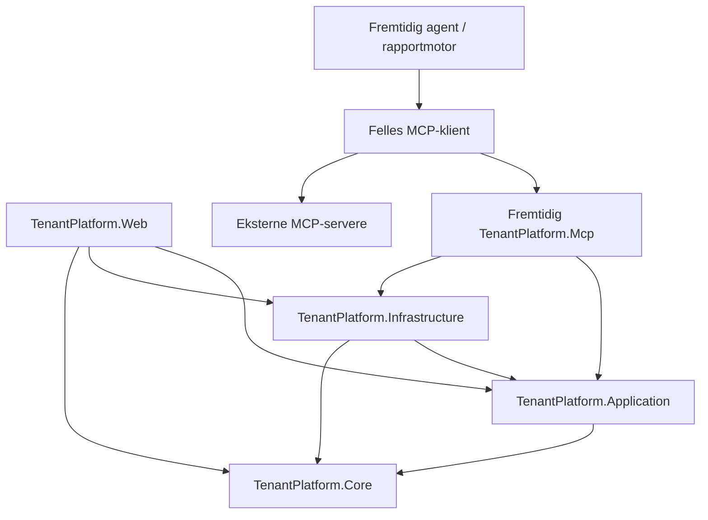

# Kartlegging og plan for videreutvikling av TenantPlatform

Dato: 17. oktober 2026. Kodegrunnlag: Git-revisjon `78232b0`, undersøkt arbeidskopi uten eksisterende endringer ved oppstart.

**Gjeldende føring for videre migrering (17. oktober 2026):** Hele steg 4 skal fullføres før steg 5 eller MCP. Eldre avsnitts forslag om en begrenset MCP-host før full migrering er historikk og gjelder ikke dette oppdraget. Se avsnitt 19 og [løpende migreringsoversikt](step-4-migration-inventory.md) for faktisk status. Steg 4 er fortsatt ikke ferdig.

Dette dokumentet inneholder kartleggingen fra steg 1 og implementert status etter steg 2 (17. oktober 2026). Det første brukstilfellet, autorisert avtaleoversikt, er nå trukket ut til Application. Andre sikkerhetsfunn er fortsatt åpne. Det er ikke implementert MCP eller gjort databaseendringer.

**Lesemerking:** «Bekreftet» betyr observert i kode eller repository-dokumentasjon. «Anbefalt» beskriver fremtidig arbeid. «Uavklart» betyr at kodegjennomgangen ikke fastslår ønsket produktregel eller faktisk driftsoppsett. Dette er ikke en fullstendig sikkerhetsrevisjon eller penetrasjonstest.

## 1. Oppsummering og viktigste funn

- **Bekreftet:** `TenantPlatform.sln` inneholdt ved steg 1 fire produksjonsprosjekter: `TenantPlatform.Core`, `TenantPlatform.Infrastructure`, `TenantPlatform.Web` og `Serga.Website`. Etter steg 2 er `TenantPlatform.Application` lagt til som det femte prosjektet. Alle bruker `net10.0`. De fire TenantPlatform-prosjektene utgjør nå plattformen. Serga er en separat Razor Pages-markedsnettside uten referanser til plattformen.
- **Bekreftet:** Web er både Blazor-host, vert for bakgrunnsjobber og fortsatt vert for de fleste applikasjonstjenestene; listepiloten ligger nå i Application. Det finnes ikke et separat REST API-prosjekt eller et generelt CRUD-API. Det finnes likevel HTTP-endepunkter i Web for autentisering, språk, dokumenter, fakturaoriginaler og rapporteksport.
- **Bekreftet:** Datatilgang skjer hovedsakelig med direkte EF Core og kortlivede kontekster fra `IDbContextFactory<TenantPlatformDbContext>`. Kontogrensen uttrykkes i spørringene, ikke med globale tenantfiltre.
- **Bekreftet:** Avtaler, Leasing og flere nyere moduler har tjenestebasert tilgangskontroll. Flere eldre registertjenester verifiserer ressursens konto, men ikke om innringer har tilgang til kontoen eller handlingen. Disse kan ikke gjøres til MCP-verktøy gjennom en enkel videresending.
- **Bekreftet:** Roller er systemdefinerte enumverdier i databasen. Konto-, organisasjons- og byggomfang finnes allerede i `UserAccountRole`, men ikke alle autorisasjonsmetoder bruker alle omfang.
- **Bekreftet:** Rapporter, dashboards, deterministiske beregninger, dokumentanalyse og integrasjonsgrensesnitt finnes allerede. Et nytt Application-lag bør gjenbruke dette fremfor å bygge parallelle regelverk.
- **Implementert/anbefalt videre:** Application er innført med en autorisert, skrivefri avtaleoversikt. Application refererer bare Core; EF-adapteren ligger i Infrastructure. Senere skal agent og rapportmotor bruke MCP for både egen og ekstern funksjonalitet, mens vanlig GUI kan kalle Application direkte. Ikke la agent eller sidedefinisjoner kjøre vilkårlig SQL eller velge innringers identitet.

## 2. Prosjekter, ansvar og oppstart

### 2.1 Dagens avhengigheter

| Prosjekt | Referanser | Faktisk ansvar |
|---|---|---|
| `src/TenantPlatform.Core` | Ingen prosjektreferanser | Domeneobjekter og enums for kontoer, organisasjoner, eiendom, identitet, tjenester, avtaler, leasing, møterom, dimensjoner og revisjon; også leasingkalkulatorer. |
| `src/TenantPlatform.Application` | Core | Transportuavhengig aktør, felles rettighetskatalog/evaluator, autorisert avtaleoversikt, kontrakter og deterministiske Attention-/påminnelsesregler. Ingen EF, IQueryable, HTTP, Blazor eller MCP SDK. |
| `src/TenantPlatform.Infrastructure` | Core og Application | `TenantPlatformDbContext`, EF-konfigurasjoner og migreringer, PostgreSQL/Npgsql, initialisering, passordkontroll, autorisasjonsfakta/listeadaptere, revisjonsinterceptor og lokal dokumentlagring. |
| `src/TenantPlatform.Web` | Core, Application og Infrastructure | Blazor, DTO-er, eksisterende applikasjonstjenester, autorisasjonsfasade, cookies og innloggingsflyt, AI-klienter, e-post, rapporteksport og jobber. |
| `src/Serga.Website` | Ingen prosjektreferanser | Separat serverrendret markedsnettside. Skal ikke få Application-/MCP-avhengigheter som følge av denne planen. |

Kilder: [solution](../../TenantPlatform.sln), prosjektfilene i de fem prosjektmappene, [DbContext](../../src/TenantPlatform.Infrastructure/Persistence/TenantPlatformDbContext.cs).

Det finnes dessuten separate konsollbaserte smoke-testprosjekter under `tests/`; disse er ikke oppført i den undersøkte solution-filen. Det er derfor ikke tilstrekkelig å bygge solution for å verifisere testprosjektene.

### 2.2 Composition root og levetider

[Web/Program.cs](../../src/TenantPlatform.Web/Program.cs) er composition root:

- Registrerer scoped applikasjonstjenester og `ITenantAuthorizationService`.
- Registrerer DbContext-fabrikken eksplisitt som scoped, med Npgsql og `AuditSaveChangesInterceptor`. Interceptor og `IAuditUserContext` er scoped.
- Registrerer `AgreementService` én gang og lar `IAgreementService`, `IAgreementFollowupService` og `IAgreementAnalysisService` bruke samme scoped instans.
- Registrerer `LeasingService`, møteringstjenester, dimensjons- og registertjenester samt e-posttjenester.
- Etter steg 2 registreres `ICurrentActor → CurrentActorAdapter`, `IAgreementListData → AgreementListData` og `IAgreementListService → AgreementListService` som scoped. Web-fasadens `ListAsync` delegerer; øvrige avtaleoperasjoner blir i Web.
- Dokumentlager og `TimeProvider.System` er singleton. AI-klientene er typed `HttpClient`-registreringer. Dokumentlageret valideres til å ligge utenfor `wwwroot`.
- Bakgrunnsarbeidere oppretter egne scopes og kontekster. `CurrentUserContextService` er både scoped brukerkontekst og Blazor `CircuitHandler`.
- Oppstart kjører `DatabaseInitializer.InitializeAsync`; dette inkluderer migreringer og utviklingsdata i utviklingsmiljø. **Å starte Web er ikke en skrivefri verifikasjon.** Ny MCP-host må ikke ukritisk kopiere oppstartsinitialiseringen eller starte alle arbeidere en gang til.

Scoped i Interactive Server betyr ofte kretslevetid, ikke én handling. Dagens kortlivede kontekster må bevares; en ny scoped tjeneste må ikke beholde en åpen DbContext i et felt. Parallelle dashboard-/verktøykall skal ha hver sin kontekst.

## 3. Brukstilfeller, datatilgang og regler

### 3.1 Tjenestekart

Alle tjenestestier nedenfor er relativt til `src/TenantPlatform.Web/Services/`.

| Område | Sentrale filer/symboler | Hva som faktisk ligger der |
|---|---|---|
| Avtaler | `Agreements/IAgreementService.cs`, `AgreementService.cs` og `AgreementService.*.cs` | Liste/detaljer, oppretting/endring, objekttilgang, dokumenter, deling, frister, økonomiske linjer, indeksregulering, grunnlag, godkjenning, analyse og dashboardspørringer. |
| Avtaleoppfølging | `AgreementFollowupDtos.cs`, `AgreementService.Followup.cs`, `AgreementDeadlineSynchronizer.cs`, `AgreementReminderProcessor.cs` | Frister, oppfølgingsstatus, ansvarlig, rettighetskontroll ved varsling, innstillinger, kø, reservasjon/retry og utsending. |
| Leasing | `Leasing/LeasingService.cs` og delklassene `Orders`, `Invoices`, `RentalInvoices`, `PaymentPlans`, `Lifecycle`, `Equipment`, `Reports` | Direkte EF, ressursavgrensning, økonomiske transaksjoner, ramme/reservasjon, realisering, fakturagodkjenning, betaling, livsløp og rapportering. Har i hovedsak konkret tjeneste fremfor et samlet grensesnitt. |
| Felles dimensjoner | `Dimensions/DimensionService.cs`, `DimensionHierarchy.cs` | Kontoadministrasjon, hierarki, validering, revisjoner og endringshistorikk. |
| Organisasjon/geografi | `AccountSettings/OrganizationElementService.cs`, `GeographicAreaService.cs`, `AccountRegisterHierarchy.cs` | Kontoeide registre og hierarkier som allerede brukes i kontrakter og diagrammer. |
| Bygg/enheter/organisasjoner/belegg | `Buildings/BuildingService.cs`, `Units/UnitService.cs`, `Organizations/OrganizationService.cs`, `Occupancies/OccupancyService.cs` med `I*Service` | Registerspørringer, oppslag, validering av referanser og endringer. Flere av disse stoler på autorisasjon i kallende side. |
| Brukere og kontoer | `UserAdministration/UserAdministrationService.cs`, `Accounts/AccountService.cs` med grensesnitt | Plattform-/kontoadministrasjon. Brukeradministrasjonen har egne bruker- og kontosjekker; den må ikke likestilles med enklere registertjenester. |
| Tjenestekatalog og bestillinger | `ServiceCatalog/ServiceCatalogService.cs`, `ServiceRequests/ServiceRequestService.cs` | Tjenestetilgjengelighet, aktive leieforhold, oppretter-/leverandørroller, tilstandsoverganger og e-post/outbox. Flere metoder mottar bruker-ID fra kalleren og må få betrodd aktør før MCP-eksponering. |
| Møterom/booking | `MeetingRooms/IMeetingRoomService.cs`, `IRoomBookingService.cs`, implementasjonene og `MeetingRoomAccess.cs` | Konto- og rollesjekk, kontoeide ressursoppslag, bookingintervall, eierskap/admin og overlappsjekk under romlås. |

### 3.2 Regelplassering og presentasjonsgrense

**Bekreftet:** `Core/Leasing/LeasingCalculator.cs` og `LeasingAllocationCalculator.cs` inneholder gjenbrukbare beregninger. Avtaleberegninger ligger fortsatt i hovedsak i Web, blant annet `AgreementNoticeRules`, `AgreementPeriodCalculator`, `AgreementAdjustmentCalculator`, `AgreementAutomaticIndexCalculator`; `AgreementReminderSchedule` ligger etter steg 2 i Application.

**Anbefalt:** Behold Core-domene og allerede rene kalkulatorer. Flytt avtaleberegninger og DTO-er sammen med brukstilfellene til Application først; flytt bare stabile, infrastrukturfrie domeneregler videre til Core dersom det gir en reell fordel. Ikke opprett duplikater av kalkulatorene i MCP eller rapportmotoren.

Razor-komponentenes skjema-/visningstilstand, `NavigationManager`, `EditForm`, lokaliserte etiketter, CSS, grafer og nedlastingsrespons skal bli i Web. Filvalidering, tilgang, transaksjoner og økonomiske beslutninger må kunne kalles uten en Razor-komponent.

### 3.3 Direkte datatilgang i Web

Dette er ikke bare tjenestekall: [Home.razor](../../src/TenantPlatform.Web/Components/Pages/Home.razor) bruker `IDbContextFactory` direkte til konto, roller, nøkkeltall og nylige forespørsler. [SelectAccount.razor](../../src/TenantPlatform.Web/Components/Pages/SelectAccount.razor) spør direkte etter brukers kontomedlemskap. `Program.cs` bruker DbContext direkte i innlogging, kontobytte og språkpreferanse.

Home har også separate avtale-widgets som allerede bruker applikasjonstjenester. Derfor bør senere arbeid flytte de resterende direkte Home-spørringene, ikke erstatte hele dashbordet.

### 3.4 Transaksjoner og skjulte skriveeffekter

- `AgreementService` bruker revisjonskontroll (`CheckRevision`) og transaksjoner ved endringer. Andre delklasser benytter kontolåser og egne snapshot-/historikkforløp.
- Leasing og dimensjoner bruker blant annet `SELECT ... FOR UPDATE` på kontoen for å serialisere økonomiske endringer. Revisjoner og idempotens-/request-ID-er beskytter godkjenninger og retry.
- `RoomBookingService.CreateAsync` bruker transaksjon og romlås før endelig overlappsjekk; en separat tilgjengelighetssjekk er bare veiledende.
- `AgreementService.GetAsync` er **ikke alltid skrivefri**: dersom frister ikke er initialisert, kalles `AgreementDeadlineInitializer.EnsureAccountAsync`. Dette er en grunn til ikke å velge avtaledetaljer som første «read-only»-MCP-verktøy.
- `AgreementService.ListAsync` har ikke denne initialiseringen. Etter steg 2 delegerer den til `AgreementListService`. EF-portens `GetReminderTimeZoneAsync` leser kun tidssonen, med samme standard fra `AgreementReminderSettings` uten å opprette innstillinger.

Disse egenskapene må dokumenteres per verktøy. Et navn som «Get» eller «Preview» er ikke bevis på at et kall ikke skriver.

## 4. Identitet og autorisasjon

### 4.1 Innlogging og kontekst

**Bekreftet:** Egen modell med `User`, `LoginAccount`, `UserAccount` og `UserAccountRole`. `LocalAuthenticationService` i Infrastructure kontrollerer passord, `IsEnabled` og midlertidig sperring etter mislykkede forsøk. `PasswordService` bruker ASP.NET Cores `PasswordHasher<LoginAccount>`. Dette er ikke ASP.NET Core Identity som komplett autentiserings-/rollemodell.

[AuthenticationCookieService](../../src/TenantPlatform.Web/Security/AuthenticationCookieService.cs) oppretter claims for bruker-ID, e-post, navn, global plattformadministrator og valgt konto. Den legger ikke kontoens roller inn som rolleclaims. `Program.cs` konfigurerer HttpOnly-cookie, SameSite Lax, åtte timers levetid og sliding expiration; Secure er miljøavhengig. Roller hentes fra databasen.

Kontovalg bygger på `UserAccounts` og eventuelt `LoginAccount.LastAccountId`. Kontobytte verifiserer medlemskap og utsteder ny cookie. Det finnes ikke én globalt valgt organisasjon eller ett globalt valgt bygg i `CurrentUserContext`; slike omfang ligger i rolletildelinger eller konkrete ressursvalg.

[CurrentUserContextService](../../src/TenantPlatform.Web/Security/CurrentUserContext/CurrentUserContextService.cs) bruker HTTP-principal utenfor kretsen og kretsens `AuthenticationStateProvider` etter `OnCircuitOpenedAsync`. Den lytter til endret autentiseringstilstand og feiler lukket mens en ny tilstand ikke er ferdig eller har feilet. Den bygger konteksten fra claims; den laster ikke selv ny medlems-/aktivstatus fra databasen ved hver tilgang.

### 4.2 Roller, omfang og ressursregler

[UserRole](../../src/TenantPlatform.Core/Identity/UserRole.cs) inneholder AccountAdmin, PropertyAdmin, TenantAdmin, TenantUser, ServiceProviderUser og særskilte leasingroller for godkjenning, ramme, betalingsplan, faktura, avvik, utstyr, livsløp og rapport/eksport. `IsPlatformAdmin` ligger separat på `User`.

[UserAccountRole](../../src/TenantPlatform.Core/Identity/UserAccountRole.cs) knytter enumrollen til et kontomedlemskap og har valgfrie `OrganizationId` og `BuildingId`. Det finnes ingen generell tabellmodell for administratoropprettede roller med en samling rettigheter.

[TenantAuthorizationService](../../src/TenantPlatform.Web/Security/Authorization/TenantAuthorizationService.cs) var ved kartleggingen før steg 3 kilden til følgende beslutninger. Etter steg 3 er den en delegat til Application; se avsnitt 13 for gjeldende implementasjon:

- `HasAnyRolesAsync`: autentisert bruker + valgt konto + rolletildeling i konto. Ikke generell kontroll av brukerens `IsActive` eller ressursens omfang.
- `CanManageBuildingAsync`: AccountAdmin eller PropertyAdmin for konkret bygg innen valgt konto.
- `HasTenantAccessToUnitAsync`/`HasTenantAccessToBuildingAsync`: tenantrolle kobles til organisasjonens aktive occupancy og kontoeide enheter.
- `CanUseAgreementsAsync`/`CanUseLeasingAsync`: aktiv bruker/medlemskap og relevante roller, eierskap eller eksplisitt avtaletilgang.
- Leasingmetoder for handlinger som fakturagodkjenning og eksport: systemrollebaserte, ved kartleggingen i hovedsak uten ekstra ressursomfang innen den valgte kontoen.
- Plattformadministrasjon og startside: separat global adminatferd. En ren PlatformAdmin får ikke automatisk ordinær konto-/avtaletilgang.

`Program.cs` registrerer `AddAuthorization()` uten et navngitt, generelt permission-policy-register. `AuthorizeRouteView` og `[Authorize]` beskytter ruter, men uttrykker ikke alle ressursreglene.

### 4.3 Konkrete håndhevingspunkter

| Lesing/endring | Serverhåndheving observert i kode |
|---|---|
| Avtaleliste, detaljer og deling | Etter steg 3: `AgreementListService` ber felles `IAuthorizationService` om autorisert scope og `AgreementListData` anvender tilgangspredikatet for listen. Detaljer og deling bruker fortsatt `AgreementService.RequireMemberAsync`, `Accessible` og `RequireAsync`: valgt konto må samsvare, aktivt medlemskap, eksplisitt AccountId, konto-admin/eier/ressursgrant. Edit-grant gir endring, ikke automatisk rett til å administrere deling. Arkiverte avtaler blokkerer vanlig redigering. |
| Avtalereferanser | `AgreementService.ValidateAsync` og `AgreementService.Structure.cs` kontrollerer relevante kontoeide parter, ansvarlige og strukturreferanser. |
| Dokumenter | `AgreementEndpoints.MapAgreementEndpoints` krever autentisering og valgt konto; tjenester kontrollerer avtalen før filstrømmen returneres. Beskyttet lager er utenfor webroot. |
| AI-utkast | `AgreementService.Analysis.cs`: aktivt medlemskap, oppretterbundet utkast, tilstand/revisjon, avtaletilgang ved eksisterende avtale, brukerbekreftelse før anvendelse. |
| Leasing | `LeasingService.Member`, `Frameworks`, `Acquisitions`, `Orders`, `ReadAcquisitions` og delklassenes handlingssjekker. `LeasingLifecycleAccess.CanRead` håndhever aktivt medlemskap og eier-/rollebasert ressurslesing. |
| Leasingrapport og eksport | `GetLeasingReportAsync` bruker valgt konto og leserregler; eksport har egen rettighet. `LeasingEndpoints` ber om `export:true`, kontrollerer format og filterlengde og setter blant annet `Cache-Control: no-store`. Rapporten begrenser datamengden. |
| Booking | `MeetingRoomAccess.RequireAsync`, kontoeide rom/bookingoppslag, samt `RequireOwnerOrAdminAsync` ved endring av booking. Rolle-/kontoporten må ikke forveksles med et ferdig generelt bygningsomfang for møterom. |
| Påminnelser | `AgreementReminderProcessor` finner aktive kontoer og kontoeide frister/avtaler. Før levering sjekkes mottaker mot `AgreementFollowupAccess.Editors`. Leasingprosessoren revaliderer mottakertilgang gjennom `LeasingLifecycleAccess.CanRead`. |

Menysynlighet fra `NavigationPermissions` og knapper som `CanEdit` er hjelp for brukeren. De er ikke erstatning for kontroll inne i et brukstilfelle som kan kalles fra en annen host.

## 5. Svakheter, usikkerheter og konsekvenser

### 5.1 Prioriterte funn

| Prioritet | Bekreftet observasjon | Konsekvens og nødvendig oppfølging |
|---|---|---|
| Høy før MCP | `BuildingService`, `UnitService` og `OrganizationService` tar konto-ID og kontrollerer data mot denne, men har ingen innringer-/autorisasjonsavhengighet i de undersøkte metodene. | AccountId-predikat begrenser spørringen til oppgitt konto, men beviser ikke tilgang til den kontoen. En ny MCP-host må ikke videreformidle verktøyargumentenes konto-ID direkte. Tjenestene trenger brukstilfellebasert autorisasjon før eksponering. Dette funnet alene beviser ikke et offentlig HTTP-angrep. |
| Høy, avklar nåværende produktregel | `Buildings.razor` godkjenner `CanManageBuildingsAsync` og kaller `GetBuildingsAsync(accountId)` uten byggfilter. `Units.razor` gjør tilsvarende med `CanManageUnitsAsync` og `GetUnitsAsync(accountId)`. Disse generelle tillatelsene inkluderer PropertyAdmin, mens detalj-/endringskontroll kan være byggspesifikk. | Kodeveien kan liste metadata for andre bygg/enheter i samme konto enn PropertyAdmin er tildelt. Dette er et konkret omfangsavvik dersom byggtildeling skal avgrense også listelesing. Ikke bekreftet ved innlogging i en kjørende løsning. Ikke påvist tilgang på tvers av kontoer gjennom denne GUI-veien. Rapportmotor må ikke arve den brede listen som en antatt sikker datakilde. |
| Høy før flerhost | `ServiceRequestService` mottar aktør-ID i flere signaturer; `CurrentUserContextService` og cookie-/auditadapteren er Web-bundet. | En modell eller MCP-klient må aldri kunne velge «hvem den er». Betrodd identitet skal komme fra hostens validerte autentisering. Bevar faktiske organisasjons-/leverandørkontroller fra tjenesten, ikke bare rolleporten i UI. |
| Middels/høy | Ikke funnet felles cookie-`OnValidatePrincipal`/sikkerhetsstempelrevalidering. `LocalAuthenticationService` sjekker LoginAccount.IsEnabled, men ikke eksplisitt User.IsActive; den tidligere `HasAnyRolesAsync` sjekket ikke aktiv bruker. Sistnevnte er erstattet av fersk aktivkontroll i Application i steg 3; eldre sesjons-/tjenesteveier er ikke generelt løst. | Deaktivering og revokering er ikke enhetlig håndhevet. En aktiv krets/cookie kan ha gamle navn/global adminstatus. Innfør en eksplisitt, testet revokeringsstrategi før agent med lang levetid. Ikke anta at auth-state-event betyr database-revalidering. |
| Middels | Ingen globale tenantfiltre; eldre entitetsrelasjoner og spørringer varierer i eksplisitt kontofilter. | Bevar AccountId på alle datakilder, joins, oppslag, eksport og writes. Ikke innfør globalt filter som eneste kontroll, og ikke påstå at alle nåværende spørringer er bevist sikre ved denne kartleggingen. |
| Middels | Brede delklasser med interne hjelpefunksjoner; `AgreementService` mottar også AI-klient/varsleralternativer for funksjoner som ikke trenger dem. | Del ett avgrenset brukstilfelle om gangen. Flytting av én fil uten de delte hjelpefunksjonene kan både ødelegge kompilering og miste tilgangsregler. |
| Middels | Lesekall kan initialisere data; bakgrunnsjobber kjører i Web. | Verktøymetadata og bekreftelsesregler må baseres på faktiske effekter. Unngå doble scheduler-instanser ved ny host. |

### 5.2 Hva kartleggingen ikke bekrefter

Ingen fullstendig metode-for-metode-revisjon av alle service-request-/registeroperasjoner, produksjonsdatabase, nettverksoppsett, cookie-nøkler, proxytilgang, faktisk brukerrevokering eller angrepstesting er utført. Ingen hemmelige konfigurasjonsverdier er lest eller tatt inn i dokumentet. `docker/.env` er ikke brukt som kilde til verdier.

Organisasjon som **motpart**, organisasjon som **rolleomfang**, `OrganizationElement` og kontoen som tenant er forskjellige begreper. Det er uavklart om fremtidige organisasjonsspesifikke roller skal begrense alle data relatert til organisasjonen, bare enkelte handlinger eller bestemte datakilder. En generell automatisk join-regel kan ikke utledes av dagens modell.

## 6. Eksisterende fundament som skal gjenbrukes

| Fundament | Finnes allerede | Hva som mangler i målbildet |
|---|---|---|
| Dashboard/diagrammer | `Components/Pages/Dashboard/AttentionWidget`, `ContractsWidget`, `InsightsWidget`; `AgreementService.Dashboard.cs` og `AgreementDashboardDtos.cs`. Gruppering på type, status, eier, motpart, organisasjon/geografi og hierarkisk drill-down. | Brukerlagrede sidedefinisjoner, generell widget-/datakildekatalog, sideversjoner og autorisert runtime. |
| Leasingrapporter | `LeasingService.Reports.cs`, `LeasingReportExport.cs`, `LeasingReportPage.razor`, `LeasingDashboard.razor`; seks rapporttyper, filtre, summer per valuta og CSV/XLSX. | Generisk, brukerdefinert rapportmodell. Datagrunnlag og regler skal gjenbrukes; eksportformattering/lokalisering er ikke selve datatilgangen. |
| Beregninger | Avtaleperioder, indeks, justeringer, leasingfordeling, betalingsplan og livsløp. | Et avgrenset register over deterministiske operasjoner som en sidedefinisjon kan referere til. Ingen modell skal regne om godkjente økonomiske snapshots. |
| AI | `AgreementService.Analysis.cs`, `IContractAnalysisClient`, `OpenAiContractAnalysisClient`, `ContractAnalysisSchema`, fakturatolking i `Leasing/Invoices`. Dokumenterte skjemaer, lokale valideringer, utkast, godkjenning og opprydding. | Innebygd chat, generell agent, MCP-klient/server og verktøyautorisasjon. Dokumentanalyse er ikke en eksisterende MCP-integrasjon. |
| Kalender | `ICalendarProvider`, `CalendarIntegrationService` og `CalendarIntegration`/`MeetingRoomCalendar`. | Grensesnittet er eksplisitt fremtidig; `ICalendarProvider` sier at adapter ikke kalles/registreres før autentisering og pålitelig levering er implementert. Ikke omtale Microsoft/Google-kalender som ferdig tilkobling. |
| E-post/integrasjon | SMTP, IMAP-innlesing, outbox og service-provider-modell; fristtransport har Capture/Smtp. | Generelt tilkoblingsregister, per-bruker/delegert OAuth og MCP-server-/verktøytilgang. |
| Navigasjon/preferanser | `Components/Layout/MainLayout.razor`, `Security/Authorization/NavigationPermissions.cs`, `User.PreferredLanguage`, språkcookie, `LoginAccount.LastAccountId`, `wwwroot/js/theme.js` med localStorage. | «Mine sider», kontobundet eierskap/deling, lagring av sideoppsett og sikker agenthistorikk. Ikke gjenbruke localStorage som autoritativ servertilgang. |
| Logging/revisjon | `Infrastructure/Auditing/AuditSaveChangesInterceptor`, `IAuditUserContext`, `Web/Auditing/AuditUserContext`; avtale-/leasinghistorikk, revisjoner, økonomiske snapshots, AI-forbruk/status og køstatus. | Felles korrelasjon for bruker → chat → MCP → brukstilfelle → datatilgang; tydelig aktør for jobber. Revisjonsinterceptor er ikke autorisasjon og logger ikke automatisk alle lesinger. |

AI-klienten bruker Responses API med strukturert JSON og `store=false`; dokumentinnhold sendes til ekstern modell etter den eksisterende arbeidsflyten. Providerintegrasjon og modellvalg skal ikke endres i steg 1. Bevar dagens skille mellom beskyttet analyseinnhold og vanlig revisjonslogg; ikke logg tokens, rå dokumenter eller MCP-hemmeligheter.

Relatert dokumentasjon: [avtaler](../agreements.md), [oppfølging](../agreement-follow-up.md), [dokumentanalyse](../agreement-contract-analysis.md), [avtaleperioder](../agreement-financial-periods.md), [grunnlag](../agreement-adjustments-basis.md), [møterom](../meeting-rooms.md), [leasingoversikt](../leasing-overview.md).

### 6.1 Eksisterende tester og verifikasjonsgrenser

Testprosjektene er konsollprogrammer med egne assertions, ikke et vanlig xUnit-/NUnit-oppsett. De relevante inngangene er `tests/<prosjektnavn>/Program.cs`:

| Prosjekt | Relevant dekning i testkoden |
|---|---|
| `TenantPlatform.Agreements.SmokeTests` | Avtaleregistrering, referanser, lesing/deling og kontogrenser. |
| `TenantPlatform.AgreementFollowup.SmokeTests` | Oppfølging, frister, ansvar og påminnelsesflyt. |
| `TenantPlatform.AgreementNotice.SmokeTests` og `TenantPlatform.AgreementPeriods.SmokeTests` | Oppsigelsesregler, avtaleperioder og økonomiske perioder. |
| `TenantPlatform.AgreementProcessing.SmokeTests` | Beregninger, grunnlag, indeksendringer, bulk og godkjenning; `ComponentEditorChecks.cs` rendrer og bruker editorene. |
| `TenantPlatform.AgreementAnalysis.SmokeTests` | Dokumentanalyse, klient-/responskontroll og godkjenningsflyt med testoppsett. Ikke grunnlag for å anta at levende providerkall er nødvendige for regresjonstester. |
| `TenantPlatform.Dashboard.SmokeTests` | Datofiltre, hierarkier, EF-oversettelse via `ToQueryString`, InMemory-baserte tilgangsscenarioer og rendring. `translation_only` i testprogrammet brukes til SQL-generering, ikke tilkobling. |
| `TenantPlatform.Leasing.SmokeTests` | Faser for kjøp, dimensjoner, faktura, bestillinger, betaling, livsløp, rapporter og komponenter. |
| `TenantPlatform.AccountRegisters.SmokeTests` og `TenantPlatform.MeetingRooms.SmokeTests` | Kontohierarkier samt rom/booking og tilhørende grenser. |

Flere av PostgreSQL-testprogrammene krever eksplisitt testtilkobling, avviser andre databasenavn og lager isolert skjema med migreringer. De må derfor ikke kjøres som en antatt lesekontroll mot applikasjonsdatabasen. Les README/program for hvert prosjekt før kjøring. I dette steget er bare dashboardtesten forsøkt uten restore; se verifikasjonen nederst.

## 7. Anbefalt målarkitektur

### 7.1 Vedtatt ansvar og avhengigheter

**Arkitekturbeslutning for steg 2:** Det opprinnelige forslaget om Application→Infrastructure er forkastet. Application refererer **bare Core** og kjenner ikke EF, DbContext, IQueryable, expression-/SQL-argumenter, HTTP, Blazor eller MCP SDK. Infrastructure implementerer avgrensede porter definert i Application. Ikke noe generisk repositorylag er innført.



Pil betyr prosjektreferanse eller fremtidig anvendelse; fremtidige deler er ikke opprettet. Serga.Website er uavhengig. Begge vertsprosjektene komponerer adaptere i sine composition roots; Application oppretter ingen konkret Infrastructure-implementasjon.

| Lag | Ansvar |
|---|---|
| Core | Domene, stabile enums/invarianter og rene domeneberegninger. Ingen transport eller infrastruktur. |
| Application | Brukstilfeller, felles kontrakter, aktørsnapshot, tilgangsbeslutninger og avgrensede datatilgangsporter. Etter steg 2: `AgreementListService`, `ICurrentActor`, `IAgreementListData`, liste-/option-DTO-er, `AgreementAttentionRules` og `AgreementReminderSchedule`. |
| Infrastructure | EF/Npgsql og teknisk utføring av autoriserte spørringer. `AgreementListData` implementerer listeporten; `AgreementListQueries` oversetter de deklarative Attention-kriteriene. Eksisterende migreringer, audit og lagring beholdes. |
| Web | Eksisterende Blazor GUI, cookies, kretskontekst og adapteren `CurrentActorAdapter`. `AgreementService.ListAsync` er en fasade over Application. Andre brukstilfeller er ennå ikke flyttet. |
| Fremtidig Mcp | Autentisert protokollhost, verktøyskjema og betrodd aktøradapter. Kaller Application og gjenbruker Infrastructure; ingen parallelle tilgangsregler. |
| Fremtidig felles MCP-klient | Gjenbrukbar transport for agent og rapportmotor mot egen og eksterne servere, med tilkoblings-/grantkontroll. Ikke implementert i piloten. |

Denne retningen tillater at senere tekniske adaptere implementerer Application-porter uten prosjektsyklus. Portene er konkrete for et brukstilfelle og eksponerer ikke EF eller vilkårlige spørringer. Vanlig GUI kan gå direkte til Application; agent og rapportmotor skal etter den presiserte beslutningen gå gjennom MCP.

### 7.2 Felles aktør og rettighetskontroll

Steg 2 har etablert `ICurrentActor.GetSnapshot()` og den uforanderlige `ActorSnapshot(IsAuthenticated, UserId, AccountId)`. Web-adapteren leser `ICurrentUserContextService.Current` én gang per snapshot. Global PlatformAdmin inngår ikke som en kontoautoritet. En bredere kontekst for jobber/korrelasjon er fremtidig arbeid:

Anbefalte videre kontrakter, navn er forslag:

- `IExecutionContext` med en uforanderlig aktør per operasjon: bruker-ID, valgt konto-ID, aktørtype (bruker/system), betrodd host-/klientidentitet og korrelasjons-ID. Ikke en klientstyrt claims-/rollepose.
- Web-adapter henter identitet fra eksisterende autentisering; MCP-adapter henter den fra validert protokollautentisering. Verktøyargumenter kan angi en ressurs eller ønsket kontobytte, men gir aldri autoritet til det.
- Application kontrollerer aktiv bruker, kontomedlemskap og relevant handlings-/ressurstillatelse før data returneres eller endres. Systemjobber bruker særskilt, avgrenset systemkontekst, ikke en falsk innlogget administrator.
- `IPermissionEvaluator` evaluerer systemdefinert rettighets-ID + operasjonens ressurs/omfang. Et globalt «kan bruke modulen» er ikke nok for lister, detaljer, eksport og writes.
- UI får `Can*`-verdier fra samme evaluering, men tjenesten kontrollerer alltid på nytt. Aktøravlesning tas som et konsistent snapshot per operasjon; oppdatert tilgang hentes/revalideres med en tydelig strategi.

Senere egne roller: behold `UserRole` og eksisterende tallverdier. Lag en eksplisitt, testet kompatibilitetsmapping fra gamle roller til systemdefinerte permissions. Nye roller grupperer de samme permissions og tildeles med konto-/organisasjons-/byggomfang. Kontogrensen gjelder også ved organisasjons-/byggtildeling. Definer eksplisitt om tilganger kombineres som union, hvordan arv fungerer, og om eksplisitt avslag skal eksistere. Ikke la brukere definere vilkårlige SQL-predikater som en rettighet.

### 7.3 Felles datatilgang

Bruk eksisterende kontekstfabrikk med én kortlivet kontekst per operasjon. Samle autoriserte spørringsuttrykk per datadomene, etter mønster av `AgreementService.Accessible`. Apply filtre og aggregasjoner **etter** sikkerhetsavgrensning; samme avgrensning gjelder eierlister, grupperingsetiketter, telling, drill-down og eksport.

Ved writes verifiseres alle referanser i valgt konto og nødvendig ressursomfang. Bevar revisjonssjekker, låserekkefølge, idempotens og snapshotregler. Ulike EF-operasjoner på samme kontekst må ikke kjøres parallelt. Ikke eksponer IQueryable, DbContext, databasekolonnenavn eller vilkårlig expression/SQL direkte i MCP eller sidedefinisjoner.

### 7.4 MCP, eksterne tilkoblinger og chat

Start med få lesende verktøy som hver representerer ett autorisert brukstilfelle. Etter arkitekturbeslutningen skal både agenten og rapportmotoren bruke MCP for egen og ekstern funksjonalitet. Vanlig GUI kan bruke Application direkte. Egen MCP-server skal eksponere nøyaktig samme Application-regler som GUI-et bruker; det skal ikke lages en separat datatilgangsvei for rapportmotor eller agent.

Tilkoblingsregisteret må senere skille mellom kontofelles serveroppsett, brukerens autentiseringsgrant, tillatt server/verktøy og faktisk datatilgang. Modellens verktøyvalg er aldri en tilgangsgodkjenning. For eksterne servere må kontodata ikke sendes uten godkjent formål og servertilgang. Eksterne verktøyresultater er ubetrodd innhold, ikke nye systeminstruksjoner.

Anbefalt sikkerhetsminimum: validerte utgående adresser/redirects (SSRF), eksplisitt tillatte servere og verktøy, begrensede tokenrettigheter, sikker hemmelighetslagring, eierskap til sesjon/chat og tids-/størrelses-/antallsgrenser. Ikke videresend plattformcookie til eksterne MCP-servere. Brukerbekreftelse for irreversible/vesentlige writes skal knyttes til konkrete argumenter, aktør og revisjon og revurderes på serveren ved utførelse.

MCP-hostens auth-transport (for eksempel delegert bearer/OAuth for nettverk eller separat lokal prosess) er en åpen beslutning. Dette steget velger ikke SDK, pakkeversjon eller et protokolloppsett som om det allerede var verifisert.

### 7.5 «Mine sider» og modellfri kjøring

AI skal lage/endre en **versjonert, deklarativ sidedefinisjon**, ikke SQL, C#, JavaScript eller Razor som kjøres på serveren. Definisjonen bør referere kjente datakilde-ID-er, validerte filtre, tillatte grupperinger, deterministiske beregninger og støttede widgettyper. Lagre eier, AccountId, versjon og eventuelle eksplisitte delinger. Innhold sendes ikke til andre brukere bare fordi modellen foreslår det.

Ved åpning av ferdig side: runtime validerer definisjonen, kontrollerer nåværende tilgang og henter data via den felles MCP-klienten. For egne data bruker MCP-verktøy de autoriserte Application-brukstilfellene; deterministiske kalkulatorer kan gjenbrukes uten modellkall. **Ingen modellkall skal være nødvendige.** Bygg på dagens avtaleinnsikt og leasingrapportregler. Ikke anta at alle eksterne MCP-verktøy er egnede rapportdatakilder; det krever egne regler for stabilitet, skjema, feil og sideeffekter.

Cache må avgrenses med konto, bruker/effektiv tilgang, definisjonsversjon og filtre. Tilgang må revalideres etter rolle-/eierendringer; eksport og drill-down må ikke bruke bredere datagrunnlag enn widgeten. Begrens resultater og beregningstid; økonomiske summer per valuta og fordelingsgrunnlag må bevare eksisterende semantikk.

## 8. Konkret flytteplan

| Eksisterende kode | Anbefalt behandling | Begrunnelse |
|---|---|---|
| `Core/**` | Behold; unngå endring i første uttrekk. | Stabilt domene skal ikke trekkes mot Web/transport. |
| `Infrastructure/Persistence/**`, migreringer, initialisering | Behold. Hosts registrerer eksisterende fabrikk/interceptor eksplisitt. | Unngå skjemaendring og ny lagringsarkitektur samtidig med uttrekk. |
| `Web/Security/CurrentUserContext/*` | Behold HTTP-/kretsadapter, innfør Application-kontrakt og adapter gradvis. | AuthenticationStateProvider og CircuitHandler kan ikke gjenbrukes av MCP-host. |
| `Web/Security/Authorization/TenantAuthorizationService.cs` | Del presentasjonsrettede menyer/startside fra handlings- og ressurskontroll. Innfør kompatibilitetsfasade for eksisterende `ITenantAuthorizationService`. | Dagens roller og UI kan fortsette å fungere mens felles regler trekkes ut. |
| `Web/Services/Agreements/AgreementService*.cs` | `ListAsync` er flyttet og delegerer nå til Application. Trekk senere ut ett brukstilfelle om gangen. | Flere grensesnitt deler én delklasseimplementasjon; unngå samtidig totalflytting. |
| `Agreement*Calculator`, `AgreementNoticeRules`, `AgreementReminderSchedule` | ReminderSchedule og Attention-regler er delt i steg 2. Øvrige kalkulatorer og NoticeRules blir foreløpig i Web. | Regler må ikke dupliseres mellom gammel og ny tjeneste. |
| `LeasingService.*`, dimensjons- og registertjenester | Senere funksjonsvise uttrekk. Registertjenester får innringer-/ressurskontroll før MCP. | Eksisterende sikkerhetsnivå varierer; et nytt namespace gjør ikke tjenestene sikre. |
| `Home.razor`, `SelectAccount.razor`, auth/språk i `Program.cs` | Presentasjon/HTTP blir; gjenbrukbare spørringer/valg flyttes etter pilot. | Reduser direkte EF i komponentene uten å flytte cookies til Application. |
| `OpenAiContractAnalysisClient`, fakturatolk, SMTP/IMAP, kalenderadapter | Skill providerkall fra brukstilfelleorkestrering. Eksisterende klientgrensesnitt og feiltyper må flyttes/splittes koordinert. | Ikke lag Infrastructure→Web eller Infrastructure→Application→Infrastructure-syklus. |
| `AgreementReminderWorker`, `LeasingLifecycleWorker`, fakturaarbeider, outbox | HostedService blir i én utpekt host i første omgang; domenearbeidet kan kalles gjennom Application. | Bevar kø/lås/retry; ikke doble jobbkjøring ved MCP-oppstart. |
| `LeasingReportExport` og HTTP-endepunkter | Autoriserte data til Application; format-/lokalisering og HTTP-respons blir adapteransvar. | Eksport må dele datatilgang uten at Application trenger HttpContext eller Web-resurser. |
| `AuditUserContext` | Adapter til betrodd Application-aktør; behold Infrastructure-interceptor og IAuditUserContext i første uttrekk. | Sikrer revisjonsaktør uten omvendt avhengighet. |
| `Serga.Website` | Ingen endring. | Uavhengig markedsnettside. |

## 9. Steg 2: autorisert avtaleoversikt (gjennomført)

### 9.1 Valg og avgrensning

Piloten valgte `AgreementService.ListAsync(Guid accountId, AgreementFilter filter, CancellationToken)` som første uttrekk, brukt av `Components/Pages/Agreements/Agreements.razor`.

Det er avgrenset, bruker kortlivet EF og har relevante sikkerhetsregler: aktivt medlemskap, valgt konto, admin/eier/grant, filtrering, telling og sideinndeling. Det gir en fremtidig lesende MCP-funksjon og grunnlag for personlige oversikter. Det unngår dokumentstrømmer, modellkall og skriveeffekten i `GetAsync`.

Avgrens piloten til listekallet med **alle nåværende filtre**, eieralternativer, sortering og paging. Ikke utvid piloten til detalj-, opprettings-, analyse- eller eksportflyt.

### 9.2 Faktisk implementert uttrekk

1. `src/TenantPlatform.Application` er lagt til i solution med `net10.0` og kun Core-referanse. Infrastructure refererer Application; Web refererer begge.
2. `Security/ICurrentActor.cs` definerer `ActorSnapshot` og en minimal betrodd aktørport. `Web/Security/Application/CurrentActorAdapter.cs` tilpasser dagens autentisering uten endring i cookie-/kretsflyten.
3. `Application/Agreements/AgreementListService.cs` kopierer filteret før første await; etter steg 3 tar felles evaluator aktørsnapshotet synkront før sitt første await. Den avviser manglende autentisering, valgt konto som ikke samsvarer med kontoargumentet, inaktiv bruker og manglende medlemskap. AccountAdmin avgjøres ut fra portens databaseleste rollefakta, ikke klientargument eller global plattformrolle.
4. I steg 2 definerte `IAgreementListData` også medlemsfakta. Etter steg 3 ligger disse i `IAuthorizationData`, og listeporten inneholder bare skrivefri tidssonelesing og en avgrenset autorisert listeforespørsel. `AgreementListScope` er Application-resultatet av tilgangsbeslutningen, ikke en transportkontrakt for klienten. Eierskap og eksisterende grants håndheves som EF-predikater i portimplementasjonen, ikke ved filtrering i minnet.
5. `Infrastructure/Agreements/AgreementListData.cs` oppretter/disponerer korte kontekster. Konto/eier/grant-avgrensning, Attention, søkefiltre, telling, eieralternativer, sortering og paging utføres i databasen. Eieralternativer beregnes etter tilgang/Attention, men før Search/Status/Type/Owner-filter, slik som før. Ingen ny transaksjon eller read-initialisering er introdusert.
6. `AgreementFilter`, `AgreementListItemDto`, `AgreementPageDto`, `AgreementOptionDto`, `AgreementAttention` og den eksisterende `AgreementValidationException` ligger nå i Application. Eksisterende konsumenter importerer samme typer; ingen parallelle DTO-varianter er opprettet. Flytting av unntaket gjør at den eksisterende påminnelseskalkulatoren kan flyttes uten en Web-avhengighet.
7. `AgreementAttentionRules` uttrykker det eksisterende regelverket som deklarative dato-/statuskriterier. `Infrastructure/Agreements/AgreementListQueries` oversetter dem til IQueryable internt i adapterlaget. Eksisterende Web-dashboardhelper delegerer til samme regler og oversetter; regelverket er ikke kopiert til en ny LINQ-/minnevariant. `AgreementReminderSchedule` er flyttet uendret til Application; `AgreementTimeZones` blir i Web fordi katalog-/velgerdelen ikke trengs av listekallet.
8. `AgreementService.ListAsync` delegerer med konto, filter og CancellationToken og returnerer Application-resultatet. `IAgreementService` og GUI-kallemønsteret beholdes. DI registrerer aktøradapter, EF-port og brukstilfelle som scoped. Testenes manuelle composition roots er oppdatert tilsvarende; avtalefasaden krever det injiserte listebrukstilfellet.

Verken detaljer, writes, dokumenter, analyse, eksport eller MCP er flyttet. Importendringer i disse filene skyldes delte DTO-/regeltyper. Audit, EF-modell, roller og innlogging er uendret.

### 9.3 Akseptansekriterier og tester

- Application bygger uten referanse til Web, ASP.NET Core/Blazor-typer, HTTP eller MCP SDK. Ingen prosjektsyklus. Core er uavhengig, og Infrastructure refererer Core og Application.
- Ingen databaseendring, migrering, innloggingsendring eller endring av enumverdier.
- Uautentisert bruker, manglende valgt konto, kontoargument forskjellig fra valgt konto, inaktiv bruker og manglende medlemskap avvises.
- AccountAdmin ser kontoen; eier ser egne avtaler; eksplisitt Read- eller Edit-grant gir listelesing. Tilbakekalt grant og fjernet medlemskap gjelder ved nytt kall.
- PlatformAdmin uten kontomedlemskap/avtalerettighet får ingen automatisk tilgang til kontodata.
- Minst to kontoer og to brukere: skjulte/utenlandske avtaler finnes ikke i rader, `TotalCount` eller `Owners`. Forged OwnerUserId-filter skal ikke utvide synlighet.
- Search, type/status/eierfilter, Attention, tidssonegrenser, arkivsemantikk, sidestørrelse 25, stabil sortering på tittel/ID og sideklamping er uendret. Ikke legg på et nytt generelt arkivfilter som endrer dagens liste.
- Kallet oppretter ikke frister eller innstillinger og skriver ikke revisjonsrader.
- Eksisterende side fungerer gjennom fasaden; navigasjon, DTO-er og lokalisert visning er uendret funksjonelt.
- Test både direkte Application-kall med en testaktør uten HttpContext og Web-fasadens videresending. Test parallell bruk med separate kontekster.
- Gjenbruk `tests/TenantPlatform.Agreements.SmokeTests` for avtaletilgang og `tests/TenantPlatform.Dashboard.SmokeTests` for Attention/gruppering. Legg målrettede tester til i relevant testoppsett; PostgreSQL-test bør bekrefte oversettelse og faktisk filtrering. InMemory alene beviser ikke SQL, låser eller databaseconstraints.

## 10. Videre rekkefølge og åpne beslutninger

### 10.1 Anbefalt rekkefølge

1. Avklar eiendoms-/organisasjonsomfang og håndter prioriterte sikkerhetsfunn, uten å vente på chatfunksjonen.
2. Avtaleoversiktpiloten og dashboardets autoriserte `GetAttentionAsync` er gjennomført i steg 2 og 4A. Prioriterte avtaler og innsikt er deretter flyttet i 4B/4C. Skrivefri avtaledetaljlesing er gjennomført i 4D; skrivefri oppfølgingslesing er deretter gjennomført i 4E. Se avsnitt 18 for videreplan og forutsetninger før MCP; ikke innføre MCP og nye roller i samme endring.
3. Systemdefinerte permission-ID-er og kompatibilitetsmapping er etablert i steg 3 (avsnitt 13). Flytt flere autoriserte lese-/rapportbrukstilfeller trinnvis.
4. Innfør autentisert MCP-host med et lite sett skrivefrie verktøy og kontraktstester som sammenligner direkte tjenestekall med MCP-kall.
5. Innfør felles utgående MCP-klient og tilkoblings-/grantmodell, inkludert hemmelighetshåndtering og server-/verktøytilgang.
6. Etabler deklarativ sidedefinisjon og deterministisk runtime med kjent datakilde-/widgetkatalog og eierskap, deretter AI-basert oppretting/endring og chatpanel over samme katalog.
7. Utvid til kontrollerte skriveverktøy med konkrete bekreftelser, revisjoner og idempotens. Utvid egne roller og omfang trinnvis; behold gamle roller under overgangen.

### 10.2 Beslutninger som må tas før de berørte stegene

| Beslutning | Hvorfor den må avklares |
|---|---|
| PropertyAdmin-listelesing og organisasjonsomfang | Bestemmer hvilke ressurser hver datakilde kan returnere, ikke bare hvilke knapper som vises. |
| Aktivering/deaktivering av konto, bruker og LoginAccount; revokering av økter | Dagens kontroller er ulike. Bestem ønsket virkningstid og unntak for plattformadministrasjon. |
| Avhengighetsretning | Avklart i steg 2: Application→Core, Infrastructure→Application/Core, Web→Application/Infrastructure/Core. Application→Infrastructure er ikke tillatt. |
| MCP-transport, autentisering og målklienter | Avgjør token-/delegasjonsmodell og sesjonshåndtering. Ikke anta at cookie er egnet for eksterne klienter. |
| Felles tilkobling kontra personlig grant | Påvirker hvem som kan legge til server, administrere hemmelighet, oppdage verktøy og bruke eksterne data. |
| Hvilke writes krever bekreftelse og hvem kan godkjenne | Agenten må ikke omgå eksisterende rolle- og arbeidsflytgrenser. |
| Personlige sider: privat, delbar eller kontoadministrert | Krever eksplisitt eierskap, kontogrense, deling, revisjon og regler ved kontobytte/sletting av bruker. |
| Retensjon og datadeling for chat/AI/verktøyresultater | Eksisterende dokumentanalysepolicy kan ikke automatisk brukes på all chat og eksterne MCP-servere. |
| Én jobbhost og migreringsansvar ved flere deployer | Forebygger doble utsendinger, dobbel opprydding og samtidige oppstartsmigreringer. |

Ingen av disse åpne spørsmålene hindrer dette kartleggingsdokumentet. De er ikke løst ved å innføre nye prosjektnavn.

## 11. Historisk verifikasjon fra steg 1

Utført: kildekodelesing, søk etter ruter/DI/prosjektreferanser, autorisasjons- og EF-mønstre, gjennomgang av relevante dokumenter og testprogrammer. Dokumentet er nytt; det fantes ikke et tidligere `docs/architecture/modernization-plan.md` å slå sammen med.

Forsøkt eksisterende test uten pakkerestaurering: `dotnet run --project tests/TenantPlatform.Dashboard.SmokeTests --no-restore`. Den stoppet før testkjøring med `NETSDK1004` fordi testprosjektets `obj/project.assets.json` manglet. Ingen test ble bekreftet bestått. Ingen pakker ble installert/restaurert for å omgå dette.

Ingen applikasjonsstart, databasekontakt, migrering, ekstern modell-/MCP-forespørsel eller driftsendring er utført. Ingen build kreves for en ren Markdown-leveranse. Testdekning omtalt i planen er observert testkode, ikke en erklæring om beståtte tester i dette steget.

Ved avslutning av steg 1 var dette dokumentet den eneste endringen. Den begrensningen gjelder ikke implementeringsoppdraget i steg 2. Ingen commit eller push inngår i noen av stegene.

## 12. Verifikasjon etter steg 2 og gjenstående begrensninger

Utført 17. oktober 2026, uten å starte Web eller Serga:

- `dotnet build TenantPlatform.sln -m:1`: bestått. Application, Infrastructure, Web, Core og Serga bygger. Ingen kompilatorfeil.
- Alle elleve separate smoke-testprosjekter under `tests/` er bygget, inkludert den nye `TenantPlatform.AgreementList.SmokeTests` og eksisterende avtale-, analyse-, oppfølgings-, notice-, periods-, processing-, dashboard-, leasing-, møteroms- og registertester.
- `dotnet run --project tests/TenantPlatform.AgreementList.SmokeTests --no-restore`: bestått i InMemory. Direkte Application-kall uten HTTP/Blazor, immutable aktør/filter på tvers av await, aktivt medlemskap, admin/eier/Read-/Edit-grants, tilbakekalling, to kontoer, skjulte rader/telling/eieralternativer, filteravgrensning, arkiv-/statusregler, 90-dagersgrenser, standard Oslo/lagret UTC rundt midnatt, stabil sortering, paging og parallelle operasjoner er kontrollert. Web-fasadens nøyaktige videresending og Web-aktøradapteren er også testet.
- Produksjonens auditinterceptor er aktiv i pilotens adaptertester. En ekstra interceptor avviser SaveChanges under lesekall. Manglende påminnelsesinnstillinger og frister forblir fraværende etter lesing.
- Npgsql-generering av Attention-spørringer er kontrollert med `ToQueryString`, uten tilkobling. Application-assemblyens referanser er kontrollert for fravær av EF, ASP.NET, Web og Infrastructure.
- `dotnet run --project tests/TenantPlatform.Dashboard.SmokeTests`: bestått. Eksisterende Attention-, DST-, innsyns-, grupperings- og komponenttester kjører med InMemory og SQL-generering, uten applikasjonsdatabase.
- Ved første verifikasjon manglet PostgreSQL-testtilkoblingen. Dette er nå fulgt opp og verifisert: `bash scripts/test-agreements-postgres.sh` bestod med en separat, midlertidig lokal PostgreSQL 17.10-instans. Hele `TenantPlatform.AgreementList.SmokeTests` kjørte mot PostgreSQL, inkludert tilgangsfiltre, `TotalCount`, eieralternativer, Attention, tidssoner, paging, tilbakekalling, parallelle lesinger og skrivevern. `TenantPlatform.Agreements.SmokeTests` bestod mot samme isolerte testinstans, med egne skjemaer, full migreringskjede og databaseconstraints. Dashboardtesten bestod fortsatt i sitt eksisterende InMemory-/SQL-genereringsoppsett. Andre databasetestsuiter er bygget, ikke kjørt. Se [testoppsett og kjøring](../../tests/TenantPlatform.AgreementList.SmokeTests/README.md).
- Bygg rapporterer NU1902/NU1903 om den eksisterende transitive `System.Security.Cryptography.Pkcs`-avhengigheten. Ingen pakkeversjoner er endret som del av piloten.

Eksisterende migreringer er kjørt bare i de isolerte testskjemaene i den nye, midlertidige testinstansen. Applikasjonsdatabasen, eksterne systemer og modeller er ikke brukt. Det er ikke gjort endringer i Serga.Website eller innloggingsflyten. Det eksisterende kartleggingsdokumentet var en brukerendring i arbeidskopien og er videreført/oppdatert, ikke erstattet med et kort statusnotat.

**Ikke løst:** Omfangsavvik i andre registertjenester, generell session-/brukerrevokering, egendefinerte roller, MCP, chat og lagrede personlige sider. Disse funnene står fortsatt i avsnitt 5. Pilotens avvisning av inaktiv bruker må ikke beskrives som at all autorisasjon i plattformen nå er sentralisert.

**Historisk anbefaling etter steg 2 (nå utført som 4A):** Flytt kun `AgreementService.GetAttentionAsync` og tilhørende behov for autorisert telling til Application/Infrastructure. Gjenbruk `ICurrentActor`, medlemsfakta, Attention-regler og kontofilter. Bevar dagens tellinger og tidssoner, sammenlign GUI og direkte brukstilfelle, og kjør PostgreSQL-regresjoner i isolert testmiljø før eventuell MCP-eksponering. Agent og rapportmotor skal senere bruke MCP, men ingen MCP-host trengs for dette neste uttrekket.

### 12.1 Reproduserbart PostgreSQL-testmiljø

`scripts/test-agreements-postgres.sh` gjenbruker testprogrammenes `AGREEMENT_TEST_CONNECTION` og krav om databasenavnet `tenant_agreement_tests`. Den oppretter en helt ny PostgreSQL-klynge med privat datamappe/socket under `/tmp`, uten TCP-lytting eller passord i repoet. Eksisterende tilkoblingskonfigurasjon og `docker/.env` blir ikke lest. Instansen stoppes og fjernes i en EXIT-trap, også dersom en test feiler. Verifisert standardkjøring sluttet med exitkode 0, og testklyngens midlertidige mappe var fjernet etter kjøring.

Docker-daemonen var ikke tilgjengelig; de allerede installerte PostgreSQL-verktøyene fra Postgres.app var tilstrekkelige. Ingen applikasjonskode fra steg 2 måtte rettes, og ingen databasesikkerhetssjekker er svekket. [Testprosjektets README](../../tests/TenantPlatform.AgreementList.SmokeTests/README.md) beskriver forutsetninger, kommandoer, alternativ verktøykatalog og avgrensninger.

## 13. Steg 3: felles systemrettigheter og kompatibilitetsfasade

### 13.1 Faktisk implementasjon og avhengigheter

Steg 2 er kontrollert mot koden: `AgreementService.ListAsync` delegerer til Application; Application refererer bare Core. Steg 3 gjenbruker `ICurrentActor`/`ActorSnapshot` og erstatter pilotens separate medlems-/rolleevaluering med `IAuthorizationService.GetAgreementListScopeAsync`. Den gamle `AgreementListMembership`/`GetMembershipAsync` er fjernet, slik at to parallelle autorisasjonsmodeller ikke blir stående.

| Plassering | Ansvar |
|---|---|
| `Application/Security/Permissions.cs` | Sentral katalog over stabile, ikke-lokaliserte rettighets-ID-er. |
| `Application/Security/LegacyRolePermissions.cs` | Eksplisitt, testbar kompatibilitetsmapping fra uendrede `UserRole`-verdier. |
| `Application/Security/AuthorizationContracts.cs` | Rettighet + ressursreferanse, fakta om aktør/tildelinger/ressurs og avgrenset `IAuthorizationData`-port. Ingen EF, IQueryable, HTTP, Blazor eller MCP SDK. |
| `Application/Security/AuthorizationService.cs` | Beslutning om handling, konto, omfang og ressurstilgang; autorisert avtalescope. |
| `Infrastructure/Authorization/AuthorizationData.cs` | Ferske databaseoppslag med kortlivede kontekster: aktiv bruker, globalt administratorflagg, medlemskap, hver rolletildelings konto/organisasjon/bygg, ressurstilhørighet, aktive leieforhold, eierskap og grants. |
| `Web/Security/Application/CurrentActorAdapter.cs` | Eksisterende adapter fra betrodd innloggingskontekst. Ingen klientargumenter velger bruker-ID. |
| `Web/Security/Authorization/TenantAuthorizationService.cs` | Kompatibilitetsfasade: alle `Can*Async` delegerer til Application. Navigasjonsvisning og valg av startside forblir presentasjon i Web. Eksisterende toargumentskonstruktør for ikke-DI-kall kobler samme evaluator, uten egne regler. DI bruker registrert evaluator. |

Cookieautentisering, LoginAccount, auditadapter og revisjonsinterceptor er beholdt. Audit er fortsatt ikke autorisasjon. Infrastructure refererer Application/Core; Web registrerer aktør, autorisasjonsport, evaluator og listebrukstilfelle. Ingen databaseendring, migrering, egen rollelagring eller Serga-endring er innført.

### 13.2 Rettighetskatalog

Alle faktiske strenger og den uttømmende `All`-listen finnes i `Permissions.cs`. Tabellen oppgir prefiks og handlinger, uten lokaliserte visningsnavn:

| Prefiks | Handlinger |
|---|---|
| `platform` | `open-accounts`, `create-account`, `read-account`, `update-account`, `delete-account` |
| `agreements` | `open`, `list`, `read-all`, `create`, `read`, `update`, `manage-sharing` |
| `buildings`, `organizations`, `units`, `servicedefinitions` | `open`, `create`, `read`, `update`, `delete` |
| `occupancies` | `open`, `create`, `update`, `end`, `delete` |
| `servicerequests` | `open`, `approve`, `complete` |
| `leasing` | `open`, `approve-orders`, `approve-limit`, `activate-plans`, `approve-invoices`, `accept-variances`, `maintain-equipment`, `manage-lifecycle`, `approve-lifecycle`, `read-reports`, `export-reports` |
| `meetingrooms` | `open`, `manage` |
| `navigation` | `home`, `tenant-portal`, `provider-portal` |
| `accountstructure` | `manage` |

Åpning av et område er et eget spørsmål fra handling mot en ressurs. Eksempel: `buildings.open` kan åpne dagens brede byggoversikt, men gir ikke `buildings.update` på et vilkårlig bygg. `agreements.list` tillater en aktiv kontodeltaker å be om en **avgrenset** liste, også om resultatet er tomt. `agreements.read-all` krever kontoomfattende AccountAdmin. Møteromsbruk følger eksisterende medlemsregel, uten krav om en bestemt rolle.

### 13.3 Kompatibilitetsmapping og omfang

| Eksisterende rolle/kilde | Rettigheter/regler |
|---|---|
| Global `User.IsPlatformAdmin` | Bare `platform.*`, også uten valgt konto/medlemskap. Gir ikke kontoadministrasjon eller innsyn i kontoavtaler. Flagg og aktiv bruker hentes fra databasen ved hvert kall. |
| AccountAdmin | Kontoens eksisterende administrasjons-/registerhandlinger, avtaleadministrasjon, alle eksisterende leasinghandlinger, møteromsadministrasjon, hjem/leietakerportal og kontostruktur. Ingen `platform.*` eller leverandørportal. Kontoomfattende handlinger krever tildeling uten organisasjons-/byggavgrensning. |
| PropertyAdmin | Eksisterende åpning av bygg/enheter/belegg/forespørsler/hjem/leietakerportal, endring av eget bygg og tilhørende enheter/belegg, godkjenning/fullføring av forespørsler i eget bygg. Eksisterende brede organisasjons-/tjenestedefinisjonslesing er bevart som eksplisitte legacyunntak. Ingen oppretting av bygg eller organisasjonsadministrasjon. |
| TenantAdmin | Lesing/endring av egen organisasjon, bygg-/enhetslesing via aktivt leieforhold, lesing av aktivt/bestillbart tjenestetilbud, leietakerportal. |
| TenantUser | Som TenantAdmin for lesing/portal, uten organisasjonsendring. |
| ServiceProviderUser | Leverandørportal. |
| LeasingOrderApprover / LeasingLimitApprover | Henholdsvis `approve-orders` / `approve-limit`, samt `leasing.open`. |
| LeasingPlanApprover / LeasingInvoiceApprover / LeasingVarianceApprover | Henholdsvis `activate-plans` / `approve-invoices` / `accept-variances`, samt åpning. |
| LeasingEquipmentManager / LeasingLifecycleManager / LeasingLifecycleApprover | Henholdsvis `maintain-equipment` / `manage-lifecycle` / `approve-lifecycle`, samt åpning. |
| LeasingReportReader / LeasingReportExporter | Henholdsvis `read-reports` / `export-reports`, samt åpning. Eksportrollen får ikke automatisk leserrollen. |
| Avtaleeier | Lesing, endring og delingsadministrasjon av egen avtale i valgt konto. Arkiverte avtaler kan ikke endres. |
| Avtalegrant Read / Edit | Read gir lesing. Edit gir lesing/endring, uten delingsadministrasjon. Ingen av dem gir konto- eller andre modulrettigheter. |

Hver tildeling beholder sin konto, organisasjon og sitt bygg. Evaluatoren prøver hele tildelinger hver for seg; den kombinerer ikke én tildelings rettighet med en annens omfang. Flere roller kan dermed gi flere konkrete rettigheter uten å bli en global rettighetsmengde. Ressursoppslag krever riktig konto før beslutning. Ukjent rettighet, feil ressurstype, manglende ressurs, identitet, aktiv bruker eller medlemskap avvises. Et eksplisitt ressurskontoargument som avviker fra valgt konto avvises.

For normale, eksisterende tildelinger er tilsiktede regler bevart. Mer avgrensede tildelinger kan ikke brukes som kontoomfattende administrator-/leasingfullmakt: når fasadens handlingsmetode ikke har et ressursargument, avvises en slik avgrenset fullmakt. En konkret bygg-/enhets-/belegg-/forespørselshandling slår nå også opp at ressursen finnes i valgt konto. Dette hindrer autorisasjon av ugyldige eller utenlandske ressurs-ID-er, uten å utvide tilgang. Når både bygg og organisasjon er satt, må begge relevante avgrensninger passe.

Legacyunntak er isolert i `LegacyAreaAccess` og eksplisitte grener i `ResourceMatches`: brede PropertyAdmin-områdeinnganger, bred organisasjons-/tjenestelesing og leietakerens aktive/bestillbare tjenestekatalog. De må ikke gjenbrukes som datascope for nye operasjoner. Avviket mellom brede bygg-/enhetslister og byggspesifikke detaljhandlinger er fortsatt en **uavklart produktregel**, ikke løst gjennom denne refaktoreringen. Eksisterende registerspørringer er ikke snevret inn eller utvidet.

Senere administratorstyrte roller kan erstatte rollekilden og den sentrale mappingen med rettighetstildelinger som beholder omfang. `IAuthorizationService` og brukstilfellene trenger ikke nye rolletester. De navngitte legacyunntakene må fortsatt håndteres eksplisitt under en slik overgang; ingen generisk policy-/SQL-motor er innført.

### 13.4 Dekning og ferskhet

**Håndhevet i nytt Application-brukstilfelle:** Avtaleoversikten revaliderer aktiv bruker, valgt konto, medlemskap og administratoromfang per kall. Infrastructure anvender AccountId + eier/grant/administratorpredikat i SQL **før** Attention, eieralternativer, søk/type/status/eierfilter, `TotalCount`, sortering og paging. Filtre og aktør tas som snapshots over await. Ingen settings, frister eller revisjonsrader opprettes ved lesing.

**Håndhevet gjennom kompatibilitetsfasaden:** Alle eksisterende `ITenantAuthorizationService.Can*Async` bruker samme evaluator og ferske databasefakta. Dette inkluderer plattformkontoer, registerressurser, områdeinnganger, møterom og handlingsspesifikke leasingkontroller. Direkte evaluator-kall krever verken HTTP eller Blazor. Rolletildelinger, grants, medlemskap, aktiv bruker og globalt administratorflagg caches ikke i evaluatoren eller porten. Tilbakekalling får virkning ved neste kall; det gis ingen påstand om atomisk revokering midt i en allerede påbegynt operasjon.

**Fortsatt arbeid før MCP:** `BuildingService`, `UnitService`, `OrganizationService`, `OccupancyService` og andre tjenester som stoler på kallende sides autorisasjon er ikke gjort til selvstendig autoriserte brukstilfeller. Øvrige avtaleoperasjoner beholder egne eksisterende sjekker og Web-implementasjon. Leasing/møterom bruker den nye fasaden der de allerede kalte den, men er ikke helhetlig migrert til Application. Dashboard/eksport/skriveoperasjoner og bakgrunnsjobber må vurderes hver for seg. Ingen modul erklæres generelt sikret for MCP gjennom UI-/fasadeendringen.

Langlivede Blazor-kretser kan fortsatt ha gamle innloggings-/kontodata i `CurrentUserContextService`; konto-/brukerrettighetene kontrolleres ferskt når ny evaluator kalles, men navigasjonsvisning/startside og alle eldre funksjoners sesjonsregler er ikke totalombygget. LoginAccount-/cookie-/kontodeaktivering og global sesjonsrevokering gjenstår som egne spørsmål fra avsnitt 5.

### 13.5 Verifikasjon og videre arbeid

Testkommandoer og isolasjonskrav er dokumentert i [test-README](../../tests/TenantPlatform.AgreementList.SmokeTests/README.md). Den nye `AuthorizationChecks.cs` kjører både i InMemory og i pilotens isolerte PostgreSQL-skjema og dekker mapping (inkludert alle leasingroller og negative tilfeller), konto-/bygg-/organisasjonsomfang, flere tildelinger, avgrenset administrator, plattformregler, eierskap/grants/deling, manglende kontekst, inaktiv bruker og tilbakekalling. Eksisterende listetester verifiserer uendret sikkerhetsavgrensning av rader, telling, eieralternativer, Attention og paging. Infrastrukturens oppslag for bygg, enhet, belegg, organisasjon, tjenestedefinisjon, forespørsel og avtale kjøres mot PostgreSQL. Fasaden kontrolleres både direkte og gjennom eksisterende funksjonstester.

Faktisk verifikasjon 17. oktober 2026:

- `dotnet build TenantPlatform.sln --no-restore`: bestått. Alle elleve separate smoke-testprosjekter er også bygget uten feil.
- `bash scripts/test-agreements-postgres.sh`: bestått, inkludert pilotens nye autorisasjonstester i InMemory **og PostgreSQL**, eksisterende Agreements-suite i PostgreSQL og Dashboard i sitt eksisterende InMemory-/SQL-genererings-/komponentoppsett.
- `bash scripts/test-agreements-postgres.sh TenantPlatform.AccountRegisters.SmokeTests TenantPlatform.MeetingRooms.SmokeTests TenantPlatform.Leasing.SmokeTests`: alle tre bestod i separate testdatabaser i en ny lokal klynge. Eksisterende leasingtester inkluderer handlingsspesifikke roller og komponentrenderinger.
- `bash scripts/test-agreements-postgres.sh TenantPlatform.AgreementAnalysis.SmokeTests TenantPlatform.AgreementFollowup.SmokeTests TenantPlatform.AgreementNotice.SmokeTests TenantPlatform.AgreementPeriods.SmokeTests TenantPlatform.AgreementProcessing.SmokeTests`: alle fem bestod mot isolert PostgreSQL. Analyse bruker eksisterende mock-HTTP og påminnelser testtransport; ingen ekstern modell eller virkelig utsending.
- Dermed er alle elleve eksisterende smoke-suiter faktisk kjørt og bestått; ti av dem kjørte databasekontroller mot PostgreSQL. Dashboard er fortsatt ikke en PostgreSQL-utført suite. Databasenavnkontrollene er uendret. Testklyngene ble stoppet og fjernet etter kjøring; ingen utviklings-/produksjonsdatabase ble brukt.
- Eksisterende NU1902/NU1903-varsler om `System.Security.Cryptography.Pkcs` består. Ingen pakkeversjoner er endret.

**Historisk anbefaling etter steg 3 (nå utført som 4A):** Flytt kun dashboardets autoriserte `AgreementService.GetAttentionAsync` til Application/Infrastructure, med samme evaluator, avgrensning før aggregering, tidssoner og sammenligning av tellinger. Avklar PropertyAdmin-listelesing separat før registertjenester eksponeres. Ikke kombiner dette med MCP-host, nye rolletabeller, rapportmotor eller sesjonsombygging.

Trygg GUI-kjøring er ikke utført: vanlig appstart migrerer/initialiserer konfigurert database automatisk. Komponentrenderinger inngår i eksisterende smoke-tester, men erstatter ikke manuell interaksjon. Kontroller lokalt med egne testbrukere:

1. AccountAdmin: åpne avtaleoversikten, filtrer/sideinndel, og åpne skjult avtale som administrator.
2. Avtaleeier, Read-mottaker og Edit-mottaker: bekreft ulik redigering/delingsadministrasjon, og at fremmed konto ikke vises.
3. PropertyAdmin for bygg A: åpne dagens bygg-/enhetsoversikt, rediger A og bekreft avvisning ved direkte redigeringslenke til bygg B.
4. Bruker med bare fakturagodkjenningsrolle: bruk leasing og godkjenn faktura, uten ordre-/rammegodkjenning.
5. Fjern rolle/grant/medlemskap i en annen økt og gjenta handlingen i den åpne økten; nye kall skal avvises. Kontroller også inaktiv bruker.
6. Global PlatformAdmin uten kontorolle: administrer plattformkontoer uten å få automatisk avtaleinnsyn.

## 14. Steg 4A: autoriserte Attention-tellinger

Dette var status etter 4A: første uttrekk i steg 4, uten prioriterte avtaler eller innsiktsgruppering. Prioriterte avtaler er senere flyttet i 4B (avsnitt 15); innsikt og øvrige brukstilfeller gjenstår.

### 14.1 Kontrollert utgangspunkt og endring

Før uttrekket lå `GetAttentionAsync` i `AgreementService.Dashboard.cs`: aktiv bruker/valgt konto/medlemskap gjennom `RequireMemberAsync`, kontoadministrasjon gjennom Web-fasaden, konto + eier/grant i `Accessible`, kontoens tidssone gjennom `SettingsAsync` og tre sekvensielle SQL-tellinger. Kontroll mot faktisk kode bekreftet at `SettingsAsync` allerede var skrivefri: manglende innstillinger ga et standardobjekt i minnet, uten lagring eller initialisering av frister. Ingen slik skrivefeil er derfor hevdet rettet i dette steget.

| Fil/kontrakt | Ansvar etter 4A |
|---|---|
| `Application/Agreements/AgreementAttentionService.cs` | `IAgreementAttentionService`, orkestrering, den flyttede `AgreementAttentionDto`, `AgreementAttentionQuery` og avgrenset `IAgreementAttentionData`. Ingen parallelle DTO-er i Web. |
| `Application/Security/AuthorizationContracts.cs` (`IAuthorizationService`) | Samme evaluator og `GetAgreementListScopeAsync` som avtalelisten. Ingen ny rolle-/autorisasjonsmodell. |
| `Infrastructure/Agreements/AgreementAttentionData.cs` | Skrivefritt tidssoneoppslag og tre sekvensielle, databasefiltrerte `CountAsync`, uten å materialisere avtaler. |
| `Infrastructure/Agreements/AgreementReadQueries.cs` | Delt konto-/eier-/grantpredikat og skrivefri tidssonelesing for liste og tellinger. Erstatter de tilsvarende uttrykkene i `AgreementListData`. |
| `Web/Services/Agreements/AgreementService.Dashboard.cs` | Eksisterende `GetAttentionAsync(accountId, ct)` delegerer til det injiserte Application-brukstilfellet. Øvrige metoder er beholdt. |
| `Web/Program.cs` | Registrerer den nye dataporten og tjenesten som scoped. `AgreementService` krever begge Application-brukstilfellene; ingen ny alternativ konstruktør eller skjult fallback. |

Application refererer fortsatt bare Core. Infrastructure refererer Application/Core, Web registrerer adapterne. Ingen nye EF-modeller, migreringer, rettighets-ID-er, roller, innloggingsendringer, Serga-endringer eller nye testprosjekter er innført. Dokumentasjon og eksisterende brukerendringer fra steg 1–3 er videreført.

### 14.2 Bekreftet tellesemantikk

Evaluatoren tar ett betrodd aktørsnapshot synkront før sitt første await. Brukstilfellet tar ett UTC-referansetidspunkt ved kallstart og bruker dette sammen med kontoens lagrede tidssone, eller eksisterende standard `Europe/Oslo`. Aktiv bruker, valgt konto, medlemskap og kontoomfattende administratorrettighet revalideres per kall. Global PlatformAdmin gir ikke kontoinnsyn: uten medlemskap avvises kallet; med medlemskap uten avtalerettigheter blir tellingene null. Eier og Read-/Edit-mottaker kan alle telle sine tilgjengelige avtaler.

`AgreementReadQueries.Visible` begrenser til valgt konto og administrator/eier/eksplisitt grant **før** kategori og aggregering. Skjulte avtaler påvirker ingen av de tre tellingene. `AgreementAttentionRules` og eksisterende `AgreementListQueries.Attention` brukes uendret:

| Kategori | Dato og status |
|---|---|
| Notice | Ikke arkivert, status Active, oppsigelsesdato fra og med i dag til og med i dag + 90 kalenderdager. |
| Renewal | Ikke arkivert, status Active, fornyelsesdato i samme inklusive vindu. |
| Expired | Ikke arkivert, status Active eller Expired, sluttdato strengt før i dag. Ingen nedre 90-dagersgrense. |

Manglende relevant dato teller ikke. Draft/Terminated teller ikke. En avtale som fortsatt er Active kan telle i alle tre kategorier samtidig. Avtaler med status Expired teller bare i Expired, selv om de har oppsigelses-/fornyelsesdato i vinduet. Sluttdato i dag er ikke utløpt. Summen av de tre tellingene er dermed ikke antall unike avtaler.

Notice/Renewal/Expired skal samsvare med avtalelistens `TotalCount` ved tilsvarende `Attention` og ellers tomt filter, for samme aktør, konto, referansedato og datatilstand. Lenker forblir `/agreements?attention=Notice`, `Renewal` og `Expired`. Eieralternativer, øvrige listefiltre, paging, komponentvisning og lokalisering er uendret.

Dashboardets separate `GetDashboardContractsAsync` bruker fortsatt `Prioritized`: union av Expired og Notice, maksimalt fem, med egen sortering. Renewal inngår ikke der alene. Denne legitime forskjellen er bevart; det er ikke samme datasett som summen av Attention-kategoriene. `GetInsightsAsync` har også egne grupperingsregler og er ikke flyttet.

Porten kjører korte kontekster og sekvensielle EF-operasjoner. Referansedatoen er konsistent innen kallet; ingen ny transaksjon eller garanti om uforanderlige data under samtidige endringer er introdusert. Lesingen lagrer ikke standardinnstillinger, frister eller auditposter. Tilbakekalling gjelder ved neste kall, med samme begrensninger for allerede påbegynte operasjoner og øvrig sesjonsrevokering som i avsnitt 13.4.

### 14.3 Tester og isolasjon

`AttentionChecks.cs` er lagt til i eksisterende `TenantPlatform.AgreementList.SmokeTests`, slik at den nye dataporten bruker samme isolerte PostgreSQL-oppsett, databasenavnkontroll og unike skjema som liste-/autorisasjonstestene. Testaktøren bruker ikke HTTP eller Blazor. Produksjonens auditinterceptor er aktiv, og en ekstra interceptor avviser SaveChanges under hvert telling-/sammenligningskall.

Regresjoner dekker:

- Ett aktørsnapshot over await og ett klokkeoppslag selv med en klokke som endrer dag ved neste oppslag.
- AccountAdmin, eier, Read/Edit, manglende identitet/konto/medlemskap, feil konto, inaktiv bruker, global PlatformAdmin, to kontoer og utilgjengelige avtaler.
- Tomt autorisert resultat, alle tre kategorier, overlapp, arkiv, status, manglende dato, dato i går/i dag, inklusive dag 90 og eksklusive dag 91.
- Lagret UTC mot standard Oslo rundt midnatt og referansedato ved både vår- og høstovergang til/fra sommertid.
- Sammenligning med filtrert listes `TotalCount` for alle kategorier, både eier/grants og administrator, endret tidssone og etter tilbakekalling.
- Fjernet grant eller medlemskap får virkning i samme Application-instans ved neste kall.
- Manglende innstillinger/frister forblir fraværende, skrivevern, og nøyaktig videresending av konto, CancellationToken og DTO gjennom Web-fasaden.

Standardkommandoen er fortsatt:

```sh
bash scripts/test-agreements-postgres.sh
```

Den kjører de nye Attention-testene **mot PostgreSQL**, liste-/autorisasjonsregresjonene og Agreements, samt eksisterende Dashboard-suite i InMemory-/SQL-genererings-/komponentoppsettet. Dashboard-komponenttester skal fortsatt ikke omtales som en PostgreSQL-utført suite. [Test-README](../../tests/TenantPlatform.AgreementList.SmokeTests/README.md) beskriver midlertidig privat klynge, opprydding og prosjektvalg. Utviklings-/produksjonsdatabasen og `docker/.env` brukes ikke.

Faktisk verifikasjon 17. oktober 2026:

- `dotnet build TenantPlatform.sln --no-restore` og eksplisitt build av de åtte berørte testprosjektene: bestått uten feil.
- `dotnet run --project tests/TenantPlatform.AgreementList.SmokeTests` og `dotnet run --project tests/TenantPlatform.Dashboard.SmokeTests`: bestått. Førstnevnte kjørte da InMemory og markerte manglende PostgreSQL-variabel som SKIP; SQL-kjøringen ble deretter gjennomført separat nedenfor.
- `bash scripts/test-agreements-postgres.sh`: exitkode 0. Nye Attention-tester og eksisterende liste-/autorisasjonstester kjørte i både InMemory og PostgreSQL; Agreements bestod mot PostgreSQL. Dashboard bestod i sitt eksisterende InMemory-/SQL-genererings-/komponentoppsett.
- `bash scripts/test-agreements-postgres.sh TenantPlatform.AgreementAnalysis.SmokeTests TenantPlatform.AgreementFollowup.SmokeTests TenantPlatform.AgreementNotice.SmokeTests TenantPlatform.AgreementPeriods.SmokeTests TenantPlatform.AgreementProcessing.SmokeTests`: exitkode 0. Alle fem bestod mot isolert PostgreSQL. Disse composition roots er berørt av den nye påkrevde konstruktøravhengigheten. Analyse og transport bruker sine eksisterende mocks/testtransporter.
- Totalt åtte berørte suiter bestod: syv med PostgreSQL-databasekontroller, pluss Dashboard. Leasing-, møteroms- og registertester er ikke kjørt på nytt i 4A; de er ikke berørt av dette uttrekket. Historisk kjøring fra steg 3 beholdes i avsnitt 13.
- Testklyngene er stoppet og fjernet. Ingen applikasjonsstart, kontakt med utviklings-/produksjonsdatabase, reell modellforespørsel eller e-postutsending. Ingen commit eller push.
- Eksisterende NU1902/NU1903-varsler for `System.Security.Cryptography.Pkcs` består; ingen pakkeversjoner er endret.

### 14.4 GUI-kontroll før deploy og resterende arbeid

Ingen interaktiv GUI-verifikasjon er utført. Vanlig Web er ikke startet mot en ukontrollert database; oppstart kan migrere/initialisere konfigurert database. Eksisterende HtmlRenderer-tester dekker lasting, vellykket visning, feil og retry, men erstatter ikke interaksjon i nettleser. Kontroller i et egnet testmiljø:

1. Åpne dashboard som AccountAdmin og bekreft alle tre tellinger for valgt konto.
2. Åpne som eier, Read-mottaker og Edit-mottaker; utilgjengelige avtaler skal ikke påvirke tallene. Read/Edit skal ikke gi administrasjonsrettigheter.
3. Klikk hver telling og sammenlign med `TotalCount` i den filtrerte avtaleoversikten, uten ekstra filtre. Gjør sammenligningen på samme kontodato og uten samtidige dataendringer.
4. Fjern en grant eller et medlemskap i en annen økt, og last widgeten/utfør nytt kall. Grant skal redusere tellingen; manglende medlemskap skal avvises. Eksisterende sesjons-/navigasjonsvisning kan fortsatt ha de begrensningene som er beskrevet i avsnitt 13.

**Historisk anbefaling etter 4A (nå utført i 4B):** Flytt bare `GetDashboardContractsAsync`. Metoden ligger ved siden av det nå flyttede kallet, har samme aktør-/tilgangs- og tidssonebehov og kan gjenbruke `AgreementReadQueries.Visible`. Bevar `Prioritized` sin union, deduplisering, sortering og grense på fem, inkludert at Renewal alene ikke kvalifiserer. `GetInsightsAsync` krever i tillegg hierarkier og Webs `AccountRegisterHierarchy`/DTO-er og er derfor et større, separat uttrekk.

Resten av opprinnelig steg 4 er fortsatt arbeid: øvrige autoriserte dashboard-/lesebrukstilfeller og deretter prioriterte tjenester per funksjonsområde. Avtaledetaljer, writes, eksport, leasing og registre er ikke flyttet i 4A. PropertyAdmin-listelesing, eldre tjenesters selvstendige autorisasjon, sesjonsrevokering og de øvrige funnene fra avsnitt 5/13 står fortsatt åpne. MCP, agent, rapportmotor og egne roller inngår ikke i dette uttrekket.

## 15. Steg 4B: dashboardets prioriterte avtaler

Bare brukstilfellet bak `AgreementService.GetDashboardContractsAsync` er flyttet i dette steget. Dette fullfører ikke hele steg 4. `GetInsightsAsync`, detaljer, writes, eksport, leasing og registre er ikke flyttet eller funksjonelt endret.

### 15.1 Kontrollert semantikk og plassering

Før endringen lå orkestreringen i Webs `AgreementService.Dashboard.cs`, og LINQ-spørringen i `AgreementDashboardQueries.Prioritized`. Koden bekreftet unionen Expired/Notice, deduplisering, grense fem og **allerede eksisterende** ID-basert siste sorteringsnøkkel. Ingen ny sortering er innført.

| Fil/kontrakt | Ansvar etter 4B |
|---|---|
| `Application/Agreements/AgreementDashboardService.cs` | `IAgreementDashboardService`, orkestrering, flyttede `AgreementDashboardItem`/`AgreementDashboardList`, `AgreementPriorityQuery`, `AgreementPriorityRules` og den avgrensede `IAgreementDashboardData`-porten. |
| `Infrastructure/Agreements/AgreementDashboardData.cs` | Skrivefritt tidssoneoppslag, autorisert spørring, SQL-union/sortering/Take og projeksjon til de fire eksisterende elementfeltene. `AgreementDashboardReadQueries` inneholder den flyttede LINQ-oversettelsen. |
| `Infrastructure/Agreements/AgreementReadQueries.cs` | Uendret felles konto-/eier-/grantpredikat og standard-/lagret tidssone fra 4A. |
| `Web/Services/Agreements/AgreementService.Dashboard.cs` | Eksisterende signatur delegerer konto og CancellationToken til det injiserte Application-brukstilfellet. `GetInsightsAsync` er beholdt. |
| `Web/Services/Agreements/AgreementDashboardDtos.cs` | Ingen parallelle element-/liste-DTO-er. Den eksisterende `Prioritized`-helperen er en delegat til Infrastructure-oversettelsen, slik at tidligere konsumenter og regresjonstester bruker samme regler. Innsikts-/presentasjonstypene er beholdt i Web. |
| `Web/Program.cs` og testenes composition roots | Registrerer/injiserer den nye tjenesten og porten med samme mønster som 4A. Ingen alternativ konstruktør eller skjult fallback. |

Application refererer bare Core, uten EF, IQueryable, HTTP, Blazor eller MCP SDK. Infrastructure refererer Application/Core, mens Web registrerer adapterne. Aktøridentitet kommer fortsatt fra `ICurrentActor` via hostens eksisterende adapter, ikke bruker-ID i transportargumenter. `IAuthorizationService.GetAgreementListScopeAsync` håndhever aktiv bruker, valgt konto, medlemskap og ferske rolletildelinger før datatilgang. Eierskap og Read-/Edit-grants håndheves i felles `Visible`-predikat. Global PlatformAdmin gir fortsatt ikke automatisk kontoinnsyn.

### 15.2 Eksakt utvalg og sortering

`AgreementPriorityRules.Create` gjenbruker uendrede `AgreementAttentionRules` for Expired og Notice; Renewal er ikke med. Tidspunktet hentes én gang ved kallstart. Kalenderdatoen beregnes i kontoens lagrede tidssone, med samme standard `Europe/Oslo` som liste og Attention. Den samme datoen brukes til både kvalifisering, sortering og resultatets `Today`.

1. Begrens avtaler til autorisert konto og administrator/eier/grant i databasen.
2. Velg unionen av ikke-arkiverte Expired- og Notice-treff. Expired krever status Active/Expired og sluttdato strengt før i dag. Notice krever Active og oppsigelsesdato fra og med i dag til og med i dag + 90 kalenderdager.
3. Dedupliser gjennom SQL `UNION`, slik at overlapp gir én rad.
4. Avtaler med sluttdato før i dag kommer først. Innen denne gruppen sorteres sluttdato **synkende**, altså nyest utløpt først. Oppsigelsesdatoen påvirker ikke denne gruppens innbyrdes rekkefølge.
5. For øvrige Notice-treff sorteres oppsigelsesdato **stigende**. Sluttdato i dag, fremtidig sluttdato eller manglende sluttdato endrer ikke denne prioriteten.
6. Ved likhet sorteres tittel stigende og deretter ID stigende. Eksisterende databasekollasjon beholdes; ingen ny kultur-/case-normalisering er lagt til.
7. Ta maksimalt fem i SQL, og materialiser bare de valgte elementene med ID, tittel, type og sluttdato.

Status Draft/Terminated og arkiverte avtaler er utelatt. Status Expired med fremtidig sluttdato kvalifiserer ikke via Notice. Manglende sluttdato kan kvalifisere via Notice; manglende oppsigelsesdato kan kvalifisere via Expired. Begge datoer mangler gir ikke treff. Sluttdato i dag er ikke Expired, men avtalen kan fortsatt kvalifisere via Notice. Renewal alene kvalifiserer ikke. Et tomt autorisert utvalg returnerer tom liste og korrekt kontodato.

Filtrering skjer før union, sortering og begrensning: utilgjengelige avtaler kan verken vises eller fortrenge noen av de fem plassene. Resultatet er ikke summen av Attention-kategoriene og er heller ikke fem avtaler fra en liste som først er begrenset uten tilgangsfilter. Alle EF-operasjoner bruker korte kontekster; ingen parallelle operasjoner deler kontekst. Lesingen lagrer ikke innstillinger, initialiserer ikke frister og oppretter ikke auditposter. Ingen ny transaksjons-/sesjonsrevokeringsgaranti er innført; fjerning av roller/grants/medlemskap håndteres ved neste kall som i 4A.

`ContractsWidget` er beholdt: detaljlenken er `/agreements/{id}`, lenken til hele oversikten er `/agreements`, og lokaliserte navn/datoer, manglende sluttdato og tom-/feil-/lastetilstand vises som før.

### 15.3 Målrettet verifikasjon

`DashboardChecks.cs` er lagt til i eksisterende `TenantPlatform.AgreementList.SmokeTests`. Det oppretter egne konto-/brukerfixtures i det samme testskjemaet og kjører både med InMemory og faktisk PostgreSQL, uten HTTP/Blazor. Databasenavnkontroll, skjemaoppretting/-opprydding og privat, midlertidig PostgreSQL-klynge fra tidligere steg er uendret.

Testene dekker:

- Konto, administrator, eier, Read/Edit, global PlatformAdmin med/uten medlemskap, manglende identitet/konto/medlemskap og inaktiv bruker.
- Flere brukere/kontoer og minst seks skjulte avtaler med høyere prioritet enn synlige avtaler: tilgang må filtreres før femgrensen. Administrator får riktige kontoeide topp fem, uten utenlandske treff.
- Eksakt rekkefølge på utløpte avtaler og Notice-treff, overlapp/deduplisering, mer enn fem kvalifiserte avtaler, like titler/datoer og stabil ID-rekkefølge ved gjentatte kall.
- Arkiv, alle relevante statuser, null-datoer, sluttdato i dag, oppsigelsesdato i går/i dag, dag 90/91, Renewal alene og tomt autorisert utvalg.
- Lagret UTC mot standard Oslo rundt midnatt: en oppsigelsesdato i går kan bli i dag, mens dag 90 kan falle utenfor vinduet. Begge sider av vår-/høst-DST tester faktisk resultat og kalenderdato.
- Ett aktørsnapshot over await og ett klokkeoppslag, samt tilbakekalt grant/medlemskap ved neste kall i samme tjenesteinstans.
- Produksjonens auditinterceptor og en ekstra SaveChanges-vakt under alle lesekall; manglende innstillinger/frister forblir fraværende.
- Web-fasadens videresending av konto, CancellationToken og nøyaktig resultat, og elementfeltene som brukes til detaljlenker/visning.

Eksisterende Dashboard-suite kontrollerer fortsatt SQL-generering med `UNION`/`LIMIT`, dato-/sorteringsregler, detaljlenke og lokalisert utløpstekst, samt komponentenes lasting, feil og retry. Den er ikke en PostgreSQL-utført eller interaktiv GUI-suite. Den nye dataporten kjøres mot PostgreSQL gjennom standardkommandoen:

```sh
bash scripts/test-agreements-postgres.sh
```

Faktisk verifikasjon 17. oktober 2026:

- `dotnet build TenantPlatform.sln --no-restore` og eksplisitt build av de åtte berørte smoke-testprosjektene: bestått uten feil.
- `dotnet run --project tests/TenantPlatform.AgreementList.SmokeTests`: bestått i InMemory. PostgreSQL var her eksplisitt SKIP fordi variabelen ikke var satt; den reelle databasekjøringen er kontrollert nedenfor.
- `bash scripts/test-agreements-postgres.sh`: exitkode 0. De nye prioriteringstestene og eksisterende liste-/autorisasjons-/Attention-tester bestod i både InMemory og PostgreSQL. Agreements bestod mot PostgreSQL. Dashboard bestod i sitt eksisterende InMemory-/SQL-genererings-/komponentoppsett.
- `bash scripts/test-agreements-postgres.sh TenantPlatform.AgreementAnalysis.SmokeTests TenantPlatform.AgreementFollowup.SmokeTests TenantPlatform.AgreementNotice.SmokeTests TenantPlatform.AgreementPeriods.SmokeTests TenantPlatform.AgreementProcessing.SmokeTests`: exitkode 0. Alle fem bestod mot isolert PostgreSQL. De er berørt fordi den nye tjenesten er en påkrevd konstruktøravhengighet i deres composition roots. Eksisterende mocks/testtransporter er brukt, uten reelle modellkall eller e-postutsending.
- Totalt åtte berørte suiter er kjørt og bestått: syv med PostgreSQL-databasekontroller og Dashboard med komponent-/minnetester. Leasing, møterom og registertester er ikke kjørt på nytt uten avhengighetsendring i 4B.
- Testklyngene ble stoppet og fjernet. Ingen kontakt med utviklings-/produksjonsdatabase, applikasjonsstart, commit eller push.
- Eksisterende NU1902/NU1903-varsler om `System.Security.Cryptography.Pkcs` består. Ingen pakkeversjoner er endret. Diffkontroll med respekt for eksisterende CRLF-linjer bestod.

### 15.4 GUI, neste uttrekk og åpne funn

Interaktiv GUI er ikke kontrollert. Vanlig Web er ikke startet mot en ukontrollert database; oppstart kan migrere/initialisere konfigurert database. Komponentrendering er testet separat. Kontroller før deploy i et egnet testmiljø:

1. Som AccountAdmin og eier/Read-/Edit-mottaker: bekreft maksimalt fem tilgjengelige avtaler og rekkefølgen nyest utløpt først, deretter nærmest oppsigelse. Overlapp skal bare gi én rad; Renewal alene skal ikke vises.
2. Klikk hver avtalerad og «alle avtaler». Kontroller detalj-ID, sluttdato/tom sluttdato og at ingen utilgjengelige avtaler vises.
3. Fjern grant eller medlemskap i en annen økt, og last widgeten på nytt. Grant skal fjerne avtalen/fylle ledig plass med neste treff; manglende medlemskap skal avvises.

**Historisk anbefaling etter 4B (nå utført i 4C):** `GetInsightsAsync` som et eget, avgrenset dashboardsteg. Metoden har allerede samme autoriserte avtalesett og kan gjenbruke `AgreementReadQueries.Visible`, men trenger også `AgreementInsightDimension`, gruppe-/resultatkontrakter og håndtering av `AccountHierarchyRow`/`AccountRegisterHierarchy.Build`, som nå ligger i Web. Type/status krever SQL-gruppering; eier/motpart krever kontobegrensede joins; organisasjon/geografi krever hierarkier, ancestor-begrensning og validering av valgt node. Disse avhengighetene og forskjellen mellom flate grupper og hierarkisk drill-down må løses samlet med målrettede tester, uten å migrere alle registertjenestene.

Hele steg 4 er fortsatt ikke ferdig. Innsikt, øvrige autoriserte lese-/skrivebrukstilfeller og nødvendige tjenestegrenser gjenstår. PropertyAdmin-listelesing, eldre registertjenesters selvstendige autorisasjon, cookie-/LoginAccount-/sesjonsrevokering og øvrige funn fra avsnitt 5/13 er fortsatt åpne. Ingen endringer i database, migreringer, innlogging, roller/rettighets-ID-er, Serga.Website, MCP, agent eller rapportmotor inngår i 4B.

## 16. Steg 4C: autorisert avtaleinnsikt

`GetInsightsAsync` er flyttet med alle seks dimensjoner og nødvendige hierarkiregler. Dette fullfører dashboarduttrekkene i 4A–4C, men **ikke hele steg 4**. Ingen MCP-host, nye roller, registertjenester, avtaledetaljer, writes eller eksport er implementert/flyttet i dette steget.

### 16.1 Plassering og gjenbruk

| Plassering | Ansvar |
|---|---|
| `Application/Agreements/AgreementInsightsService.cs` | `IAgreementInsightsService`, orkestrering, flyttede `AgreementInsightDimension`, `AgreementInsightGroup`, `AgreementInsightsDto`, vektet `AgreementInsightRules.GroupHierarchy` og den avgrensede dataporten `IAgreementInsightsData`. |
| `Application/AccountSettings/AccountRegisterHierarchy.cs` | Den ene implementasjonen av `AccountRegisterHierarchy.Build` og den ene `AccountHierarchyRow`-kontrakten, flyttet fra Web. Funksjonen er ren: rå navn/foreldre inn, stier/forfedre ut. Ingen EF, lokaliseringstjeneste eller UI-tilstand. |
| `Infrastructure/Agreements/AgreementInsightsData.cs` | SQL-gruppering for type/status, kontobegrensede eier-/motpartsjoins, kontoeide hierarkinoder og SQL-telling per autorisert node. |
| `Infrastructure/Agreements/AgreementReadQueries.Visible` | Uendret konto + administrator/eier/grant-avgrensning, gjenbrukt før alle aggregater. |
| Web | `AgreementService.GetInsightsAsync` delegerer konto, dimensjon, valgt node og CancellationToken. Grafikk, prosentberegning, lokaliserte etiketter, dimensjons-/nodevalg, navigasjon og feilvisning er beholdt. Den tidligere `GroupHierarchy`-helperen delegerer til Application, uten en kopiert algoritme. |

`AgreementService` krever nå det injiserte innsiktsbrukstilfellet. DI og berørte test-composition-roots er oppdatert, uten skjult fallback. Alle eksisterende hierarkikonsumenter – registersidene, avtalenes strukturvalg og testene – importerer den samme Application-funksjonen og kontrakten. Registertjenestene og deres produkt-/tilgangsregler er ikke flyttet.

Avhengighetsretningen er uendret: Application→Core, Infrastructure→Application/Core, Web→Application/Infrastructure/Core. Application inneholder ingen EF, IQueryable, HttpContext, Blazor eller MCP SDK. Dataportene eksponerer bare dimensjoner, autorisert scope, aggregatkontrakter og hierarkinoder, ikke kolonnenavn eller vilkårlig SQL.

Aktør og tilgang kommer fra samme `ICurrentActor`/`IAuthorizationService.GetAgreementListScopeAsync` som de øvrige pilotene. Evaluatoren tar aktørsnapshot før første await. Dimensjon og valgt node er enum-/Guid-verdiargumenter og kan ikke endres av klientens fortsatte redigering etter kallet. Aktiv bruker, valgt konto, medlemskap og administratoromfang revalideres ved hvert kall. CancellationToken videresendes til evaluatoren og alle EF-operasjoner. Global PlatformAdmin gir ikke kontoinnsyn eller generell tilgang til hierarkiet.

### 16.2 Semantikk per dimensjon

Målet er **antall avtaler**, ikke beløp, varighet eller summerte leiekostnader. Alle dimensjoner bruker autorisert avtalesett med `!IsArchived`. Det finnes ikke et generelt Active-filter her: Draft, Active, Terminated og Expired teller. Attention-/prioritetsvinduene fra 4A/4B gjelder ikke innsikt. Det er ingen dato-/tidssoneavhengighet i dette brukstilfellet.

| Dimensjon | Gruppering og rekkefølge |
|---|---|
| Type | SQL `GROUP BY Type`, deretter stigende enumverdi. Key er enumverdien som tekst. Ukjent verdi beholder nøkkel/telling, men har null `Type` slik at GUI bruker eksisterende «uspesifisert»-etikett. |
| Status | SQL `GROUP BY Status`, stigende enumverdi. Key er `status-{verdi}`; ukjent verdi har null `Status`. |
| Owner | SQL left join mot brukere som har medlemskap i den aktuelle kontoen. Gruppér på ID og trimmet navn. Manglende bruker eller eier uten kontomedlemskap samles i `missing`, uten navn fra annen konto. Ingen ny filtrering på eierens aktive status er innført. |
| Counterparty | SQL left join bare mot organisasjoner i valgt konto. Manglende/utenlandsk referanse samles i `missing`, uten fremmed etikett. |
| Organization / Geography | SQL-telling per `OrganizationElementId` / `GeographicAreaId`, deretter vektet sammenstilling mot riktig kontoeide hierarki i Application. Ingen dobbelttelling. |

Eier-/motpartsgrupper og hierarkigrupper sorteres på antall synkende, deretter navn stigende. Rene navn-/sti-regler og eksisterende kultursortering er bevart. For tidligere udefinerte likheter er det lagt til stabil ID-/nøkkelsortering som siste nøkkel. Hierarkibygging sorterer fortsatt navn uten hensyn til store/små bokstaver i gjeldende kultur, nå med ID som stabil siste nøkkel for like navn. Type-/statusrekkefølge er uendret.

De gyldige enumverdiene håndheves av PostgreSQL-constraints. Test av fallback for ukjente enumverdier skjer derfor med bevisst inkonsistent InMemory-fixture, ikke ved å svekke PostgreSQL-kontrollene. PostgreSQL har fortsatt støtte for en eksisterende utenlandsk motparts-ID gjennom eldre ID-relasjon; den kontobegrensede joinen beskytter etiketten. Helt manglende referanser stoppes av FK og testes også som slik avvisning.

### 16.3 Hierarki, metadata og valgt node

På rotnivå grupperes hver autorisert node under øverste rot. Null-referanse eller referanse som ikke finnes i det byggede hierarkiet havner i `missing`. Når en node er valgt, teller bare dens undertre: direkte tildelinger får `Direct=true`, øvrige tildelinger samles under nærmeste barn av valgt node. Forfedres egne tildelinger, søsken og `missing` tas ikke med i et valgt undertre. En valgt bladnode gir bare direkte tildelinger. Nullgrupper med count 0 opprettes ikke; tomt undertre gir tom gruppeliste og Total 0.

Vanlig bruker får bare nodeetiketter for egne/grantede, ikke-arkiverte avtaler og deres forfedre. Vedkommende får ikke metadata for uvedkommende søsken, etterkommere eller tomme grener. Kontoomfattende AccountAdmin beholder derimot hele kontohierarkiet som Options, også ubrukte grener som kan velges og gi tomt resultat. Eksisterende behandling av inaktive registerelementer er bevart: spørringen filtrerer ikke på nodens IsActive; historiske tildelinger og deres stier kan fortsatt vises. Dette er en avtalemetadataregel, ikke en generell rett til å bruke registertjenestene.

Valgt node valideres mot det byggede, tillatte hierarkiet **i aktuell dimensjon og konto**. Ukjent, utenlandsk, feil dimensjon eller utilgjengelig node gir `UnauthorizedAccessException`, aldri ufiltrerte data. En GUID som faktisk eksisterer i begge registrene behandles naturligvis ut fra registeret for valgt dimensjon. Metadata avgrenses før nodevalidering og resultatbygging. Rett til én avtale utvider ikke hvilke andre grener eller avtaler som kan vises.

En avgrenset valideringsendring er gjort: valgt node sammen med Type/Status/Owner/Counterparty avvises nå med ArgumentException. Tidligere ble dette ugyldige filteret stille ignorert. GUI nullstiller allerede nodevalget ved dimensjonsbytte, så ordinær brukerflyt er bevart. Ukjent dimensjon avvises fortsatt.

`AccountRegisterHierarchy.Build` beholder tidligere rotforankrede traversering og visited-beskyttelse: foreldreløse noder, isolerte sykluser og selvreferanser som ikke nås fra en rot tas ikke med. Ingen rekursiv traversering eller automatisk reparasjon av registerdata er innført. Slik ugyldig tildeling blir `missing` på rotnivå og kan ikke velges. Regler for å opprette/endre registerforeldre er fortsatt i de eksisterende registertjenestene.

### 16.4 Datamengde, SQL og skrivefrihet

Flate grupper og relevante joins utføres i SQL før materialisering; Application får bare aggregater. Hierarkiporten gjør to sekvensielle spørringer: hele hierarkiet for én konto/dimensjon og telling per node i det autoriserte avtalesettet. Med gyldige referanser er dette N noder og høyst N+1 nodeaggregater, ikke én rad per avtale. Sammenstilling bruker stier/forfedre i minnet, uten N+1-databaseoppslag. Ingen ny maksimal nodemengde eller paginering er lagt på de eksisterende GUI-kontraktene; svært store kontohierarkier må fortsatt dimensjoneres, og en senere transport må ha eksplisitte svarstørrelsesgrenser.

Korte kontekster disponeres per portoperasjon, uten parallelle EF-operasjoner på samme kontekst. Ingen skriveeffekt, frist-/settingsinitialisering eller auditpost inngår. Det er ikke innført ny transaksjonskonsistens over samtidige endringer eller total sesjonsrevokering. Den samme Application-instansen revaliderer grants, medlemskap og roller ved neste kall. De øvrige begrensningene i avsnitt 13 gjelder fortsatt.

### 16.5 Tester og GUI

`InsightsChecks.cs` utvider det eksisterende `TenantPlatform.AgreementList.SmokeTests`-oppsettet, uten nye testprosjekter, databasenavn eller sikkerhetsunntak. Den tester alle seks dimensjoner direkte uten HTTP/Blazor, fersk konto-/eier-/grant-/adminavgrensning, status/arkiv, alle lovlige nodevalg, metadata, flere nivåer og ugyldige/utenlandske noder. Separate fixtures inkluderer en kontoeier uten medlemskap og en motpart fra en annen konto; begge må grupperes som missing uten fremmede navn.

Tester kontrollerer også SQL-nodeaggregater fremfor per-avtale-rader, lik count/navn med stabil sortering, manglende referanser/ukjente enumverdier, sykluser/foreldreløse noder, tomme resultater, snapshots/token over await, tilbakekalling i samme tjenesteinstans, skrivevern med produksjonens auditinterceptor og nøyaktig Web-fasadedelegering. Manglende bruker/motpart og ugyldige enums er også simulert i InMemory; PostgreSQL-kontrollene er ikke deaktivert for å tillate slike fixtures.

Faktisk verifikasjon 17. oktober 2026:

- `dotnet build TenantPlatform.sln --no-restore` og eksplisitt build av de ni berørte testprosjektene: bestått uten feil.
- `dotnet run --project tests/TenantPlatform.AgreementList.SmokeTests`: bestått i InMemory. PostgreSQL var her eksplisitt SKIP uten testvariabel; den reelle databasekjøringen er gjennomført nedenfor.
- `bash scripts/test-agreements-postgres.sh`: exitkode 0. Nye innsiktsporter og eksisterende liste-/autorisasjons-/Attention-/prioriteringstester bestod i InMemory og PostgreSQL, sammen med Agreements i PostgreSQL og Dashboard i sitt eksisterende InMemory-/SQL-genererings-/komponentoppsett.
- `bash scripts/test-agreements-postgres.sh TenantPlatform.AgreementList.SmokeTests`: exitkode 0 etter utvidelse av testene for like gruppenavn, nodeaggregatenes kardinalitet og manglende eierreferanse. De siste testene kjørte både i InMemory og PostgreSQL der fixture-constraints tillater det.
- `bash scripts/test-agreements-postgres.sh TenantPlatform.AccountRegisters.SmokeTests TenantPlatform.AgreementAnalysis.SmokeTests TenantPlatform.AgreementFollowup.SmokeTests TenantPlatform.AgreementNotice.SmokeTests TenantPlatform.AgreementPeriods.SmokeTests TenantPlatform.AgreementProcessing.SmokeTests`: exitkode 0. Registertester kjøres fordi den delte hierarkifunksjonen er flyttet. De fem øvrige avtaleprosjektene har endrede composition roots. Eksisterende mocks/testtransporter brukes; ingen reelle modellkall eller utsendinger.
- Totalt ni berørte suiter er kjørt og bestått: åtte med PostgreSQL-databasekontroller og Dashboard med komponent-/minnetester. Leasing og møterom er ikke kjørt på nytt uten berørte avhengigheter.
- Testklyngene er stoppet og fjernet. Ingen utviklings-/produksjonsdatabase, vanlig applikasjonsstart eller `docker/.env` er brukt. Databasenavn-/skjemakontroller og eksisterende constraints er beholdt.
- Eksisterende NU1902/NU1903-varsler for `System.Security.Cryptography.Pkcs` består. Ingen pakkeversjoner er endret. Diffkontroll med respekt for eksisterende CRLF-linjer bestod.

Interaktiv GUI er ikke testet. Vanlig Web er ikke startet mot en ukontrollert database. Eksisterende HtmlRenderer-regresjoner dekker dimensjonsbytte, hierarkivelger, etiketter/prosenter og loading/error/retry, men erstatter ikke nettleserinteraksjon. Kontroller i et egnet testmiljø:

1. Bytt mellom alle seks dimensjoner som AccountAdmin og eier/Read-/Edit-mottaker. Kontroller total, status-/typeetiketter og like gruppenavn; arkiverte avtaler skal ikke telle.
2. Velg rot, barn og blad i begge hierarkier. Kontroller direkte/underliggende summer og at samme avtale ikke telles flere ganger.
3. Gå tilbake ved å velge forelder/«Alle», og bytt deretter dimensjon. Valgt node skal nullstilles ved dimensjonsbytte, uten hengende filter.
4. Bekreft at vanlig bruker ikke får uvedkommende grenetiketter. Administrator skal fortsatt kunne velge en tom gren og få tomt resultat.
5. Fjern grant/medlemskap i en annen økt og last på nytt. Tellinger og tilgjengelige nodevalg skal reduseres, eller kallet avvises ved manglende medlemskap.

### 16.6 Kort status og neste steg

| Status | Brukstilfeller og begrensninger |
|---|---|
| Transportuavhengig grunnlag klart for senere begrenset MCP-lesing | `IAgreementListService.ListAsync`, `IAgreementAttentionService.GetAttentionAsync`, `IAgreementDashboardService.GetDashboardContractsAsync`, `IAgreementInsightsService.GetInsightsAsync`. Alle bruker betrodd aktør, fersk felles autorisasjon og databaseavgrensning, uten leseskriving. PostgreSQL-testene dekker de faktiske portene. Ingen MCP-transport er implementert eller testet. |
| Krever fortsatt flytting/sikkerhetsarbeid | Avtaledetaljer og øvrige avtaleoperasjoner, dokumenter/eksport, registertjenester, leasing, møterom og jobber. En Web-/UI-sjekk alene gjør ikke tjenesten klar for en ny host. Brede PropertyAdmin-lister, metadataregler ved nye roller og øvrige funn fra avsnitt 5/13 er fortsatt åpne; innlogging/sesjonsrevokering er ikke totalombygget. |
| Historisk anbefaling etter 4C (utført i 4D) | En skrivefri, autorisert detaljoperasjon fra `AgreementService.GetAsync`, med felles ressursautorisasjon og eksisterende detalj-/struktur-/dokument-/noticekontrakter. Koden kan i dag kalle `AgreementDeadlineInitializer.EnsureAccountAsync` ved lesing. Denne sideeffekten må skilles eksplisitt fra en ren leseoperasjon og GUI-kompatibiliteten testes; metoden skal ikke merkes som et rent MCP-leseverktøy slik den står nå. Ikke flytt alle writes samtidig. |

Et første lite MCP-lesegrensesnitt **kan bygges på de fire ferdige brukstilfellene før resten av plattformen er migrert**. Det må få en betrodd hostadapter fra validert autentisering til `ICurrentActor`, verifisert kontovalg, avgrensede verktøykontrakter/enumfiltre, svarstørrelsesgrenser og tester som sammenligner direkte Application-kall med transportkall. Klienten må aldri velge brukeridentitet, et ferdig autorisert scope eller vilkårlig SQL. Tjenestene skal fortsatt revalidere ved hvert kall, ikke stole på bufrede verktøy-/menytillatelser. Dette er en vurdering, ikke en MCP-implementasjon eller godkjenning av øvrige tjenester.

Hele steg 4 er fortsatt åpent. Historiske funn og begrensninger fra tidligere avsnitt er beholdt. Ingen migreringer, database-/rolleendringer, endringer i PropertyAdmin-produktregler, innlogging eller Serga.Website, commit eller push inngår i 4C.

## 17. Steg 4D: skrivefri, autorisert avtaledetaljlesing

Det nye brukstilfellet er `IAgreementDetailsReader.ReadAsync(accountId, agreementId, ct)`. Bare dette kallet er garantert skrivefritt. Eksisterende `AgreementService.GetAsync` er en **GUI-kompatibilitetsfasade som fortsatt kan skrive**. Hele steg 4, og heller ikke hele detaljsidens kallkjede, er dermed ferdig migrert eller skrivefri.

### 17.1 Kartlagt utgangspunkt og plassering

Den tidligere `GetAsync` autoriserte via `RequireAsync`, og kalte `AgreementDeadlineInitializer.EnsureAccountAsync` hvis den aktuelle avtalen manglet initialisering. Dermed kunne lesing av én avtale behandle alle uinitialiserte avtaler i kontoen i batcher på 100. Deretter ble avtalen lastet på nytt og detalj-/struktur-/dokument-/noticeopplysninger hentet.

`AgreementDeadlineSynchronizer` kan beregne og lagre oppsigelses-/opphørsdatoer, opprette/erstatte/trekke tilbake fristforekomster, skrive fristorientert historikk, avbryte foreldede påminnelser og sette `DeadlinesInitialized`. Initialisereren endrer også parentens Revision; vanlig auditinterceptor kan skrive revisjons-/auditposter ved SaveChanges. Dette er reelle skriveeffekter, ikke en ren DTO-beregning. Ingen innstillinger opprettes av denne initialiseringen.

| Plassering | Ansvar etter 4D |
|---|---|
| `Application/Agreements/AgreementDetailsReader.cs` | Skrivefritt brukstilfelle og avgrenset `IAgreementDetailsData`-port. Ingen avhengighet til initialiserer eller writer. |
| `Application/Agreements/AgreementDetailsDtos.cs` | Den ene flyttede `AgreementDetailsDto`, dokument-/grantmetadata, `AgreementNoticeSnapshot` med ren `From`-projeksjon og noticehistorikk. `SaveAgreementRequest` flyttes også fordi detaljkontrakten arver den; ingen tilhørende skriveoperasjon er flyttet. |
| `Application/Security/AuthorizationContracts.cs` / `AuthorizationService.cs` | `AgreementReadScope` og `GetAgreementReadScopeAsync`, med ett aktørsnapshot, ferskt medlemskap/ressursfakta og handlingsflagg fra samme `AgreementAllowed`-regler som `CanAsync`. Ingen ny rolle-/tilgangsmodell. |
| `Infrastructure/Agreements/AgreementDetailsData.cs` | Konto-/ressursfiltrert detaljprojeksjon og metadataoppslag med kortlivet context, uten SaveChanges eller initialisering. |
| `Web/Services/Agreements/AgreementService.GetAsync` | Først autorisert Application-lesing. Ved manglende initialisering: eksplisitt initialisering av bare denne avtalen, deretter ny autorisert lesing. |
| `Web/Services/Agreements/AgreementDeadlineSynchronizer.cs` | Samme eksisterende initialiseringsmotor. Ny intern `EnsureAgreementAsync` bruker samme løkke/retry, avgrenset med AgreementId. Kontovis `EnsureAccountAsync` beholdes for øvrige eksisterende konsumenter. |

DI og berørte test-composition-roots krever den nye readeren, uten skjult fallback. Application refererer bare Core; Infrastructure implementerer porten. Ingen EF, IQueryable, HTTP, Blazor eller MCP SDK er innført i Application. Binær dokumentnedlasting, `AgreementDownload`, lagring, analyse, options og øvrige skrivefunksjoner blir i Web. Importendringer hos eksisterende konsumenter skyldes flyttede, delte kontrakter.

### 17.2 Autorisasjon og data-/metadataavgrensning

`GetAgreementReadScopeAsync` tar én betrodd `ICurrentActor`-snapshot før første await, og kontrollerer valgt konto mot kontoargument, aktiv bruker, medlemskap, eksisterende kontoeid avtale og konkret lesetilgang. Ingen bruker-ID kan velges gjennom metodeargumenter. Global PlatformAdmin uten ordinært kontomedlemskap/avtaletilgang avvises. Kontoomfattende AccountAdmin, eier og Read-/Edit-grants bevares. Ukjent ID, utilgjengelig avtale og utenlandsk avtale avvises uten detaljresultat.

Read, Update og ManageSharing bruker samme felles regelimplementasjon. `CanEdit` krever administrator/eier/Edit og ikke arkivert avtale. `CanManageAccess` er administrator/eier, også når avtalen er arkivert; en Edit-grant gir ikke delingsadministrasjon. Arkiv/status hindrer ikke i seg selv autorisert lesing. Flaggene er informasjon om handlinger, ikke fullmakt som senere writes kan stole på uten ny kontroll. Eksisterende serverkontroller for writes blir stående.

Infrastructure bruker `AgreementReadQueries.Visible` og konkret AgreementId på nytt ved datalast. Dokumenter, deling og noticehistorikk krever både riktig konto og avtale. Index, motpart, bygg, enhet og organisasjons-/geografistier slås opp bare i valgt konto. Strukturstier gjenbruker den rene `AccountRegisterHierarchy.Build`; inaktive historiske noder kan fortsatt gi riktig sti. Ingen full liste med uvedkommende strukturvalg legges i detaljresultatet.

Personnavn er også metadata: eier/oppretter/sist endret, registrert oppsigelse, dokumentopplaster, grantmottaker og historikkaktør får bare navn dersom brukeren er medlem av aktuell konto. Inaktive medlemmer beholdes som navnekilder; personer uten medlemskap får tomt/manglende navn. Dokument-/historikk-/grantposter i den autoriserte avtalen beholdes også når navnet ikke kan vises. En administrator/eier kan dermed fortsatt se og fjerne en lagret grant til en person uten medlemskap, uten å hente et fremmed navn. Read-/Edit-mottakere får ingen liste for delingsadministrasjon.

Dette er en avgrenset metadataforsterkning mot de tidligere globale brukeroppslagene. Utenlandske eller manglende motpartsnavn blir tomme, fremmede bygg-/enhetsnavn blir null; tidligere Single-/dictionary-oppslag kunne feile eller vise globale navn. Lagrede referanse-ID-er og historiske snapshots i selve den autoriserte avtalen beholdes; de gir ingen rett til å slå opp den fremmede ressursen. PostgreSQL-constraints svekkes ikke for å håndtere eldre relasjoner som bare har ID-FK.

Porten har et fast antall sekvensielle oppslag, ikke ett oppslag per dokument eller historikkrad. Den materialiserer én avtale, kontoens nødvendige hierarkidata for stier og avtalens egne metadata. Dokumentinnhold, StorageKey og andre lagringsdetaljer inngår ikke i den flyttede dokumentkontrakten.

### 17.3 Lagrede verdier og eksplisitt GUI-initialisering

Readeren returnerer lagrede datoer og notice-snapshots; den kaller verken `AgreementNoticeRules.Recalculate` eller `EnsureAccountAsync`, og skriver ikke frister, innstillinger, historikk eller audit. `AgreementNoticeSnapshot.From` kopierer lagrede felt. JSON-historikk deserialiseres som før, uten å omskrive den. Ingen ny fristberegning utføres på siden av de autoritative lagrede verdiene.

Resultatets nye `DeadlinesInitialized` viser om lagret backfill er utført. Manglende initialisering er en gyldig lesetilstand: eksempelvis kan en lagret BeforeRenewal-regel ha null beregnet oppsigelsesdato før eldre data er initialisert. Den skrivefrie operasjonen retter ikke dette ved lesing. Eksisterende deterministisk kalenderberegning ligger fortsatt i Core/eksisterende synkronisering; GUI-fasaden kan initiere den eksplisitt og lese de oppdaterte verdiene på nytt.

GUI-overgangen er bevisst smal:

1. Kall den nye readeren og få konkret lesetilgang kontrollert før eventuell initialisering.
2. Hvis `DeadlinesInitialized` er false, kall den interne `EnsureAgreementAsync` med samme konto og avtale-ID.
3. Bruk samme synkronisering, ny parent-Revision og eksisterende DbUpdateConcurrencyException-retry som før. Ny kontroll i løkken gjør gjentatte kall idempotente.
4. Les resultatet på nytt gjennom Application, med ny autorisasjonskontroll.

Dette gir ikke Read-mottakere noen ny administrativ skrivefullmakt eller en klienttilgjengelig initialiseringskommando. Automatisk system-backfill ved GUI-lesing fantes allerede; nå begrenses akkurat `GetAsync`-triggeren fra hele kontoen til ressursen som er autorisert. Ukjente/utilgjengelige avtaler får ikke startet initialisering. Det er en eksplisitt innsnevring av skriveomfanget, ikke en skjult ny produktregel for manuelle endringer. Ny reader og intern initialiserer er ikke utbyttbare API-er.

**Historisk gjenværende sideeffekt ved avslutning av 4D (rettet for panelet i 4E, se avsnitt 18):** Detaljsidens `AgreementFollowupPanel` gjør et separat `GetFollowupAsync`-kall. Dette, `ListDeadlinesAsync` og bakgrunnsprosessoren bruker fortsatt eksisterende kontovis `EnsureAccountAsync`. De er ikke flyttet i 4D. Full sideåpning kan derfor fortsatt gi kontovis backfill gjennom oppfølgingspanelet, selv om `GetAsync` alene nå er målrettet. Den nye Application-readeren kaller ingen av disse. Disse eldre flytene krever eget uttrekk/sikkerhetsarbeid før de kan eksponeres som skrivefrie verktøy.

Autorisasjon skjer per lesekall. Det er ikke innført en ny transaksjon over autorisasjon, initialisering og gjenlesing, og ingen garanti om øyeblikkelig revokering midt i en allerede påbegynt operasjon. Nye kall revaliderer aktiv bruker, medlemskap, roller og grants. Generell sesjons-/cookie-/LoginAccount-revokering og øvrige eldre Web-kontroller er fortsatt eget arbeid.

### 17.4 Tester og GUI-kontroll

`DetailsChecks.cs` kjører i eksisterende `TenantPlatform.AgreementList.SmokeTests`, med samme private PostgreSQL-instans, databasenavn-/skjemakontroller og produksjonens auditinterceptor. En SaveChanges-vakt er aktiv under hver direkte Application-lesing. Testene dekker:

- Ett aktørsnapshot gjennom aktør-, ressurs- og dataport, og korrekt CancellationToken uten HTTP/Blazor.
- Administrator/eier/Read/Edit, forskjellen mellom redigering og deling, arkiv/Terminated, ukjent/utilgjengelig/utenlandsk avtale, global PlatformAdmin og alle relevante manglende kontekster/inaktiv bruker.
- Samme reader etter fjernet grant og medlemskap; sammenligning av handlingsflagg med den felles evaluatoren.
- Lagrede detaljer, manglende valgfrie felt, inaktive strukturstier, noticehistorikk og avgrensede dokument-/grantmetadata uten fremmede navn. Eldre utenlandske motparts-/bygg-/enhetsreferanser prøves der gjeldende FK-er faktisk tillater dem; ingen constraints deaktiveres.
- Manglende frister/settings/initialiseringsflagg forblir urørt ved direkte lesing. Separat avvist GUI-kall må også la frister og flagg stå urørt.
- GUI-lesing som Read-mottaker bevarer eksisterende backfill og kalenderberegning (31. mars minus én måned gir 28. februar), men berører bare valgt avtale. PostgreSQL kjører konkurrerende Read-/Edit-kall; nye kall skal være idempotente uten dupliserte frister eller nye revisjoner.
- Eksisterende `AgreementNoticeSnapshotView` renderes med flyttet kontrakt og initialiserte datoer. Web-fasadens videresending av konto, avtale-ID, token og ferdig resultat testes separat.

Faktisk verifikasjon 17. oktober 2026:

- `dotnet build TenantPlatform.sln --no-restore` og eksplisitt build av de åtte berørte smoke-testprosjektene: bestått uten feil.
- `dotnet run --project tests/TenantPlatform.AgreementList.SmokeTests`: bestått i InMemory. PostgreSQL var her eksplisitt SKIP uten testvariabel, og ble deretter kjørt reelt nedenfor.
- `bash scripts/test-agreements-postgres.sh`: exitkode 0. Nye detaljer og eksisterende liste-/autorisasjons-/Attention-/prioriterings-/innsiktstester bestod i InMemory og PostgreSQL. Agreements bestod i PostgreSQL; Dashboard bestod i sitt eksisterende InMemory-/SQL-genererings-/komponentoppsett.
- `bash scripts/test-agreements-postgres.sh TenantPlatform.AgreementList.SmokeTests TenantPlatform.AgreementAnalysis.SmokeTests TenantPlatform.AgreementFollowup.SmokeTests TenantPlatform.AgreementNotice.SmokeTests TenantPlatform.AgreementPeriods.SmokeTests TenantPlatform.AgreementProcessing.SmokeTests`: exitkode 0. Dette verifiserte også metadata-/initialiseringsvaktene og de berørte analyse-/oppfølgings-/redigeringskonsumentene med sine eksisterende mocks/testtransporter.
- `bash scripts/test-agreements-postgres.sh TenantPlatform.AgreementList.SmokeTests`: exitkode 0 etter siste utvidelse med rendering av eksisterende notice-detaljkomponent. Direkte reader kjørte med SaveChanges-vakt; Web-initialisering ble separat testet uten vakten, inkludert to samtidige PostgreSQL-kall og gjentatt idempotent lesing.
- Totalt åtte berørte suiter er kjørt og bestått: syv med PostgreSQL-databasekontroller og Dashboard med komponent-/minnetester. Register-, leasing- og møteromstester er ikke kjørt på nytt uten berørte implementasjoner i dette steget.
- Testklyngene er stoppet og fjernet. Ingen utviklings-/produksjonsdatabase, vanlig appstart, faktisk modellforespørsel eller e-postutsending. Databasenavn-/skjemavakter og constraints er beholdt. Ingen commit eller push.
- Eksisterende NU1902/NU1903-varsler om `System.Security.Cryptography.Pkcs` består. Ingen pakkeversjoner er endret. Diffkontroll med hensyn til eksisterende CRLF-linjer bestod.

Ingen interaktiv GUI-verifikasjon er utført. Vanlig Web er ikke startet mot en ukontrollert database. Komponenttesten gjelder notice-delen av detaljvisningen og eksisterende Dashboard-regresjoner; den er ikke en full nettleser- eller helsideverifikasjon. Kontroller før deploy i et egnet testmiljø:

1. Åpne en avtale fra både liste og prioritert dashboard. Kontroller innhold, strukturstier, dokumentmetadata og eksisterende dokumentlenker/nedlasting.
2. Prøv eldre/uinitialiserte data: GUI skal fortsatt vise oppdaterte frister etter sin initialisering. Skill mellom `GetAsync`-triggeren og oppfølgingspanelets separate backfill.
3. Sammenlign eier, Read og Edit: Read skal ikke få redigering/delingsadministrasjon; Edit skal ikke få delingsadministrasjon. Kontroller at manglende personetiketter ikke skjuler selve dokument-/historikk-/grantposten.
4. Åpne arkivert avtale og kontroller lesing/redigeringsflagg samt de eksisterende options-/oppfølgingsflytene, som fortsatt ligger i Web.
5. Fjern grant eller medlemskap i en annen økt og last på nytt; nye Application-kall skal avvises.

### 17.5 Oppdatert MCP-grunnlag og videre arbeid

Fem transportuavhengige, skrivefrie Application-operasjoner kan nå danne grunnlag for et senere, avgrenset MCP-lesegrensesnitt: avtaleoversikt, Attention-tellinger, prioriterte avtaler, innsikt og **`IAgreementDetailsReader.ReadAsync`**. Webs `GetAsync`, `GetFollowupAsync` og `ListDeadlinesAsync` må ikke brukes som erstatning for disse med en påstand om skrivefrihet. Binær dokumentnedlasting, analyse, writes og øvrige tjenester er ikke dermed klare for MCP.

Historisk anbefalt neste uttrekk etter 4D (nå utført i 4E) var skrivefri, autorisert oppfølgingslesing bak `GetFollowupAsync`, med samme konkrete avtalescope, eksplisitt skille fra backfill og kontobegrensede ansvarlig-/historikk-/påminnelsesmetadata. Dette adresserer en faktisk gjenværende sideeffekt i detaljsidens kallkjede. Kontovis fristliste/initialisering, options, dokumenter, analyse og øvrige skrivefunksjoner krever senere avgrensede steg. Ikke flytt alle writes eller bygg et generelt initialiseringssystem i samme endring.

Vurderingen fra 4C om en første begrenset MCP-lesehost gjelder fortsatt: de ferdige operasjonene kan eksponeres før hele plattformen er migrert, men hostautentisering, betrodd aktøradapter, kontovalg, verktøykontrakter, svargrenser og transporttester gjenstår. Ingen MCP er implementert i 4D. PropertyAdmin-produktregler, generelle sesjonsregler, eldre register-/leasing-/møteromstjenester og historiske funn fra avsnitt 5/13 er fortsatt uløst. Hele steg 4 er ikke ferdig.

## 18. Steg 4E: skrivefri, autorisert oppfølgingslesing

`IAgreementFollowupReader.ReadAsync` er nå et selvstendig Application-brukstilfelle uten Web-avhengighet eller initialisering. Webs eksisterende `GetFollowupAsync` bevarer GUI-et med eksplisitt, målrettet initialisering og ny autorisert lesing. Kontovis fristliste, bakgrunnsprosessering og writes er ikke flyttet. Hele steg 4 er fortsatt ikke ferdig.

### 18.1 Kartlagt oppførsel og ansvar

Før uttrekket kunne enhver autorisert avtaleleder/eier eller Read-/Edit-mottaker hente frister og historikk. Det fantes ikke et ekstra krav om Edit for grunnleggende oppfølgingsinnsyn. Handlingsflagg skilte redigering fra eier-/administratorens arkivering, og bare redigeringsberettigede fikk kandidatlisten for ansvarlig. Kallet initialiserte hele kontoen, lastet frister i alle tilstander og gjorde ekstra bruker-, historikk- og påminnelsesoppslag for hver frist. Leveringsloggen eksponerte også lagret mottakeradresse og TransportId til ordinære lesere.

| Plassering | Ansvar etter 4E |
|---|---|
| `Application/Agreements/AgreementFollowupReader.cs` | Ny reader/port, flyttede frist-/historikk-/leverings-/oppfølgingskontrakter og de rene reglene for innsyn i leveringsoppsummeringer og godkjente resultatnøkler. |
| `Infrastructure/Agreements/AgreementFollowupData.cs` | Konto-/avtalebegrensede batchoppslag for lagrede frister, historikk, ansvarlige og eventuelle leveringsoppsummeringer. Ingen lagring. |
| `Infrastructure/Agreements/AgreementFollowupAccess.cs` | Eksisterende `Editors`-predikat flyttet uendret fra Web. Både reader, eksisterende skriveroperasjoner og påminnelsesprosessor bruker samme implementasjon. Ingen kopiert tildelingsalgoritme. |
| Webs `AgreementService.GetFollowupAsync` | Autorisert lesing, eventuell `EnsureAgreementAsync` bare for valgt avtale, deretter ny autorisert lesing. |
| `AgreementFollowupPanel` | Samme frister, handlingsknapper, historikk og lokaliserte visning. Vertens grove transportstatus hentes som presentasjonskonfigurasjon via IOptions, ikke fra Application-resultatet. Teknisk TransportId er fjernet fra leveringsvisningen. |

`AgreementDeadlineRow` deles fortsatt med den eksisterende kontofristlisten, men den listen og dens filter/page-kontrakt blir i Web. De flyttede kontraktene har ingen parallelle varianter. Det nå unødvendige `AgreementReminderOptions`-argumentet er fjernet fra AgreementService-konstruktøren; transportkonfigurasjonen brukes fortsatt av panelet og de eksisterende transport-/jobbtjenestene. DI og berørte composition roots er oppdatert uten fallback.

Application refererer bare Core; Infrastructure implementerer porten og Web registrerer den. Application bruker ikke EF, IQueryable, HTTP, Blazor eller MCP SDK. Binær dokumenthåndtering, analyse, øvrige skriveroperasjoner og andre moduler er ikke endret.

### 18.2 Tilgang, handlingsflagg og metadata

Readeren gjenbruker `GetAgreementReadScopeAsync` fra 4D: ett betrodd aktørsnapshot før await, aktiv bruker, valgt konto, medlemskap og konkret avtaletilgang. Ingen bruker-ID eller ferdig autorisert scope kan leveres som readerargument. Ukjent/utilgjengelig/utenlandsk avtale og global PlatformAdmin uten ordinær kontotilgang avvises. Grants, medlemskap og roller revalideres per kall.

Read og Edit kan fortsatt se den autoriserte avtalens frister og historikk. `CanEdit` kommer fra felles Update-regel og er false ved arkiv. `CanArchive` kommer fra eier-/administratorens ManageSharing-omfang og er også false ved arkiv. Edit-grant gir ikke arkivering eller delingsadministrasjon. Status Terminated innfører ikke et nytt generelt leseforbud; eksisterende status-/arkivsemantikk beholdes. Flagg er ikke fullmakt ved senere writes, som fortsatt revaliderer.

Ansvarlig, historikkaktør, historisk tildelt person og relevant mottaker slås bare opp gjennom medlemskap i aktuell konto, som i 4D. Inaktive medlemmer kan fortsatt ha historiske etiketter. Manglende/utenlandsk navn fjerner ikke fristen eller historikkposten: navnet blir tomt/manglende. En faktisk null systemaktør beholdes som null og skilles fra en person som ikke kan navngis. Motpartsnavn begrenses også til konto, med tom verdi for en ugyldig eldre referanse.

`ResponsibleValid` bruker samme eksisterende tildelingspredikat som skriver-/jobbflyten: aktivt medlem som er eier, AccountAdmin eller har Edit-grant til avtalen. Kandidatlisten returneres bare når handlingene kan brukes, ikke til ordinær Read eller på arkiverte avtaler. Flyttingen av predikatet endrer ikke eksisterende rolle-/omfangsregler; det er ikke en ny generell autorisasjonsport. Eventuell fremtidig harmonisering av denne eldre kandidat-/jobblogikken med egendefinerte roller og finere rolletildelingsomfang krever et eget steg.

**Eksplisitt metadataforsterkning:** Ordinær Read får ikke lenger leverings-/køoppsummeringer. De er begrenset til redigeringsberettigede eller eier-/administratoromfang; dette gir ingen nye handlingsfullmakter. Redigeringsgranten alene får heller ikke leveringsmetadata når arkiv har fjernet redigeringsretten. Eier/administrator kan fortsatt se relevant arkivert leveringshistorikk.

Selv for disse brukerne returneres bare oppsummeringer for frister i valgt konto og avtale. Mottakeretiketten kommer fra nåværende kontomedlems e-postadresse, aldri rå lagret `RecipientAddress`. Ukjent/utenlandsk mottaker blir null. Rader med slik mottaker kan fortsatt vise den autoriserte fristens anonyme leveringsstatus, men uten identitet. Bare kjente, publiserte `Followup...`-resultatnøkler tillates; ukjente tekster blir null. Queue-ID, reservasjon/tokens, rå transport-ID, interne retry-/transportfelter og lagret adressetekst inngår ikke i kontrakten. `TransportId` er fjernet helt fra DTO-en. Vertens Capture/Smtp/NotConfigured-status er presentasjon, ikke MCP-/Application-data.

### 18.3 Lagrede frister, beregninger og datatilgang

Alle avtalens lagrede fristforekomster beholdes: Current, Replaced og Withdrawn, inkludert Completed. Ingen ny horisont, statustelling, Take-grense eller undertrykking av gammel historikk er innført. Sortering er State, DueDate og nå ID som stabil siste nøkkel ved likhet. Historikk sorteres stigende CreatedUtc/ID; leveringsoppsummeringer sorteres ScheduledUtc/ID. Ansvarligkandidater beholder FirstName som første sorteringsnøkkel, med LastName/ID som stabile siste nøkler.

Ansvarlig er eksplisitt AssignedUserId eller arvet OwnerUserId. Avtalens preferanser og kontoens lagrede reminderinnstillinger returneres uten initialisering. Manglende settings gir eksisterende standardobjekt i minnet: deaktivert, [90,30,7], Europe/Oslo og 08:00. `DeadlinesInitialized` har samme semantikk som i 4D; false og tom fristliste er et gyldig skrivefritt resultat.

Readeren tar ett UTC-referansetidspunkt ved kallstart. DaysLeft er DueDate.DayNumber minus kontodatoens DayNumber, med `AgreementReminderSchedule.Today` og lagret/default tidssone. Det er kalenderdager, ikke døgn målt som 24 timer. Den konkrete avtaleautorisasjonen trenger ingen kalenderdato og tar derfor ikke et ekstra klokkeoppslag. Ett tidspunkt brukes gjennom hele resultatet, også rundt midnatt og DST.

Porten bruker én kortlivet context, sekvensielle spørringer og konto-/avtalefilter før materialisering. Historikk og leveringsoppsummeringer hentes via join til det samme avgrensede fristesettet, ikke bare en ukontrollert DeadlineId. Alle relaterte rader lastes i batch og fordeles per frist i minnet; antall rundreiser vokser ikke med antall frister. Ordinær Read gjør ikke oppslag i leveringskøen. Ingen SaveChanges, frist-/settingsoppretting eller auditposter inngår.

Som før kan én avtale ha stor historikk; ingen ny GUI-paginering er lagt til. En senere MCP-host må ha svarstørrelsesgrenser og eksplisitte verktøykontrakter, uten å gjøre den eksisterende GUI-kontrakten til et ubegrenset generelt køverktøy.

### 18.4 GUI-initialisering og øvrige sideeffekter

`GetFollowupAsync` følger nå samme overgang som `GetAsync`: reader først, intern `EnsureAgreementAsync` bare hvis initialiseringsflagget mangler, deretter reader på nytt med fersk autorisasjon. Det gamle kontovise kallet er fjernet fra akkurat denne fasaden. Et avvist kall starter ikke initialisering. Dette viderefører eksisterende automatisk system-backfill for Read-mottakere, uten ny manuell skrivefullmakt eller klienttilgjengelig initialiseringskommando.

Begge fasadene deler den samme målrettede motoren fra 4D, med parent-Revision, concurrency-retry og idempotens. Samtidige detalj-/oppfølgingskall skal bare initialisere én avtale én gang, og ferdig initialiserte gjentatte kall skal ikke endre Revision eller duplisere forekomster. Ingen ny transaksjons- eller generell sesjonsrevokeringsgaranti er lagt til.

Gjenværende **kontovise** kall til `EnsureAccountAsync` er kontrollert mot koden:

- `AgreementService.ListDeadlinesAsync` etter eksisterende medlemskontroll.
- `AgreementReminderProcessor.RunAccountAsync` i eksisterende kontovis bakgrunnsprosessering.

Disse konsumentene og skriveroperasjonene er beholdt. `EnsureAgreementAsync`-motoren er ikke endret i 4E.

Detaljsidens øvrige automatiske kall er også undersøkt: `GetOptionsAsync` og `GetAnalysesAsync` gjør oppslag; noticepanelet beregner visning fra mottatte detaljer. Analyseutkast opprettes først gjennom eksplisitt OpenAsync-brukerhandling. Opplasting, redigering, analyse, tildeling, arkivering og preferanseendring er fortsatt writes. **Hele detaljsiden erklæres ikke skrivefri**: de to GUI-fasadene kan fortsatt initialisere valgt avtale, og siden tilbyr skrivehandlinger. Bare de nye Application-readerne er skrivefrie. De to migrerte fasadene åpner ikke lenger for kontovis backfill ved sideåpning.

### 18.5 Tester og GUI-kontroll

`FollowupChecks.cs` bruker eksisterende AgreementList-smoke-oppsett med produksjonens auditinterceptor og SaveChanges-vakt på alle direkte readerkall. Tester dekker aktør-/tidssnapshot og token uten HTTP/Blazor, eier/admin/Read/Edit, alle relevante avvisninger, arkiv/tilstander, metadata med fremmede/manglende navn, rensing av leveringsoppsummeringer, standard-/lagrede settings, midnatt/DST, tilbakekalling og skrivefri manglende initialisering.

Separat testes GUI-autorisasjon før initialisering, urørte rader etter avvisning, avgrensning til valgt avtale, gjentatte kall og samtidig `GetAsync` + `GetFollowupAsync` i PostgreSQL. Eksisterende oppfølgingspanel renderes med både Read og eier, inklusive renset leveringshistorikk og vertskonfigurasjon. Fasadens konto/ID/token/resultat videresending kontrolleres separat. Eksisterende worker-/oppfølgings-/notice-/processingregresjoner bruker samme flyttede tildelingspredikat og beholdte kontoinitialisering.

Faktisk verifikasjon 17. oktober 2026:

- `dotnet build TenantPlatform.sln --no-restore` og eksplisitt build av de åtte berørte smoke-testprosjektene: bestått uten feil.
- `dotnet run --project tests/TenantPlatform.AgreementList.SmokeTests`: bestått i InMemory. PostgreSQL var her eksplisitt SKIP uten testvariabel; den faktiske databasekjøringen ble gjennomført nedenfor.
- `bash scripts/test-agreements-postgres.sh`: exitkode 0. Ny oppfølgingsreader, metadata-/samspillstester og eksisterende liste-/autorisasjons-/Attention-/prioriterings-/innsikts-/detaljtester bestod i InMemory og PostgreSQL. Agreements bestod i PostgreSQL; Dashboard bestod i sitt eksisterende InMemory-/SQL-genererings-/komponentoppsett.
- `bash scripts/test-agreements-postgres.sh TenantPlatform.AgreementAnalysis.SmokeTests TenantPlatform.AgreementFollowup.SmokeTests TenantPlatform.AgreementNotice.SmokeTests TenantPlatform.AgreementPeriods.SmokeTests TenantPlatform.AgreementProcessing.SmokeTests`: exitkode 0. Disse fem berøres av delte kontrakter, constructor/composition roots og den flyttede kandidat-/workerregelen. Eksisterende mocks/testtransporter ble brukt, uten reelle modellkall eller utsendinger.
- Totalt åtte berørte suiter er kjørt og bestått: syv med PostgreSQL-databasekontroller, samt Dashboard. Oppfølgingspanelets nye komponenttester kjørte også i både InMemory- og PostgreSQL-fixturen. Register-, leasing- og møteromstester ble ikke kjørt på nytt uten berørt implementasjon.
- Konkurrerende `GetAsync`/`GetFollowupAsync` og gjentatte blandede kall er faktisk kjørt mot PostgreSQL, med kontroll av manglende duplikater, urørte uvedkommende avtaler og uendret Revision etter initialisering. Direkte readerkall hadde SaveChanges-vakt; GUI-initialisering ble testet separat med skriving tillatt.
- Testklyngene ble stoppet og fjernet. Utviklings-/produksjonsdatabase, vanlig appstart og `docker/.env` ble ikke brukt. Databasenavn-/skjemavakter og constraints er beholdt. Ingen migrering, commit eller push er gjort.
- Eksisterende NU1902/NU1903-varsler for `System.Security.Cryptography.Pkcs` består. Ingen pakkeversjoner er endret; ingen nye kompilatorvarsler gjenstår. Diffkontroll med hensyn til eksisterende CRLF-linjer bestod.

Interaktiv GUI er ikke testet. Vanlig Web er ikke startet mot en ukontrollert database. Komponentrendering er ikke helside-/nettleserverifikasjon. Kontroller før deploy:

1. Åpne oppfølgingspanelet på initialiserte og eldre uinitialiserte avtaler; kontroller frister, ansvarlig, historikk og riktige handlingsknapper.
2. Sammenlign eier, Read, Edit og arkiv: Read har frister/historikk uten ansvarligvalg eller leveringslogg; Edit kan følge opp, men ikke arkivere. Tekniske transport-ID-er skal ikke vises.
3. Last detalj og oppfølging gjentatte ganger, og gjerne fra to økter samtidig. Ingen ekstra revisjoner eller dupliserte frister skal oppstå etter initialisering.
4. Kontroller at åpning av én avtale gjennom disse to fasadene ikke initialiserer en annen avtale. Kontovis fristliste/jobben har fortsatt sin separat dokumenterte backfill.
5. Fjern grant eller medlemskap i en annen økt og last på nytt; nye kall skal avvises uten initialisering.

### 18.6 MCP-grunnlag og avgrenset videreplan

Oppdatert videregrunnlag etter steg 4: [Steg 5A – autentisert MCP-lesehost](mcp-read-host-plan.md). Dette er et dokumentert implementeringsgrunnlag; ingen MCP-host er implementert eller testet. Restomtalen nedenfor beskriver status ved 4E; senere migrering er dokumentert i avsnitt 19.

Seks skrivefrie, transportuavhengige Application-operasjoner er nå grunnlag for senere MCP-lesing: liste, Attention, prioriterte avtaler, innsikt, detaljreader og oppfølgingsreader. Alle har betrodd aktør og fersk felles autorisasjon; nye SQL-porter er testet mot isolert PostgreSQL. Dette er ikke en implementert eller autentisert MCP-host. Web-fasadene, kontofristlisten, transportkøen og øvrige tjenester blir ikke MCP-klare gjennom disse uttrekkene.

**Nødvendig før en første autentisert MCP-lesehost:**

1. Velg et lite, eksplisitt utvalg av de ferdige Application-operasjonene. Verktøy må ikke kalle GUI-fasadene eller generelle Infrastructure-porter direkte.
2. Etabler hostautentisering og en betrodd adapter til `ICurrentActor`. Brukeridentitet kommer fra validert autentisering; klienten kan ikke velge UserId, administratorflagg eller autorisert scope. Kontovalg må verifiseres, og Application skal fortsatt revalidere medlemskap/grants per kall. Fastsett gyldighet/revokering for hostens legitimasjon uten å anta at Web-cookies automatisk passer en ekstern klient.
3. Definer avgrensede verktøyskjemaer, enum-/ID-validering, svargrenser, kansellering og sikker feilmapping uten å lekke ressursers eksistens, tokens eller intern transportinformasjon. Velg eksplisitt om operasjonell oppfølgingsmetadata inngår i første utvalg.
4. Test transport mot direkte Application-kall: konto-/ressursavgrensning, grants og tilbakekalling, feltrensing, init=false uten skriving, flere samtidige kall og sikker håndtering av ukjente ID-er/for store svar. Bevar isolert PostgreSQL-oppsett.

**Kan migreres/ryddes senere uten å blokkere et slikt begrenset leseutvalg:** skrivefri kontofristliste med utskilt backfill, generelle register-/leasing-/møteromsbrukstilfeller, dokumentnedlasting/eksport, øvrige avtale-writes, egendefinerte roller og større opprydding av sesjons-/initialiseringsarkitektur. De må ikke eksponeres før deres egne autorisasjons-/effektregler er håndtert. Full harmonisering av kandidat-/bakgrunnsroller er ikke en påstand om at alle nåværende tjenesteveier er sentralt sikret.

Et naturlig senere domeneuttrekk er `ListDeadlinesAsync`, som fortsatt initialiserer hele kontoen og har mutable filtre. Det er ikke nødvendig å flytte dette eller hele plattformen før en første host for de seks allerede ferdige operasjonene. PropertyAdmin-produktregler, generell sesjonsrevokering og tidligere sikkerhetsfunn står fortsatt åpne. Ingen MCP, agent, rapportmotor, databaseendring, migrering, Serga-endring, commit eller push inngår i 4E; hele steg 4 er ikke ferdig.

## 19. Steg 4: implementering og sluttkontroll

Status 17. oktober 2026: **Steg 4 er implementert og sluttkontrollert. Alle elleve suiter bestod samlet; solution og alle elleve testprosjekter bygger.** De 40 åpne radene i checkpoint 19.29 er håndtert i 19.30–19.34. Ingen beskyttet operasjon er funnet som fortsatt avhenger av Web/UI for forretningsautorisasjon. Endelig automatisert verifikasjon og manuell GUI-sjekkliste står i 19.35.

[Løpende migreringsoversikt](step-4-migration-inventory.md) registrerer produksjonsoperasjoner, aktør, tilgang/dataomfang, effekter, målplassering og status. Alle angitte produksjonsfiler er kontrollert. Tidligere avsnitt/checkpoint er historikk og deres restlister gjelder ikke dagens arbeidskopi. Eksisterende endringer fra steg 2–4E er videreført. Interaktiv GUI og generell sesjonsrevokering er egne spor; steg 5/MCP er ikke startet.

### 19.1 Brukstilfeller som nå er flyttet

| Område | Application | Infrastructure / Web |
|---|---|---|
| Plattformkontoer | `Accounts/AccountService`: global plattformautorisasjon for liste, detalj, oppretting, endring, slettbarhet og sletting; språk-/navnevalidering og slettingsregel. | `AccountData` utfører kontobegrensede oppslag, lås, referansesjekker og transaksjon. Webs `AccountService` delegerer. Global plattformautoritet gir ikke vanlig tenantinnsyn. |
| Bygg | `Buildings/BuildingService`: autoriserte operasjoner, normalisering og slettingsbeslutning. | `BuildingData` gjør projeksjoner og kontobegrenset mutasjon under bygglås/transaksjon. Web delegerer. |
| Organisasjoner | `Organizations/OrganizationService`: konkrete lese-/skrivehandlinger, normalisering og referansebasert slettingsregel. | `OrganizationData` håndterer EF/transaksjon; Web delegerer. Eksisterende PropertyAdmin-leseunntak brukes også av occupancyens organisasjonsvalg. |
| Enheter | `Units/UnitService`: konkret enhetstilgang, kontroll av målbyggets rettighet ved oppretting/flytting, foreldre-/syklusregler og slettingsregel. | `UnitData` begrenser relaterte etiketter/tellinger til kontoen, og holder en kontolås gjennom hierarkivalidering og lagring. Web delegerer. |
| Organisasjons-/geografiregistre | `AccountSettings/AccountRegisterService`: `AccountStructure.Manage`, inputnormalisering, foreldre-/syklus-/referanseregler, oppretting/endring/sletting. Flyttede kontrakter og unntak har ingen parallelle Web-varianter. | `AccountRegisterData` låser kontoen før registertilstanden leses. Application beslutter endringen mens samme kortlivede transaksjon holdes frem til lagring. Eksisterende FK-feilmapping bevares. Webs to registertjenester er delegater. |
| Dimensjoner | `Dimensions/DimensionService`, hierarki og kontrakter: rettighet, normalisering, unike koder, foreldrekontroll, revisjon og historikk. Historikkaktøren følger det etablerte aktørsnapshotet. | `DimensionData` holder eksisterende kontolås og transaksjon over Application-reglene og lagringen. Web-fasaden delegerer; leasing-/GUI-konsumentene bruker de samme flyttede reglene. |
| Kontomeny/-valg/-etikett | `Security/AccountContextReader`: betrodd aktør, aktiv bruker og egne medlemskap; valgt navn krever også medlemskap i valgt konto. | `AccountContextData` gjør skrivefrie oppslag. Tre Razor-komponenter bruker readeren uten direkte EF. Ingen klientvalgt bruker-ID. Selve HTTP-kontobyttet er fortsatt åpent migreringsarbeid. |
| Home | `Dashboard/HomeReader` og felles evaluators `GetHomeReadScopeAsync`: aktive medlemskap og tildelingsbundet byggscope. | `HomeData` avgrenser før telling og topp-ti. Mottakernavn hentes bare gjennom medlemskap i aktuell konto. `Home.razor` er presentasjon uten EF. |
| Kontofristlesing | `Agreements/AgreementDeadlineReader`: skrivefri lesing, uforanderlig filter før await, ferskt listescope, enum-/datointervallvalidering og ett UTC-referansetidspunkt. | `AgreementDeadlineData` bruker samme konto-/eier-/grantpredikat før telling, eieralternativer, filtre og paging. Kontobegrensede left joins skjuler fremmede/manglende etiketter uten å fjerne fristen. Ingen kømetadata eller lagring. |
| Eksplisitt GUI-initialisering | `Agreements/AgreementInitializationService`: konkret avtaleautorisasjon eller autorisert synlig kontoutvalg før backfill. | Motoren og synchronizeren er flyttet til Infrastructure; de rene notice-reglene er flyttet til Application. Foreldre-Revision, retry, batching og idempotens er bevart. GUI-fasadene kaller Application. |

Application refererer fortsatt bare Core og har ingen EF-, IQueryable-, HTTP-, Blazor-, Infrastructure- eller Web-avhengighet. De nye transaksjonsportene er konkrete for sine registre/ressurser; det er ikke innført et generisk repositoryrammeverk. DI og alle berørte test-composition roots bruker de nye påkrevde avhengighetene uten produksjonsfallback.

### 19.2 Eksplisitte kompatibilitetsregler og effekter

- PropertyAdmin beholder den eksisterende brede bygg-/enhetslisten i valgt konto. Den er isolert i Application og gir ikke detalj-, redigerings-, flytte- eller sletterett til andre bygg/enheter. Direkte tester kontrollerer at en annen rolletildelings brede omfang ikke kan lånes til disse handlingene. Produktbeslutningen om fremtidig listestramming er fortsatt åpen.
- PropertyAdmins eksisterende brede organisasjonslesing bevares. Organisasjonsliste for administrasjon/occupancyvalg krever de aktuelle AccountAdmin-/PropertyAdmin-tildelingene, ikke en generell modulrettighet alene. Tenantroller beholder konkret organisasjonslesing etter eksisterende evaluator.
- Home beholder sin eksisterende kontovise organisasjonstelling som en uttrykkelig kompatibilitetsregel. Bygg, enheter og forespørsler avgrenses med byggscope før aggregering. Dette er ikke en generell organisasjons-/ressursfullmakt.
- `AgreementDeadlineReader.ReadAsync` oppretter aldri frister, settings eller auditposter. Tomt uinitialisert resultat er gyldig. GUI-listen kaller separat `EnsureVisibleAccountAsync`, deretter readeren med ny autorisasjon. En vanlig bruker initialiserer nå bare sine tilgjengelige avtaler gjennom denne fasaden. Den kontovise bakgrunnsjobben beholder sin eksisterende separate initialisering og er fortsatt ikke ferdig migrert.
- `GetAsync` og `GetFollowupAsync` bruker nå den selvstendig autoriserte Application-initialiseringen for valgt avtale, med ny readerlesing etterpå. Dette er fortsatt GUI-fasader med mulige skriveeffekter; de direkte readerne er skrivefrie.
- Bygg-, konto-, organisasjons- og enhetsskriving revaliderer autorisasjon etter at den avgrensede transaksjonen er åpnet. Referanser og selve endringen bruker samme kontobegrensede kontekst. Dette er ikke en ny generell garanti om atomisk sesjons-/grantrevokering.

### 19.3 Verifikasjon av gjennomførte deler

`BuildingChecks` i eksisterende AgreementList-suite tester direkte Application-kall uten HTTP/Blazor: plattform-/kontoadskillelse, aktivstatus, konkret byggscope, legacyliste uten detaljrett, fremmed konto/ressurs, at rolletildelinger ikke kombinerer rettighet og omfang, Home-tellinger, bygg-/konto-/organisasjons-/enhetswrites, normalisering, referanser og enhetssyklus. Lesekall har eksisterende SaveChanges-vakt; transaksjonelle writes kjøres separat mot isolert PostgreSQL.

`FollowupChecks` tester i tillegg skrivefri kontofristlesing, manglende initialisering, kontomenyreader, grants, fremmede ansvarligetiketter, telle-/option-/row-avgrensning og direkte avvist Application-initialisering. Eksisterende samtidige detalj-/oppfølgingskall og uendret Revision ved gjentakelse tester den flyttede motoren. Registertesten kaller Application direkte for lese-/skrive-/foreldre-/referanse-/konkurransetilfellene. Eksisterende avtale-/leasingregresjoner dekker registerreferanser og dimensjons-/historikkregler gjennom oppdaterte konsumenter.

Faktisk verifikasjon 17. oktober 2026:

- `dotnet build TenantPlatform.sln` samt eksplisitt `dotnet build` av alle elleve testprosjekter: exitkode 0, uten kompilatorfeil. Solution ble også bygget på nytt etter sluttendringene.
- `bash scripts/test-agreements-postgres.sh TenantPlatform.Agreements.SmokeTests TenantPlatform.Dashboard.SmokeTests TenantPlatform.AgreementAnalysis.SmokeTests TenantPlatform.AgreementFollowup.SmokeTests TenantPlatform.AgreementNotice.SmokeTests TenantPlatform.AgreementPeriods.SmokeTests TenantPlatform.AgreementProcessing.SmokeTests TenantPlatform.Leasing.SmokeTests TenantPlatform.MeetingRooms.SmokeTests`: exitkode 0 for alle ni.
- `bash scripts/test-agreements-postgres.sh TenantPlatform.AccountRegisters.SmokeTests TenantPlatform.AgreementList.SmokeTests`: exitkode 0. Registertesten kalte nå Application direkte; listesuiten inkluderte de nye direkte testene for konto, bygg, organisasjoner, enheter, Home, kontoopplysninger og kontofrister.
- Totalt alle elleve eksisterende suiter bestod: ti med isolerte PostgreSQL-kontroller, Dashboard i sitt etablerte InMemory-/SQL-genererings-/komponentoppsett. Leservakten og eksisterende samtidighets-/revisjons-/idempotensregresjoner ble beholdt. Listesuitens nye leseprøver kjørte også i InMemory.
- Tidlige samleforsøk fant to gamle test-composition roots (kontotjeneste og avtalefasade) som ikke var oppdatert til de nye påkrevde avhengighetene. Disse ble rettet med faktisk autorisert testaktør og Application-avhengigheter; de relevante suitene ble kjørt på nytt og bestod. Ingen tester eller databaseconstraints ble svekket.
- Testklyngene ble stoppet og fjernet av runneren. Ingen utviklings-/produksjonsdatabase, vanlig appstart, `docker/.env`, reelle modellkall eller utsendinger ble brukt.
- Eksisterende NU1902/NU1903-varsler for `System.Security.Cryptography.Pkcs` består. Ingen pakkeversjoner ble endret. Sluttbygg hadde ingen nye kompilatorvarsler. `git -c core.whitespace=cr-at-eol diff --check` bestod; eksisterende CRLF-linjer ble respektert.
- Sluttsøk bekreftet Application→Core uten forbudte runtimeavhengigheter, ingen direkte EF i Razor-komponentene og ingen endring av Serga eller migreringsfiler. Søk fant fortsatt de åpne Web-/systemveiene i 19.4; dette er ikke en godkjent fullstendig bypasskontroll av alle gamle operasjoner.

### 19.4 Gjenværende Web-ansvar etter uttrekkene

Web beholder cookies, betrodd HTTP-/Blazor-aktøradapter, navigasjons-/URL-presentasjon, lokalisering, fil-/HTTP-/CSV-/XLSX-formatering, HostedService-løkker og composition root. Alle beskyttede Web-fasader delegerer til autoriserte Application-brukstilfeller. LeasingService har ikke lenger DbContextFactory, Web-brukerkontekst, Web-autorisasjon eller private EF-/rolle-/forretningshjelpere. Ingen direkte databaseoperasjon er funnet i Razor-komponentene.

Livsløp, betalingsplaner, innkjøps-/leiefakturaer og rapport/dashboard/eksport er implementert i 19.30–19.34. Det er ingen åpne operasjonsrader. Systemjobber har eksakte avgrensede Application-innganger, mens schema forblir teknisk bootstrap og plattform-/demodata har egne beskyttede jobber. Metodevis sluttkontroll omfatter også innganger utenfor leasing, rolle-/eierfakta i Infrastructure, HTTP-ruter, navigasjon, dokumenter og initialiseringsveier.

GUI-fasadene for avtaledetalj/oppfølging kan fortsatt autorisert initialisere valgt avtale. Kontofristlisten bruker separat initialisering av synlige avtaler; jobben kan initialisere kontoen. Leasingens oppfølgingsliste og dashboard beholder dokumentert eksplisitt livsløpsinitialisering. Dette er ikke en påstand om at hele GUI-et eller alle fasader er skrivefrie. De rene Application-readerne og rapportoperasjonene skriver ikke.

### 19.5 GUI og leveransegrense

Interaktiv GUI er ikke kontrollert. Web er ikke startet mot en ukontrollert database. Eksisterende komponenttester er ikke nettleserverifikasjon. I et trygt testmiljø må konto-/kontomenybytte, Home, bygg-/organisasjons-/enhetslister og redigering, registre, dimensjoner, frister/historikk/handlingsknapper samt ny lasting etter fjernet rolle/grant/medlemskap kontrolleres. Se også sjekklisten i 18.5.

Ingen modellkall, reelle utsendinger, migrering av utviklings-/produksjonsdatabase, skjemaendring, Serga-endring, MCP, agent, deploy, commit eller push inngår. Steg 4s implementering og sluttkontroll er ferdig; steg 5/MCP er ikke startet. Se 19.35 for faktisk verifikasjon og manuell GUI-grense.

### 19.6 Fortsettelse: brukeradministrasjon fullført

Hele IUserAdministrationService er flyttet til Application/UserAdministration, inklusive profiler, lokal login-orkestrering, medlemskap, systemrolletildelinger og konto-/organisasjons-/byggalternativer. Web-fasaden delegerer. UserAdministrationScope etableres av felles evaluator med ett betrodd aktørsnapshot og fersk aktivstatus/global plattformautoritet/medlemskap/Users.Manage. Rollen AccountAdmin beholder sine tidligere brukeradministrasjonsrettigheter; et separat scoped medlemskap kan ikke gi kontoomfattende administrasjon. Klientens målbruker-ID gir aldri innringeridentitet. Cached IsPlatformAdmin brukes ikke av disse operasjonene.

Infrastructure-portene avgrenser lister/profiler/tilgang før projeksjon. Rolleetiketter begrenses til rolletildelingens konto. Profilendringer og tilgangsendringer revalideres etter lås, med korte transaksjoner og kontobegrensede referanseoppslag. Samtidige identiske rolletildelinger serialiseres; fjerning av siste rolle og medlemskap lagres atomisk. Den eksisterende regelen om at AccountAdmin kan invitere en kjent eksisterende bruker til egen konto bevares. Den gir ikke lesing av brukerens andre medlemskap. AccountAdmin kan ikke endre global adminstatus. Ingen nye roller eller datamodellendringer.

Faktisk verifikasjon: dotnet build TenantPlatform.sln og bash scripts/test-agreements-postgres.sh TenantPlatform.AgreementList.SmokeTests bestod. UserAdministrationChecks kaller Application direkte uten HTTP/Blazor og tester konto-/globaladskillelse, metadata, aktive brukere, fremmede referanser, profilwrites, ignorert fremmed opprettingskonto for AccountAdmin, lokal login, avvist plattformeskalering, konkurrerende rolletildeling, atomisk medlemskapsfjerning, tilbakekalt rolle og global adminstatus. Lesere kjøres med SaveChanges-vakt i InMemory/PostgreSQL; skrivergarantiene kjøres i PostgreSQL. Eksisterende pakkevarsler består. Dette erstatter brukeradministrasjonspunktet som åpent arbeid i 19.4; øvrige områder er fortsatt åpne. Ingen interaktiv GUI-test i denne delen.

### 19.7 Fortsettelse: belegg fullført

Alle åtte operasjoner i IOccupancyService er flyttet til Application/Occupancies med en delegat i Web og kortlivede EF-porter i Infrastructure. Application eier periodevalidering, type/aktivstatus for tenantorganisasjon, aktiv enhet, inklusive overlappgrenser, hierarkivarsler og forbud mot sletting av historiske forekomster. Historisk kontovis administrasjonsliste er bevart eksplisitt; konkret detalj krever nå Occupancies.Read med ressursens bygg-/organisasjonsscope i felles evaluator. Listen kan ikke gi detalj-/skrivefullmakt. Oppretting/flytting verifiserer mål-enhetens Create-regel; Update/End/Delete revalideres per handling. Bare eksisterende admin-/PropertyAdmin-roller har disse rettighetene.

Writes holder kontolås fra før tilstanden leses til etter commit, slik at samtidig overlapp ikke kan passere begge valideringene. Foreign tenant-/unit-referanser avvises; joins og konfliktetiketter begrenses til kontoen. Hierarkioverlapp er fortsatt et varsel, mens overlapp på samme enhet avvises. Ingen generell revisjons-/datamodellendring.

Faktisk verifikasjon: solution-build og bash scripts/test-agreements-postgres.sh TenantPlatform.AgreementList.SmokeTests bestod. OccupancyChecks kaller Application direkte: legacyliste versus konkret detalj, feil konto/bygg, hierarkimetadata, fremmed tenantreferanse, flytting til annet bygg, to samtidige overlappforsøk, avslutning, sletting og historikkvern, samt tilbakekalt rolle. Lesere har SaveChanges-vakt i InMemory/PostgreSQL; transaksjoner/konkurranse kjøres i PostgreSQL. Ingen interaktiv GUI-test. Dette lukker beleggsdelen i 19.4; øvrig migrering fortsetter.

### 19.8 Fortsettelse: tjenestedefinisjoner, felt og katalog fullført

Hele grensesnittene IServiceDefinitionService (13 operasjoner), IServiceDefinitionFieldService (fire) og IServiceCatalogService (tre) ligger nå i Application. Web-fasadene delegerer. Application eier konkret operasjonsautorisasjon, oversettelsesvalg, normalisering, kode-/feltnøkkelunikhet, feltalternativer, providerstandard og reglene som hindrer sletting av definisjoner/felt/leverandører som er i bruk. Dataportene er konkrete for definisjonsgrafen; de har ingen egen rollemodell. Kontolås/transaksjon dekker validering og lagring av grafen. Relaterte data hentes gjennom kontoeide definisjoner og foreldre-ID-er; rå request-/outboxmetadata inngår ikke i katalogkontrakten.

Kataloglokasjoner har ikke bruker-ID som argument. Betrodd AccountActorScope krever aktiv bruker, valgt konto og medlemskap, og Application velger de eksisterende tenantrolle-/organisasjonstildelingene. Hver tildelings organisasjons-/byggscope anvendes samlet i databasen. Det eksisterende brede administrative lokasjonsvalget er isolert som kompatibilitet og gir ingen generell rett til å opprette forespørsler i et annet bygg. Bare aktive/bookbare kontoeide tjenester materialiseres. UI-modellen ServiceRequestFieldInputModel er beholdt i Web.

Faktisk verifikasjon: solution-build og bash scripts/test-agreements-postgres.sh TenantPlatform.AgreementList.SmokeTests bestod etter oppdatering. Direkte ServiceDefinitionChecks dekker konto-/tenant-/PlatformAdmin-avvisninger, oversettelser, konkrete definisjoner, feltcreate/update/read/delete, valgverdier, providercreate/update/read/delete, fremmed providerorganisasjon, definisjonsdelete, åpne forespørsler/brukte felt, metadata, katalog og lokasjonsvalg samt tilbakekalt medlemskap. Readere har SaveChanges-vakt. Skrive-/FK-/transaksjonstilfeller kjørte i PostgreSQL. En testfixture ble rettet til eksplisitt rollefjerning før medlemskapsfjerning; eksisterende FK ble ikke svekket. ServiceRequestService og e-post/systemarbeid er fortsatt åpne. Ingen interaktiv GUI-test i denne delen.

### 19.9 Fortsettelse: login, kontobytte, preferanser og navigasjon

AuthenticationSessionService ligger i Application og eier påloggingsorkestrering, verifisert kontovalg, LastAccountId og egen språkpreferanse. Identiteten etableres av ILocalAuthenticationService som en teknisk credentialport, ikke en klientangitt bruker-ID eller adminclaim. Hash/verifikasjon, eksisterende lockout og teknisk loginlagring blir i Infrastructure. LocalAuthenticationService bruker nå kortlivet factory-context. Application leser fersk profil etter credentialproof og avviser inaktive brukere. Ren PlatformAdmin uten medlemskap beholder plattformlogin; flere kontoer uten husket gyldig valg krever kontovalg som før. Global flagg gir ikke kontobytte uten medlemskap. SaveLanguage avgrenser faktisk write til aktiv betrodd bruker. SupportedLanguages brukes uendret.

Web-endepunktene lager bare cookie, kulturcookie, persistent-egenskap, rutemapping og HTTP-responser. De har ingen konto-/bruker-/rolleoppslag eller SaveChanges. Databasebootstrap i Program er fortsatt separat åpent systemarbeid; vanlig schemamigrering skal være teknisk bootstrap, ikke en innlogget brukers operasjon. Nedlasting/eksport er fortsatt åpne i de gjenværende avtal-/leasingbrukstilfellene.

NavigationReader i Application leverer navigasjonsflagg, fersk globalstatus og roller for startside. Ett betrodd aktørsnapshot brukes, med aktivstatus/medlemskap og kontobundne relasjoner fra eksisterende IAuthorizationData. Ingen cached IsPlatformAdmin brukes til disse beslutningene. TenantAuthorizationService har ingen direkte beskyttede dataoppslag; dens eksplisitte compatibility-konstruktører komponerer Application-reader/evaluator for eksisterende ikke-DI-tester. Produksjons-DI injiserer readeren. Den rene rutemappingen GetStartPage(bool, roles) er fortsatt Web-presentasjon og gir ingen datafullmakt. Ingen generell cookie-/sesjonsrevokeringsløsning er innført.

Faktisk verifikasjon: solution-build og bash scripts/test-agreements-postgres.sh TenantPlatform.AgreementList.SmokeTests TenantPlatform.AccountRegisters.SmokeTests bestod. AuthenticationChecks kaller Application direkte med faktisk lokal passordadapter og isolert database: feil passord, gyldig passord for inaktiv bruker, ren globaladmin, flerkontovalg, LastAccountId, feil/fjernet medlemskap, språk begrenset til egen aktiv profil, anonymitet og fersk navigasjon etter rolle-/globaltilbakekalling. Navigasjonslesere har SaveChanges-vakt. Ingen ekte eksterne tjenester brukes. Dette lukker login/kontobytte/språk og gjenværende navigasjonsoppslag, men ikke HTTP-området samlet. Ingen interaktiv GUI-verifikasjon.

### 19.10 Fortsettelse: møterom, booking og kalender fullført

Hele rom-, booking- og kalenderkonfigurasjonsgrensesnittene er flyttet til Application/MeetingRooms. Web-fasadene delegerer. MeetingRoomAccess bruker den etablerte evaluatoren og betrodd AccountActorScope; ingen Web-rollemodell beholdes. Bruk krever aktivt medlemskap i valgt konto, konfigurasjon krever MeetingRooms.Manage, og endring/kansellering krever organizer eller administrator. Aktøridentiteten og rettighetene revalideres etter låsen. Ordinære medlemmer får ikke ekstern mappingkonfigurasjon. Fremtidig ICalendarProvider er flyttet som en ubrukt port, uten nye providerkall eller autentiseringsoppsett.

Booking beholder room FOR UPDATE før lesing av eksisterende bookinger, READ COMMITTED, halvåpne intervaller, overlappskontroll, aktive rom/bygg og idempotent kansellering med historikk. Application utfører reglene mens Infrastructure holder lås/transaksjon gjennom lagringen. Kontoeide referanser verifiseres før configwrites; mapping-unikhet og databaseconstraints beholdes. OrganizerUserId kommer fra betrodd scope og ikke request. Organizeretiketter begrenses til medlemskap i aktuell konto, uten å fjerne bookingrader ved manglende navn.

Faktisk verifikasjon: solution-build og bash scripts/test-agreements-postgres.sh TenantPlatform.MeetingRooms.SmokeTests bestod. Suiten kaller nå Application direkte gjennom en ICurrentActor-testadapter uten Web/HTTP. Den eksisterende PostgreSQL-konkurransen (nøyaktig én overlappende booking vinner), nabointervaller, rescheduling, cancellation/history, mapping/interval-FK-regler og fremmede referanser er beholdt. Nye prøver kontrollerer SaveChanges-vakt for konfigurasjons-/bookingreadere, inaktiv administrator, tilbakekalt administratorrolle og ren globaladministrator uten tenantmedlemskap. Siste innstramming av aktørsnapshot etter lås bestod også i samlet regresjon (19.11). Ingen interaktiv GUI-test eller ekstern kalendertrafikk.

### 19.11 Verifisert checkpoint etter fortsettelsen

**Hele steg 4 er fortsatt ikke ferdig.** Gjennomført i denne fortsettelsen er hele brukeradministrasjon/medlemskap/systemroller, belegg, tjenestedefinisjoner/-felt/katalog, møterom/booking/kalenderkonfigurasjon, login/kontobytte/språk og gjenværende navigasjons-/startsidedata, som dokumentert i 19.6–19.10. Tidligere uttrekk beholdes. Det gjenstår vanlig implementeringsarbeid i 19.4; ingen ekstern blokkering er påvist. Dette er et presist gjenopptakspunkt dersom utførelsen avbrytes, ikke en ferdigmelding eller et forslag om å erstatte videre implementering med kartlegging.

Etter møteromsendringene, før den påfølgende serviceforespørselsmigreringen:

- `dotnet build TenantPlatform.sln` og eksplisitt `dotnet build` av samtlige elleve testprosjekter: exitkode 0.
- `bash scripts/test-agreements-postgres.sh TenantPlatform.MeetingRooms.SmokeTests TenantPlatform.AgreementList.SmokeTests TenantPlatform.AccountRegisters.SmokeTests TenantPlatform.Agreements.SmokeTests TenantPlatform.Dashboard.SmokeTests TenantPlatform.AgreementAnalysis.SmokeTests TenantPlatform.AgreementFollowup.SmokeTests TenantPlatform.AgreementNotice.SmokeTests TenantPlatform.AgreementPeriods.SmokeTests TenantPlatform.AgreementProcessing.SmokeTests TenantPlatform.Leasing.SmokeTests`: exitkode 0. Alle elleve suiter bestod samlet, ti med isolert PostgreSQL og Dashboard i sitt eksisterende InMemory-/SQL-genererings-/komponentoppsett. Nye direkte Application-prøver inngikk.
- Testklyngen ble stoppet og fjernet. Ingen vanlig Web-oppstart, utviklings-/produksjonsdatabase, `docker/.env`, reelt modellkall eller utsending. Ingen skjema-/Serga-endring, MCP, deploy, commit eller push.
- Eksisterende NU1902/NU1903-varsler for System.Security.Cryptography.Pkcs består. Ingen pakkeoppgradering eller nye kompilatorvarsler. CRLF-bevisst diffkontroll bestod.
- Systematisk søk bekreftet at de migrerte Web-fasadene og Razor-komponentene ikke utfører beskyttede EF-oppslag; navigasjonsfasadens factory-parametre er kun eksplisitt ikke-DI-komposisjon av Application-adaptere. Login/kontobytte/språk har ingen direkte databasebruk. Application har fortsatt bare Core som prosjektreferanse og ingen forbudte runtimeavhengigheter.
- Sluttsøk finner fortsatt beskyttet EF-/rolle-/arbeidslogikk i de åpne serviceforespørsels-, avtale-, leasing- og systemveiene. Derfor er oppdragets endelige bypass-/ferdigkriterium **ikke oppfylt**. Oversikten har en konkret kilde-/operasjonsliste for videre arbeid.

Ingen interaktiv GUI-test er gjennomført. Manuelle kontroller må omfatte bruker-/rolleadministrasjon og tilbakekalling, belegg/hierarkivarsler, tjeneste-/felt-/providereditorer, portalens katalog/lokasjonsvalg, login/kontobytte/språk/navigasjon og møterom/booking, i tillegg til tidligere sjekklister. Komponentrendering fra regresjonene er ikke nettleserverifikasjon. PropertyAdmin-listenes framtidige produktomfang, globale profilfelt for brukere delt mellom kontoer og generell cookie-/sesjonsrevokering er separate spørsmål; de er ikke grunner til å la resterende beskyttede operasjoner bli i Web.

### 19.12 Serviceforespørsler, leverandørflyt og e-postbestilling

Alle tretten forespørselsoperasjoner og e-postkomponering er flyttet til Application med egne typed datakontrakter. Betrodd aktiv kontoinnringer erstatter alle bruker-ID-argumenter. Application eier den konkrete requester-/tenant-/administrator-/leverandørtilgangen, validering, tilstandsoverganger, kommentarer, svartråding og bestilling. Web er delegat; faktisk SMTP/IMAP/outbox-jobb er fortsatt separat åpent systemarbeid. Infrastructure utfører kontobegrensede projeksjoner og account-låste transaksjoner. Tilgang revalideres etter låsen. Godkjenning/tildeling og separat købestilling beholder sine commitgrenser; parallelle køkall dupliserer ikke bestillingen.

Ressursomfang bruker én samlet rolletildeling; uavgrenset PropertyAdmin gir ikke konkret autoritet, og oppretting krever faktisk lokasjonsfullmakt. Global PlatformAdmin gir ingen kontobypass. Fremmede definisjonsfelt og requester-personmetadata begrenses. E-post beholder den opprinnelige engelske oversettelsesregelen, mens GUI beholder sin fallback.

Direkte ServiceRequestChecks dekker leservakt, requester/admin/leverandør, feil konto, metadata, oppretting med betrodd identitet, godkjenning/tildeling, kommentarer, arbeid/fullføring, e-postkomponering, samtidige købestillinger, svartråding og tilbakekalling. Isolert PostgreSQL brukes for faktiske transaksjoner; ingen sending. Hele steg 4 er fortsatt åpent i avtaler, leasing og systeminnganger. Ingen interaktiv GUI-test.

### 19.13 Avtaleoppfølging-writes, notice, indeks og dokumenter

AgreementFollowupWriter eier de seks oppfølgings-/innstillings-/notice-operasjonene. Application gjør konkret autorisasjon og revalidering i låst transaksjon, revisjon, tildeling/overganger, historikk, påminnelseskansellering og noticeberegning. Arkivering krever eier/administrator, og innstillinger krever account-wide avtalefullmakt. Lesing er skrivefri. Infrastructure utfører atomisk lagring og eksisterende fristsynkronisering. Kandidatpredikatet fra 4E deles fortsatt.

AgreementIndexService eier register, oppretting, endring og indeksverdi/korreksjoner. Kontomedlemmers legacylesing bevares; skriverne krever account-wide administratorrett. Application eier normalisering, perioder, historiske revisjoner/superseding og stale-markering, med samme konto-lås mot grunnlagsarbeid.

AgreementDocumentService eier ordinær avtaleopplasting og nedlasting. Binærlagerport/kontrakter er i Application, teknisk implementasjon i Infrastructure. Ingen context holdes under strømmen. Tilgang og revisjon revalideres før metadata lagres; ved feil slettes bare dokument uten lagrede metadata. Analyse- og leasingdokumentbrukstilfeller gjenstår. Webs fil-/HTTP-responser er adapteransvar.

Direkte Application-prøver er lagt til i FollowupChecks og AgreementDocumentChecks: Write-avvisninger, historikkaktør, innstillinger/revisjon, indeksnormalisering/korreksjon og skrivefri lesing, samt dokumenttilgang og tilbakekalling under strømming. Oppfølgings-/notice-/processingregresjoner er kjørt i isolert PostgreSQL. Endelig samlet bygg/test skal gjentas etter resterende implementering. Ingen interaktiv GUI, ekte utsending eller modellkall. Hele steg 4 er fortsatt ikke ferdig.

### 19.14 Avtaleadministrasjon og finansielle brukstilfeller

AgreementManagementService eier options, oppretting, redigering og deling. Application kontrollerer aktive kontoreferanser, beholdte inaktive registervalg, eieroverføring, revisjon, form-/perioderegler, låste finansfelter, stale proposals, indeksvalg og historikk. Infrastructure utfører konto-/avtalelåste transaksjoner og fristsynkronisering. Edit gir ikke delingsadministrasjon eller eieroverføring. GetOptions er skrivefri og kontobegrenset. Direkte AgreementDocumentChecks dekker disse inngangene, inkludert fremmede referanser og tilbakekalte grants.

AgreementFinancialService eier nå linjer, linjeversjoner, priser, avslutning, prognose, grunnlag, regenerering, godkjenning, kansellering, korreksjon, bulkpreview/-generering og bulkgodkjenning. Rene beregnings-/fingerprintregler og kontrakter er i Application. Infrastructure bruker ett konto-/avtalebegrenset finanssnapshot med RepeatableRead for lesing og konto-før-avtale-lås for writes. Application revaliderer konkret tilgang etter åpning og avgjør tilstander, eier-/Edit-skille, revisjoner, eventkrav, snapshots og idempotens. Nye snapshots ser også denne transaksjonens egne nye rader før commit. Lister og options får autorisert SQL-omfang før filtrering/paging; historiske personetiketter begrenses til kontomedlemmer.

Management-/dokumentdelen har bestått direkte Application-prøver og eksisterende Agreements-, Notice-, Periods- og Processing-regresjoner i isolert PostgreSQL. Finansdelen har nye direkte prøver for leservakt, avvisning, linje/avslutning/prognose, grunnlagsoperasjoner og bulk; `bash scripts/test-agreements-postgres.sh TenantPlatform.AgreementList.SmokeTests TenantPlatform.AgreementPeriods.SmokeTests TenantPlatform.AgreementProcessing.SmokeTests` bestod med exitkode 0 etter finansendringene, inkludert nye direkte prøver og eksisterende samtidighets-/historikk-/komponentregresjoner. De tidligere elleve grønne suitene i 19.11 dekker ikke automatisk alle senere endringer. Analyse, leasing og systemarbeid er fortsatt gjenstående implementering.

### 19.15 Avgrenset analyseopprydding

AgreementAnalysisCleanupService er en egen Application-inngang for systemvedlikehold, med eksplisitt betrodd SystemWorkKind.AgreementAnalysisCleanup. Brukeroperasjoner får ingen generell system-/administratorbypass. Manglende identitet eller en annen jobbtype avvises før datatilgang. Application velger bare utløpte/forkastede utkast eller markerte filfjerninger, beskytter godkjente dokumenter og aktive leases, og beholder metadata ved mislykket filsletting. Infrastructure holder utkastlåsen og håndterer konkrete SQL-/filsystemoperasjoner; global referansesjekk ved foreldreløs fil er teknisk lagersikring på tvers av kontoer. Web beholder delegat/komposisjon og HostedService-løkken.

AgreementAnalysis-suiten kaller denne Application-jobben direkte og bestod i isolert PostgreSQL, inkludert feil jobbidentitet, retry etter slettefeil, expiry, låser og beskyttelse av arkivfiler. Ingen modellkall. Den brukerinitierte analyseflyten er fortsatt åpen; dette lukker bare oppryddingsjobben, ikke hele analyseområdet eller øvrig systemarbeid.

### 19.16 Verifisert utførelsescheckpoint etter 19.15

**Hele steg 4 er ikke ferdig.** Denne kjøringen har gjennomført brukeradministrasjon/medlemskap/rolletildelinger, belegg, definisjoner/felt/katalog, serviceforespørsler/leverandørflyt/kommentarer/svar/e-postbestilling, møterom/booking/kalenderkonfigurasjon, login/kontobytte/språk/navigasjon og alle ordinære avtaleadministrasjons-/finans-/oppfølgings-/notice-/dokumentoperasjoner samt analyseoppryddingsjobben. Tidligere migrerte readere, register-/dimensjons- og ressursbrukstilfeller er bevart. Konsumenter og testkomposisjon er oppdatert uten autorisasjonsfallback.

Checkpointet lagres ved kjøringens utførelses-/kontekstgrense før hele oppdraget er gjennomført. Dette er en ufullført implementeringsleveranse, ikke en ekstern blokkering. Ingen ekstern tilgangs-, teknisk eller produktblokkering er påvist. Gjenstående arbeid skal fortsette fra dagens arbeidskopi uten å gjenta ferdige uttrekk.

Faktisk sluttverifikasjon for de gjennomførte endringene 17. oktober 2026:

- `dotnet build TenantPlatform.sln` og eksplisitt build av alle elleve `tests/*/*.csproj`: exitkode 0 etter siste produksjonsendring.
- `bash scripts/test-agreements-postgres.sh TenantPlatform.AccountRegisters.SmokeTests TenantPlatform.AgreementList.SmokeTests TenantPlatform.Agreements.SmokeTests TenantPlatform.Dashboard.SmokeTests TenantPlatform.AgreementAnalysis.SmokeTests TenantPlatform.AgreementFollowup.SmokeTests TenantPlatform.AgreementNotice.SmokeTests TenantPlatform.AgreementPeriods.SmokeTests TenantPlatform.AgreementProcessing.SmokeTests TenantPlatform.Leasing.SmokeTests TenantPlatform.MeetingRooms.SmokeTests`: exitkode 0. Alle elleve suiter bestod samlet. Ti brukte isolert PostgreSQL; Dashboard brukte sitt eksisterende InMemory-/SQL-/komponentoppsett. Alle nye direkte Application-prøver inngikk, inklusive serviceforespørsler, oppfølgingswrites, indeks, dokumenter, administrasjon/finans og avgrenset oppryddingsjobb.
- CRLF-bevisst `git diff --check` bestod. Application har bare Core som prosjektreferanse; søk fant ingen EF, IQueryable, HTTP/Blazor eller Infrastructure/Web-avhengigheter i produksjonsfilene der. Ingen direkte contextbruk ble funnet i Razor-komponentene. Søk etter beskyttet Web-datatilgang bekrefter de konkret åpne analyse-/leasing-/jobbveiene.
- Eksisterende NU1902/NU1903 for System.Security.Cryptography.Pkcs består. Ingen nye kompilatorvarsler, pakkeoppgradering, schema-/Serga-endring, MCP, deploy, commit eller push. Testklyngen ble stoppet og fjernet. Ingen vanlig appstart, utviklings-/produksjonsdatabase, reelle modellkall eller utsendinger.

Konkret rest: alle beskyttede analyseoperasjoner i `AgreementService.Analysis.cs`, med tilhørende Web-hjelpere/schema/modelladapter; alle `LeasingService`-delklassene i oversiktens kilde-/metodetabell; `AgreementReminderProcessor`, `LeasingInvoiceProcessor`, `LeasingLifecycleProcessor`, `InboundServiceRequestEmailService`/IMAP og `EmailOutboxWorker`; beskyttet seeding via `DatabaseInitializer`/`PlatformDataInitializer`/`DemoDataInitializer` (skill fra ren schemamigrering); analyse-/leasingnedlasting og leasingeksport; endelig avstemming av alle produksjonsinnganger og bypasskontroll. Disse er ikke legitimt ferdigklassifiserte adapterunntak.

Interaktiv GUI er ikke testet. Trygt manuelt oppsett må kontrollere alle tidligere sjekklister og i tillegg requester-/provider-/adminvisning, kommentarer/svar, e-postbestilling uten reell sending, oppfølgingswrites/notice/innstillinger/indeks, avtaleoppretting/redigering/deling, finanslinjer/prognose/grunnlag/bulk, dokumentvisning/opplasting og ny lasting etter tilbakekalling. Komponentrendering og direkte tester er ikke nettleserverifikasjon. PropertyAdmin-listenes produktomfang og generell sesjonsrevokering er fortsatt separate spørsmål; de blokkerer ikke videre migrering.

### 19.17 Fortsettelse: brukerinitiert avtaleanalyse

Alle ni analyseoperasjoner er flyttet fra AgreementService.Analysis.cs til AgreementAnalysisService i Application: utkast, filer, analysebestilling/lease/usage, matching, godkjenning/promotering, forkasting og historikk. Oppretterbinding, fersk konto-/avtaletilgang og revalidering etter strømming/modellkall håndheves der. Godkjenning beholder utkastlås, konto før avtale, organisasjonsmatching, revisjon og atomisk dokument-/findingpromotering. Ny avtale bruker samme rene opprettingsregler som AgreementManagementService. Usage lagres fortsatt uavhengig før responsevalidering, og mislykkede forsøk resettes bare ved riktig attempt/state.

Infrastructure implementerer SQL-/transaksjonsport og HTTP-modelladapter. Application eier de rene schema-/resultatreglene og har ingen provider-/HTTP-avhengighet. Eksisterende analyseopprydding og binærlagerport gjenbrukes. Godkjent historikk returnerer ikke lagringsnøkler, attempt-ID eller lease. Webs AgreementService er nå uten EF-/forretningsautorisasjon; gamle Require/Validate/Apply-/strukturhjelpere er fjernet. GUI-fasaden beholder eksplisitt initialiseringsorkestrering.

AgreementAnalysis-suiten er endret til direkte Application-komposisjon med betrodd testaktør og har ingen Web-prosjektreferanse. PostgreSQL-kjøringen bestod med mock HTTP-modell, samtidige godkjenninger, leases, revisjoner, tilbakekalling under API-kall, oppretterbinding og metadata. Utvidede leservakter og tilbakekalling under opplasting er lagt til. Målrettet AgreementList-regresjon kontrollerer de oppdaterte konsumentene. Leasing og øvrig systemarbeid gjenstår; dette er ikke fullføring av hele steg 4.

### 19.18 Avtalepåminnelser

AgreementReminderJob eier planlegging, kansellering, skippede/foreldede frister, køvalg, claim/reservasjon, gjeldende mottaker, utsending og retry/ferdigstilling. Alle innganger krever eksakt AgreementReminders før datatilgang og kontovis initialisering. Infrastructure utfører kontobegrensede spørringer, CAS og eksisterende låser; Web beholder transportimplementasjon og HostedService-løkke. Grense 200, maksimalt tre forsøk, utløp og backoff er bevart. Felles dokumentert ansvarligregel ligger nå i AgreementResponsibleRules i Application og oversettes fra rå fakta; eksisterende leser-/skriver-/jobbpredikat deler denne uten en parallell Infrastructure-rollemodell. Kontovis backfill er fortsatt tilsiktet systemarbeid.

Followup-/Notice-suitene kaller Application-jobben direkte. Feil/manglende systemidentitet avvises før arbeid; øvrige eksisterende kø-/reservasjons-/DST-/tilbakekallings-/konkurranseprøver bestod i isolert PostgreSQL.

### 19.19 Innkommende tjenestepost og outbox

InboundServiceRequestEmailJob og EmailOutboxJob krever hver sin eksakte systemidentitet. Innkommende post bindes til faktisk serverfunnet forespørseltoken, låser forespørselen og beholder idempotens med eksisterende globale ExternalMessageId-constraint. En ID-kollisjon på en annen konto/forespørsel blir ikke kvittert som samme melding. From er uverifisert meldingsinnhold og blir aldri innringer-/historikkaktør eller forretningsrolle.

Outbox revaliderer faktisk konto/forespørsel og nåværende leverandør eller samme forespørsels innkommende svartråd før levering. Reply-To beregnes fra gjeldende token. Ugyldig foreldreressurs/mottaker gir ingen sending. Status/historikk lagres atomisk; feiltekst er renset og retry/backoff beholdes. PostgreSQL-radlås med SKIP LOCKED hindrer dobbel behandling av samme levende køelement ved samtidige arbeidere. En prosesskrasj etter SMTP-aksept og før commit kan fortsatt gi ny levering; dette er ingen exactly-once-garanti og ingen skjemany lease. Køen inneholder ikke bestillerens brukeridentitet, så det påstås ikke ny revalidering av en historisk bestillers grant. Den autoriserte produsenten og systemets leveringsfullmakt er separate.

SMTP/IMAP, mapping, seen-ACK og HostedService-løkker er tekniske adaptere i Web. Legacy-parserens tokenprefiks bekrefter ikke mottakerdomenet; IMAPs UID-fallback og eksisterende sertifikatrevokeringskonfigurasjon er ikke endret. Dette er dokumenterte transportbegrensninger, ikke en bruker-/administratorbypass i Application. MailJobChecks tester direkte feil systemidentitet før data, samtidighet/idempotens, fremmede meldings-ID-er/køreferanser, falsk From, gjeldende mottaker/Reply-To, tilbakekalling og renset retry med mocksender i isolert PostgreSQL.

### 19.20 Leasingens faktura- og livsløpsjobber

LeasingInvoiceJob krever LeasingInvoices og eier servervalgt faktura, lease-token, tolkingstimeout, resultatilstand og tokenbundet publisering/historikk. Ingen context holdes under providerarbeid. XML/UBL, HTTP, prosesser og provideropsjoner er flyttet til Infrastructure; porter/resultatkontrakter er i Application. Fortolkning godkjenner ikke fakturaen. Flyttede leasingkontrakter er felles kontrakter, ikke migrerte brukeroperasjoner.

LeasingLifecycleJob krever LeasingLifecycle og eier tilstandsberegninger, oppgaver, obsolete/reopen, eksplisitt tildeling, påminnelsesplan og varslingsmottakere under eksisterende kontolås og commitgrenser. LeasingLifecycleRecipientRules bevarer dokumentert legacylesing for fem handlingsroller og konkrete eiere med aktivt medlemskap. Dette er ikke en ny generell skrive-/godkjenningsfullmakt; handlingsroller til brukerinnganger er fortsatt åpne der Web-brukstilfellene står igjen. Infrastructure leverer rå fakta og SQL, ikke en ny rettighetsmodell.

Leasing-suiten kaller begge jobbene direkte med prøver for manglende/feil arbeidsidentitet og eksisterende faktura-/lease-/livsløps-/varslings-/konkurranseregresjoner i isolert PostgreSQL. Fakturatolking bruker mocks/testtransporter.

### 19.21 Teknisk schema og beskyttet seeding

DatabaseInitializer.MigrateSchemaAsync utfører bare EF-schemamigrering. Den kjøres som teknisk bootstrap uten krav om en innlogget bruker. PlatformInitializationJob og DemoInitializationJob er separate beskyttede Application-innganger med eksakt PlatformSeed/DemoSeed. Demo krever i tillegg betrodd development-miljø fra verten. Ingen klientargument gir miljø eller systemfullmakt, og ingen ny HTTP-seedkommando er lagt til. Eksisterende faste demobyggere og deres lagringsgrenser bevares i interne Infrastructure-byggere; PostgreSQL-sessionlås serialiserer samtidige demooppstarter. Plattformbyggeren er fortsatt tom og påstås ikke å opprette nye plattformdata.

BootstrapChecks kaller Application direkte og tester manglende/kryssede jobbidentiteter, production-skip og faktisk gjentatt/samtidig demoinitialisering i isolert PostgreSQL. Ingen vanlig appstart eller utviklings-/produksjonsdatabase er brukt.

### 19.22 Leasingens katalog, regler og oppfølging

LeasingClassificationService eier katalogtilgang og dimensjonsregelendring. LeasingUserAccess utleder relevante legacyrettigheter fra felles fersk AccountActorScope med account-wide handlingsroller; plattformflagget gir ingen kontotilgang. Katalogen krever relevant leserrolle eller konkret eid ramme/anskaffelse/bestilling, og er skrivefri. Regler krever administrator, fremmed dimensjon avvises og revisjon/historikk håndteres av Application etter kontolås og fersk aktør. Klassifisering ved selve anskaffelsesendringen ligger fortsatt i Web og er åpen sammen med den skriveren.

LeasingFollowupService eier alle seks oppfølgings-/varslingsoperasjoner, administratorens settings/historikk, konkret eierskap/handlingsrolle, tildelt mottaker, revisjon, tilstand, historikk og request-idempotens. Lesemarkering krever riktig mottaker og nåværende konkret tilgang. Listen beholder eksplisitt eksisterende kontobackfill gjennom den avgrensede systemjobben og tar fersk autorisasjon etterpå; den er ikke en skrivefri reader. Infrastructure leverer avgrensede SQL-projeksjoner og konto-låste transaksjoner. Web delegerer; GUI/type-/DI-/testkomposisjon er oppdatert med påkrevde avhengigheter.

LeasingApplicationChecks tester de nye Application-inngangene direkte uten HTTP/Blazor, med SaveChanges-vakt på katalog/settings/historikk og PostgreSQL for writes: rettigheter, konto-/foreldrereferanser, aktiv mottaker, revisjon, historikkaktør, idempotens, lesemarkering og tilbakekalling. Eksisterende leasingregresjoner dekker også panelrendering. Hele leasingområdet og hele steg 4 er fortsatt åpne.

### 19.23 Leasingens rammeskriver og grunnleggende lesing

LeasingFrameworkWriter eier oppretting/endring av rammer med aktiv betrodd kontoaktør, konkret eier/admin, egen livsløpsgodkjenning ved Finished, referanser, revisjon, registrerte barn, ordrereservasjoner, kapasitet, kredittnoteregel og historikk. Konto-låsen og atomisk lagring er beholdt. Felles rene ValidateCommon-regler er flyttet til LeasingRules; de gjenværende Web-skriverne delegerer til disse samme reglene.

LeasingReader eier OptionsAsync, ListAsync, GetAsync og NewAcquisitionAsync. Application fastsetter konkrete omfang; Infrastructure avgrenser før paging og projeksjon. Listens smalere eier-/administrator-/limitomfang, detaljens rapport-/ordreinnsyn og options' eget rammeutvalg er bevart eksplisitt. NewAcquisition bygger bare et forslag og bruker ett klokketidspunkt. Historiske personetiketter kommer fra kontomedlemskap; fremmed/manglende aktør fjerner ikke historikk. Interne dokumentlagringsnøkler fjernes fra detaljresultatet. Globale administratorflagg og scoped AccountAdmin utvider ikke disse brukerfullmaktene.

Direkte LeasingApplicationChecks omfatter alle fem innganger: tillatte/avviste eiere/administratorer, revisjon, fremmede referanser, betrodd oppretter, skrivefri lesing og in-memory-forslag, konto-/metadatagrenser og tilbakekalling. Eksisterende Leasing-regresjoner brukes for kapasitet, samtidighet og GUI-komponenter. Anskaffelseswrites, bestillinger og øvrige åpne brukstilfeller er ikke ferdigmarkert.

### 19.24 Leasingdokumenter og betalingsimport

LeasingDocumentService eier UploadAsync/DownloadAsync, UploadOrderAsync og betalingsimportens UploadPaymentPlanSourceAsync/ReadPaymentPlanSourceAsync. Application kontrollerer konkret parent, dokumentbinding og handlings-/eierregel. Binærstrømming holder ingen context; konto-låst metadata-transaksjon reautoriserer aktøren etter strømmen. Ordinær/ordreopplasting endrer fortsatt parent-Revision og skriver samme historie; betalingskilde endrer fortsatt ikke parent-Revision. Slettevern ved tvetydig commit beholder filer med metadata. Betalingsimportens gamle manglende revalidering etter strømming er lukket. Størrelsesgrenser, CSV/XLSX-kontroller og preview-regler er bevart; teknisk parser er i Infrastructure og de rene mapping-/resultatreglene i Application. Fakturaoriginaler blir ikke ferdige gjennom dette uttrekket.

Direkte tester omfatter alle fem innganger, skrivefri nedlasting/fil-lesing, konkret eier og konto, kildedokumentets parent, betrodd historikkaktør, og tilbakekalling under opplasting uten fil/metadata/revisjonsendring. Eksisterende dokument-/ordre-/betalingsimportregresjoner og komponentrendering brukes også. Ingen ekstern transport eller vanlig Web-oppstart.

### 19.25 Avstemming og utførelsescheckpoint etter 19.24

**Steg 4 er fortsatt ikke ferdig.** Fortsettelsen har fullført hele brukeranalysen, alle identifiserte systemjobber, adskilt og beskyttet seeding, og følgende leasinginnganger: grunnleggende options/list/detail/new, rammeoppretting/-endring, katalog/dimensjonsregler, alle seks oppfølgings-/varslingsinnganger, generelle/ordredokumenter og betalingsimport. De tidligere fullførte områdene er bevart. Ingen delvis ferdige moduler betegnes som hele leasingområdet.

Avstemmingen fant også en duplisert ansvarligbeslutning i Infrastructure/AgreementDeadlineData. Den bruker nå rå fakta og samme Application-eide AgreementResponsibleRules.Eligible som leser-/skriver-/jobbvelgerne. Dette er verifisert i InMemory og PostgreSQL med bevart konto-/avtaleomfang, telling og paging.

Konkret gjenstående implementering, med nøyaktige operasjoner i migreringsoversiktens kilde-/metodetabell:

- LeasingService.cs: SaveAcquisitionAsync/SaveAcquisitionCore, CancelAsync og deres medfølgende ordre-/finans-/klassifiseringshjelpere.
- LeasingService.Classification.cs: ApplyClassification/RemoveClassification ved anskaffelsesendring; katalog og regeladministrasjon er allerede flyttet.
- LeasingService.Orders.cs og OrderPreviews.cs: bestillingslesing/-writes, realisering/link/reopen, grenseforslag/-godkjenning, preview og kandidatvalg.
- LeasingService.Equipment.cs og Lifecycle.cs: utstyrslesing/-writes, livsløpsvilkår/-forslag/-beslutninger/-reversering/-dokumentgjennomgang og closure-/invalideringshjelpere. Oppfølging/varsler og systemjobben er allerede flyttet.
- LeasingService.PaymentPlans.cs: finansieringsrevisjon, betalingslesing, planer/aktivering og termingjennomgang. Betalingsfilimport og dens lesing er allerede flyttet.
- LeasingService.Invoices.cs og RentalInvoices.cs: alle innkjøps-/leiefakturabrukstilfeller, godkjenning/reversering, matching/allokering/retry og fakturaoriginaler. Tolkerjobben og provideradapteren er allerede flyttet.
- LeasingService.Reports.cs og LeasingEndpoints: autorisert rapport-/dashboardutvalg og eksportfullmakt. Ren HTTP-/CSV-/XLSX-formatering kan forbli teknisk adapter.
- Endelig produksjonsomfattende metode-/bypasskontroll etter disse uttrekkene. De konkrete åpne Web-skriverne og deres Infrastructure-integrasjon gjør at ferdigkriteriet ennå ikke er oppfylt.

Neste konkrete implementeringshandling er å flytte SaveAcquisitionCore/Cancel og deres klassifiserings-, første finansierings- og ordre-konsum/-reverseringsregler til Application med en kontolåst typed transaksjonsport. De brukes også av fakturagodkjenning og ordrelinking, så samme Application-regler og transaksjon må gjenbrukes der; ingen forwarding til gammel Web-logikk eller parallelle forretningsregler i Infrastructure. Deretter migreres de resterende leasinginngangene med deres egne direkte autorisasjonsprøver.

Arbeidet checkpointes ved kjøringens utførelsesgrense med fungerende delområder. Det er gjenstående implementering, og ingen ekstern blokkering er påvist. Ingen påbegynt ubygget migrering skal startes på nytt eller erstattes med ny generell kartlegging.

Manuell GUI er ikke testet. Før deploy, i et trygt isolert miljø, må tidligere sjekklister suppleres med:

1. Analyseutkast, dokumentopplasting/nedlasting, mockanalyse, gjennomgang, organisasjonsbekreftelse, godkjenning og ny lasting etter fjernet medlemskap/grant.
2. Leasingliste/options/detaljer og rammeendring som eier, ordinært medlem og relevante handlingsroller; kontobytte og ny lasting etter tilbakekalling.
3. Katalog/regler, oppfølgingsliste/tildeling/fullføring, varslingsinnstillinger og lesemarkering, med kontobackfill og samtidige økter.
4. Ordinære/ordredokumenter og betalingsimport, inklusive tilbakekalling under opplasting og tomme personetiketter uten interne lagringsnøkler.
5. Dedikerte testtransporter for påminnelser/innkommende post/outbox, og oppstart/seeding bare i disponibelt development-miljø. Ingen reell e-post/modell eller ukontrollert vanlig appstart.

Komponentrendering, direkte brukstilfelletester og PostgreSQL-verifikasjon er ikke interaktiv nettleserverifikasjon. Separate produktspørsmål om PropertyAdmin-omfang og generell cookie-/sesjonsrevokering er ikke brukt som begrunnelse for å la de åpne leasingoperasjonene bli i Web.

Faktisk samlet verifikasjon 17. oktober 2026, etter siste produksjonsendring (felles ansvarligpredikat):

- `dotnet build TenantPlatform.sln` og eksplisitt build av alle elleve `tests/*/*.csproj`: exitkode 0. Ingen nye kompilatorvarsler; eksisterende NU1902/NU1903 for System.Security.Cryptography.Pkcs består. Ingen pakkeversjon er endret.
- `bash scripts/test-agreements-postgres.sh TenantPlatform.AccountRegisters.SmokeTests TenantPlatform.AgreementList.SmokeTests TenantPlatform.Agreements.SmokeTests TenantPlatform.Dashboard.SmokeTests TenantPlatform.AgreementAnalysis.SmokeTests TenantPlatform.AgreementFollowup.SmokeTests TenantPlatform.AgreementNotice.SmokeTests TenantPlatform.AgreementPeriods.SmokeTests TenantPlatform.AgreementProcessing.SmokeTests TenantPlatform.Leasing.SmokeTests TenantPlatform.MeetingRooms.SmokeTests`: exitkode 0. Alle elleve suiter bestod samlet; ti med isolert PostgreSQL og Dashboard i sitt eksisterende InMemory-/SQL-/komponentoppsett. Nye direkte analyse-, jobb-/mail-/bootstrap- og leasingprøver inngikk, inklusive SaveChanges-vakter og tilbakekalling under strømming/modellkall.
- Målrettede kjøringer mellom de sammenhengende delene bestod også. Tidlige forsøk fant en gammel testkonstruktør, en navigasjonsprojeksjon og en testforventning som ikke tok hensyn til dokumentert legacy-mottakerregel. Disse er rettet, og samlet kjøring ovenfor er gjennomført etterpå. Ingen databaseconstraints eller eksisterende regresjoner er svekket.
- CRLF-bevisst `git -c core.whitespace=cr-at-eol diff --check` bestod. Application har bare Core som prosjektreferanse; søk fant ingen EF/IQueryable/HTTP/Blazor/provider-SDK eller Infrastructure/Web-avhengighet der. Ingen direkte EF ble funnet i Razor-komponentene. Metode-/kildekontroll bekrefter de 61 åpne leasingradene; ingen åpen operasjonsrad utenfor leasing gjenstår i oversikten. Dette er ikke en ferdig full bypassattestasjon mens disse inngangene står igjen.
- Testklyngene ble stoppet og fjernet av runneren. Ingen vanlig appstart, utviklings-/produksjonsdatabase, docker/.env, ekte utsending, ekstern kalender eller reelt modellkall. Ingen schema-/migrerings-/Serga-endring, MCP, deploy, commit eller push. Interaktiv GUI er ikke testet; sjekklisten over gjelder fortsatt.

### 19.26 Anskaffelser, klassifisering og delte finans-/ordresteg

LeasingAcquisitionWriter eier SaveAcquisitionAsync/SaveAcquisitionCore, CancelAsync og LinkOrderAcquisitionAsync. De rene klassifiseringsreglene ligger i LeasingClassificationRules og første finansiering i LeasingInitialFinancing. Application kontrollerer betrodd aktør, fersk tilgang etter kontolås, konkret eierskap, referanser, revisjon, låste økonomiske koblinger, mengder/allokering, overganger, perioder, kapasitet, idempotens og historikk. Ingen bruker-ID/adminflagg leveres som innringerargument. ILeasingAcquisitionWork har eksplisitte, typed konto-/ressurssnapshots og lagringssteg; ingen EF-/IQueryable-/generisk repositorykontrakt er innført i Application.

Infrastructure håndterer kortlivet context, konto-før-data-lås, avgrensede batchoppslag, korrekt EF-tracking av nye/allokerte rader og eksisterende SaveChanges-/commitgrenser. Fakturagodkjenning og -reversering gjenbruker samme Application-regler i sin eksisterende transaksjon gjennom eksplisitt Join; den sjekker aktiv transaksjon og sikrer kontolås. Brukertilgang kontrolleres fortsatt i Application. Det er ingen parallell kopi av SaveAcquisitionCore/ConsumeOrder/ReverseOrderParts/ApplyClassification i Web eller Infrastructure. Fakturaens øvrige brukstilfelle-/godkjenningsregler er fortsatt åpne; disse delstegene er interne transaksjonssteg, ikke klientkommandoer.

AcquisitionApplicationChecks kaller Application direkte uten HTTP/Blazor: autoriserte eiere, avviste innringere/kontoer/referanser, serverstyrt kontostempel, første snapshot/historikkaktør, sen kapasitetsfeil med atomisk rollback, revalidering etter lås, konkurrerende leverings-retry, linking, revisjon, kansellering uten automatisk reopen og fjernet medlemskap. Eksisterende leasing-/faktura-/klassifiserings-/ordreregresjoner bestod i isolert PostgreSQL.

### 19.27 Alle ordre-/grensebrukstilfeller og previews

LeasingOrderReader og LeasingOrderWriter eier de ti ordre-/grenseinngangene, med LinkOrderAcquisitionAsync i den felles anskaffelsesbrukssaken. Nye ordreanskaffelser, relaterte ordre og kandidater bruker samme ferske evaluator og LeasingUserAccess. Pure previews er i LeasingOrderPreviews. Eier-/administrator-/rapport-/ordre-/limitroller er bevart eksplisitt; lesing gir ikke eierwrite. SQL utfører Application-bestemte konto-/ressurspredikater; readere har ingen SaveChanges eller initialisering. Ordredetalj renser interne dokument-/fakturalagringsnøkler, hash og behandlingsclaim/feilmetadata.

Writes beholder utkast, pending, approved og separate endringsforslag, linjehistorikk, forbrukt/unreserved scope, grenseforslag og eksplisitt reopen. Konto-låst transaksjon og ferske roller dekker validering, SaveChanges, kapasitet og commit. Nødvendig sikkerhetsforsterkning: idempotent retry godtas først etter gjeldende ressurs-/handlingsautorisasjon, slik at tilbakekalte rettigheter ikke kan bruke gamle request-ID-er som bypass. Application godkjenner reelle handlinger; Infrastructure håndterer bare data, locks og transaksjoner.

Direkte prøver dekker alle inngangene, skrivefri lesing med SaveChanges-vakt, ordinær eier versus approver, rolle-/medlemskapstilbakekalling, inaktiv bruker, fremmede referanser, forslag før godkjenning, kapasitetsgrenser, idempotens og historikk. Eksisterende PostgreSQL-regresjoner og komponentprøver bestod. De gjenværende private SQL-/dato-/leserhjelperne i Web brukes av de åpne faktura-/betalings-/livsløps-/rapportinngangene og er ikke en ferdigmarkering av disse områdene.

### 19.28 Fire utstyrsregistreringsinnganger

LeasingEquipmentService eier byggalternativer, utstyrslisten, countable og SaveEquipment. Application krever aktiv betrodd kontoinnringer, faktisk avgrenset anskaffelse og særskilt vedlikeholdsrolle for writes. Den håndhever tilstand, item-binding, mengder, duplikater, normalisering, referanser, revisjon, idempotens og historikk. Uavhengig konto-/ressursstempel fra klienten ignoreres. Infrastructure leser minimale kontoidentifikatorer i batch for duplikatvalidering og utfører konto-låst atomisk lagring. Listens scope ligger i SQL før paging; byggalternativer bevarer legacykontomedlemsregelen.

Direkte prøver dekker de fire nye Application-inngangene, skrivefri lesing, manglende vedlikeholdsrolle, fremmede referanser, duplikater, overkvantum med rollback av hele batchen, serverstempling, historikkaktør, normalisering, retry og tilbakekalling. Eksisterende livsløps-/utstyrs-/komponentregresjoner bestod i isolert PostgreSQL. ReverseLifecycleEventAsync og øvrige livsløpsoperasjoner står fortsatt åpne. Den gamle CanRead-raden er konkret begrunnet som teknisk råfakta→Application-regeladapter, ikke en selvstendig brukerinngang eller tillatelse til å beholde Web-autorisasjon.

### 19.29 Verifisert fortsettelsescheckpoint: 40 åpne rader

**Hele steg 4 er ikke ferdig, og alle 61 opprinnelige rader er ikke lukket.** Av de 61 er 20 rader implementert, inklusive den rene FulfillmentKey-regelen. Én eksisterende CanRead-rad er konkret klassifisert som teknisk råfakta→Application-regeladapter. Det gjenstår 40 åpne rader. Kildetabellen er oppdatert metodevis; ingen hel leasingferdigmelding er basert på disse deluttrekkene.

Ferdig i denne fortsettelsen: SaveAcquisition/Cancel med klassifisering, første finansiering og delte ordrekonsum-/reverseringsregler; alle ordre-/grenseoperasjoner med linking og previews/kandidatvalg; fire utstyrsregistreringsinnganger. Nye og berørte konsumenter/DI/testkomposisjoner er oppdatert uten fallback. Fakturaflytene bruker den nye felles transaksjonen, men deres øvrige brukstilfelle-/forretningsautorisasjon er fortsatt i Web og står åpen. Ingen påbegynt ubygget migrering gjenstår i arbeidskopien.

Eksakt rest:

- `LeasingService.Equipment.cs`: ReverseLifecycleEventAsync (1 rad).
- `LeasingService.Lifecycle.cs`: GetLifecycleAsync, SaveLifecycleTermsAsync, ProposeLifecycleEventAsync, DecideLifecycleEventAsync, ReviewLifecycleDocumentsAsync, med closure-/invalideringshjelpere (5 rader).
- `LeasingService.PaymentPlans.cs`: AddFinancingRevisionAsync, GetPaymentsAsync, ListPaymentPlansAsync, SavePaymentPlanAsync, ActivatePaymentPlanAsync, ReviewPaymentTermAsync (6 rader).
- `LeasingService.Invoices.cs`: PurchaseInvoicesAsync, ListInvoicesAsync, UploadInvoiceAsync, GetInvoiceAsync, DownloadInvoiceAsync, SaveInvoiceReviewAsync, RetryInvoiceAsync, UseInterpretationAsync, RejectInvoiceAsync, PreviewInvoiceAsync, ApproveInvoiceAsync, ReverseInvoiceAsync (12 rader).
- `LeasingService.RentalInvoices.cs`: CanRegisterRentalInvoiceAsync, NewRentalInvoiceAsync, DeleteRentalInvoiceAsync, UploadRentalInvoiceAsync, ListRentalInvoicesAsync, GetRentalInvoiceAsync, SaveRentalReviewAsync, UseRentalInterpretationAsync, RetryRentalInterpretationAsync, ApproveRentalInvoiceAsync, CorrectRentalAllocationsAsync, ReverseRentalInvoiceAsync, DownloadRentalInvoiceAsync (13 rader).
- `LeasingService.Reports.cs`: GetLeasingReportAsync/GetLeasingDashboardAsync og `LeasingEndpoints.MapLeasingEndpoints` for underliggende eksportfullmakt (3 rader). Ren CSV/XLSX-/HTTP-formatering er teknisk; autorisert datautvalg er fortsatt åpent.

Neste konkrete implementeringshandling: flytt livsløpets seks brukerinnganger samlet med siste-revisjonsvern ved reversering, rolle-/eierregler, tilstands-/closureberegninger, dokument-/utstyrs-/replacementreferanser og plan-/fakturaavstemming. Bruk en konkret konto-/anskaffelses-/hendelsesavgrenset transaksjonsport og behold konto-før-data-lås. Flytt rene closure-/invalideringsregler slik at senere leiefakturaflyter kan gjenbruke dem i samme transaksjon. Fortsett deretter med betalingsplaner, innkjøps-/leiefaktura og rapport/eksport. Endelig produksjonsomfattende metode-/bypasskontroll gjenstår etter implementeringen.

Dette er et checkpoint for et ufullført implementeringsoppdrag, ikke en ekstern blokkering eller et nytt kartleggingsoppdrag. Ingen ekstern blokkering er påvist. Fortsett fra denne arbeidskopien og de verifiserte uttrekkene.

Interaktiv GUI er ikke kjørt. Før deploy må tidligere sjekklister suppleres i et trygt isolert miljø: anskaffelse/klassifisering og kansellering som eier/admin, ordreutkast→pending→godkjenning og endringsforslag, delrealisering/retry/reopen, limitforslag/-godkjenning, utstyrsregistrering med duplikat-/mengdevern, opprinnelig fakturagodkjenning/-reversering gjennom delt transaksjon og ny lasting etter fjernet rolle/medlemskap. Kontroller tom/riktig metadatavisning uten interne lagrings-/behandlingstokens. Komponentrendering og direkte Application-/PostgreSQL-tester er ikke nettleserverifikasjon. Generell sesjonsrevokering og separate produktspørsmål er ikke brukt til å erklære migreringen ferdig eller blokkert.

Faktisk verifikasjon 17. oktober 2026 etter siste produksjonsendring:

- `dotnet build TenantPlatform.sln` og eksplisitt build av alle elleve `tests/*/*.csproj`: exitkode 0. Ingen nye kompilatorvarsler. Eksisterende NU1902/NU1903 for System.Security.Cryptography.Pkcs består; ingen pakkeoppgradering.
- `bash scripts/test-agreements-postgres.sh TenantPlatform.AccountRegisters.SmokeTests TenantPlatform.AgreementList.SmokeTests TenantPlatform.Agreements.SmokeTests TenantPlatform.Dashboard.SmokeTests TenantPlatform.AgreementAnalysis.SmokeTests TenantPlatform.AgreementFollowup.SmokeTests TenantPlatform.AgreementNotice.SmokeTests TenantPlatform.AgreementPeriods.SmokeTests TenantPlatform.AgreementProcessing.SmokeTests TenantPlatform.Leasing.SmokeTests TenantPlatform.MeetingRooms.SmokeTests`: exitkode 0. Alle elleve suiter bestod samlet; ti med isolert PostgreSQL, Dashboard i sitt eksisterende InMemory-/SQL-/komponentoppsett. Nye direkte AcquisitionApplicationChecks inngikk med rene Application-aktører, SQL-paging/leservakt, roller, referanser, tilbakekalling, forslag, økonomiske grenser, historikk, samtidighet og atomisk lagring. Tidligere analyse-/jobb-/bootstrap-tester ble bare regresjonskjørt, ikke migrert om igjen.
- Målrettet Leasing/PostgreSQL ble brukt mellom de sammenhengende delene. En tidlig graph-lagring av nye item/allokeringsrader krevde eksplisitt Added-state for nye server-ID-er; dette ble rettet, og både målrettet og samlet kjøring ovenfor bestod etterpå. Constraints/regresjoner er bevart.
- `git -c core.whitespace=cr-at-eol diff --check` bestod. Alle produksjonsstier i migreringsoversikten finnes. Application har bare Core som prosjektreferanse og ingen EF/IQueryable/HTTP/Blazor/provider-SDK/Infrastructure/Web-avhengighet. Ingen direkte EF ble funnet i Razor-komponentene. Kodekontroll bekrefter de åpne livsløps-/betalings-/faktura-/rapportinngangene; en endelig full bypassattestasjon kan ikke gis mens disse står igjen.
- Testklyngene ble stoppet og fjernet av runneren. Ingen vanlig appstart, utviklings-/produksjonsdatabase, docker/.env, reell utsending eller modellkall. Ingen schema-/migrerings-/Serga-endring, MCP, nye rolletabeller, deploy, commit eller push.

### 19.30 Livsløp: seks innganger implementert, 34 åpne rader

Fortsettelsen fra 19.29 har flyttet ReverseLifecycleEventAsync, GetLifecycleAsync, SaveLifecycleTermsAsync, ProposeLifecycleEventAsync, DecideLifecycleEventAsync og ReviewLifecycleDocumentsAsync til LeasingLifecycleService i Application. Web delegerer. DTO-ene har én Application-definisjon. Fersk aktør/medlemskap og konkrete eier-/handlingsroller revalideres etter kontolås og før idempotente svar. Infrastructure laster konto-/anskaffelses-/hendelsesavgrensede fakta og lagrer i samme transaksjon, uten en separat rollemodell.

Application eier vilkårs-/overgangs-/mengde-/replacementregler, dokument-/mottakerreferanser, siste-revisjonsvern og eksplisitt reverseringskopiering, historikk og closure-avstemming. Leserens manglende livsløp er kun et minneobjekt; dokumenters StorageKey skjules. Rene invalideringsregler er samlet i LeasingLifecycleRules og brukes av gjenværende leiefakturaflyt via en teknisk råfaktaadapter i dens eksisterende transaksjon. Fakturaenes øvrige autorisasjon er fortsatt åpen.

Verifisert: solution build exitkode 0; målrettet `bash scripts/test-agreements-postgres.sh TenantPlatform.Leasing.SmokeTests` exitkode 0. Eksisterende livsløpsregresjoner kaller nå Application direkte med betrodd aktør uten HTTP/Blazor; tillegg dekker skrivefri uinitialisert lesing med SaveChanges-vakt og avvisning av fremmede/ukjente referanser og manglende handlingsroller. Eksisterende livsløps-/faktura-/ordre-/utstyrs-/komponenttester bestod. Ingen interaktiv GUI. Samlet verifikasjon gjentas etter siste implementeringsendring.

Det gjenstår 34 åpne rader: betalingsplaner 6, innkjøpsfakturaer 12, leiefakturaer 13 og rapport/dashboard/eksport 3. Hele steg 4 er ikke ferdig. Neste del er betalingsplanenes seks innganger med stabile betalingsidentiteter, finansieringsrevisjoner, allokering og aktiv-plan-constraint. Ingen ekstern blokkering er påvist. Ingen skjemaendring, MCP, deploy, commit eller push.

### 19.31 Betalingsplaner: seks innganger implementert, 28 åpne rader

AddFinancingRevisionAsync, GetPaymentsAsync, ListPaymentPlansAsync, SavePaymentPlanAsync, ActivatePaymentPlanAsync og ReviewPaymentTermAsync delegerer til LeasingPaymentService. Application håndhever fersk konto-/eier-/handlingsautorisasjon, finansieringsvilkår, stabile terminer, finansieringsrevisjoner, innholdshash/idempotens, planaktivering, allokert endringsbekreftelse og variansregler. Den konkrete porten laster konto-/anskaffelses-/plan-/terminavgrensede fakta etter kontolås. Gammel aktiv plan lagres som erstattet før ny aktiveres, i én transaksjon. Ingen ny rettighetsmodell i Infrastructure. Planlisten bruker batchdata i stedet for én spørring per anskaffelse. DTO-er ligger kun i Application; dokumentnøkler og behandlingstokens maskeres ved lesing.

Solution build og målrettet Leasing/PostgreSQL bestod, med alle seks betalingsinnganger direkte i Application og SaveChanges-vakt på leserne, SQL-eierfilter, rolleavgrensning, tilbakekalling, eksisterende økonomiske overganger og regresjoner. Livsløpstestene fikk i tillegg samtidige beslutningsretries med én historikkpost og tilbakekalling før idempotent svar. En test forsøkte først godkjenning etter at ansvarligs medlemskap var fjernet; korrekt LifeInvalidOwner ble beholdt, og fixturen gjenopprettet medlemskapet før den uavhengige samtidighetsprøven. Deretter bestod hele den målrettede suiten. Ingen produksjonsregel ble svekket.

28 åpne rader gjenstår: innkjøpsfakturaer 12, leiefakturaer 13 og rapport/dashboard/eksport 3. Neste del er de tolv innkjøpsfakturainngangene. Hele steg 4 og endelig bypasskontroll er fortsatt ikke ferdig. Samlet solution-/elleveprosjektbygg og alle elleve suiter kjøres etter siste implementeringsendring. Interaktiv GUI gjenstår. Ingen ekstern blokkering, schemaendring, MCP, deploy, commit eller push.

### 19.32 Innkjøpsfakturaer: tolv innganger implementert, 16 åpne rader

Alle tolv innganger i Invoices.cs delegerer til LeasingPurchaseInvoiceService: PurchaseInvoicesAsync, ListInvoicesAsync, UploadInvoiceAsync, GetInvoiceAsync, DownloadInvoiceAsync, SaveInvoiceReviewAsync, RetryInvoiceAsync, UseInterpretationAsync, RejectInvoiceAsync, PreviewInvoiceAsync, ApproveInvoiceAsync og ReverseInvoiceAsync. Application bestemmer konto-/ressurs-/eier-/rapport-/ordreinnsyn, opplastingsadgang, revisjoner, duplikatregler, linjematching, dokumenterte mengder, kreditt, økonomiske effekter og reverseringsavhengigheter. Legacyregelen for innkjøpsgodkjenning er beholdt: eier-/administratoromfang, ikke en ny leiefaktura-handlingsrolle. Metadata skjuler lagringsnøkkel, behandlingstoken og intern feiltekst; autoriserte originaler åpnes gjennom lagringsporten.

Godkjenning og reversering gjenbruker LeasingAcquisitionWriter og dens transaksjonsarbeid i fakturaens kontolåste transaksjon. Lagringspunkter, historikk og limitkontroll beholdes. Opplasting revaliderer etter strømlesing og kontolås og rydder bare ulagrede filer ved feil. SQL/EF ligger i LeasingPurchaseInvoiceData uten separat rettighetsmodell.

Målrettet Leasing/PostgreSQL bestod etter uttrekket (exitkode 0). Innkjøpsregresjonene kaller nå Application direkte, med alle tolv innganger i tillatt/avvist flyt. Tillegg dekker skrivefri lesing med SaveChanges-vakt, metadata, originalnedlasting og avvist godkjenningsretry etter fjernet medlemskap. Eksisterende matching, duplikater, kredittgrenser/-policy, limit, ordrekobling, tolkingsmocks og reversering bestod sammen med betalings-/livsløps-/komponenttestene. Ingen reelle modellkall.

16 åpne rader gjenstår: leiefakturaer 13 og rapport/dashboard/eksport 3. Neste sammenhengende del er leiefakturaer, med Application-eid allokering og closure-invalidering i samme transaksjon. Hele steg 4 og produksjonsomfattende sluttkontroll er ikke ferdig. Ingen ekstern blokkering. Interaktiv GUI gjenstår; samlet bygg/alle suiter kjøres etter siste implementeringsendring. Ingen skjemaendring, MCP, deploy, commit eller push.

### 19.33 Leiefakturaer: tretten innganger implementert, tre åpne rader

Alle tretten åpne innganger i RentalInvoices.cs delegerer til LeasingRentalInvoiceService, inklusive registreringsadgang, manuell oppretting/sletting, opplasting, liste/detalj/original, review/tolkingsvalg/retry, godkjenning, korreksjon og reversering. Application eier opplaster-/konto-/rollevalg, finansieringsbasert matching, party/currency, kredittrammer, allokeringssummer, stabile terminer, avhengigheter og idempotens. Godkjenningsrollen utvides ikke til registrering eller redigering av en annens utkast. Opplastingsadgang bevarer den eksisterende noe bredere eierregelen for ordre/ramme; manuell oppretting krever fortsatt anskaffelseseierskap eller administrator.

Korreksjon lagrer reverserte koblinger før nye, i samme kontolåste transaksjon. Betalingskontroll resettes eksplisitt, all historikk beholdes, og dokumentkontroll invalidiseres av felles Application-regel i fakturatransaksjonen. Draft-sletting bevarer betalingsaudit og rydder originalfilen etter commit med teknisk feillogging. Ingen EF-/rollemodell i Application/Infrastructure henholdsvis. Web delegerer; gamle betalings-/opplastings-/closurebeslutninger er fjernet fra Web.

Målrettet Leasing/PostgreSQL bestod (exitkode 0). Eksisterende leiefakturatester kaller nå alle tretten innganger direkte i Application, inklusive økonomiske overganger og avvisninger. Nye prøver dekker skrivefrie lesere/registreringssjekk med SaveChanges-vakt, metadata, ukjent ressurs, manglende godkjenningsrolle og tilbakekalt medlemskap før retry. Tidligere innkjøps-, livsløps-, ordre-, betalings- og komponentregresjoner bestod samlet. Testtransporter/-tolkere ble brukt.

Tre åpne operasjonsrader gjenstår: rapport, dashboard og eksport. Deretter gjenstår produksjonsomfattende metode-/bypasskontroll og samlet bygg av solution/alle testprosjekter med alle suiter. Hele steg 4 er ennå ikke erklært ferdig. Ingen ekstern blokkering, interaktiv GUI, MCP, skjemaendring, deploy, commit eller push.

### 19.34 Rapport/dashboard/eksport og metodeavstemming

De siste tre radene er implementert. LeasingReportService eier rapportutvalg, filtre, beløps-/klassifiserings-/plan-/allokeringsberegninger, svargrenser og særskilt ExportReports. SQL-porten mottar et Application-bestemt konto-/aktør-/eierscope; ingen rollemodell er innført i Infrastructure. Knytninger, navn og alle relaterte rader avgrenses til samme konto før materialisering. Metadata for ukjente kontomedlemmer blir tomme. Rapport-/eksportkallet revaliderer også aktør/omfang etter datalasting; eksport nekter en ordinær leser eller eier uten eksportrollen. HTTP-ruten injiserer Application-tjenesten direkte med export=true. CSV/XLSX og HTTP-header/respons blir i Web.

Rapportdata lastes i batch og beregnes i Application; eksisterende radgrenser, paginering, historiske dimensjonsnavn, justeringer uten oppdiktet fordeling, valuta-/kapasitetsgrunnlag og allokeringssummer bevares. De enkelte rapportene er skrivefrie. Dashboard bevarer sitt eksisterende kall til autorisert oppfølgingsinitialisering; det er ikke erklært skrivefritt. Ingen ny skjult leseskriving er lagt til.

Målrettet Leasing/PostgreSQL bestod med direkte Application-kall for rapport/dashboard/eksport, eier-/rapport-/eksportskillet, fremmed konto/dimensjonsreferanse, SaveChanges-vakt på alle rapporttyper og avvist aktør etter datalasting. Eksisterende dashboard/drilldown-/CSV-/XLSX-/komponentkontroller bestod. Solution og alle elleve testprosjekter bygget etter siste implementeringsendring (tolv vellykkede bygg, ingen feil eller nye kompilatorvarsler). Samlet kjøring av alle elleve suiter pågår.

Avstemmingen finner 253 operasjonsrader i oversikten og ingen manglende angitte produksjonsfiler. Alle de 40 åpne radene fra 19.29 er implementert. Av de 61 eldre leasingradene er 60 implementert; den tidligere CanRead-adapteren er konkret erstattet av Application-regelen og fjernet fra Web. De siste foreldede EF-/rolle-/transaksjons-/closurehjelperne er fjernet fra LeasingService; dens konstruktør trenger ikke lenger DbContextFactory, Web-brukerkontekst eller Web-autorisasjon. Composition roots er oppdatert uten fallback.

Sluttkontrollen omfatter også alle Web-tjenesters offentlige asynkrone innganger, alle HTTP-ruter, Razor-konsumenter, navigasjon, autentisering og oppstart/systemjobber. Webs gjenværende EF-treff er composition/bootstrap, og AgreementDashboardQueries er en ren SQL-uttrykksadapter til Application-bestemte regler. Infrastructure leser rå rolle-/medlems-/grantfakta eller utfører Application-bestemte SQL-omfang; AccountAdmin-faktaprojeksjon er ikke en separat beslutningsregel. Ingen LegacyRolePermissions/evaluator eller Web-avhengighet finnes i Infrastructure. Application refererer bare Core og har ingen EF/IQueryable/HTTP/Blazor/provider-SDK-avhengighet.

Tekniske unntak er konkret avgrenset: cookie/claims/kultur og circuit-/auditadapter; startside-URL fra validert navigasjons-/sesjonsresultat; HostedService-løkker og eksakt SystemWorkKind-komposisjon; SMTP/IMAP/modell-/filadaptere; ren fil-/HTTP-/CSV-/XLSX-formatering; skjemamigrering uten innlogget bruker. Platform-/demodata forblir beskyttede Application-jobber. ImportedItem, FinancingAt, MissingDimensions, FulfillmentKey og ordrepreview er rene beregninger som delegerer til Application/Core og gir ingen I/O eller fullmakt. Ingen ny beskyttet inngang uten Application-autorisasjon er funnet i gjennomgangen.

Endelig ferdigstatus gis først etter samlet testresultat nedenfor. Interaktiv GUI, separate produktspørsmål (blant annet PropertyAdmin/legacyrolleharmonisering) og generell sesjonsrevokering er egne spor. Ingen MCP/steg 5, deploy, commit, push, schema-/pakke-/Serga-endring.

### 19.35 Steg 4 implementert og sluttkontrollert

**Implementering: ferdig.** De 40 åpne operasjonsradene fra 19.29 er implementert i 19.30–19.34, inklusive nødvendige hjelperegler og konsumenter. Hele migreringsoversikten er avstemt mot produksjonskoden: 253 operasjonsrader, ingen åpne statuser og ingen manglende angitte kildefiler. Av de 61 eldre leasingradene er 60 implementert; CanRead-adapteren er konkret erstattet av Application-regelen og fjernet. Rene beregninger og tekniske adapterunntak er begrunnet i 19.34, ikke brukt til å skjule beskyttede operasjoner.

Sluttkontrollen gikk også utenfor leasing: alle offentlige asynkrone Web-tjenesteinnganger (234 deklarasjoner, inklusive tekniske adaptere), HTTP-login/kontobytte/språk/logout, alle nedlastings-/eksportveier, Razor-konsumenter, navigasjon, oppstart, jobber og relevante initialiseringsveier. Beskyttede innganger delegerer til Application og autoriserer gjennom dens betrodde aktør/evaluator eller eksakte systemarbeidsidentitet. Ingen ny oversett beskyttet operasjon ble funnet. Infrastructure henter kontoavgrensede fakta og utfører Application-bestemte SQL-omfang/lagringssteg, uten separat rollemodell; rå rolle-/grant-/medlemsfakta og Application-predikater er kontrollert særskilt. Application→Core og Infrastructure→Application/Core er bevart. Application har ingen EF, IQueryable, HTTP, Blazor eller provider-SDK. Ingen direkte EF finnes i Razor-komponentene. Dette er en arkitektur-/inngangskontroll, ikke en generell attestasjon av produktets legacyregler eller alle fremtidige angrepsmuligheter.

**Automatisert verifikasjon etter siste implementeringsendring, 17. oktober 2026:**

- `dotnet build TenantPlatform.sln` og eksplisitt `dotnet build` av samtlige elleve `tests/*/*.csproj`: exitkode 0, tolv vellykkede bygg, ingen kompilatorfeil eller nye kompilatorvarsler. Eksisterende NU1902/NU1903 for System.Security.Cryptography.Pkcs består. Ingen pakkeversjon er endret i denne fortsettelsen.
- Samlet `bash scripts/test-agreements-postgres.sh TenantPlatform.AccountRegisters.SmokeTests TenantPlatform.AgreementList.SmokeTests TenantPlatform.Agreements.SmokeTests TenantPlatform.Dashboard.SmokeTests TenantPlatform.AgreementAnalysis.SmokeTests TenantPlatform.AgreementFollowup.SmokeTests TenantPlatform.AgreementNotice.SmokeTests TenantPlatform.AgreementPeriods.SmokeTests TenantPlatform.AgreementProcessing.SmokeTests TenantPlatform.Leasing.SmokeTests TenantPlatform.MeetingRooms.SmokeTests`: exitkode 0. Alle elleve suiter bestod; ti med isolert PostgreSQL og Dashboard med eksisterende InMemory-/SQL-/komponentoppsett. Testklyngen ble stoppet og fjernet av runneren etter vellykket kjøring.
- Nye direkte Application-prøver og eksisterende regresjoner dekker livsløp, betalingsplaner, innkjøps-/leiefakturaer, rapport/dashboard/eksport, tillatt/avvist innsyn og handling, konto-/ressurs-/referansegrenser, roller/eiere, tilbakekalling før retry, teknisk metadata, skrivefrie lesere, økonomiske snapshots, allokering/kreditt/reversering, historikk, revisjoner, samtidighet og idempotens. Produksjonens constraints og auditoppsett er bevart. Testtransporter/-tolkere ble brukt; ingen reelle modell-/e-post-/kalenderkall.
- `git -c core.whitespace=cr-at-eol diff --check` bestod. Kilde-/avhengighets-/Web-EF-/Infrastructure-rollegjennomgang bestod. Ingen schema-/migrerings-/Serga-endring i denne fortsettelsen. Ingen vanlig appstart, utviklings-/produksjonsdatabase eller docker/.env ble brukt. Ingen deploy, commit eller push.

**Interaktiv GUI: ikke verifisert.** Komponentrendering er ikke nettleserverifikasjon. Følgende må kontrolleres i et trygt isolert GUI-miljø før deploy:

1. Bruker-/medlems-/rolleadministrasjon, konto-/språkbytte og navigasjon; last på nytt etter deaktivert bruker eller fjernet rolle/grant/medlemskap. Kontroller separat PlatformAdmin uten kontotilgang.
2. Belegg, tjeneste-/felt-/leverandøreditorer, katalog, serviceforespørsler, kommentarer og e-postbestilling med testtransport; møterom/booking og kalenderkonfigurasjon.
3. Avtaledetalj/oppfølging på initialiserte og eldre avtaler: frister, historikk, knapper, målrettet initialisering og ny lasting etter fjernet tilgang. Kontroller også skriver-, finans-/grunnlags- og analyseflytene med testadaptere.
4. Leasing som eier, vanlig medlem og respektive handlings-/rapport-/eksportroller: anskaffelse/ordre/utstyr, livsløpsvilkår→forslag→beslutning→reversering, planutkast→aktivering/terminkontroll, fakturareview→preview/godkjenning/kreditt/korreksjon/reversering og originalnedlasting. Kontroller samtidige økter/retry uten duplikater eller ekstra økonomisk effekt.
5. Sammenlign rapport/dashboard/drilldown og CSV/XLSX med valuta, filter og historiske etiketter; eier/leser uten eksportrolle skal avvises ved direkte eksport-URL. Kontroller tomme/maskerte tekniske metadata og riktige handlingsknapper etter tilbakekalling.

**Separate spor:** PropertyAdmin-produktregler, harmonisering av dokumenterte legacy kandidat-/bakgrunnsroller, større sesjons-/initialiseringsarkitektur og generell sesjonsrevokering er ikke utvidet eller erklært løst. Nye Application-kall revaliderer aktivstatus/medlemskap/grants/roller; det innfører ikke en ny global økt-/cookie-revokeringsgaranti. De separate sporene endrer ikke at steg 4s migrering og sluttkontroll nå er gjennomført.

Steg 5 er ikke startet. Ingen MCP-host, agent, nye roller, deploy, commit eller push er gjort. Denne leveransen gir ikke i seg selv autorisasjon til å starte steg 5.

## 20. Steg 5A: grunnlag for første autentiserte MCP-lesehost

[Implementeringsgrunnlaget for MCP-lesehosten](mcp-read-host-plan.md) er utarbeidet mot dagens kode og offisiell MCP-, C# SDK- og OpenAI-dokumentasjon, kontrollert 17. oktober 2026. Anbefalingen er egen TenantPlatform.Mcp med stateless Streamable HTTP, etablert separat OAuth/OIDC-tjeneste, delegert brukeridentitet, verifisert konto per kall og fersk Application-autorisasjon. Interne agent-/rapportkonsumenter skal også bruke MCP; vanlig GUI kan fortsatt bruke Application direkte.

Foreslått 5B-utvalg er agreements_list uten eiermetadata og agreements_attention, samt skrivefritt accounts_list for kontovalg. Planen angir konkrete kontrakter, svar-/paginggrenser, DI/deployment, token-/revokeringsprofil, produkteierbeslutninger og transport-/PostgreSQL-akseptanse. Detalj/oppfølging og leveringsmetadata utsettes. Nyere protokolls discovery og eldre initialize-håndtrykk skal prøves hver for seg; dokumentasjonsstøtte er ikke kjørt ChatGPT-kompatibilitet.

Kodekontrollen fant separat oppfølging fra steg 4: listeportens eiernavn/Owners mangler detaljreaderens medlemskapsavgrensning, og Web-Dockerfilens restore-lag mangler eksplisitt Application.csproj. MCP-kontrakten utelater eierfeltene; en egen MCP-container må ha korrekt restore-lag. Ingen av funnene er rettet i dette dokumentasjonssteget. GUI-kontroll, produkt-/legacyrollevalg og generell sesjonsrevokering er fortsatt egne spor; se planen for avgrensning og hva som må håndteres før en senere utvidelse.

**5A-leveranse: bare dokumentasjon.** Ingen prosjekt-/pakke-/applikasjons-/konfigurasjons-/databaseendring, leverandørtilkobling, MCP-oppstart/test, commit eller push er gjort. Steg 5B er ikke startet. Leverandør, identitetskobling, klient-/kontosamtykke, revokering, intern grantlagring og ekstern driftsadresse må velges før den avhengige implementeringen.

## 21. Restfunn etter steg 4: eiermetadata og Web-restore

Separat kodeoppfølging 17. oktober 2026, før OAuth/MCP-implementering. Eksisterende endringer i arbeidskopien og dokumentasjonsgrunnlaget er bevart. [MCP-planen](mcp-read-host-plan.md) og [autentiseringsvurderingen](mcp-auth-decision.md) har oppdatert funnstatus; autentiseringsanbefalingen er fortsatt et forslag.

**Eiermetadata: rettet og automatisert verifisert.** AgreementListData avgrenser eieroppslag gjennom UserAccounts i valgt konto, som detaljreaderen. Inaktive medlemmer beholder etiketten. Owners-alternativene inneholder bare eiere fra autoriserte avtaler som har medlemskap i denne kontoen. Radenes LEFT JOIN gir tom OwnerName ved manglende/fremmed medlemskap, uten å endre OwnerUserId, eierskap eller grants. Eksisterende konto-/avtaletilgang, filtre, telling, Title/Id-sortering, sideklamping og sidestørrelse 25 beholdes. Owners beregnes fortsatt før ordinære søke-/status-/type-/eierfiltre, etter eventuelt Attention-utvalg. GUI-et renderer allerede OwnerName direkte i listecellen og på detaljsiden; tom etikett følger eksisterende mønster uten ny tekst eller klientbeslutning. Kontofristlistens ansvarlig-/Owners-oppslag ble kontrollert og bruker allerede kontoavgrensede medlemsoppslag; ingen endring var nødvendig der.

Nye OwnerMetadataChecks kaller Application direkte i InMemory og PostgreSQL. De dekker aktivt/inaktivt medlem, medlemskap bare i annen konto, fjerning av eiermedlemskap mellom kall, Read/Edit-grants og administrator, uendrede rader/OwnerUserId/TotalCount, tomme etiketter, Owners uten fremmede navn, eierfilter også uten etikett, kombinerte filtre, arkiv, sidegrenser og sortering. Alle lesekall har både synkron og asynkron SaveChanges-vakt med produksjonens auditinterceptor; lagrede avtaler/revisjoner/grants/settings/frister sammenlignes før/etter lesing. Ingen eierskaps-/grantreparasjon eller initialisering inngår.

**Web-restore: inputfeilen rettet, faktisk containerbygg gjenstår.** Dockerfilen kopierer nå Application.csproj før restore. Den transitive prosjektgrafen er kontrollert: Web, Infrastructure, Application og Core kopieres, sammen med solution. Repoet har ingen Directory.Build/Directory.Packages props/targets, NuGet.config, global.json eller packages.lock.json som må med i dette laget. En ny midlertidig mappe med bare Dockerfilens restore-input bestod faktisk `dotnet restore src/TenantPlatform.Web/TenantPlatform.Web.csproj`. Dette er lokal restoreverifikasjon, ikke et Linux-/containerbygg. Docker-klienten finnes, men både daemon-kontrollen og forsøkt `docker build --file docker/web/Dockerfile --tag tenantplatform-web:step4-restfindings .` feilet med «Cannot connect to the Docker daemon». Containerverifikasjon står derfor åpen. Runtime-image, port, startkommando og deploymentoppførsel er beholdt; Serga og VM er ikke endret.

**Verifikasjon etter kodeendringene:**

- Solution og berørt AgreementList-testprosjekt bygget uten feil. Avtale-/dashboardprosjektene bygget også gjennom runnerens `dotnet run`. Eksisterende NU1902/NU1903 for System.Security.Cryptography.Pkcs består; ingen pakkeversjoner er endret.
- `bash scripts/test-agreements-postgres.sh TenantPlatform.AgreementList.SmokeTests TenantPlatform.Agreements.SmokeTests TenantPlatform.Dashboard.SmokeTests`: exitkode 0. Alle tre suiter bestod, inklusive de nye eiermetadatatestene og eksisterende liste-/Attention-/prioriterings-/innsikts-/detalj-/oppfølgingsregresjoner. AgreementList og Agreements kjørte databasekontroller mot isolert PostgreSQL; Dashboard brukte sitt eksisterende InMemory-/SQL-/komponentoppsett. Den midlertidige klyngen ble stoppet og fjernet.
- Ingen utviklings-/produksjonsdatabase, vanlig appstart, ekte utsendinger eller modellkall. Ingen OAuth/MCP, pakkeoppgradering, skjemaendring, deploy, commit eller push. Interaktiv GUI er ikke testet; source-/komponentkontroll erstatter ikke manuell nettleserverifikasjon. Faktisk Web-containerbygg er eneste uutførte byggkontroll i dette oppdraget.

## 22. Steg 5B1: OAuth-utsteder i Web

**Implementert og automatisert verifisert 17. oktober 2026.** Brukerens 5B1-oppdrag vedtar arkitekturgrunnlaget fra [autentiseringsvurderingen](mcp-auth-decision.md): OpenIddict i eksisterende Web, dagens User/LoginAccount/passord/cookie, code+PKCE S256, forhåndsregistrerte klienter, én MCP-resource/lesescope, signert fem minutters access-JWT og uttrykkelig samtykke til rotert refresh med absolutt åttetimersgrense. [MCP-planen](mcp-read-host-plan.md) er oppdatert med skillet mellom levert utsteder og gjenstående MCP-host. OAuth er deaktivert som standard. Ingen MCP-host, intern OAuth-klient, agent eller rapportmotor er implementert.

### 22.1 Ansvar og oppførsel

Application `OAuthAccessService` eier lokal adgang, grantens maksimale levetid og brukerens administrasjon av egne tilkoblinger fra betrodd aktør. Infrastructure leverer rå User.IsActive/LoginAccount.IsEnabled-fakta og implementerer grant-/tokenlagring via etablerte managers; ingen separat rollemodell er innført. Application har ingen OpenIddict-, EF-, HTTP- eller Blazor-avhengighet. Web adapterer egen cookie eller et allerede OpenIddict-validert kode-/refresh-subjekt til et operasjonsbundet aktørsnapshot. Ingen klientangitt UserId, e-postkobling, provisioning eller administratorbypass.

Web håndterer bibliotekets protokollvalidering, separate schemes, Data Protection-beskyttet login-/samtykkeinteraksjon, antiforgery og lokal retur. OAuth-login verifiserer eksisterende passord uten å velge/lagre GUI-konto. Vanlig GUI-login beholder gammel kontovalg-/navigasjonsflyt gjennom den utskilte felles loginhandleren. Samtykke binder bruker/klient/resource/scope og andre validerte parametre; endrede skjulte felt og ugyldige interaksjoner avvises. Fornyelse krever offline_access-samtykke. User.IsActive og LoginAccount.IsEnabled revalideres før godkjenning, code exchange og refresh. Vanlig passord-lockout og Web-logout er ikke gjort om til generell sesjons-/grantrevokering.

`/oauth/connections` viser og tilbakekaller bare egne grants; Application kontrollerer eierskap ved direkte ID-forespørsler også. Utstederen revokerer authorization og tokenkjeden. Eksisterende signaturvaliderte JWT-er har dokumentert restlevetid, mens kommende MCP skal revalidere lokale medlemskap/roller/grants gjennom Application. Token inneholder stabil lokal sub og nødvendige protokollclaims, uten GUI-roller, e-post, medlemslister eller forretningsdata. Biblioteket beskytter koder/refresh; bare access-token-kryptering er deaktivert. Refresh roteres uten gjenbruksleeway og utvider ikke opprinnelig slutt; access-/refresh-utløp avkortes absolutt i bibliotekets pipeline etter klargjøring og før serialisering/lagring, slik at også senere behandlingstid er omfattet. Privat levetidsmetadata fjernes fra access-tokenet.

### 22.2 Lagring, konfigurasjon og drift

OpenIddict Server.AspNetCore/EntityFrameworkCore 7.7.2 er kontrollert mot aktuell offisiell dokumentasjon og pakkeavhengigheter. net10.0-pakken krever EF Core Relational 10.0.11; de to direkte EF Core/Relational-referansene i Infrastructure er derfor oppdatert fra 10.0.10. Npgsql 10.0.3 og øvrige eksisterende pakkeversjoner er beholdt. Ingen uvedkommende pakkeoppgradering eller Serga-endring.

`OAuthDbContext` har eget schema `oauth`, standard OpenIddict-tabeller og egen `oauth.__EFMigrationsHistory`. Migreringen er generert med `bash scripts/add-migration.sh AddOAuthIssuer OAuthDbContext`; designfactory har en fiktiv connection og åpner ingen vanlig database. Skriptets ettargumentsform fungerer fortsatt for domenekonteksten. Begge konteksters migreringer er faktisk anvendt i testens isolerte PostgreSQL-database. Domenets modell og eksisterende migreringer er ikke endret.

Normal Web-oppstart migrerer/registrerer ikke OAuth. Eksplisitte `--oauth-migrate` og `--oauth-register-clients` er operatørmoduser som avslutter før vanlig oppstart, domenebootstrap og HostedServices. Registrering bruker standard managers idempotent med eksakte callbacks og eksplisitte klient-/resource-/PKCE-tillatelser. Ingen fri klientregistrering eller generell klientportal. Ingen implicit/password/client-credentials-flow, OIDC-brukerdata eller UserInfo annonseres.

Aktivering krever fast HTTPS-issuer/resource, egen auth-lagringskonfigurasjon, gyldige separate RSA-PFX-er og vedvarende cookie-key ring. Manglende/ugyldig konfigurasjon gir oppstartsfeil; ingen Development-/test-bypass. Tidligere nøkler kan beholdes for rotasjon/dekryptering. Offentlige domener, faktisk ChatGPT-callback, produksjonshemmeligheter, rettigheter, migrering og backup/rotasjon er eksplisitte driftsoppgaver, ikke utført her. Se [komplett driftsveiledning](oauth-issuer-operations.md) for konfigurasjonsnøkler, operatørkommandoer, scopes, logger, nøkler og gjenoppretting.

### 22.3 Faktisk verifikasjon etter siste kodeendring

- `dotnet build TenantPlatform.sln --no-restore` og eksplisitt bygg av OAuth-, AgreementList-, AccountRegisters- og Dashboard-testprosjektene: alle fem exitkode 0. Ingen kompilatorfeil eller nye kompilatorvarsler. Eksisterende NU1902/NU1903 for System.Security.Cryptography.Pkcs består. Migreringsgenereringen rapporterte at EF CLI 10.0.10 er eldre enn runtime 10.0.11; genereringen bestod, og globalt verktøy er ikke endret.
- `bash scripts/test-agreements-postgres.sh TenantPlatform.OAuth.SmokeTests TenantPlatform.AgreementList.SmokeTests TenantPlatform.AccountRegisters.SmokeTests TenantPlatform.Dashboard.SmokeTests`: exitkode 0 etter siste kodeendring. Alle fire suiter bestod; OAuth, AgreementList og AccountRegisters med isolert PostgreSQL, Dashboard med eksisterende InMemory-/SQL-/komponentoppsett. Runneren stoppet og fjernet klyngen. Øvrige suiter er ikke kjørt på nytt i dette delsteget.
- Ny OAuth-suite bruker ekte OpenIddict, standard EF-lagring, produksjonens auth-komposisjon og loginhandler/komponenter på TestServer, ikke mock-utstedte tokens. Den dekker faktisk cookie-/passordinnlogging og lokal retur, ordinær GUI-kontovalgflyt, samtykke/avslag/CSRF/manipulering, ukjent klient/scope/resource, PKCE-feil/metode, kodegjenbruk, callbackavvik, code exchange og refresh-resource, refresh-rotasjon/gjenbruk/utvidelsesforsøk, fravær av refresh uten samtykke, inaktiv/deaktivert bruker før pending godkjenning/code exchange/refresh, egne/andres grants og revokert fornyelse.
- Microsoft IdentityModel validerer den faktisk utstedte JWT-signaturen, type, issuer, audience og levetid. Testene kontrollerer sub/feltfravær og faktisk fem minutters utløp, åtte timers grant, styrt klokke mot slutt inklusive ti sekunders simulert forsinkelse før tokenklargjøring, avkortet access-utløp og avvist videre refresh. Lokal signaturvalidering etter grantrevokering viser den dokumenterte restvirkningen. Restart med samme vedvarende testnøkler/key ring bevarer cookie og refresh. Captured logger inneholder ikke genererte passord, klienthemmeligheter, koder eller access-/refresh-token.
- Testklienter, nøkler og kontrollert klokke finnes bare i testprosjektet; ingen testautentiseringshandler eller produksjonsswitch er innført. Testen krever eksakt testdatabasenavn og runnerens midlertidige sockets. Ingen utviklings-/produksjonsdatabase, vanlig Web-oppstart, ekte modell-/e-postkall, deploy, commit eller push.
- Docker-klienten finnes, men daemonen er fortsatt utilgjengelig ved kontroll (`Cannot connect to the Docker daemon`). Faktisk Linux-/containerbygg er uutført; lokal build/restore er ikke omtalt som containerverifikasjon.

**Interaktiv GUI og ekstern drift er ikke testet.** Kontroller vanlig nettleserlogin med/uten valgt konto, samtykke/avslag, brukermeny/egne tilkoblinger på alle tre språk og nye kall etter lokal deaktivering. TestServer-komponent-/HTTP-kjøring erstatter ikke nettleser, TLS/proxy, driftsnøkler/rotasjon eller faktisk ChatGPT-tilkobling. Disse kontrollene er spesifisert i driftsveiledningen.

**Neste delsteg, 5B2:** egen TenantPlatform.Mcp resource server med accounts_list, agreements_list uten eiermetadata og agreements_attention; lokal JWT-validering fra utstederens discovery/JWKS, eksakt issuer/audience/type/client/scope og maksimalt 30 sekunders toleranse, verifisert kontovalg og fersk Application-autorisasjon, skrivevern/SELECT-rolle, svargrenser og reelle MCP-/PostgreSQL-transporttester. Interne OAuth-/MCP-klienter, agent og rapportmotor ligger fortsatt i senere delsteg. Steg 4s manuelle GUI-kontroller, separate produkt-/legacyrollevalg og generell Web-cookie-/sesjonsrevokering forblir egne spor.
